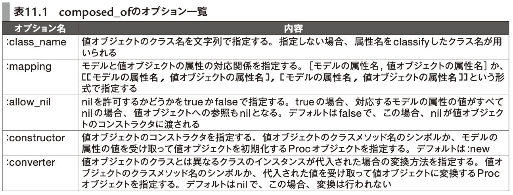

# 11章 複雑なドメインを表現する

- [パーフェクトRuby on Rails【増補改訂版】：書籍案内｜技術評論社](https://gihyo.jp/book/2020/978-4-297-11462-6)

- **11章 複雑なドメインを表現する**
- **11-1 アーキテクチャパターンから見るRails**
  - ドメイン
    - >アプリケーションが対象とする問題領域の こと
  - ドメインモデル
    - >ドメインを分析して構成概念を抽出することをモデリングと呼び、その結果得られた概念のこと
      - その振る舞いのことをドメインモデル・ドメインロジックという
  - アクティブレコード
    - データの取得・保存処理とドメインロジックを合わせてカプセル化するアーキテクチャパターン
- **11-2 値オブジェクト**
  - Userモデルはphone_number属性を持っているが、CompanyやOrganizationモデルも同じ属性を持っており、phone_numberに関するメソッドをどこに生やすべきか分からないとき
    - → 値オブジェクトの導入
    - PhoneNumberクラスを作る
    - UserモデルやCompanyモデルのphone_numberのgetterやsetterでは、PhoneNumberのインスタンスを返すようにする
  - いつ導入すべきか
    - 「複数のモデルから扱われる特定の意味を持った値」を扱いたくなったとき
  - `composed_of`
    - 値オブジェクトとのgetterやsetterを自動で定義してくれるメソッド
**user.rb**

```
class User < ApplicationRecord
  composed_of :phone_number, mapping: %w[phone_number value]
end
```

- 第1引数の`:phone_numer`について
  - Userモデルのphone_numberへのアクセスが、PhoneNumber (phone_numberのclassify)へのアクセスになる
- `mapping:` オプション引数について
  - Userモデルの実際のphone_numberの値は、PhoneNumberクラスのvalueの値にmappingされるようにする
- 
- **11-3 サービスオブジェクト**
  - サービスオブジェクト
    - 複数のオブジェクトを組み合わせて表現するロジックを、オブジェクトして定義したもの
      - 2つの口座間の残高のやりとり など
    - モデルではないため、状態を持たない
  - ロジックにログを残す必要がある場合などは、そのロギングのモデルにロジックを実装すればよかったりする
    - BankAccountMoneyTransferモデルで`before_create :transfer_money`とすれば、Railsのレールに乗れる上に、`transfer_money`と(BankAccountMoneyTransferの)`create`は同一のトランザクションで行われるのも都合がいい
  - 導入時のポイント
    - モデルに実装すべきロジックまで実装しない
    - イベントの見落としがないかを確認する
