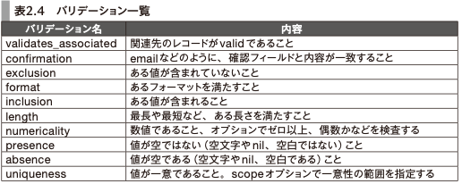
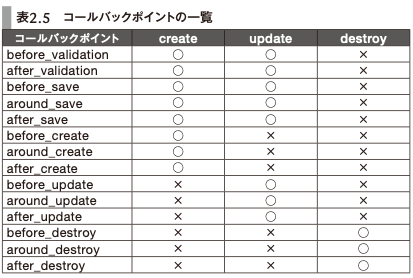
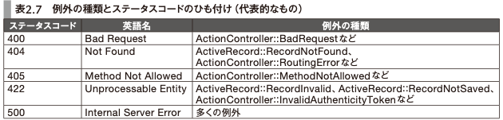

# 2章 Ruby on RailsとMVC

- [パーフェクトRuby on Rails【増補改訂版】：書籍案内｜技術評論社](https://gihyo.jp/book/2020/978-4-297-11462-6)

- **2章 Ruby on RailsとMVC**
- **2-1 MVCアーキテクチャ**
- **2-2 モデルを扱う**
  - scopeでnilを返すと空の`ActiveRecord::Relation`になって返る
- []
- []
  - `after_initialize`, `after_find` というのもある
  - 列挙型には`ActiveRecord::Enum`
    - statusに対して`!`や`?`のメソッドが生える
    - `カラム名_before_type_cast`で、DB内の実際の値を取れる
    - status名がそのままscopeになる機能もある
      - `not_status名`も生える
- **2-3 コントローラの役割**
  - >Railsでは通常、GET以外のリクエストではセキュリティトークンが必須
    - CSRF対策
  - ルーティングのresoucesの内側で独自のGETやPOSTのルーティングをするとき
    - [Rails のルーティング - Railsガイド](https://railsguides.jp/routing.html#%E3%83%A1%E3%83%B3%E3%83%90%E3%83%BC%E3%83%AB%E3%83%BC%E3%83%86%E3%82%A3%E3%83%B3%E3%82%B0%E3%82%92%E8%BF%BD%E5%8A%A0%E3%81%99%E3%82%8B)
    - そのまま書くと
      - idを見るときは`params[:photo_id]`のようになる
    - `member do`内に書くと
      - idを見るときは`params[:id]`を使える
      - resoucesの一種の扱いに近くなる
  - 例外は、基本的には500になって返る
    - 例外クラスによってはRails側がいいかんじのステータスコードにしてくれる
- []
- **2-4 コントローラとビューの協調とビューテンプレートの基本**
  - `request.variant`機能で、たとえばPCとスマホのページを出し分けられる
    - テンプレートファイルの探索が変化する
- **2-5 ビューテンプレートについて**
  - テンプレートエンジンいろいろ
    - HTML
      - ERB
      - Haml
      - Slim
    - API
      - jbuilder
  - jbuilder
    - `!`で終わらないメソッドは、メソッド名がそのままjsonのキーになる
      - 引数が値になる
      - 引数の値がArray系だと、メソッドに渡されたブロックで要素をeachする
    - `!`で終わるメソッドには特殊な機能がある
