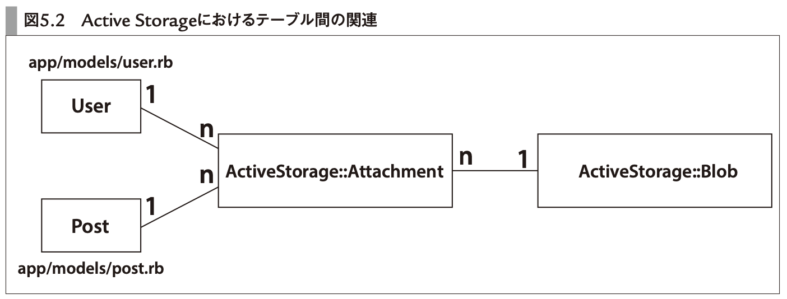
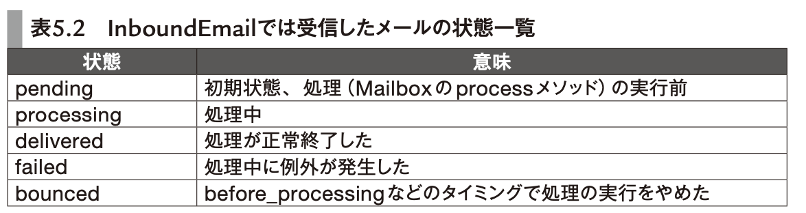

# 5章 Rails標準の機能を活用して素早く機能実装する

- [パーフェクトRuby on Rails【増補改訂版】：書籍案内｜技術評論社](https://gihyo.jp/book/2020/978-4-297-11462-6)

- **5章 Rails標準の機能を活用して素早く機能実装する**
- **5-1 Active Jobによる非同期実行**
  - `rails g job async_log`で`app/jobs/async_log_job.rb`が作られる
  - ジョブクラスはApplicationJobを継承する
  - `perform_later`でenqueue
    - `AsyncLogJob.set(wait: 1.minute).perform_later`のように、時間の指定もできる
  - `perform_later`の引数にActiveRecordオブジェクトを渡すと、`peform`時にはその時点でDBからfetchしたレコードのデータが使われる
    - レコードの実体ではなく`gid://active-job-example/AsyncLog/3`のようなURIを渡している
  - バックエンドとジョブをつなぐアダプター
    - デフォルトでは async アダプター
      - 本番環境には不向き
    - Sidekiq, Resque, Delayed Job など
      - Shoryukenは、AWS SQSをqueueとして利用するとき用のgem
    - (sidekiqなら)`bundle exec sidekiq`でプロセスを起動する
  - queueはJobごとにあるのではない。自由。
    - デフォルトでは`default`queueを使う
    - 別のqueueを使いたい場合
    - 1. `config/sidekiq.yml`に設定を書く
    - 2. Jobクラス内で`queue_as :async_log`のようにqueueを指定する
    - 2. `set`メソッドで動的に指定する
  - `retry_on`でリトライできる
  - `discard_on`で、例外次第でリトライを中断できる
  - テスト
    - `ActiveJob::TestCase`を継承したクラスで、`assert_enqueued_with`アサーションでテストする
- **5-2 Active Storageによるファイルアップロード**
  - Active Storage
    - Rails 5.2から
    - 標準機能でファイルアップロードができるようになった
  - 始め方
    - `rails active_storage:install`
    - `rails g scaffold user name portrait:attachment`
      - `portrait`属性は別のテーブルで管理される
- 
  - ファイル置き場の指定は`config/storage.yml`に書く
    - 開発環境ならローカルのファイルシステム
    - 本番ならAWS S3
    - 環境ごとの振り分けは`config/environments/development.rb`等で`config.active_storage.service = :local`のように設定する
  - サムネイル機能もActive Storageに備わっている
- **5-3 Action Mailerによるメール送信**
  - `rails g mailer UserMailer`
  - ` UserMailer.with(to: "rails@example.com", name: "rails").welcome.deliver_now`のように呼ぶ
  - 開発環境でメールの動作確認
    - `config.action_mailer.delivery_method = :file`と設定
      - 実際に送信はされず、`tmp/mails`以下に保存される
  - テスト環境で動作確認
    - `config.action_mailer.delivery_method = :test`
      - 実際に送信はされず、`ActionMailer::Base.deliveries`配列にメールが入る
  - 本番
    - 送信のためのSMTPサーバを用意する必要がある
      - SendGridなど
        - SendGridで作ったアカウントをcredentialsとして保存して、`config.action_mailer.smtp_settings`で設定する
- **5-4 Action Mailboxによるメール受信**
  - メールサーバーサービス(SendGridなど)と連携できる
    - SendGridにRailsアプリのURLを叩いてもらうことで、メールの受信をする
    - メールサーバーがrailsコマンドを叩くことで連携する場合もある
  - 受信したらAction MailBoxが処理をする
  - `bin/rails action_mailbox:install`
  - 外部からのリクエストを認証する設定を書く
  - SendGridにメールが届くように、DNSのMXレコードを設定する必要がある
  - RailsのURLが叩かれたとき
    - InboundEmailモデルが作られる
      - メールの処理状態を管理するモデル
      - 
    - メールをActive Storageで保存
    - Active Jobで処理をenqueue
    - メールサービスにレスポンスを返す
  - app/mailboxes/application_mailbox.rb
    - `routing (/[0-9]+-comment@/i) => :comments`
  - `bin/rails generate mailbox comments`
    - ApplicationMailboxを継承した、`#process`が生えたクラスが作られる
  - 開発時は`/rails/conductor/action_mailbox/inbound_emails`でRailsにメールを送れる
  - テスト
    - `receive_inbound_email_from_mail`
      - InboundEmailが作られ、それを受信したことになる
- **5-5 Action Textによるリッチテキスト機能**
- (省略)
  - フロントはTrixというライブラリを使っている
- **5-6 Action Cableによるリアルタイム通信**
  - WebSocketを使ったリアルタイム双方向通信
  - `bin/rails g channel room speak`
    - 以下が作られる
**app/channels/room_channel.rb**

```
class RoomChannel < ApplicationCable::Channel
  # 購読後に呼ばれる
  def subscribed
     stream_from "room_channel" # "room_channel" という名前のブロードキャストを設定
  end

  # 購読解除後に呼ばれる 
  def unsubscribed
  end

  # クライアントから呼び出された時に実行される
  def speak(data)
    # ストリーム名 "room_channel" で通信しているクライアントすべてに届いたメッセージを送信
    ActionCable.server.broadcast("room_channel", { message: data["message"] })
  end
end
```

**app/javascript/channels/room_channel.js**

```
consumer.subscriptions.create("RoomChannel", {
  // 接続時. input要素などにspeakを呼び出すイベントを登録
  connected() {
  },

  // 切断時
  disconnected() {
  },

  // サーバからのデータを受信した時
  received(data) {
    alert(data['message']);
  },

  speak: function() {
    return this.perform('speak'); // RoomChannel#speak メソッドを WebSocket 通信経由で呼び出す
  }
}
```

- 上記の実装をすると、ブラウザ側でspeakメソッドを`speak("hoge")`のように呼び出すと、サーバー側ではそれを山びこするので、ブラウザでは`received(data)`の`alert("hoge")`が呼ばれる
- 接続を管理するアダプタが必要
  - デフォルトだと[Redis](本番環境)
    - 開発環境はインメモリ
- (アプリサーバーとしてのRailsと分離させて、) Action Cable専用のプロセスを建てることもできる
  - config.ruで`run ActionCable.server`する
  - `bundle exec puma cable/config.ru`で起動
  - 別ドメインにする
    - `config.action_cable.url = "wss://example.com/cable"`
  - app/views/ layouts/application.html.erbには`action_cable_meta_tag`を書く
  - `config.action_cable.allowed_request_origins`にその別ドメインを追記
- Action Cableの認証
  - 署名付きCookieにUserのidとかを入れる(APIサーバー側)
  - `Connection < ActionCable::Connection::Base`を編集する
    - WebSocket 接続時にインスタンスが作成されるクラス
    - `identified_by :current_user`とする
      - `current_user`フィールドが作られる
    - クライアントが接続した時に呼ばれる `connect`メソッドに、current_userにユーザーを代入する処理を書く
