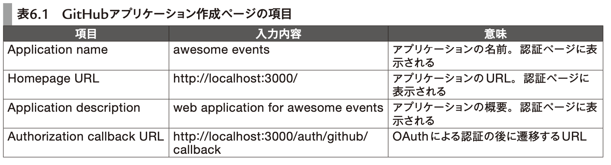

# 6章 Railsアプリケーション開発

- [パーフェクトRuby on Rails【増補改訂版】：書籍案内｜技術評論社](https://gihyo.jp/book/2020/978-4-297-11462-6)

- **6章 Railsアプリケーション開発**
- **6-1 イベント告知アプリケーションを作る**
  - railsデフォルトのwebサーバーはpuma
- **6-2 アプリケーションの作成と下準備**
- **6-3 OAuthを利用して「GitHubでログイン」機能を作る**
  - github上でアプリの登録が必要
    - Developer settings → OAuth Apps → New OAuth App
    - 
  - OmniAuth gem
    - ユーザ認証機能を提供するgem
      - 「どのような形式で認証するか」は OmniAuth とは別に実装できる
        - どのような形式で、ってどういうことだろう?
    - CSRF対策が必要
      - 「悪意のあるサイトのjsが、作ったアプリのOAuthリンクを勝手に踏んで、勝手にOAuthで認証認可してしまう」ということ?
      - https://github.com/cookpad/omniauth-rails_csrf_protection gemで対策できるらしい
  - Githubで得たClient IDとClient Secretをアプリに設定する
```rb
Rails.application.config.middleware.use OmniAuth::Builder do
  if Rails.env.development? ¦¦ Rails.env.test?
    provider :github,
      "YOUR_CLIENT_ID",
      "YOUR_CLIENT_SECRET"
  else
    provider :github,
      Rails.application.credentials.github[:client_id],
      Rails.application.credentials.github[:client_secret]
  end
end
```

- `config/credentials.yml.enc`復号化用のキーは、`config/master.key`(git管理しないファイル)か`RAILS_MASTER_KEY`を使って設定する
- ユーザーが`/auth/github`のリンクを踏む → OmniOuthによってgithubのOAuth用ページへリダイレクトされる。という流れ
  - OmniOuthが、Githubにログイン済みか未ログインかを判定してくれて、未ログインならリダイレクトしてくれる
- ユーザーがgithubの認証画面でAuthorizeしたあとの、アプリ側での処理
  - OmniAUthのコールバックURLは、デフォルトでは`auth/:provider/callback`
    - `get "/auth/:provider/callback" => "sessions#create"`とする
  - `SessionsController#create`を実装していく
    - ログインorユーザー登録の処理
    - `request.env["omniauth.auth"]`で`OmniAuth::AuthHash`オブジェクトが得れる
      - `auth_hash[:provider]`
      - `auth_hash[:uid]`
      - `auth_hash[:info]`
    - `provider, uid`でUserを見つけて、UserのidをCookieに入れてログインとする
- ログアウト
  - `delete "/logout" => "sessions#destroy"`
  - `SessionsController#destroy`
    - セッション(Cookie)を消せばOK
- **6-4 イベントの登録機能を作る**
  - config/application.rbで`config.time_zone = "Tokyo"`
    - アプリで扱う値は日本時間になる
  - DBに入る値もJSTにしたいときは
    - `config.active_record.default_timezone = :local `
    - プリケーションサーバのタイムゾーンを JST にする
  - `Time`, `DateTime` ではなく `ActiveSupport::TimeWithZone`を使うべし
    - `Time.zone.now`, `Time.current` で得れる
    - ActiveSupport::TimeWithZone
  - SJR
    - Server-generated JavaScript Responses
    - `.js.erb`みたいなやつ
- **6-5 イベントの閲覧機能を作る**
  - `localize`メソッド
    - i18nで日時を文字に変換
  - `User.id = Event.owner_id`と`User.id = Event.organizer_id`のように、同一モデル間に複数の関連付けがある場合も想定して、`has_many :created_events, class_name: "Event", foreign_key: "owner_id"`のようにするのがよい
- **6-6 イベントの編集・削除機能を作る**
- **6-7 登録されたイベントへの参加機能，参加キャンセル機能を作る**
- **6-8 退会機能を作る**
- **6-9 おわりに**
