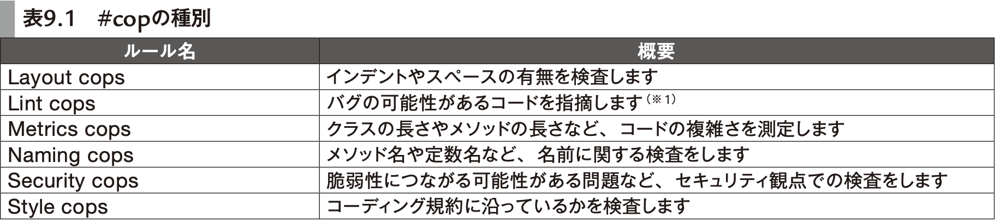

# 9章 コード品質を上げる

- [パーフェクトRuby on Rails【増補改訂版】：書籍案内｜技術評論社](https://gihyo.jp/book/2020/978-4-297-11462-6)

- **9章 コード品質を上げる**
- **9-1 CI（継続的インテグレーション）**
  - Github Actions
    - アクション
      - 処理をモジュール化する仕組み
```yml
name: Rails Tests
on: [push, pull_request]
jobs:
  build:
    runs-on: ubuntu-latest
    steps: # stepごとに独立したプロセスで動く
    - uses: actions/checkout@v2
    - name: Set up Ruby 2.6
      uses: ruby/setup-ruby@v1 # 任意のバージョンのRuby実行環境を用意するアクションを実行
      with:
        ruby-version: 2.6
    - name: Build and test
      env:
        RAILS_ENV: test
      run: | # OS のシェル上でコマンドを実行する設定
        sudo apt-get -yqq install
        bundle install --jobs 4 --retry 3 bin/rails db:create
        bin/rails db:migrate
        bin/yarn install
        bin/rails test
        bin/rails test:system

```

- **9-2 Gemの定期update**
  - GitHub Dependabot
    - bundle updateされたGemのPRが自動で作成される
**.dependabot/config.yml**

```
version: 1
update_configs:
  - package_manager: "ruby:bundler"
    directory: "/"
    update_schedule: "weekly"
    allowed_updates:
      - match:
        update_type: "all"
    version_requirement_updates: "off"
```

- CIでリリースノートとかも教えてくれて便利
- **9-3 静的解析**
  - rubocop
    - 
    - Railsの場合は rubocop-performance と rubocop-rails を一緒に使うとよい
      - .rubocop.ymlへの追記が必要
**.rubocop.yml**

```
require:
  - rubocop-performance
  - rubocop-rails
```

- https://github.com/rails/rails/blob/main/.rubocop.yml
  - Rails開発チームのrubocopの設定
- Brakeman
  - 脆弱性の静的解析
- **9-4 カバレッジ測定**
  - SimpleCov
    - カバレッジ測定
**test/test_helper.rb**

```
require 'simplecov'
SimpleCov.start 'rails'
```

- coverage/index.html に結果が吐かれる
- **9-5 アプリケーションパフォーマンス測定（APM）**
  - Skylight, New Relic
    - アプリのパフォーマンスの測定をするサービス
      - web上でパフォーマンスのモニタリングができる
  - rack-mini-profiler
    - Rails アプリケーションのパフォーマンスを測定
