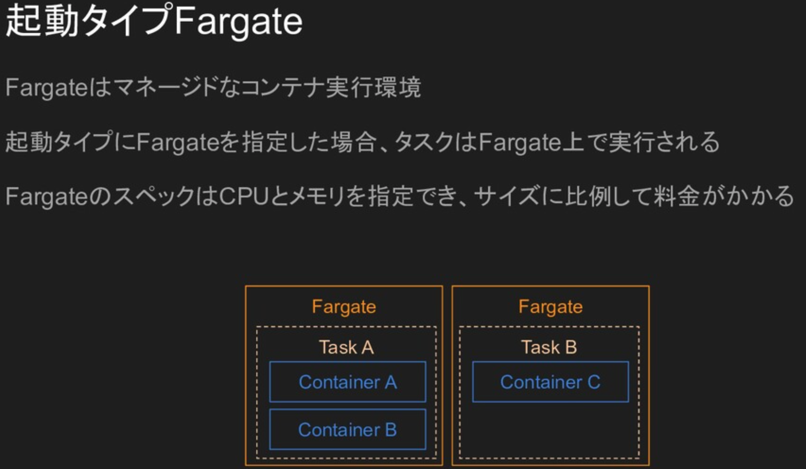

# AWS ECS

- ECSやFargateとはなんぞや、の入門
  - [Rails on Fargate（ESC）入門・構築メモ書き](https://zenn.dev/hiracky16/scraps/0c4e9465a0021f)
- docker composeでecs
  - 公式
    - [Docker Compose と Amazon ECS を利用したソフトウェアデリバリの自動化 | Amazon Web Services ブログ](https://aws.amazon.com/jp/blogs/news/automated-software-delivery-using-docker-compose-and-amazon-ecs/)
    - [ECS での Docker コンテナーのデプロイ | Docker ドキュメント](https://matsuand.github.io/docs.docker.jp.onthefly/cloud/ecs-integration/)
    - [Deploy applications on Amazon ECS using Docker Compose | Containers](https://aws.amazon.com/jp/blogs/containers/deploy-applications-on-amazon-ecs-using-docker-compose/)
    - [compose-cli/ecs-compose-examples.md at main · docker/compose-cli](https://github.com/docker/compose-cli/blob/main/docs/ecs-compose-examples.md)
    - [compose-cli/ecs-compose-features.md at main · docker/compose-cli](https://github.com/docker/compose-cli/blob/main/docs/ecs-compose-features.md)
    - [compose-cli/ecs-architecture.md at main · docker/compose-cli](https://github.com/docker/compose-cli/blob/main/docs/ecs-architecture.md)
    - [Amazon ECR をAWS CLI - Amazon ECR](https://docs.aws.amazon.com/ja_jp/AmazonECR/latest/userguide/getting-started-cli.html)
  - ブログ
    - [Docker ComposeによるAmazon ECS対応がGAに！コンテナをローカル環境と同じノリでECS環境で起動できるぞ！！ | DevelopersIO](https://dev.classmethod.jp/articles/docker-compose-for-amazon-ecs-now-available/)
    - [docker-compose.ymlを全自動でAWS ECSにデプロイ](https://zenn.dev/thr3a/articles/b71b16c88387d2)
    - [docker compose cliでecsにデプロイした話 - sasurau4のブログ](https://sasurau4.hatenablog.com/entry/2021/04/21/190333)
      - くわしい
    - [Docker ComposeのAmazon ECSデプロイを試してみた - SMARTCAMP Engineer Blog](https://tech.smartcamp.co.jp/entry/docker-compose-with-ecs)
      - 「DockerイメージをECRへPush」について書かれている
    - [Docker Compose CLI を使って Keycloak を AWS ECS にデプロイする - Linkode.TechBlog](https://blog.linkode.co.jp/entry/2021/06/23/061829)
- docker composeのecs対応だと、imageのbuildは非対応
  - >Ignored. No image build support on AWS.
    - [compose-cli/ecs-compose-features.md at main · docker/compose-cli](https://github.com/docker/compose-cli/blob/main/docs/ecs-compose-features.md)
  - docker-compose.ymlにbuildと書くとエラーになるから、imageを指定する必要がある
    - ECRにpushして、それを指定すれば認証とか不要でそれを使える
- docekrのcontext
  - なにか設定? `docker context ps`で一覧、`docker context inspect コンテキスト名`で詳細
- ECSで環境変数を使うには
  - 環境変数を保管するようなサービスには、AWS Systems ManagerとAWS Secrets Managerがある
  - [ECSでごっつ簡単に機密情報を環境変数に展開できるようになりました！ | DevelopersIO](https://dev.classmethod.jp/articles/ecs-secrets/), [【祝！】FargateでもECSにごっつ簡単に環境変数に機密情報を渡せるようになりました！ | DevelopersIO](https://dev.classmethod.jp/articles/fargarte-secrets/)
    - >ECSのタスクを定義する時、環境変数にパラメータストアから取得するSecureStringのパスを指定するだけで、タスク起動時にその内容を自動的に復号して、環境変数に設定してくれます。
    - タスク作成時に環境変数を設定できるようになる
    - ECSのdocker compose integrationはこのへんは自動作成だから関係なさそう
- docker compose integrationだと、作成時にdocker-compose.ymlの環境変数に登録すればいけそうだけど、直書きするわけにはいかない...
  - 手段用意されてた
  - [Deploying Docker containers on ECS | Docker Documentation](https://docs.docker.com/cloud/ecs-integration/#secrets)
    - >Dockerモデルを使用してECSサービスにシークレットを渡し、機密データをファイルとしてにバインドできます/run/secrets。作成ファイルがシークレットをファイルとして宣言している場合、そのようなシークレットはECSでのアプリケーション展開の一部として作成されます。external: true作成ファイルで参照として既存のシークレットを使用する場合は、ECSシークレットマネージャーの完全なARNをシークレット名として使用します。(自動翻訳)
    - >AWS Secrets Managerを使用すると、機密データをプレーンテキスト（Dockerシークレットのように）または階層JSONドキュメントとして保存できます。(自動翻訳)
    - Secrets Managerを使う必要がありそう
    - これをdotenvとかで読み込めばよさそう
      - [bkeepers/dotenv: A Ruby gem to load environment variables from .env](https://github.com/bkeepers/dotenv)
- FargateのECSでコマンドを打つには
  - [ECSで「dockerexec ...」コマンドを実行する方法・Issue＃187・aws / containers-roadmap](https://github.com/aws/containers-roadmap/issues/187)
    - 超議論されてるissue, ECS ExecがGAされたからか今はclose
  - [アップデート 実行中のコンテナに乗り込んでコマンドを実行できる「ECS Exec」が公開されました | DevelopersIO](https://dev.classmethod.jp/articles/ecs-exec/)
  - [待望！Amazon ECSのコンテナにログインできるAmazon ECS Execを試してみた - SMARTCAMP Engineer Blog](https://tech.smartcamp.co.jp/entry/try-amazon-ecs-exec)
    - `aws ecs execute-command`コマンド
    - aws cliのSession Managerプラグインが必要
  - execute-commandコマンドを使うには
    - タスクの定義を更新する
      - 『「SSMセッションマネージャー関連の権限を付与したポリシー」を含んだロール』をタスクロールに指定する
    - サービスの設定を更新する
      - cliでコマンドを打って更新
    - 使えるようになる
      - タスクとコンテナを指定してコマンドを実行できる
- [メドピア AWS勉強会 ECS編 / MedPeer AWS Seminar ECS - Speaker Deck](https://speakerdeck.com/reireias/medpeer-aws-seminar-ecs)
  - fargateインスタンスはTaskごとに1個
    - 
  - sshできないと書いてあるが(当時2020)、今(2023)ならできた気がする
  - メモリ100%になるとOOM killerが発動するので注意
  - ECSスケーリング
    - タスクの数をスケール可能
  - ログ
    - Dockerコンテナのログが自動的にCloudWatch Logsに流れる
  - デプロイのとき、新しいhtml,cssファイルのリクエストを、古いタスクへ取りに行き、404になることがある
    - 対策
    - 1. cloud frontで配信する
    - 2. CodeDeployを使う
- リクエスト過多でレスポンスが詰まっているとき、ヘルスチェックが失敗してコンテナが落ちてしまうことがある
  - メモリにまだ空きがあったとしても落ちる
- [Desired Capacity で頭が混乱したときのための記事](https://zenn.dev/taroman_zenn/articles/cc87196f39fade)
  - min： Desired Capacityの最小。
  - max： Desired Capacityの最大。
  - Desired Capacity： 起動したいインスタンス数。静的スケーリング以外では可変である。
  - **静的スケーリングではmaxとminは考えなくてよい**
  - **動的スケーリングでは Desired Capacity は初期設定の意味しか持たない**
- ↑ 静的スケーリングであっても、スケールアップをする場合はminやmaxの値が関係してくる
  - 「1台減らしてから1台増やす」か「1台増やしてから1台減らす」どちらの挙動になるかが、min, max, Desired Capacity 次第で決まる
