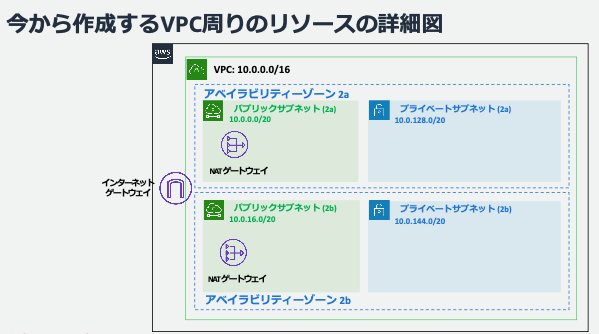
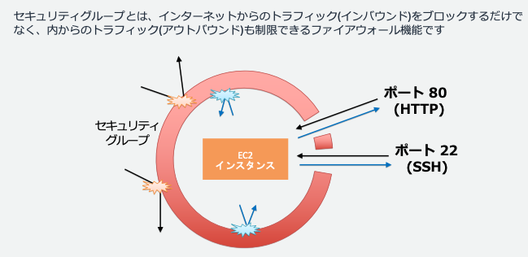
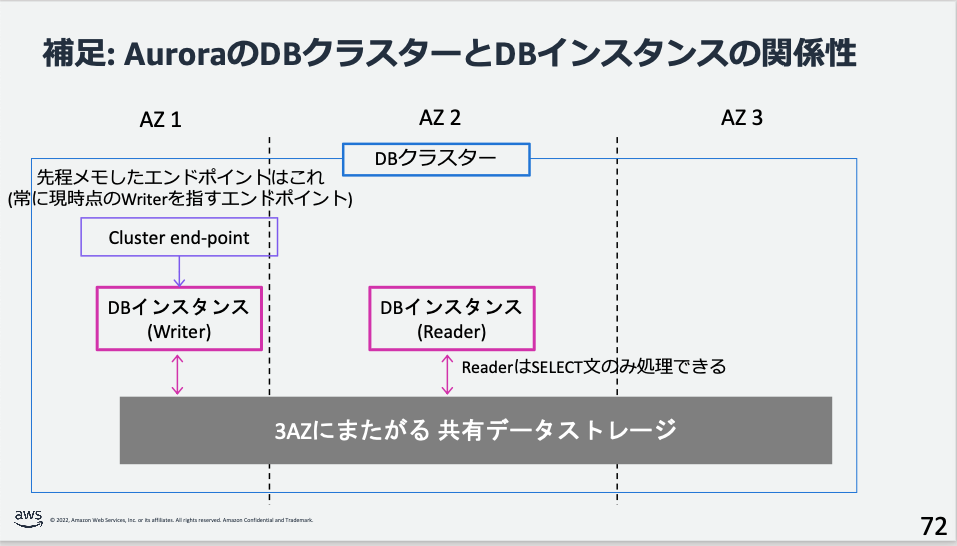
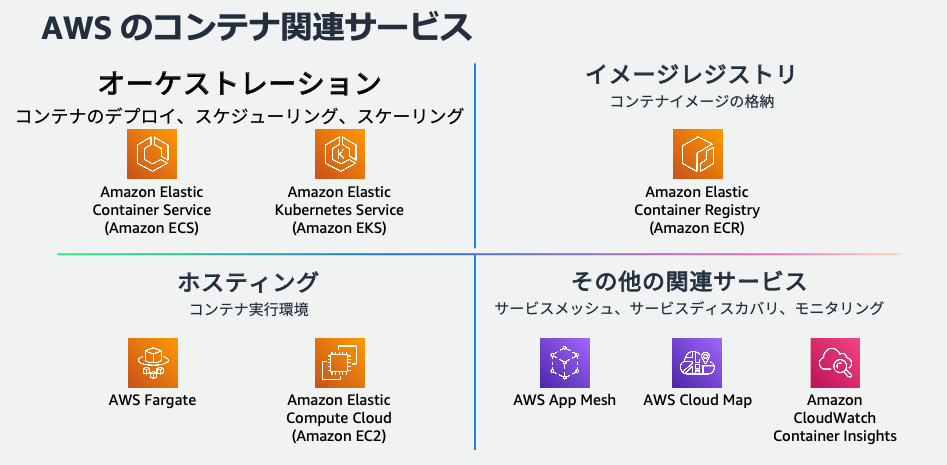
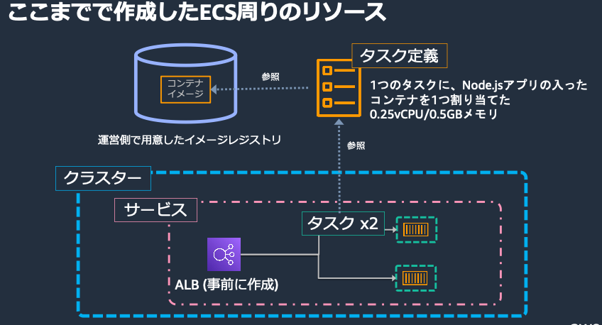
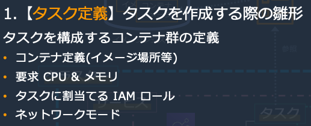
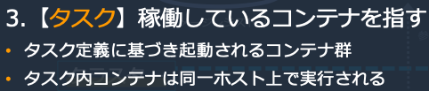
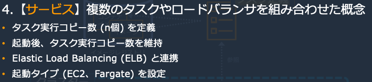
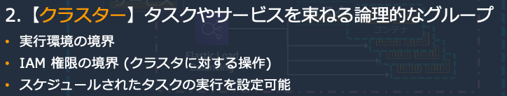
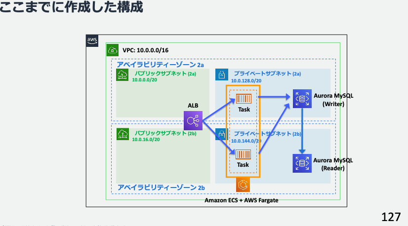

# AWS

- ドキュメントのAI検索サービス
  - https://www.awsdocsgpt.com
- macからs3をGUIで見るにはcyberduckがよさげ
  - [MacのCyberduckでS3にファイル転送する | Developers.IO](https://dev.classmethod.jp/articles/cyberducktos3/)
- サーバーっぽいサービスをまとめる [【2021年】AWS全サービスまとめ | DevelopersIO](https://dev.classmethod.jp/articles/aws-summary-2021/)
  - EC2 (Elastic Compute Cloud)
    - クラウドサーバー
    - 開発者が設定する系
  - Lightsail
  - Fargate
    - サーバーレス
    - 自動でやってくれる系
  - ECS (Elastic Container Survice)
    - >Dockerコンテナのクラスター管理サービス。サーバーやクラスターの管理不要でコンテナが実行できる Fargate 起動タイプ と、EC2でコンテナを実行するサーバーのクラスターを管理する EC2 起動タイプ がある
  - Elastic Beanstalk
    - >アプリケーションのデプロイ・管理サービスで、AWSのPaaSのひとつ。EB単体のものではなく、実態はEC2やS3、RDSやELBなどをプロビジョニングするサービス。
  - ECR (Elastic Container Registry)
    - DockerHub的なもの?
    - Dockerイメージを配布する
  - App Runner
    - 最近出たやつ
    - heroku的な、全部やってくれる系
- ユーザーからALBまではHTTPSで通信して、内部ではHTTPで通信するのが一般的?
  - SSL Termination, SSLオフロード  というらしい
  - [ELBでSSL Termination後の内部通信を暗号化する | DevelopersIO](https://dev.classmethod.jp/articles/elb-ssl-termination/)
- [Amazon Route 53のALIASレコード利用のススメ | DevelopersIO](https://dev.classmethod.jp/articles/amazon-route-53-alias-records/)
- [amazon web services - How to decide which ECS tool to use? - Stack Overflow](https://stackoverflow.com/questions/67359857/how-to-decide-which-ecs-tool-to-use)
  - ECSにデプロイする方法の比較
    - Docker ECS integration
      - https://docs.docker.com/cloud/ecs-integration/
    - ecs-cli
      - https://docs.aws.amazon.com/AmazonECS/latest/developerguide/ECS_CLI.html
    - AWS Copilot
      - https://docs.aws.amazon.com/AmazonECS/latest/developerguide/AWS_Copilot.html
    - AWS CLI ecs
      - https://awscli.amazonaws.com/v2/documentation/api/latest/reference/ecs/index.html
  - > CloudFormation, AWS CDK, Terraform and Pulumi
    - これらの選択肢もある
    - AWS CDK: AWS Cloud Development Kit
  - Docker ECS integration が良さげ、という回答
- AWS RDSのオートスケーリング
  - ストレージの自動拡張
- AWS Auroraのオートスケーリング
  - インスタンス数の自動拡張
- https://github.com/trek10inc/awsume
  - コマンドを打つたびにprofileを指定しなくてもよくなるツール
  - MFAが必要だけれどもコマンド内でawscliコマンドを
- awsの各サービスを深く学びたいときはblack beltの動画がよいらしい
- AMI (amazon machine image)
  - OSが既に入っている仮想サーバーのこと
  - MacOSとかLinux系OSとか
  - EC2でどのAMIを使うかを選ぶ
- EBS (block store)
  - ブロックストレージ
  - EC2にアタッチできる(EC2用のデータ領域として使える)
- EFS (FIle System)
  - 複数のEC2から(1つの)EFSに繋げることができる
  - インスタンス越しのファイルシステムみたいなもの?
- IAMポリシー
  - 
- aws jump start 研修 予習動画
  - バックアップ
    - RTO
      - どこくらいの時間で復旧させるか
    - RPO
      - どの地点まで復旧させるか
  - スケーラビリティ・パフォーマンスの問題を防ぐために
    - 計算
      - スケールアップ(性能up)
        - すぐに限界がくる
      - スケールアウト(台数up)
    - DB
      - リードレプリカのスケールアウト
      - インメモリ(Redis, Memcached)
    - 静的ファイル
      - ユーザー←CDN←オブジェクトストレージ
  - 運用の改善
    - ログの収集
    - ダッシュボード作り
    - 通知
- [AWSアーキテクチャのサンプルをまとめてみた | DevelopersIO](https://dev.classmethod.jp/articles/aws-architecture-summary/)
- aws jump start 研修 day1
  - 用語が色々出てくる...
  - VPC
    - VPCはAZを複数持っていて、AZはパブリックとプライベートのサブネットを持っている
      - 
      - サブネット2つ
        - `us-west-2a`と`us-west-2b`
        - 
  - セキュリティグループ
    - 
  - データベース
    - AZを分けている。writer`us-west-2a`とreader`us-west-2b`
    - 
  - ALB
    - ターゲットグループ
      - 「宛先」のようなもの
    - ALBの設定で、どのターゲットグループを使うかを指定する
  - コンテナ
    - 
    - 
      - 
      - 
      - 
      - 
      - 「クラスター」はコンソールから自前で作るもの
      - 「サービス」もコンソールから自前で作るもの
      - 「タスク」は、「サービス」が、「タスク定義」を元にして自動で作ってくれるもの
        - 台数調整とかもしてくれる
  - 
    - ↑の図で、タスクが「プライベートサブネットa」と「プライベートサブネットb」の両方にあるのは、「サービス」作成時のサブネットの指定でこれらを指定したから
      - タスク6個とかに設定したら3個ずつ分配されるはず
  - その他メモ
    - L7(アプリケーション層) vs L4(トランスポート層)ロードバランサー
      - L7はパケットの内容を見れる。高度なルーティングやSSL/TLS終端(ssl terminate)をできる
    - ロードバランサーとリバースプロキシの違い
      - ロードバランサー：負荷分散
      - リバースプロキシ：リクエストの中身を見て、適切なサーバーへ振り分け
    - DynamoDBの分散
      - Partition Keyのハッシュ値をもとに分散させる
    - RDBでは水平分散、垂直分散ともに管理が困難？
      - ある程度以上大規模になると、分散システムにするには独自でシャーディングする必要がある
    - Auroraの内部について
      - 内部のストレージを共有している
        - 物理的には違うのだろうけれど、技術的に頑張っているから実現できていそう
    - ポリシーは操作の認可で、セキュリティグループは通信の認可
    - ECSのタスクがS3とかを触りたいときは、タスクロールというものを付与する必要がある(タスク定義で指定する)
    - DBのWriteが多いときの対応
    - 1. スケールアップ
    - 2. SQLチューニング
    - 3. DBのシャーディング
      - 10万/s, 100万/sくらいになってから
- aws jump start 研修 day2
  - Systems Manager
    - Session Mangerという機能
      - >インバウンドポートを開くことなく、ブラウザやCLI からインタラクティブなシェルアクセスを実現
  - miro
    - AWSの構成図を書くツール
  - https://aws.amazon.com/jp/solutions/case-studies
    - 色々な会社のインフラ図が見れるかも
  - 外部APIを叩きたい
    - プライベートネットワークにあるECSコンテナからは叩けない
      - パブリックネットワークに置いたNATゲートウェイを経由して外部APIへアクセスする
        - インターネットゲートウェイも必要なのか？
  - システム概要を提示されたとき
    - UIをイメージして必要な要件を考える
    - リファレンスアーキテクチャを眺めてから考える
  - Q&Aなど
    - API Gatewayとは (外部APIを叩くときに必要なのか?)
      - APIを「提供する側」の窓口 (なので、外部APIを叩く際には不要(無関係))
      - 外部APIを叩きたいときは、ec2等から直接叩く
    - プライベートサブネットからアウトバウンドの通信をしたいとき
      - 通信元→NAT→インターネットゲートウェイ の順で外に出ていく
    - API Gatewayの使い時
      - API Gatewayは認可認証・振り分けができるので、API Gateway + Lambda のようなサーバーレスでLambdaと共に使われることがよくある
    - NATゲートウェイの用途
      - NATゲートウェイを通すことで、プライベートサブネットのインスタンスが、アウトバウンドの通信であれば、インターネットとやりとりができるようになった
        - アウトバウンド通信の具体例としては、パッチ当て・イメージ取得など
- aws jump start 研修 day3
  - APIゲートウェイは、lambdaへリクエストを振り分ける、webでいうnginxのような役割らしい
  - ロール
    - ポリシーを束ねたもの
      - ポリシーとは、何に対してどの操作を許可するかのリスト
- AWS公式のハンズオンをまとめているサイト
  - https://aws-samples.github.io/jp-contents-hub/
    - >Amazon Web Services(AWS) の 日本語ハンズオンやワークショップを、カテゴリごとにまとめています。
    - > 右側の目次や、ヘッダー部分の検索ボックスから、各コンテンツにたどり着けます。
  - [AWS ワークショップを探してみました！ | DevelopersIO](https://dev.classmethod.jp/articles/aws-workshops-20190909/)
- [A/BテストツールとしてCloudWatch Evidentlyを導入してみた - メドピア開発者ブログ](https://tech.medpeer.co.jp/entry/202310-clowdwatch-evidently)
  - CloudWatch Evidently
  - >AWS上でA/Bテストやフィーチャーフラグの管理ができるサービスです。
- Route Table
  - VPC (Virtual Private Cloud)に対してRoute Tableを定義して、Route Tableは複数のRouteを持つ
  - VPC**外**とのの通信経路を定義する
  - Route Table：ipに対して、どのSubnet/Internet Gateway/NAT Gateway/VPC Peeringにつなげるかを定義するもの
- [【2023/3時点】AWSの通信料(コスト)を一枚にまとめてみた \| いくらは神の食べ物](https://www.ikura-oisii.com/1065/)
  - ポリシーシミュレータ
    - AWS ポリシーシミュレータというものがあり、どのポリシーでどんなアクションが許可されているのかを調べやすい
    - (ログインしていれば) https://policysim.aws.amazon.com/home/index.jsp から使える
      - IAMの画面からも行けるらしい
  - たとえばECSにシェルでログインする権限があるか確認する手順
    - (色々調べたとして) 自分が持っているロールに紐づくポリシーが `ReadOnlyAccess` ポリシーであることを知る
    - ECS関連のアクションが載っているページを見て、`ecs:ExecuteCommand` アクションが求められることを知る
      - [Amazon Elastic Container Service のアクション、リソース、および条件キー - サービス認可リファレンス](https://docs.aws.amazon.com/ja_jp/service-authorization/latest/reference/list_amazonelasticcontainerservice.html)
      - > ExecuteCommand
        - > Amazon ECS コンテナでリモートでコマンドを実行するアクセス許可を付与します
    - IAMポリシーシミュレーターで、 `ReadOnlyAccess` ポリシーに `ecs:ExecuteCommand` アクションが含まれていないことを調べて、ECSにシェルでログインする権限を持っていないことがわかる
  - [AWSのAZ間レイテンシを測定してみた(2023年東京/大阪)](https://zenn.dev/tsumita7/articles/aws-mesuring-latency-among-az-2023#4.-%E3%83%AC%E3%82%A4%E3%83%86%E3%83%B3%E3%82%B7%E6%B8%AC%E5%AE%9A%E7%B5%90%E6%9E%9C)
    - 東京と大阪で、400μs(マイクロ秒)(= 0.001ミリ秒)くらいのレイテンシの違いがある
    - なにかの拍子にAZが変わったとき、1リクエストあたり内側でたとえば10000回の通信が発生している場合、10ミリ秒の遅延がおきうる
