# AWSで実現するモダンアプリケーション入門

- [AWSで実現するモダンアプリケーション入門 | 技術評論社](https://gihyo.jp/book/2023/978-4-297-13326-9)
  - 第1章　モダンアプリケーションとは何か
    - 1.1　求められるイノベーション
    - 1.2　モダンアプリケーションのメリット
    - 1.3　モダンアプリケーションのベストプラクティス
    - 1.4　まとめ
  - 第2章　サンプルアプリケーションの紹介
    - 2.1　シナリオの検討
    - 2.2　現在のアプリケーションの仕様
    - 2.3　Sample Book Storeのモダンアプリケーション化
    - 2.4　まとめ
  - 第3章　アプリケーション開発におけるベストプラクティスを適用
    - 3.1　The Twelve-Factor App
    - 3.2　Beyond the Twelve-Factor App
      - 1コードベース、1アプリケーション
        - 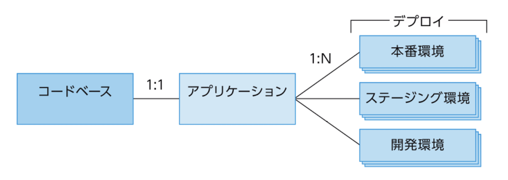
      - APIファースト
      - 依存関係管理
        - 明示的に依存する
          - 現代だとGemfileとかDockerfileとかで当たり前になっているけれど、それらが主流になる前の時代に作られたものなので、ベストプラクティスとして入ってきているのだと思う
      - デザイン、ビルド、リリース、実行
      - 設定、機密情報、コード
        - AWS SSM を使う手もあり
          - 設定値をキャッシュしてポーリングすることで、設定値変更のみの再デプロイを避ける手法が紹介されている（が、果たして懸念が無いのかは疑問）
      - ログ
      - 廃棄容易性
      - バックエンドサービス
      - 環境一致
      - 管理プロセス
      - ポートバインディング
      - ステートレスプロセス
      - 並行性
      - テレメトリ
      - 認証、認可
    - 3.3　プラクティスの紹介
    - 3.4　まとめ
  - 第4章　データの取得による状況の可視化
    - 4.1　ビジネスデータ
      - データの例
        - アクティブなユーザー数
        - 新規の会員登録／退会をしたユーザー数
        - 書籍の販売数
        - 閲覧数／検索数
        - 滞在時間
    - 4.2　運用データ
      - サービスの運用状況を把握するために必要なデータのこと
      - データの例
        - 運用担者の呼び出し回数
        - 設定変更など運用作業の依頼として起票されるチケット数
        - チケットが完了するまでの経過時間
        - 1日あたりのデプロイ数
        - サービスの可用性
    - 4.3　システムデータ
      - リクエスト数、エラー数、レイテンシ などのこと
    - 4.4　オブザーバビリティ（可観測性）
      - 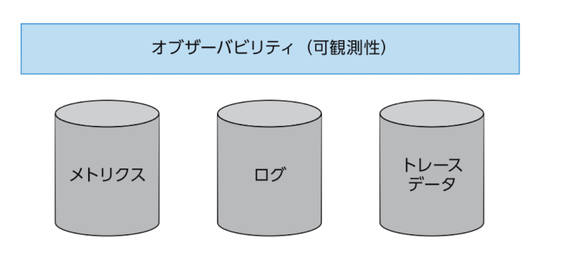
    - 4.5　まとめ
  - 第5章　サーバーレスやコンテナテクノロジーによる運用改善
    - 5.1　サーバーレステクノロジーを使う価値
    - 5.2　AWSでのサーバーレス
    - 5.3　サーバーレスとコンテナのワークロード比較
    - 5.4　シナリオによるサーバーレスワークロードの構成例
      - 構成例
        - 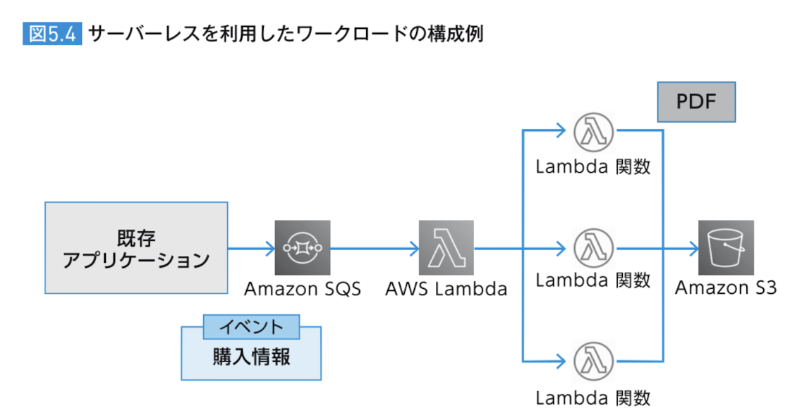
        - 大規模リクエストについて
          - SQSは無尽蔵のAPI実行をサポートしているので問題なし
          - Lambdaも自動的にスケールする
            - 最大同時実行数には注意
        - エラー対応について
          - Lambdaが失敗したとき
            - SQSキューから取り出した値はまた元のキューに戻るので、Lambda失敗時の再enqueueなどの処理はしなくていい
              - Lambdaが正常終了した場合はSQSキューから取り出した値はそのまま消えるのでそのままでOK
              - 注意点として、Lambdaのタイムアウトより、SQSの可視性タイムアウトを十分長くすること
          - （既存アプリケーションが）誤ったメッセージを送ってしまった時
            - SQSのDLQ (dead letter queue) を使い、繰り返し失敗したメッセージはDLQに置かれるようにする
          - 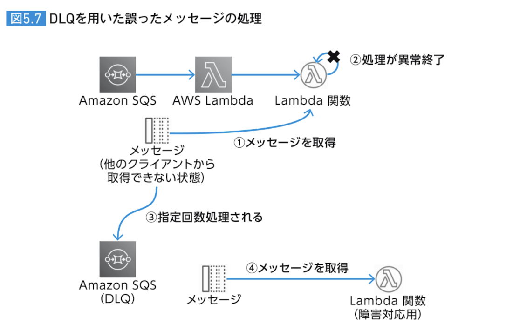
        - 冪等性について
          - SQSは、at-least-once (少なくとも1回) は保証しているが、同じメッセージが複数回配信されないことは保証しないので、アプリケーション側（コンシューマー側）は冪等に作る必要がある
            - IDなどをキーにして重複実行されても冪等な結果になるようにアプリケーション側で工夫する
        - モニタリングについて
          - SQSからは各種メトリクス（メッセージが停滞している時間など）を取れるので、それを監視すればOK
        - 拡張性について
          - 今後、複数のSQSに送る必要が出てきたときなどは、↓のようにEventBridgeを組み合わせてあげるとよい
            - 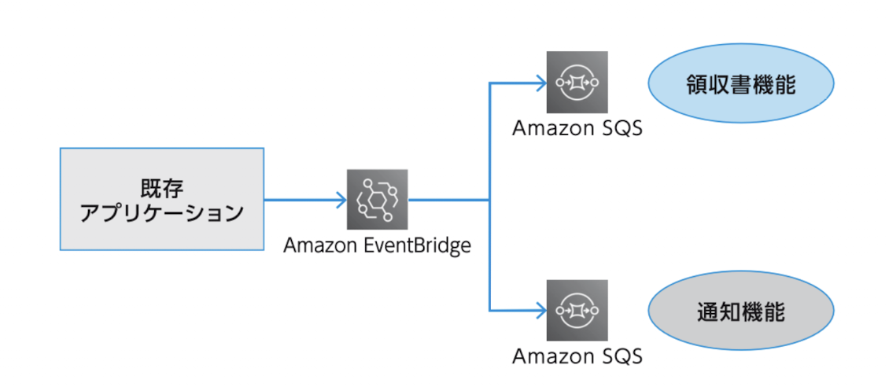
    - 5.5　シナリオによるコンテナワークロードの構成例
      - 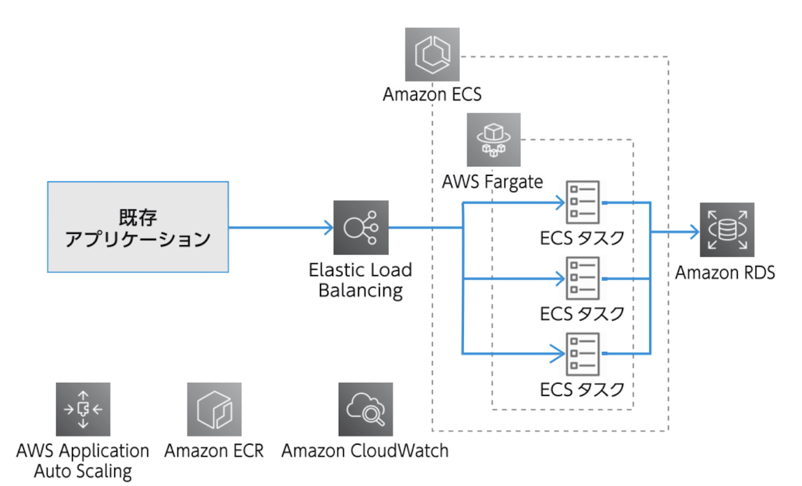
        - 既存アプリケーションから「ポイント機能」のAPIが呼び出される想定
        - 大規模リクエストについて
          - 負荷分散→ELBがやってくれる
          - スケーリング→Auto Scalingを利用する
            - リクエスト数などのメトリクスに基づいてタスク数を自動で増減
        - エラー対応について
          - APIのレスポンスにエラーを含めて呼び出し元に返す
        - 冪等性について
          - ポイント付与や消費などの更新系の操作は、「購入ID」のような一意のIDを一緒に送ってもらい、冪等になるように実装する
    - 5.6　まとめ
  - 第6章　CI/CDパイプラインによるデリバリーの自動化
    - 6.1　継続的インテグレーションと継続的デリバリー（CI/CD）
    - 6.2　パイプライン・ファーストという考え方
    - 6.3　CI/CDツールに求める機能と要件
      - （アプリケーションを中断させない）デプロイ手法
        - ローリングデプロイ
        - Blue/Greenデプロイ
    - 6.4　シナリオによるCI/CDの構成例
      - ECSサービスの更新手順
        - 1. ECRに新規イメージを保存
        - 2. それを使ってECSタスク定義を作成
        - 3. それを使ってECSサービスを更新
          - ECSでローリングデプロイやB/Gデプロイのサポートがあるのでそれを使う
      - CodeBuild：テストやビルドを行う環境と、その実行コマンドを書く
        - 定義はyamlで書く
      - CodePipeline：CI/CDパイプラインを書く
        - CodePipelineは実行環境を持っているわけじゃないので、テストやビルドはCodeBuildを呼び出す必要がある
    - 6.5　CI/CDパイプラインのさらなる活用
    - 6.6　まとめ
  - 第7章　要件にあったデータベースの選択
    - 7.1　データベースに求める機能と要件
      - DB選択時に検討すべき観点
        - データ量
        - データの増減の傾向
        - 保持期間
        - アクセスパターン
          - CRUDの頻度など
        - データの形式
    - 7.2　Purpose-built database とは何か
    - 7.3　シナリオによるデータベースの選択
    - 7.4　まとめ
  - 第8章　モダンアプリケーションパターンの適用によるアーキテクチャの最適化
    - 8.1　パターンとは
    - 8.2　シングルページアプリケーション（SPA：Single Page Application）
    - 8.3　API Gateway：API呼び出しの複雑性を集約する
      - 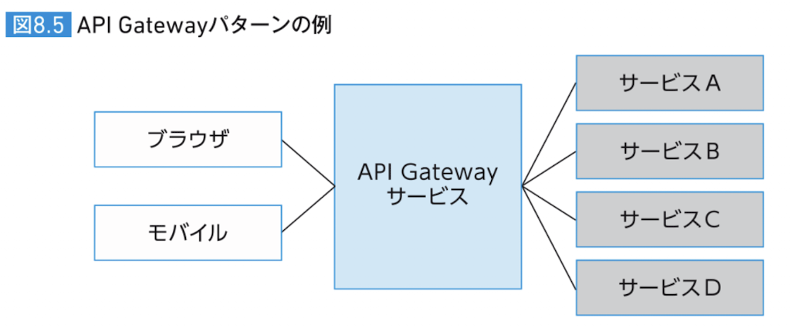
      - 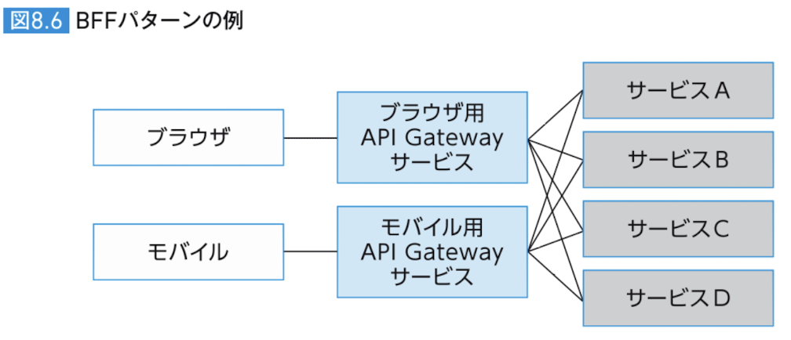
        - BFFはフロントエンド（クライアント）の種類ごとに個別に作る
    - 8.4　メッセージング：サービス間の非同期コラボレーションの促進
      - メッセージングの2大パターン
        - キューモデル
        - パブサブ(pub/sub)モデル
          - 1対多 でメッセージを送信（ファンアウト）する
          - AWS EventBridge や AWS SNS を利用して実現できる
          - 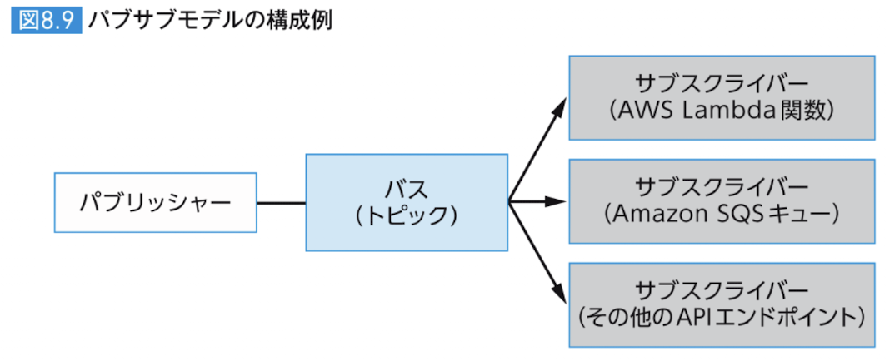
    - 8.5　Saga：サービスにまたがったデータ整合性の維持
      - 2つの実現方法がある
        - コレオグラフィ
          - それぞれのサービスが自律的に（自ら）補填トランザクションなどを発行する
          - イベントの伝播には AWS EventBridge などを使える
            - 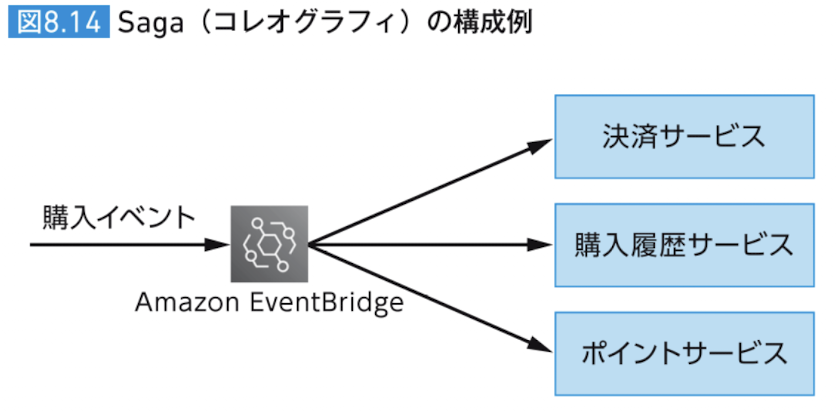
        - オーケストレーション
          - AWS Step Functions をオーケストレーターとして利用できる
          - 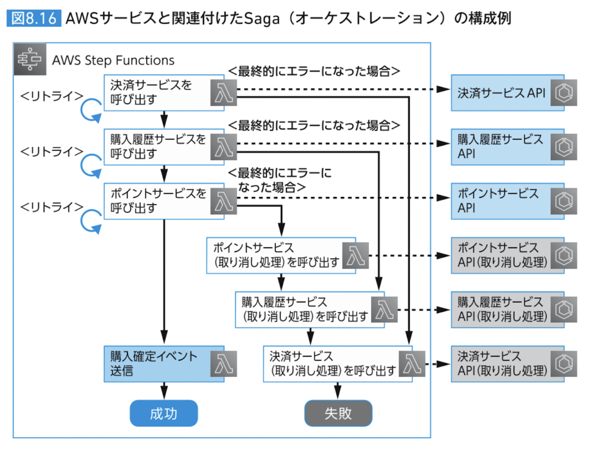
    - 8.6　CQRS：データの登録と参照の分離
    - 8.7　イベントソーシング：イベントの永続化
      - ビジネスに重要なイベントをログとして、耐久性のあるストレージに保存し、他のサービスに伝搬するパターン
    - 8.8　サーキットブレーカー：障害発生時のサービスの安全な切り離し
    - 8.9　サービスディスカバリ：サービスを見つける
      - 今は Amazon ECS Service Connect を使うのが推奨になっているはずで、サービスメッシュの役割もしてくれる
    - 8.10　サービスメッシュ：大規模サービス間通信の管理
    - 8.11　フィーチャーフラグ：新機能の積極的なローンチ
    - 8.12　分散トレーシング：サービスを横断するリクエストの追跡
      - AWS X-Ray SDK をアプリケーションに導入することで実現できる
        - AWS X-Ray デーモン経由で送られる
      - ADOT (AWS Distro for OpenTelemetry)：OpenTelemetry のディストーションのひとつ
        - OpenTelemetry：テレメトリデータ（メトリクス・ログ・トレース）を収集・変換・送信するための、標準化されたAPIやSDK, ツールセットの提供をしているもの
    - 8.13　まとめ
