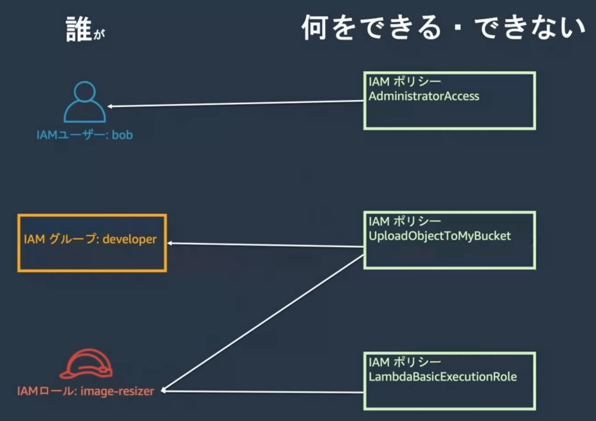

# AWSのサービスと開発ツール

- ドキュメントのAI検索サービス
  - https://www.awsdocsgpt.com
- macからs3をGUIで見るにはcyberduckがよさげ
  - [MacのCyberduckでS3にファイル転送する | Developers.IO](https://dev.classmethod.jp/articles/cyberducktos3/)
- サーバーっぽいサービスをまとめる [【2021年】AWS全サービスまとめ | DevelopersIO](https://dev.classmethod.jp/articles/aws-summary-2021/)
  - EC2 (Elastic Compute Cloud)
    - クラウドサーバー
    - 開発者が設定する系
  - Lightsail
  - Fargate
    - サーバーレス
    - 自動でやってくれる系
  - ECS (Elastic Container Survice)
    - >Dockerコンテナのクラスター管理サービス。サーバーやクラスターの管理不要でコンテナが実行できる Fargate 起動タイプ と、EC2でコンテナを実行するサーバーのクラスターを管理する EC2 起動タイプ がある
  - Elastic Beanstalk
    - >アプリケーションのデプロイ・管理サービスで、AWSのPaaSのひとつ。EB単体のものではなく、実態はEC2やS3、RDSやELBなどをプロビジョニングするサービス。
  - ECR (Elastic Container Registry)
    - DockerHub的なもの?
    - Dockerイメージを配布する
  - App Runner
    - 最近出たやつ
    - heroku的な、全部やってくれる系
- ユーザーからALBまではHTTPSで通信して、内部ではHTTPで通信するのが一般的?
  - SSL Termination, SSLオフロード  というらしい
  - [ELBでSSL Termination後の内部通信を暗号化する | DevelopersIO](https://dev.classmethod.jp/articles/elb-ssl-termination/)
- [Amazon Route 53のALIASレコード利用のススメ | DevelopersIO](https://dev.classmethod.jp/articles/amazon-route-53-alias-records/)
- [amazon web services - How to decide which ECS tool to use? - Stack Overflow](https://stackoverflow.com/questions/67359857/how-to-decide-which-ecs-tool-to-use)
  - ECSにデプロイする方法の比較
    - Docker ECS integration
      - https://docs.docker.com/cloud/ecs-integration/
    - ecs-cli
      - https://docs.aws.amazon.com/AmazonECS/latest/developerguide/ECS_CLI.html
    - AWS Copilot
      - https://docs.aws.amazon.com/AmazonECS/latest/developerguide/AWS_Copilot.html
    - AWS CLI ecs
      - https://awscli.amazonaws.com/v2/documentation/api/latest/reference/ecs/index.html
  - > CloudFormation, AWS CDK, Terraform and Pulumi
    - これらの選択肢もある
    - AWS CDK: AWS Cloud Development Kit
  - Docker ECS integration が良さげ、という回答
- AWS RDSのオートスケーリング
  - ストレージの自動拡張
- AWS Auroraのオートスケーリング
  - インスタンス数の自動拡張
- https://github.com/trek10inc/awsume
  - コマンドを打つたびにprofileを指定しなくてもよくなるツール
  - MFAが必要だけれどもコマンド内でawscliコマンドを
- awsの各サービスを深く学びたいときはblack beltの動画がよいらしい
- AMI (amazon machine image)
  - OSが既に入っている仮想サーバーのこと
  - MacOSとかLinux系OSとか
  - EC2でどのAMIを使うかを選ぶ
- EBS (block store)
  - ブロックストレージ
  - EC2にアタッチできる(EC2用のデータ領域として使える)
- EFS (FIle System)
  - 複数のEC2から(1つの)EFSに繋げることができる
  - インスタンス越しのファイルシステムみたいなもの?
- IAMポリシー
  - 
