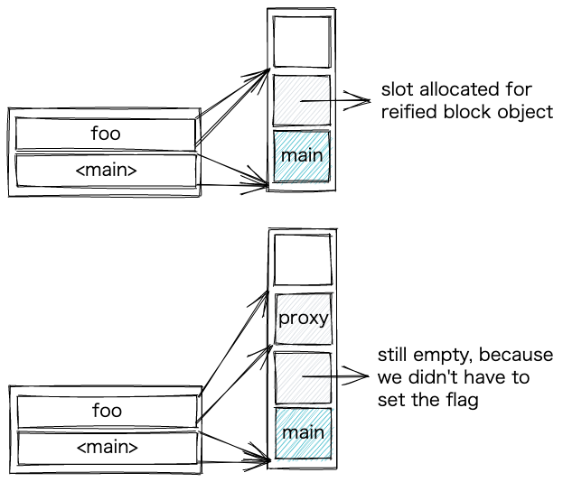

# Advent of YARV

- https://kddnewton.com/2022/11/30/advent-of-yarv-part-0.html
- YARVバイトコードの各処理を、Rubyで書いたらこんなかんじ、というスタイルで解説している。
- **Part 0 - Introduction**
  - 用語について
    - Call site
      - ソースコード中のメソッドが呼ばれた場所
    - Reify
      - 遅延評価において，前に定義されていた値を評価すること
- **Part 1 - Pushing onto the stack**
- VM命令の説明
  - `putobject`について，`putobject`命令自身が，オペランド(`putobject 3`の`3`など)を持っている
    - `putobject`命令は，GCのために，自身が持つ値をマークする責任がある．これにより，命令列がGCされるまで(オペレーターの他に)オペランドのためのメモリ消費も必要となるという問題がある
- **Part 2 - Manipulating the stack**
- VM命令の説明の続き
  - `adjuststack n`
    - n回pop
  - `setn n`
    - topからn個下の箇所の値を、topの値で上書きする
  - `topn n`
    - topの値を、topからn個下の値で上書きする
- **Part 3 - Frames and events**
- 前半はフレームについての話
  - `value stack`と`frame stack`
  - フレームの種類一覧
    - `top` トップレベル
    - `method` メソッド定義
    - `block` ブロック
    - `class` クラスやモジュール
    - `rescue` rescueのブロック
    - `ensure` ensureのブロック
    - `eval` evalのため
    - `main`
      - >a frame for themain
    - `plain`
      - >a unique frame used with the once instruction
- 後半はTracePointについての話
  - `0000 putobject_INT2FIX_0_                                             (   1)[Li]`
    - `(1)`は、ソースコードの1行目の命令であることを表している
    - `[Li]`は、TracePointのlineイベントが起きることを表している
  - `0003 opt_plus   <calldata!mid:+, argc:1, ARGS_SIMPLE>(   1)[CcCr]`
    - `[Cc]`は`c_call`
    - `[Cr]`は`c_return`
- **Part 4 - Creating objects from the stack**
- スタックtopからとってきた複数の値を計算する命令
- (変数が入っていたりして)実行時まで具体的な値が分からない、動的に決まる値の生成で使われる
  - `newarray n`
    - topのn個からArrayを作る
    - `duparray`は`duparray [1, 2, 3]`のように、コンパイル時にわかる配列をpushする命令
  - `newarraykwsplat 3`
    - topのn個からArrayを作る
    - 最後のエントリが`**`が使われているHashであるとき
    - `[1, 2, **{ foo: "bar" }]`のようなコードで出現する
  - `newhash 4`
    - key, valueの順で積まれたn個の要素をHashにする
  - `newrange 0`
    - 引数は、0なら`..`, 1なら`...`のrange
  - `toregexp (正規表現のオプション), (popする数)`
    - 動的に作る正規表現
  - この章で紹介した命令は、`send`命令で実行することもできるが、効率のためにこのような命令が用意されている
- **Part 5 - Changing object types on the stack**
- 型を変換する命令
  - `calldata`について
    - `mid`
      - メソッド名
    - `argc`
    - `flags`
      - `VM_CALL_TAILCALL`とか
      - `VM_CALL_ZSUPER`
        - 引数なし(zero)のsuperの呼び出し
  - 命令列に`<calldata!mid:to_s, argc:0, FCALL|ARGS_SIMPLE>`のような表現があれば、その命令はcalldataオペランドをとる命令
  - `objtostring`
    - `to_s`する
  - `anytostring`
    - `"`のリテラル内で`to_s`した結果がStringじゃなかったときに、元の値が内部的に文字列に変換されて、それが使われる
```ruby
a = Object.new
def a.to_s
  :A
end
p "#{a}" #=> "#<Object:0x0000000102952178>"
p a.to_s #=> :A
```

- `intern`
  - シンボルリテラルで動的にシンボルを生成するとき
- `expandarray`
  - popしたArrayを分解してpushする
  - 多重代入に使う
  - 逆順で入れるかとかのフラグがあって色々ややこしそう
- `splatarray`
  - topが配列でないなら、`#to_a`で配列にする
- **Part 6 - Calling methods (1)**
- `send`命令について
  - 1つ目のオペランドは calldata
  - 2つ目のオペランドは ブロックへのポインタ
    - ブロックが無ければ nil
  - `send`命令を実行するとき、呼び出し側のspの位置は、渡す引数個分topから引いた位置に設定されてから`send`される
- **Part 7 - Calling methods (2)**
  - `opt_plus`とかは、2つの値が Integer, Float, String, Array 同士の場合かつ、メソッドが再定義されていない場合に、(メソッド探索を伴わずに)直接操作を行っている
  - yjitでは、ソースコード上で同じ位置のものは同じ型だろうという理論で、この型チェックを極力省くような最適化をしている
- **Part 8 - Local variables (1)**
  - `getlocal`は、変数のepからの負のindexと、frameを遡る個数の2つの値を引数に取る
- **Part 9 - Local variables (2)**
- ブロックパラメーターの扱いについて
  - `&block`のような引数のこと
  - `getblockparam`
    - `getlocal`とほぼ同じ
    - 初回呼び出し時のみ、フレームのブロック引数のスロットに、ブロックをProcに変換したものを格納する処理が入る
      - `VM_FRAME_FLAG_MODIFIED_BLOCK_PARAM`がfalseなら、`rb_vm_bh_to_procval(ec, VM_ENV_BLOCK_HANDLER(ep))`でブロックをProcに変換して、`VM_FRAME_FLAG_MODIFIED_BLOCK_PARAM`をtrueにする
      - [ruby/insns.def at master · ruby/ruby](https://github.com/ruby/ruby/blob/f7b215af0ed5148d1946f1e9d817a0875db02ec6/insns.def#L101-L121)
  - `getblockparamproxy`
    - 普通、引数として受けとったblockはcallメソッドしか呼ばないから、それに特化したプロキシオブジェクトを使うようにする
    - 
  - `setblockparam`
    - ブロック引数の再定義
      - 普通は使わなそう
- **Part 10 - Local variables (3)**
  - 最初にスタックに積まれる3つのデータ
    - `VM_ENV_DATA_INDEX_ME_CREF`
      - メソッドエントリー or クラス参照 or 特殊変数 or false
        - スタックを弄った時にfalseが出てきたのはここを参照していたからかも
    - `VM_ENV_DATA_INDEX_SPECVAL`
      - 親の環境フレームへの参照 or メソッドのブロックハンドラ(渡したブロックへの参照?)
    - `VM_ENV_DATA_INDEX_FLAGS`
      - フラグ
  - `vm_svar`という、`VALUE`を5つ並べた構造体があり、`imemo`という名前で呼ばれている
  - `vm_svar`
    - lastline
      - `gets`, `readline`の最後の値
      - `$_`
    - backref
      - 最後にマッチした正規表現の値
      - `$~`
    - others
      - flip-flopオペレーターの現在の状態(true/false)が入った配列
  - `getspecial x, y`
    - 特殊変数を得るためのオペレーター
    - `0, _`
      - lastline
    - `1, 4`
      - 最下位ビットが0の場合(第2引数が偶数の場合)
      - 第2引数の1/2の特殊変数(この場合は`$2`を返す)
    - `1, 77`
      - 最下位ビットが1の場合(第2引数が奇数の場合)
      - `38 * 2 + 1 = 77`なので、`&`(= `38`)である`$&`へのアクセス
    - `2以上, _`
      - flip-flopの値へのアクセス
- **Part 11 - Class and instance variables**
  - `getclassvariable クラス名のシンボル, インラインキャッシュ`
    - クラス変数の値がどこに格納されているかについてのキャッシュ
    - キャッシュのキーは、現在の`ruby_vm_global_cvar_state`の値
      - このグローバル変数は、モジュールなどがincludeされるたびに増加する
        - キャッシュを無効化するため(多分)
  - `getinstancevariable`
    - Ruby 3.2から、ObjectShapeによってキャッシュの仕組みが変わった
    - 難しいから解説は省略している
- **Part 12 - Global variables**
- **Part 13 - Constants**
- **Part 14 - Branching**
- **Part 15 - Defining classes and modules**
- **Part 16 - Defining methods**
- **Part 17 - Method parameters**
- **Part 18 - Super methods**
- **Part 19 - Defined**
- **Part 20 - Catch tables**
- **Part 21 - Once**
- **Part 22 - Pattern matching**
- **Part 23 - Primitive**
- **Part 24 - Wrap up**
