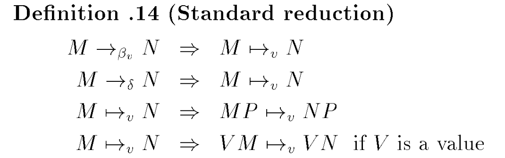

# An Introduction to Continuations

- https://www.semanticscholar.org/paper/An-Introduction-to-Continuations-Moreau/0d5b5411c172d583e218a90f702053ac509c98f7
  - β(beta)規則, β簡約
    - 自由変数を置き換えるやつ
    - 値呼び出しの関数呼び出しそのもの
  - δ(delta)規則, δ簡約
    - 予めδで定義されたものがあったときに、関数適用をδリダクションできる、というもの
      - `delta(+, 1) = +_1, delta(+_1, 2) = 3`と定義されているならば、`(+ 1 2)`は`(+_1, 2)`を経由して`3`にδ reductionできる
    - 組み込み関数を数学的に定義できる
  - 標準簡約
    - 
    - 左が先に探索される深さ優先で簡約
    - 左から順にVになっていく
  - Church-Rosserの定理
    - どこから簡約しても同じ結果になる
      - 一方で、簡約の仕方によっては結果が出ないこともある
        - 結果が出る計算ならば、最左から簡約する戦略をとることで、結果は必ず出ることが保証されている
          - 最左から簡約: 標準簡約 $ \lambda_v
  - コンテキスト`C[]`
    - redex以外の部分
    - redexとは
      - 規則の左辺
      - redex ~= 部分式のようなもの
      - redexを簡約してもよい＝部分式の箇所だけを簡約してもよい
    - プログラムのreduxの部分をhole`[]`に置き換えると、それはコンテキスト(のみ)になる
      - 空のコンテキストのことを、holeといい、`[]`とする
    - `(λ k . (**10** (k 5)) (λ u . u))`
    - `________======__________________` (`=`がredex, `_`がcontext)
    - コンテキストは、構文規則だけで求めることができる
  - `C[M]`
    - `C[]`中のholeを`M`に置き換えたもの
    - `M -> N`が成り立っていれば、`C[M] -> C[N]`もある
  - 評価コンテキスト`E[]`
    - 導出を一意にするため
      - 最左ということを明示的に示さずに、規則的に最左になるような規則を定めるため
  - 規則があるとき、`redex -> contractum`
    - contractum: 規則の右辺
    - 規則を適用できるようなexpに対して、`(redex? exp) // => #t`
      - expがbeta簡約可能かdelta簡約可能
      - つまり、expがまるごと規則の左辺値のとき
    - できないようなexpに対しては、`(applic? exp) // => #t`のはずなのでapplyする
  - 論文中、reduxが最初に出てくる文章
    - >So far, we have defined two rules Beta and Delta, which are binary relations over the set of terms A. Such binary relations are usually called notions of reduction. The left-hand side of a rule is called a redex, while its right-hand side is called a contractum.
    - > これまで、項集合Aに対する二項関係である2つの規則BetaとDeltaを定義してきた。このような二項関係は通常、還元概念と呼ばれる。規則の**左辺をredex**といい、**右辺をcontractum**という。
    - > Let Exp be an expression of A that has a subexpression M. Let us also suppose that M is a redex with contractum N (according to rule Beta, or Delta).
    - > Expを部分式Mを持つAの式とする。また、Mが（規則Beta、またはDeltaに従って）contractum Nを持つredexであるとする。
    - > We define a relation on terms of A called the compatible closure, which associates Exp with an expression Exp’ where the subexpression M is replaced by the contractum N. The compatible closure is also called the one-step reduction.
    - >この関係では、Expと、部分式Mを部分式Nに置き換えた式Exp'が関連づけられる。一段階削減とも呼ばれる。
- ---
- >今日のところはやっていることの意味合い・話の展開の理解が心もとなく感じ
- > ましたが，原文を読むと，そこを補強する文言がそれなりにあります．小宮補
- > 足も加えつつ書いておきます：
- > ・β_vとδという規則は，二項関係である．
- > # 二項関係aRbは，aとbがRという関係にある，ということだけを言うものであ
- > # り，aからbを求める，というような意味合いはデフォルでは含みません．今
- > # から，「機械的に計算する（簡約）」というメカニズムを（数学的基盤であ
- > # る）二項関係を用いて定義しようとしています．
- > ・部分式のβ/δ簡約をしたいけど定義6・7だけではムリ．じゃあ二項関係を
- > 増やしましょう →compatible closureの話（そしてこれらの二項関係を
- > one-step reductionと呼ぶことにしたわけですね）．
- > # ⇒の右辺に現れる PM や PN などを M/N と読み替えて ⇒ の左辺に登場さ
- > # せればいくらでも二項関係をつくれますね．→ closureたる所以
- > そしていよいよ機械的計算メカニズムである「簡約」の定義ですが，定義9に
- > 入る前に p.6 冒頭の
- >   We define a {\em reduction} as a sequence of one-step reductions.
- > は言っておくべきでしょう．その次の
- >   In order to reduce a term, we search for a subexpression that is a
- >   redex（redexを見つけ出す戦略の話につながる文）, we replace it by its
- >   contractum, and we repeat this process（定義9につながる）; a
- >   reduction {\em terminate} when there is no redex left（答えが求まる，
- >   の定義）, or it {\em diverges} if a redex can always be found. When
- >   reduction terminates, the resulting term is in {\em normal form},
- >   i.e., it does not contain any redex（normal form; 正規形という用語も
- >   必ず挙げておくべき．イタリック体の用語は原則紹介しておくべき）．
- > を踏まえておくこともこのあとの展開をスムースに理解するために効き目があ
- > ります．
- > 定義9の簡約がどういうものかの定義ですが，one-step reductionが二項関係
- > なので推移律を使う論理展開ができ，推移的閉包の話に持っていけるところが
- > ミソ．
- > # コンピュータの原理（計算のメカニズム）が，単純な二項関係（one-stepの
- > # 置換え規則の意味をもたせた）と，推移的閉包で定義できてしまう！
- >- 今回の評価関数のプログラムは深さ優先の再帰で実装されるため、最左の redexを調べる間の残りの式の情報は、処理系のスタックが保持する（暗黙的な継続といえる）。
- > -
- > 評価コンテキストは継続を概念としてではなく明示的なデータとして扱えることを意味するから、今回のプログラムの説明のために評価コンテキストを用いるのは適さない。
- > -
- > 今回のプログラムの説明を定義に沿って行いたい場合には、論文8pの定義14を使った説明が適している。
- >- スライド6,
- > ここでいうスタックは処理系内部の暗黙的なスタックでなく、プログラム上で扱える明示的なスタックである。
- >- スライド4p : プログラムはScheme言語で書かれているから、ここでの rest
- > は型の指定がなく、何でもは入れてしまう（本当は継続の record
- > しか入れないが）。
- > - **CEK-machine で環境が導入されたが、これは今まででは beta-reduceでの束縛変数の置換が対応する。**
- > -` ρ[x:=V]` は環境の拡張を意味し、環境 `ρ` に `x:=V`
- > という束縛を加えて拡張した環境を表す。
- >-
- > これまでの節で様々な、継続の表現方法を紹介してきたが、それらは言語処理系に何かしらのデバイスを要求していた。
- >      - 例えば、スタックによる表現ではスタックのデータ構造のサポート（push,
- > pop のサポート）を要求し、CEK-machine
- > では継続を表すレコードや状態遷移を行う機械を要求した。
- >      -
- > デバイスを要求するということは、デバイスを持たない処理系では継続を表現できないことを表す。
- > - CPS
- > ではデバイスを必要とせず、プログラムの記述のみで継続を表現できる特徴がある。
- >      -
- > このため、処理系のデバイスの有無に捕らわれることなく、継続を表現可能である。
- >
- > - スライド12p、左、最後の行：ρ(x) は誤り
- >      - 1つ上の行で、`ρ1=ρ[x:=1]`としたうえで`ρ1(x)`と表すのがよい。
- >      - そもそも、`ρ(x)`は値を表すから、1と書いてしまった方がよい。
