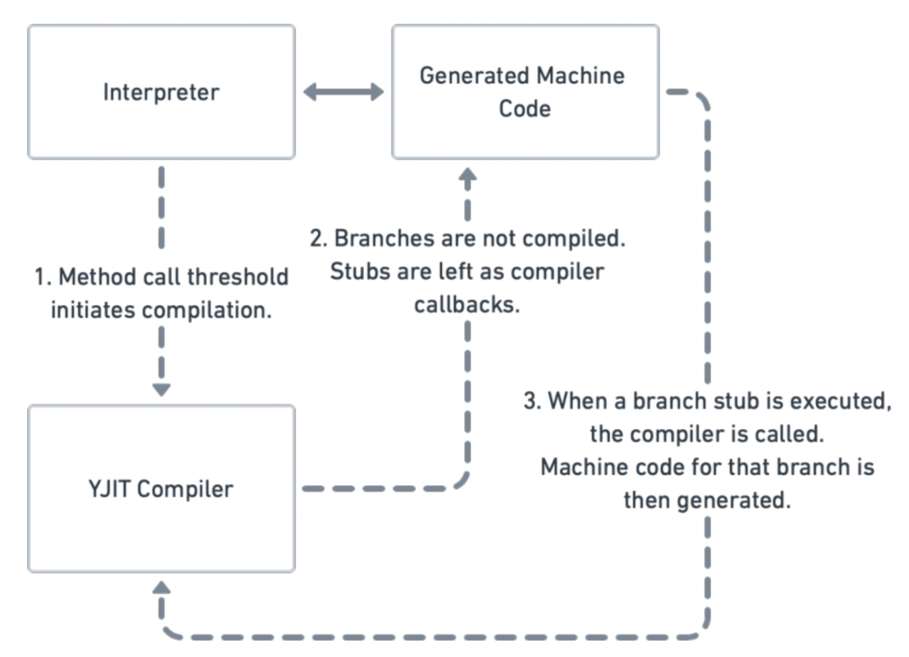
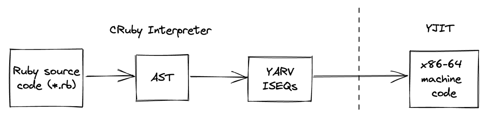
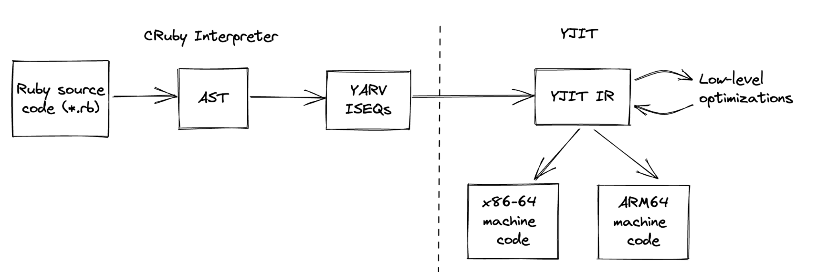

# Building a Lightweight IR and Backend for YJIT

- https://rubykaigi.org/2022/presentations/maximecb.html
- [YJIT RubyKaigi 2022 slides - Google スライド](https://docs.google.com/presentation/d/1xJ4CwS13Tu2inO2-YxtSNhYmi2y8VDyW4QRpan0fKV0/edit#slide=id.g142c92ecb23_0_10)
- YJITではYARVバイトコードをx86マシンコードへ直接変換する
- Lazy Basic Block Versioning (LBBV) アーキテクチャ
  - 型情報を集める
  - コンテキストに基づいてブロックを最適化
  - コントロールフローをunfold(= 展開)する
- Ruby3.2では
  - CからRustによる実装に
  - ObjectShapeとの統合
  - コードのGCを実施
  - (x86(=AMD)の他に)ARM64もサポート
    - Apple M1で動くようになる
    - ラズパイでも動くようになる
  - 64ビットかつリトルエンディアンのアーキテクチャのみに対して実装する予定
    - 他のアーキテクチャ(RISC-Vなど)は後で
- 設計
  - 解析はO(n)で済ます
  - 
  - これまでは
    - 
  - これからは
    - 
    - ARMのサポートや、低レベル最適化が行われるようになる
- Frontend vs Backend
  - Frontend
    - YARV→IR
    - 主に最適化を行う
    - 型・定数・実行結果に基づいた最適化
  - Backend
    - IR→マシンコード
    - プラットフォームに依存した最適化
- x86とARMはけっこう似ている
  - 違うところもある
- (Peephole Optimizations)のぞき穴的最適化は調査中
- まだまだ最適化できる箇所はあるよ！
- 論文紹介
  - Building a new JIT Compiler inside CRuby. RubyKaigi 2021.
  - YJIT: A Basic Block Versioning JIT Compiler for CRuby. VMIL 2021.
  - Simple and Effective Type Check Removal through Lazy Basic Block Versioning. M Chevalier-Boisvert and M Feeley. ECOOP 2015.
  - Interprocedural Type Specialization of JavaScript Programs Without Type Analysis. M Chevalier-Boisvert and M Feeley.  ECOOP 2016.
