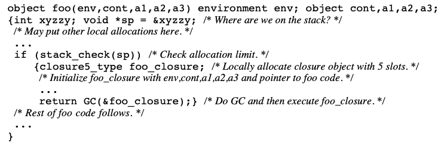

# CONS Should Not CONS Its Arguments, Part II: Cheney on the M.T.A.1

- 1994
- Henry G.Baker
  - 1992年の同一著者のCONS Should Not CONS Its Arguments, or, a Lazy alloc is a Smart allocの続き？
  - 1976年のCONS Should Not Evaluate its Argumentsはややこしいけれども違う論文。著者も違うし。大昔だし
    - Misreading Chatのhaskellの歴史回で言っていたのはこっち
    - こっちは遅延評価の発想が出てきた論文
  - CPS を用いた実行方式におけるスタックごみ集めの実時間化手法の説明も参考にするといいかも
  - [Chicken (Scheme) - Wikipedia](https://ja.wikipedia.org/wiki/Chicken_(Scheme))
    - この論文の手法を実装したScheme
    - >(CのコールスタックをSchemeのヒープとして活用する) この方式では、Cのスタック操作（自動変数のためのスタック領域割り当てや、変数のサイズに基づく固定長配列のアロケーションなど）を使用することができる。スタックを使い切ってしまったら、ガーベッジコレクションを開始することができる。
    - Schemeで使う3つのヒープ
      - 新しく作成されたオブジェクトが置かれるCのコールスタック
      - ガーベッジコレクタが必要なオブジェクトをコピーする先の2つのヒープ
  - [あとで実装するありがちなScheme処理系実装方針(CPS+トランポリン) | Niyarin's blog](https://niyarin.github.io/contents/2019-12/my-scm-plan.html)
    - >Chicken SchemeというSchemeからC言語へ変換する処理系の紹介をします。私と同じ方針を採用しているので良さそうな機構をもってくれば私の処理系も強化することでしょう。毎回トランポリンする場合オーバーヘッドが大きくなるため、この処理系では、単純にすべてのケースでトランポリンするのではなく、スタックを併用して使って、オーバーフローしそうになったらトランポリンするという方針を取っています。CPS変換しているのでトランポリンまではreturnせず、スタックは短くならないようになっているため、closureやデータ構造をヒープに割り当てて、スタックの中が増えてくるとコピーGC(新しく作ったスタックに)します。詳細はChicken Scheme論文(CONS Should Not CONS Its Arguments, Part II: Cheney on the M.T.A. 1)にかかれています。手抜きですんません。おわり。
- **Abstruct**
- >C言語へのコンパイル時に完全な末尾再帰性を実現するためのこれまでの方式は、 スタックをポップするために何らかの「トランポリン」を必要とした。我々は、ニュージャージー州のStandard MLと同じ方法で、(ゴミを集めた)ヒープ に全てのフレームを割り当てることで、末尾再帰問題を解決することを提案し ます。Schemeのプログラムは継続渡し形式に変換されるので、対象となるC関数は 決して戻ることはありません。Cのスタックポインタは、チェイニー式コピーガベージコレクション方式のためのアロケーションポインタになる。このSchemeでは、C関数呼び出し、C引数、C変数アリティ関数が使え、プログラム全体の複雑なブロックコンパイルは必要なく、分割コンパイルが可能です。
- **Introduction**
  - トランポリン
    - 高オーバーヘッド
  - [Appel](Appleではない)が作ったC処理系では
    - >スタックがオーバーフローしそうになると、次の関数のアドレスがトランポリンに長くjmp(またはreturn'ed)される
    - トランポリンの頻度をへらす
- **The Proposed Scheme**
  - >Schemeを[CPS](continuation-passing style)に変換してコンパイルし、得られたラムダ式を個々のC関数にコンパイルすることを提案
  - 関数呼び出しは通常のC言語の呼び出し
  - 追加引数で「継続クロージャ」と「クロージャ環境」を受け取る(渡す)
    - クロージャ変換?
  - 現在使っているスタックフレームのみが生きている
    - returnしないので、過去のスタックフレームに戻ることが起きない
  - しかし、過去のスタックフレームが持っているクロージャやユーザーデータ(動的配列とか)は、生きている
    - コピーGCで別の場所に移動させる
      - >ライブオブジェクトとライブクロージャはすべて別の領域にコピーされ（それによって凝縮され）、C の「スタック」割り当て領域の先頭にある「スタック」フレームで実行が再開される
  - GCをCで書けるのが利点
    - スタックフレームには関与しないので
    - アセンブリではなくCで、というニュアンス?
  - GCの根となるのは最新の継続クロージャ
    - 継続と環境のセット？
  - 
    - ↑SchemeのクロージャfooをCに変換したもの
  - `alloca(size_t size)`関数
    - sizeバイトを、呼び出し元のスタックフレームに確保する
    - 呼び出し元のスタックフレームがreturnしたとき、確保した領域は開放される
    - allocaを使えと書いてあるけれど仕組みがよくわからない
- **CONS Should Not CONS Its Arguments**
  - よくわからん
- スタックが伸び縮みすることで管理していた情報を、別の情報(関数の作成 = フレームの作成)で管理するようにした
