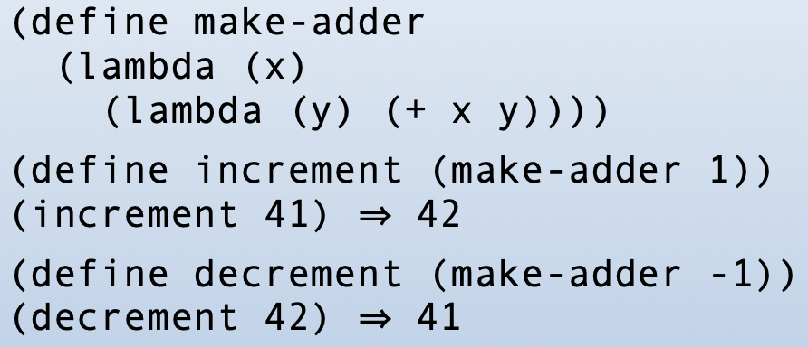
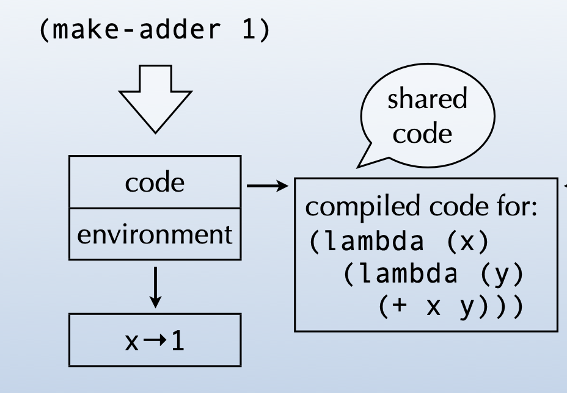
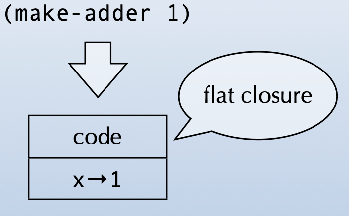
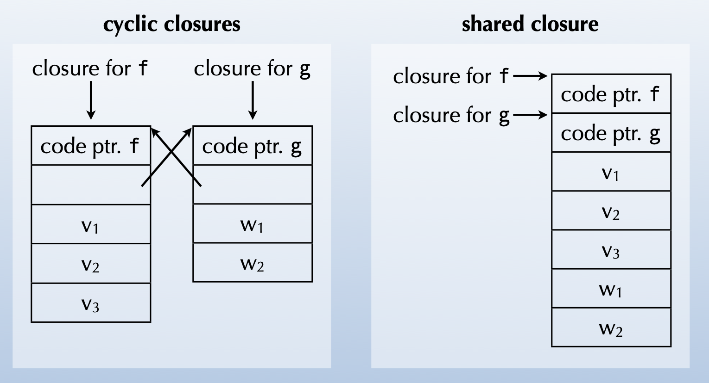
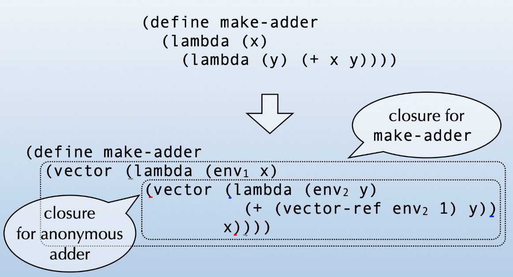
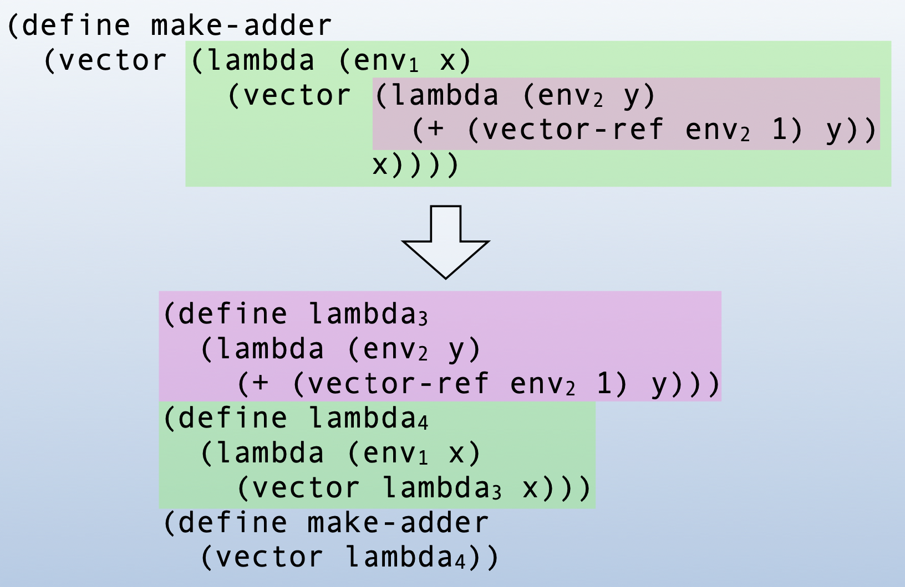
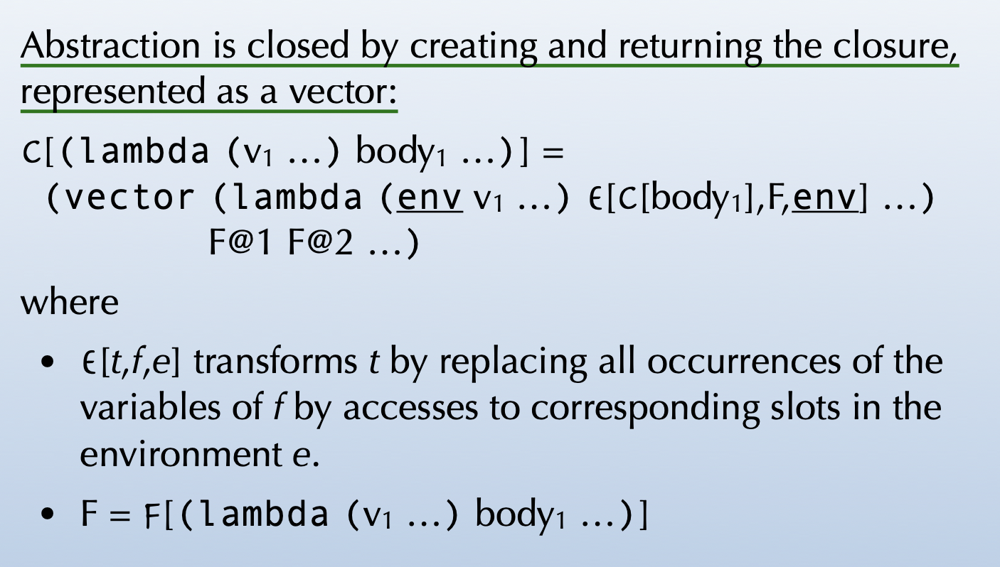
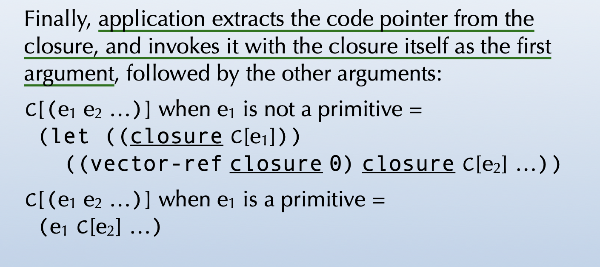

# Closure conversion

- from クロージャ変換
- Michel Schinz – parts based on slides by Xavier Leroy 2007–04–27
- クロージャの本質を説明しているスライド
- 
  - コードポインタと環境の組がクロージャ
    - クロージャという名前の由来は、これらを内包しているところから
    - 
  - クロージャの表現
    - コードはクロージャごとに共有
    - (アドレスが)定数でなければならない
    - 一方で、環境は(共有しないから)自由
  - flat closure
    - one-block closureともいう
    - 
    - 環境がインライン化される
    - 最初の図と違って、クロージャは環境を持たなくなり、クロージャ自身が環境の役割を担っている
  - recursive closure
    - 再帰的に自身を呼び出しているクロージャ
    - 実現する方法がいくつかある
      - 自身の変数を、自由変数として扱う
        - 自由変数なので、深い呼び出しから浅い環境が見えて、実現できる
      - > with flat closures, the environment is the closure, and can be reused directly
        - (flat closures において、) 環境 ＝ クロージャ
  - Mutually-recursive functions
    - 相互再帰的な関数
    - 2種類の実現方法
      - cycleクロージャを使用する
      - 内部ポインタで単一のクロージャを共有する
    - 
  - Closure conversion
    - 単純化によりクロージャを実装する、その変換手法のこと
    - 「ネストされいる」&「自由変数を含む」関数を、「トップレベル」&「closed」な関数に変換する
  - closed function
    - 自由変数を持って**いない**関数
    - closingによりclosed functionになる
  - closing
    - 環境の引数を追加すること
    - 
      - 自由変数だった`x`が、`(vector-ref env2 1)`になっている
      - なんでvectorにラップしているのかは不明...
      - 内側の(赤色)vectorは、2要素目が`x`になっている
        - (赤色)vectorから見て外側の、自由変数の`x`を保持しているということ?
        - `env2`には`(赤vector (λ (env2 y) ...) x)`が入るのか?
          - それを`(vector-ref env2 1)`によって`x`を取っているのかも
          - (Schemeのvectorも普通の言語と同じで0-index)
      - `make-addr`の戻り値がlambdaからvectorになったけれど、このvectorをどのように扱えばいいのかがわからぬ
        - もっと下のスライドに書いてあった
      - index0がコードで、index1以降が環境を表しているvectorに変換している
  - hoisting
    - 巻き上げ
    - 関数をトップレベルに移す
    - 
  - まとめると、closure conversionとは
    - まずはclosingをして
    - 次にhoistingをすること
- (残りのスライドについては省略...)
  - 関数抽象の変換
    - 
  - 関数適用の変換
    - 
      - `(vector-ref closure 0)`で、クロージャのbody(コード部分)を取り出している
