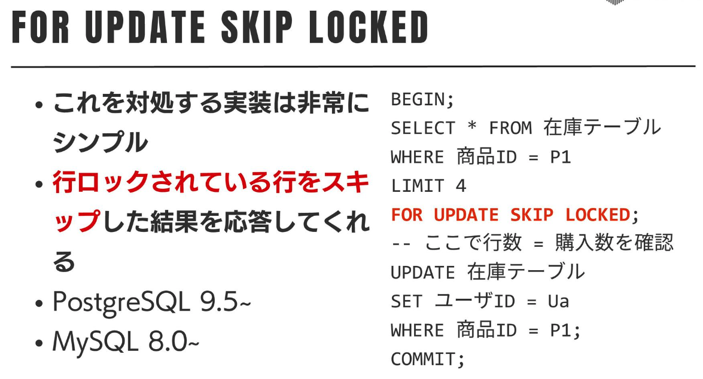

# DB設計

- 各リクエスト(やjob)が「あるテーブルの先頭から**早い順に1個**とってきて更新する」ような処理は、ロックが必要
  - 普通の`SELECT ... FOR UPDATE`だと(競合したとき)ロック待ちが発生してしまうけれど、`SELECT ... FOR UPDATE SKIP LOCKED`をつけることで、ロックされている行をスキップして取得してくれる
    - [推し活の ハイトラフィックに立ち向かう Railsとアーキテクチャ - Kaigi on Rails 2024 - Speaker Deck](https://speakerdeck.com/falcon8823/tui-sihuo-no-haitorahuitukunili-tixiang-kau-railstoakitekutiya-kaigi-on-rails-2024?slide=31)
      - 
    - MySQL 8.0〜
    - SELECT ... FOR UPDATE
    - FOR UPDATE SKIP LOCKED
