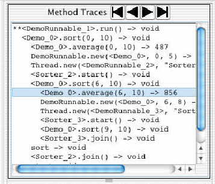

# Debugging Backwards in Time

- 著者: Bil Lewis
- https://arxiv.org/abs/cs/0310016
- [Debugging Backwards in Time | Connected Papers](https://www.connectedpapers.com/main/8ccf68f3ad51fba4406ed97af65efa6951f35132/Debugging-Backwards-in-Time/graph)
  - 全知デバッグを提案した論文
  - ツール TOD
  - >recording every state change
  - 代入やメソッド呼び出しを記録
  - タイムスタンプを変更させたとき、diffがあったものを強調表示させる
    - 変数・コードの行・スレッド
  - >Arbitrary method calls may be made at any time.
    - 遡った箇所でメソッドを実行したら、それは別の時系列となる
    - > > 2.6 式をインタラクティブに評価する
    - > > 任意のメソッド呼び出しをいつでも行うことができます。プログラマは、デバッガを任意の時間に戻し、記録されたオブジェクトのその時点の値を使用してメソッド呼び出しを評価することができます。これらのメソッドは別の「タイムライン」で実行され、元のデータには影響を与えない。二次タイムラインでは、メソッドを実行する前にインスタンス変数の値を変更することが可能である。
  - Instrumentation(計測・診断)したくないようにもできる
    - メモリ節約のため
    - 安全な(バグが無いと革新できたり、組み込みだったり)メソッドに関しては、instrumentしないように設定すれば良い
  - 実装
    - タイムスタンプの配列
    - タイムスタンプが記録するもの
      - インスタンス変数の変更
        - タイムスタンプ、変数、新しい値
      - メソッド呼び出し
        - タイムスタンプ、オブジェクト、メソッド名、引数、戻り値
    - 全ての変数は、タイムスタンプと値のペアのリストが紐付けられている
      - タイムスタンプが最も近いときの値が、その変数のそのタイムスタンプ時の値
  - メソッドトレースは階層的
- 
- **感想**
  - ふわふわしている
    - ツールの論文だから？
  - スナップショットは？
    - プログラム全体じゃなくて変数ごとにログが付く
- **関連が深い論文**
  - 191の論文から引用されている...
    - デバッグ関連が多い
  - Scalable omniscient debugging
    - 実行トレースの節約
  - Expositor: Scriptable time-travel debugging with first-class traces
  - Design and Implementation of a Backward-In-Time Debugger
  - A Case Study for Reversible Computing: Reversible Debugging of Concurrent Programs
    - 全知デバッグの話ではない
    - 可逆計算
    - 並列計算
- ---
- >1 Introduction
- > Over the past forty years there has been little change in way commercial program debuggers work. In 1961 a debugger called “DDT” MIT62 existed on Digital machines which allowed the programmer to examine, deposit, set break points, set trace points, single step, etc. In 2003 the primary debuggers for Java allows one to perform the identical functions with greater ease, but little more.
- > I believe that the reason for this is that the designers of debuggers have all concentrated on an- swering one question: “What information can we provide to the programmers while the program is running?” While this is not at all unreasonable, it’s not the right question. The question they should have been asking is “What information will help the programmer most?” The answers are not the same.
- >
- >
- > Omniscient Debugging
- >
- > An omniscient debugger works by collecting events at every state change (every variable assignment of any type) and every method call in a program. After the program is finished, it brings up a debugger display and allows the programmer to look at the state of the program at any time desired. The programmer can select any variable and go “backwards in time” to see where it was set, or what its values were. It is possible to “single step” the program forwards or backwards, to step to any method call, follow any exception throw, any context switch, etc.
- > The objective of this paper is to introduce the concept of omniscient debugging and to illustrate by use of a specific implementation that it is effective. The details of implementation and performance are interesting only as they form a lower bound. If it proves to be effective, there are lots of ways of improving performance.
- >
- > Omniscient Debugging is Interesting
- >
- > There are a number of things that make omniscient debug- ging worth the effort of exploring.
- > • First and foremost, (I claim) debugging is easier if you can go backwards. The most common question programmers have is “Who set this variable?”
- > • It eliminates the worst problems with breakpoint debuggers: no “guessing” where to put break- points, no “extra steps” to debugging, no “Whoops, I went too far”, no non-deterministic prob- lems. The programmer will never have to run the program twice.
- > • It gives the programmer a unique view of the program. Being able to see the traces of all the method calls for each of the threads is quite simply interesting. It makes looking at unknown code much easier.
- > • All the data is serializable. It can be analyzed remotely. It can be saved to a file. Several program- mers can work with the exact same debugging session. Beta customers can e-mail a debugging session to developers even if they don’t have the source.
- > Section 2 describes the appearence and functionality of the ODB (an implementation in Java). Section 3 tells how it is used on different types of bugs and discusses the results of user studies. Section 4 describes an implementation, its performance and limitations. Section 5 talks about its integration with event analyzers.
- >
- >
- >
- > 2 The ODB
- > For the rest of this paper, we are going to discuss the issues of Omniscient Debugging within the context of the “ODB”, an implementation of this concept in Java. It’s important to note that the general concept of Omniscient Debugging is independent of the implementation language and can equally well be done in C or C++.
- > The ODB is an implementation in pure Java which collects information by instrumenting the byte code of the target program as it’s loaded. It uses a single high-level lock to order the events from different threads. It has been tested on MacOS, UNIX, and Windows on a large variety of programs. It is freely available for download from www.LambdaCS.com. It is a proof-of-concept and serves as an upper bound for the cost of collection and display. It is also a very effective debugger.
- > For a graphical debugger such as the ODB, there are two vitally important issues we need to address: presentation of information and “navigation.” How does the programmer get the debugger to display the program state of interest and how does he recognize that state?
- >
- > 2.1 Maintaining State
- > We want to be able to “revert” the program to any previous state. Effectively this means that every change in every accessible object or local variable constitutes a separate state and must be recorded. We’ll need to record each assignment in each thread and define an ordering on them.
- > The time stamp (an integer) will be the sole referent to program state. Usually it will not be directly evident. The programmer will select a trace line to look at, switch to a different thread, move up on down the stack, or even step through the code. Most of the time he won’t even notice the time stamp, but all display panes will be updated to reflect it.
- >
- > 2.2 Presentation
- > Every object, variable, I/O stream, etc. will have a known value at each time stamp. When we change the currently displayed time stamp (we will hence forth refer to this as “reverting the debugger” to a given time) all of the data displays will be updated to reflect the values at that time. The line of code which generated the event will be highlighted, the method trace that it happened in too. The panes for the current thread, the current stack, the variable values, etc. will all reflect the selected time stamp.
- > Things that don’t change their value between the previously selected time stamp and the cur- rent one, shouldn’t change either. They shouldn’t change their appearance, their position, or their highlighting. Things that do change should do so obviously. New variable values should be marked, code lines should be highlighted, etc. The programmer should never wonder “Did this change?” or “Where am I?”
- >
- >
- > 2.3 Recognizing State
- > It is essential be able to recognize state. This basically means the programmer should be able to look at an object and know which object it is and what values its instance variables have. The ODB supplies a print format showing the class name and an index number: <MyObject_75>, chopping off the package. Class objects are displayed as just the class name (e.g., Person), strings and primitives as expected (1, true, "A string").
- > This representation can be easily displayed in a JList, or stored in an editor. It can be printed out and it can even be typed back in to the debugger at a later date to reference that object. The object <Demo_0> in figure 1 shows its four instance variables, the last of which (array) is open recursively. In the locals pane the dashes (--) indicate that a variable hasn’t been set yet.
- > There are a few cases where a different print format is more “intuitive” for the programmer. A blocked thread will acquire a “pseudo variable” to show the object it’s waiting for (_blockedOn) as will objects whose locks are used.
- > The collection classes constitute another special case. In reality, a Vector comprises an array of type Object, an internal index, and some additional bookkeeping variables which are not of any interest to anyone other than the implementer. So the ODB displays vectors and hashtables in formats more consistent with the way they are used. For example, the keys for a hashtable won’t disappear or move.
- > Large objects are problematic and remain an open issue. What is the best way to display a 1000x1000x1000 array? Or even just a 10000 element array? Or a large bitmap? Or a tree?
- >
- > 2.4 Displaying Method Traces
- > Every method call that is recorded will be displayed in a “method trace” pane. The format of the trace line will be:
- > <Object>.methodName(arg0, arg1) -> returnValue.
- > Each line will be indented according to depth and a matching “return line” will be added when it returns. Return lines which directly follow their trace line will be elided.
- > In figure 1 we can see that current time stamp is no. 272 (out of 1265) and is the first event in a method. It is a call to average(6, 10), which returned 856. This occurred in thread <Sorter_1>. From both the “stack” pane and the “trace” pane it’s evident that sort(6, 10) is calling average(), and that it, in turn, is called recursively from sort(0, 10). The this object is <Demo_0>, which the programmer has copied to the “objects” pane and then expanded the array instance variable, which happens to be an array of 20 integers.
- > In multithreaded programs, each thread will have its own set of trace lines which will only be displayed when the debugger is reverted to a time stamp in that thread.
- > Although interesting in itself, the primary purpose of the trace window is not for debugging directly, but rather as a convenient index into the time sequence of the program. In other words, the programmer is going to use the traces to find interesting points in the program. The programmer will then revert to the time when that method call was executed and start looking at state.
- > The “objects” pane shows whatever objects the user has copied here via double-clicking on ob- jects in other windows (any object in any pane may be copied here). Double-clicking on an instance variable will expand the value of that instance variable in-place (like the array int20_0).
- > Variables which changed values from the previously selected time stamp will be displayed with a leading ‘*’ (e.g., start and end).
- >
- >
- > 2.5 Navigation
- > Simple navigation through the program’s history is accomplished through selecting lines in a pane or pushing the buttons above them. Selecting a line in the “threads” pane reverts the debugger to the nearest event in that thread. Selecting a line in the stack frame will display that stack frame. Selecting a trace line, a code line, or an output line will revert to the time when that line executed (was printed). The buttons work as uniformly as possible for the different panes. The four most common buttons revert to the first, previous, next, and last time stamp for the selected object in that pane. In the “threads” pane, these execute first/last time stamp for the thread, but previous/next context switch. In the “code” pane, they are first/last line in current method, and “step into forwards” and “step out of backwards.” The other buttons execute “step over”, “return from”, and “next iteration on current
- > line.”
- > In addition to first/last/previous/next, it is possible to bring up a list of all the values a variable
- > ever had and select one of them. The ODB will revert to the time when that variable was assigned that value.
- >
- > In figure 2 we see a selection from among the four values that array element 16 took on during the run of quick sort.
- > Modeled after EMACS, the ODB has a minibuffer which is used to present messages and to exe- cute extended commands (such as Evaluate Expression or Search). The programmer may do an incre- mental text search through the “trace” pane, or an event-analysis search through all events, forwards or backwards.
- >
- > 2.6 Evaluating Expressions Interactively
- > Arbitrary method calls may be made at any time. The programmer may revert the debugger to any time and then evaluate a method call using the then-current values of the recorded objects. These methods will be executed in a different “timeline” and won’t affect the original data. In the secondary timeline it is possible to change the value of instance variables before executing a method.
- >
- > 3 The Nature of Bugs under the ODB
- > The ODB divides bugs along two dimensions: Do all the events recorded for the bug fit in memory? Does the bug output wrong data or does it fail to output correct data?
- >
- > 3.1 The Snake in the Grass
- > This second is “the snake in the grass” metaphor. If the program prints out something wrong (“the answer is 41” instead of 42), then we have a handle on the bug. We can see the snake in the grass and we can grab its tail. Now if the program simply fails to output the correct answer, then we don’t have a direct handle to the bug. This is the snake in the grass we can’t see.
- > For programs that fit and we can see the snake, then the ODB is absolutely wonderful. It is pos- sible to start on the faulty output and step backwards, finding the improper value at each point, and follow that value back to its cause. (If you’ve got a snake’s tail and you pull on it long enough, you will get to its head.) It is not unusual to start the debugger, select the faulty output, and navigate to its source in 60 seconds. With perfect confidence.
- > A good example of this is when I downloaded the JUSTICE java class verifier. I found that it disallowed a legal instruction in a place I needed it. Starting with the output “Illegal register store”, it was possible to navigate through a dozen levels to the code that disallowed my instruction. I changed that code, recompiled, and confirmed success. This took 15 minutes (most of which was spent confirming the lack of side-effects) in a complex code base of 100 files I had never seen before.
- > Breakpoint debuggers suffer from the “lizard in the grass” problem. Even when they can see the lizard and grab its tail, the lizard will break off its tail and get away. And then they’re back to the “lost lizard in the grass” problem.
- > For relatively small problems (say 10,000 events), it is easy just to scan the entire set of method traces. For larger problems, the “lost snake in the grass” problem becomes more problematic. We have a large data set and an uncertain idea of what we’re looking for.
- > Happily, searching through large sets of method traces for uncertain situations is a well-studied problem. The ODB leverages directly off of this work and incorporates the get() function of Ducassé Duc99b as an minibuffer command. Of course now the get() can search backwards as well as forwards.
- > A good example of this is the quick sort demo that is part of the ODB jar file. It sorts everything perfectly, except for elements 0 and 1 sometimes. To search for this problem, we can issue a get() search to find all calls to sort() that include 0 and 1.
- > port = call & callMethodName = "sort" & arg0 = 0 & arg1 >= 1
- > There are four matches and sort(0, 2) is the obvious call to look at. Stepping through that method, it’s quickly obvious that average() failed to include the high value, which is why sort usually worked.
- >
- > 3.2 Size
- > The other important dimension is that of size. In a 31-bit address space, there is room to store about 10 million events. A huge percentage of real bugs fit nicely into this space. A good percentage don’t. There are a number of ways to attack this problem. We can:
- > • “garbage collect” old events and throw them away. • instrument fewer methods.
- > • record for a shorter time.
- > 3.2.1 Garbage Collection
- > Garbage collection is good because it requires no effort and effectively maintains a window of events surrounding the bug. It is bad because it’s not throwing away garbage, but just older events which might be important. It is also bad because it allows the program to run long enough for performance to become an issue. It adds an extra 50% on top of the cost of the average event.
- >
- > When the source of the bug is within 10 million events of the time when recording was turned off, then we are back to the well-known “snake in the grass problem.” When it is further away, we’ve lost the source of the bug, and the garbage collector loses its value.
- > During the development of the GC, a bug occured sporadically after the second invocation of the GC. An index into the time stamp array was getting changed to account for a special situation during recording, but the GC didn’t know it. It would write in a forwarding index, which would not be recognized as illegal until the second GC, by which time the original faulty object was long gone.
- > Attempts to debug this problem with breakpoints and print statements failed completely. Using the ODB on itself (which was tricky back then) revealed the problem in relatively short order.
- >
- > 3.2.2 Safe Code
- > It is quite normal for a large percentage of a program to consist of well-known, “safe” code. (These are either recomputable methods, or methods we just don’t want to see the interiors of.) By requesting that these methods not be instrumented, a great deal of uninteresting events can be eliminated. The ODB allows the programmer to select arbitrary sets of methods, classes, or packages, which can then be instrumented or not.
- > The more work the program does in uninstrumented code, the lower the overhead. A good ex- ample of this is the following loops:
- > Code Slowdown for (int i=0; i<MAX; i++) sum+=smallArrayi; 300x for (int i=0; i<MAX; i++) x=x*x+x; 100x for (int i=0; i<MAX; i++) sum+=bigArrayi; 30x for (int i=0; i<MAX; i++) s="Item"+i; 2x
- > These numbers are very sensitive to memory usage issues. The small array fits into cache, so the uninstrumented loop runs in three cycles. The large array (1,000,000 elements) doesn’t fit, and the uninstrumented loop runs 10x slower.
- >
- > 3.2.3 Starting/Stopping Recording
- > If the programmer suspects that a certain known event always occurs before the bug (e.g., “When I push this button it crashes.”), then recording could be turned on at that point and turned off after the bug. The ODB allows manual control (there’s a “Start/Stop Recording” button). It also allows auto- matic control. Automatic control means that we’re going to scan a large set of events for a particular pattern, which will turn on/off recording. Once again, this is precisely the problem event analyzers are intended for and the ODB uses the get() function of Ducassé for this purpose also. By using a very fast event comparison (as fast as 10ns to check for a given source line, object, or method), it is possible to run the ODB over a much wider range of programs.
- >
- > 3.3 User Studies
- > Several small-scale studies involving 2 - 8 subjects were performed and gave encouraging results. An abstracted version of an actual bug was presented to the subjects with a brief explaination of the code and a half-hour introduction to the ODB. The bug was a classic “seen snake-in-the-grass” bug which took over an hour to find by the original programmer using conventional tools. All subjects were able to pin-point the source within fifteen minutes.
- >
- >
- > 4 Performance and Memory Requirements
- > The important thing to recognize here is that the ODB represents a worst-case implementation–we can only do better. The ODB is completely naive, it does no optimization at all. With aggressive use of recomputation, collection can be reduced by orders of magnitude, leaving us with insignificent slowdown and near-infinite recording space. This allows us to focus on the main issue: Is this an effective way to debug a program?
- > On a 700MHz Apple 3G, the standard test method is one which takes two arguments and per- forms four assignments to local variables. It requires roughly 10μs to record the method call and another 1μs per each assignment and marker event, for a total of 10 events in 19μs, and average of 2μs/event.
- > Performance is not an issue for bugs which generate less than 10 million events. At a rate of 2μs/event, it takes only 20 seconds to fill the entire 2GB address space.
- > For programs that depend on the GC, this is a issue. A couple typical programs are shown below.
- > Code Slowdown Debugging ODB back-end 300x Debugging ODB display 10x Debugging Ant 7x
- > Notice that the back-end of the ODB is a worst-case program. It uses no utility methods and manipulates few strings. Ant, by contrast, uses a lot of utilities and libraries. The ODB display uses Swing extensively, but still does a lot of array manipulations and JList construction.
- > A 64-bit address space changes things. It is then possible to collect billions of events, and per- formance for data sets that fit becomes an issue. This implies that using get() to start and stop recording will become more important.
- > In actual experience with the ODB, neither CPU overhead nor memory requirements have proven to be a major stumbling block. Debugging the debugger with itself is not a problem on a 110 MHz SS4 with 128 MB. On a 700 MHz iBook it’s a pleasure. All bugs encountered while developing the ODB fit easily into the 500k event limit of the small machine.
- >
- >
- > 4.1 Implementation
- > The ODB keeps a single array of time stamps. Each time stamp is a 32-bit int containing a thread index (8 bits), a source line index (20 bits), and a type index (4 bits). An event for changing an instance variable value requires three words: a time stamp, the variable being changed, and the new value. An event for a method call requires: a time stamp and a TraceLine object containing: the object, the method name, the arguments, and the return value (or exception), along with a small pile of housekeeping variables. This adds up to about 20 words. A matching ReturnLine will also be generated upon return, costing another 10 words.
- > Every variable has a HistoryList object associated with it which is just a list of time stamp/value pairs. When the ODB wants to know what the value of a variable was at time 102, it just grabs the value at the closest previous time. The HistoryLists for local variables and arguments hang off the TraceLine, those for instance variables hang off a “shadow” object which resides in a hashtable.
- > Every time an event occurs, it locks the entire debugger, a new time stamp is generated and inserted into the list, and associated structures are built. Return values and exceptions are back- patched into the appropriate TraceLines as they are generated.
- > The code insertion is very simple. The source byte code is scanned, and instrumentation code is inserted before every assignment and around every method call.
- > A typical insertion looks like this:
- >
- > where the original code was lines 289 and 291, assigning a value to the local variable ie. The instrumentation creates an event that records that on source line 64 of Micro.java (#292), the local variable ie (#295), whose HistoryList can be found on the TraceLine in register 2 (#299), was assigned the value in register 1 (#298). The other kinds of events are similar.
- >
- >
- > 5 Integration with Event Analyzers
- > The get() is a function which will match a modestly complex pattern to an event. The pattern to be matched is based on prolog syntax and proves to be very expressive and convenient. Because a moderately complex query can be easily typed on a single line, it becomes possible to implement get() as an extended minibuffer command. And this is a very good thing.
- > The most common get() patterns will also map down to very efficient code. A simple search pattern such as this:
- > can run as fast as 10ns/test (7 cycles!). This pattern reads “Find the entry line in a method named "sort" which has two parameters, named "start" and "end".” Optimized code would require only six equality tests. The less-than-optimal ODB adds about 50ns to this. Thus an get() test cur- rently runs about 40x faster than recording an event (50ns vs. 2us).
- > The conclusion is that using get() to start/stop recording can make a huge impact on a long- running program, contrasted to running that same program and relying on the garbage collector.
- >1 はじめに
- > 過去40年間、商用プログラムデバッガの動作にはほとんど変化がなかった。1961年、Digital社のマシンに "DDT" MIT62 と呼ばれるデバッガが存在し、プログラマは検査、預託、ブレークポイントの設定、トレースポイントの設定、シングルステップなどを行うことができました。2003年、Java用の主要なデバッガは、同じ機能をより簡単に実行することができますが、それ以上のことはほとんどできません。
- > その理由は、デバッガの設計者が皆、一つの問いに答えることに集中してしまったからだと思う。「プログラム実行中にプログラマに提供できる情報は何か？これは決して不合理なことではないが、正しい質問ではない。本来は、"どのような情報がプログラマーの助けになるのか "ということを問うべきでしょう。答えは同じではありません。
- >
- >
- > 全知全能のデバッガ
- >
- > 全知全能デバッガは、プログラムの状態変化（あらゆる型の変数への代入）とメソッド呼び出しのたびにイベントを収集することで機能する。プログラム終了後、デバッガのディスプレイを表示し、プログラマは好きな時にプログラムの状態を見ることができる。また、任意の変数を選択し、その変数が設定された場所や値を「過去にさかのぼって」確認することができる。また、プログラムを前方または後方に「シングルステップ」し、任意のメソッド呼び出しにステップし、例外のスローやコンテキストスイッチなどをフォローすることが可能である。
- > 本論文の目的は、全知全能デバッグの概念を紹介し、それが有効であることを具体的な実装を使って説明することである。実装と性能の詳細は、下界を形成するものとしてのみ興味深いものである。もし有効であることが証明されれば、性能を向上させる方法はいくらでもある。
- >
- > 全知全能のデバッグが面白い
- >
- > 全知全能デバッグの面白さは、いくつもあります。
- > - まず第一に、（私が主張する）デバッグは、後戻りができれば簡単です。プログラマーが最もよく抱く疑問は、"誰がこの変数を設定したのか？"です。
- > - ブレークポイントをどこに置くか「推測」することも、デバッグに「余分なステップ」を加えることも、「おっと、やりすぎた」と思うことも、非決定論的な問題を引き起こすこともない。プログラマーは、プログラムを2度実行する必要がない。
- > - プログラマーは、プログラムに対して独自の視点を持つことができる。各スレッドのすべてのメソッドコールのトレースを見ることができるのは、非常に単純に面白いことです。未知のコードを見るのがより簡単になる。
- > - すべてのデータはシリアライズ可能である。リモートで解析できる。ファイルに保存することもできる。複数のプログラマーが全く同じデバッグセッションで作業できる。ベータ版ユーザは、ソースを持っていなくても、開発者にデバッグセッションを電子メールで送ることができる。
- > 第2章では、ODBの外観と機能（Javaによる実装）を説明する。3章では、さまざまな種類のバグに対する使用方法と、ユーザー調査の結果について説明します。第4章では、実装とその性能、制限について述べる。第5節では、イベントアナライザとの統合について述べる。
- >
- >
- >
- > 2 ODBについて
- > 本論文の残りの部分では、Javaにおけるこの概念の実装である「ODB」の文脈で、全知全能デバッグの問題を議論するつもりである。ここで重要なのは、全知全能デバッグの一般的なコンセプトは、実装言語に依存せず、CやC++でも同様に実現できる、ということです。
- > ODBは、純粋なJavaによる実装で、ターゲットプログラムがロードされる際に、そのバイトコードをインスツルメンテーションすることで情報を収集する。異なるスレッドからのイベントを順序付けるために、単一の高レベルロックを使用します。MacOS、UNIX、Windowsで、さまざまなプログラムがテストされています。www.LambdaCS.com から自由にダウンロードすることができます。これは概念実証であり、収集と表示のコストの上限として機能する。また、非常に効果的なデバッガでもある。
- > ODBのようなグラフィカルなデバッガでは、情報の表示と "ナビゲーション "という2つの極めて重要な問題に取り組む必要があります。プログラマーは、どのようにしてデバッガーに関心のあるプログラムの状態を表示させ、その状態をどのように認識するのでしょうか。
- >
- > 2.1 状態を維持する
- > 私たちは、プログラムを以前の状態に「戻す」ことができるようにしたいと考えています。これは、アクセス可能なオブジェクトやローカル変数のすべての変更が、個別の状態を構成し、記録されなければならないことを意味します。各スレッドのそれぞれの割り当てを記録し、それらの順序を定義する必要があります。
- > タイムスタンプ（整数）は、プログラムの状態を示す唯一の参照情報となります。通常、それは直接的には明らかにならない。プログラマーはトレースラインを選択し、別のスレッドに切り替え、スタックを上下に移動し、あるいはコードをステップスルーすることになります。ほとんどの場合、プログラマーはタイムスタンプに気づきませんが、すべての表示画面はタイムスタンプを反映するように更新されます。
- >
- > 2.2 プレゼンテーション
- > すべてのオブジェクト、変数、I/Oストリームなどは、各タイムスタンプで既知の値を持ちます。現在表示されているタイムスタンプを変更すると (以降、これを特定の時間に「デバッガーを戻す」と呼びます)、すべてのデータ表示が更新され、その時点の値が反映されます。イベントを生成したコード行はハイライト表示され、そのイベントが発生したメソッドのトレースも表示されます。現在のスレッド、スタック、変数の値などのペインは、すべて選択されたタイムスタンプを反映します。
- > 以前に選択したタイムスタンプと現在のタイムスタンプの間で値が変化しないものは、どちらも変化しないはずです。また、外観や位置、ハイライトも変更すべきではありません。変更されるものは、明らかに変更されるべきです。新しい変数値にはマークを付け、コード行にはハイライトを付けるなど。プログラマーは、「これは変わったかな」「ここはどこだろう」と思うようなことがあってはならない。
- >
- >
- > 2.3 状態を認識する
- > 状態を認識できることは重要です。これは基本的に、プログラマーがあるオブジェクトを見て、それがどのオブジェクトで、そのインスタンス変数がどんな値を持っているかを知ることができることを意味する。ODBでは、クラス名とインデックス番号を表示する印刷フォーマットを用意しています。<MyObject_75>と、パッケージは切り捨てられます。クラスオブジェクトは、クラス名（例：Person）、文字列、プリミティブとして期待通りに表示されます（1, true, "A string" ）。
- > この表現は、JListで簡単に表示することができ、エディタに保存することもできます。プリントアウトもできるし、後日、デバッガにタイプバックしてそのオブジェクトを参照することもできる。図1のオブジェクト<Demo_0>は4つのインスタンス変数を示していますが、最後の変数(array)は再帰的にオープンされています。ローカルペインでは、ダッシュ(--)は変数がまだ設定されていないことを示しています。
- > プログラマーにとって、異なる表示形式の方が「直感的」な場合がいくつかある。ブロックされたスレッドは、ロックが使用されているオブジェクトと同様に、待機中のオブジェクト（_blockedOn）を示す「擬似変数」を取得します。
- > コレクションクラスは、もうひとつの特殊なケースを構成しています。実際には、VectorはObject型の配列と内部インデックス、そして実装者以外には興味のない追加の帳簿変数から構成されています。そこでODBでは、ベクターとハッシュテーブルを、より使用実態に即した形で表示することにした。例えば、ハッシュテーブルのキーが消えたり動いたりすることはない。
- > 大きなオブジェクトは問題があり、未解決の課題として残っています。1000x1000x1000 の配列を表示するにはどうしたらよいでしょうか？あるいは10000要素の配列でもいいのでしょうか？あるいは大きなビットマップ？あるいはツリー？
- >
- > 2.4 メソッドトレースの表示
- > 記録されたすべてのメソッド呼び出しは、"メソッドトレース "ペインに表示されます。トレース行のフォーマットは次のとおりです。
- > <Object>.methodName(arg0, arg1) -> returnValue.
- > 各行は深さに応じてインデントされ、戻るときに一致する「戻り線」が追加されます。トレースラインに直接続くリターンラインは消去される。
- > 図1では、現在のタイムスタンプがNo. 272 (out of 1265) で、あるメソッドの最初のイベントです。これは平均値(6, 10)の呼び出しで、856を返しました。これはスレッド <Sorter_1> で発生しました。スタック」ペインと「トレース」ペインの両方から、 sort(6, 10) が average() を呼び出していること、そしてそれが sort(0, 10) から再帰的に呼び出されていることは明らかです。このオブジェクトは<Demo_0>で、プログラマはこれを「オブジェクト」ペインにコピーし、配列のインスタンス変数を展開したのですが、これがたまたま20個の整数の配列になっています。
- > マルチスレッドのプログラムでは、各スレッドが独自のトレース行のセットを持ち、デバッガがそのスレッドのタイムスタンプに戻されたときにのみ表示されるようになります。
- > それ自体は面白いのですが、トレースウィンドウの主な目的は、直接デバッグすることではなく、むしろプログラムの時間的順序への便利なインデックスとして使用することです。つまり、プログラマはトレースを使って、プログラムの中の面白いポイントを探すことになる。そして、プログラマーは、そのメソッドコールが実行された時点に戻して、状態を調べ始めることになる。
- > オブジェクト」ペインには、ユーザーが他のウィンドウのオブジェクトをダブルクリックしてここにコピーしたオブジェクトが表示される（どのペインにあるオブジェクトもここにコピーできる）。インスタンス変数をダブルクリックすると、そのインスタンス変数の値がインプレースで展開されます（`int[20]_0`という配列のように）。
- > 先に選択したタイムスタンプから値が変化した変数には、先頭に「*」が表示されます（例：startとend）。
- >
- >
- > 2.5 ナビゲーション
- > プログラム履歴の簡単なナビゲーションは、ペイン内の行を選択するか、その上にあるボタンを押すことで実現できます。スレッド」ペインで行を選択すると、デバッガーはそのスレッドで最も近いイベントに戻ります。スタックフレーム内の行を選択すると、そのスタックフレームが表示されます。トレース行、コード行、出力行を選択すると、その行が実行された（出力された）時点に戻ります。ボタンは、異なるペインに対して可能な限り統一的に機能します。最も一般的な4つのボタンは、そのペインで選択されたオブジェクトの最初の、前の、次の、最後のタイムスタンプに戻ります。スレッド」ペインでは、これらはスレッドの最初/最後のタイムスタンプを実行しますが、前/次のコンテキストスイッチが実行されます。コード」ペインでは、現在のメソッドの最初と最後の行、および「前方へのステップイン」と「後方へのステップアウト」が実行されます。他のボタンは、"step over"、"return from"、"next iteration on current line "を実行します。
- > を実行します。
- > 最初/最後/前/次に加え、変数が持つすべての値のリストを表示し、その中から1つを選択することができます。
- > のリストを表示し、そのうちの1つを選択することができます。ODBは、その変数にその値が割り当てられた時点に戻ります。
- >
- > 図2では、配列要素16がクイックソートの実行中に取った4つの値から選択されているのがわかります。
- > EMACSをモデルにしたODBにはミニバッファがあり、メッセージの表示や拡張コマンド（式の評価や検索など）の実行に使用される。プログラマは、"トレース "ペインからインクリメンタルなテキスト検索を行ったり、すべてのイベントを前方または後方から検索するイベント分析検索を行うことができます。
- >
- > 2.6 式をインタラクティブに評価する
- > 任意のメソッド呼び出しをいつでも行うことができます。プログラマは、デバッガを任意の時間に戻し、記録されたオブジェクトのその時点の値を使用してメソッド呼び出しを評価することができます。これらのメソッドは別の「タイムライン」で実行され、元のデータには影響を与えない。二次タイムラインでは、メソッドを実行する前にインスタンス変数の値を変更することが可能である。
- >
- > 3 ODBにおけるバグの性質
- > ODBでは、バグを2つの次元で分類している。そのバグについて記録されたすべてのイベントがメモリに収まっているか？バグは間違ったデータを出力するか、正しいデータを出力しないか？
- >
- > 3.1 草むらの中のヘビ
- > この 2 つ目は「草むらの中のヘビ」の比喩です。もしプログラムが何か間違ったことを出力したら（「答えは42ではなく41です」）、私たちはバグを把握することができます。草むらにいる蛇を見ることができ、その尻尾をつかむことができるのです。さて、もしプログラムが単に正しい答えを出力しなかったとしたら、私たちはバグを直接には把握していないことになります。これは、私たちには見えない草むらの中のヘビなのです。
- > 蛇が見えるようなプログラムであれば、ODBはとても素晴らしいものです。不具合のある出力から順に、各ポイントで不適切な値を見つけ、その値を辿って原因を突き止めることが可能です。(蛇の尻尾を長く引っ張れば、頭に辿り着くように）。デバッガを起動し、不具合のある出力を選択し、その原因までナビゲートするのに60秒かかることも珍しくありません。完璧な自信をもって。
- > この良い例が、JUSTICE java class verifierをダウンロードしたときです。私は、必要な場所で合法的な命令を許可しないことを発見しました。Illegal register store "という出力から始まって、私の命令を不許可にしたコードまで、何十階層もナビゲートすることが可能でした。そのコードを変更し、再コンパイルし、成功を確認した。初めて見る100個のファイルからなる複雑なコードベースで、15分（そのほとんどは副作用がないことの確認に費やされた）かかりました。
- > ブレークポイントデバッガは、「草の中のトカゲ」問題に悩まされています。トカゲが見えて尻尾を掴んでも、トカゲは尻尾を折って逃げ出す。そして、「草むらで迷子になったトカゲ」問題に戻ってしまうのです。
- > 比較的小さな問題（例えば1万イベント）であれば、メソッドトレース一式をスキャンするだけでよいので簡単です。大きな問題では、「草むらで迷子になったトカゲ」問題がより問題になります。大規模なデータセットがあり、何を探しているのかが不明なのです。
- > 幸いなことに、不確実な状況下で大規模なメソッドトレース集合を検索することは、十分に研究されている問題です。ODBはこの研究を直接利用して、Ducassé Duc99bのget()関数をminibufferコマンドとして組み込んでいます。もちろん、get()は前方だけでなく後方も検索できるようになりました。
- > この良い例が、ODB jarファイルの一部であるクイックソートのデモです。これはすべてを完璧にソートしますが、0と1という要素がたまにあることを除きます。この問題を検索するには、0 と 1 を含む sort() のすべての呼び出しを見つけるために get() 検索を実行します。
- > port = call & callMethodName = "sort" & arg0 = 0 & arg1 >= 1
- > 4つのマッチがあり、sort(0, 2)は見るべき明らかなコールです。そのメソッドをステップスルーすると、平均値()が高い値を含むことに失敗していることがすぐにわかります。そのため、sortは通常動作します。
- >
- > 3.2 サイズ
- > もう一つの重要な次元は、サイズです。31ビットのアドレス空間には、約1000万件のイベントを格納するスペースがある。実際のバグの大部分はこのスペースにうまく収まる。しかし、そのうちのかなりの割合がそうではありません。この問題を解決する方法はいくつもあります。例えば
- > - 古いイベントを「ガベージコレクション」して捨てる。- より少ないメソッドで実行する。
- > - より短い時間しか記録しない。
- > 3.2.1 ガベージコレクション
- > ガベージコレクションは、労力を必要とせず、バグを取り巻くイベントのウィンドウを効果的に維持できるため、良いものです。悪い点は、ゴミを捨てているのではなく、重要かもしれない古い事象を捨てているに過ぎないということです。また、パフォーマンスが問題になるほどプログラムを長く走らせることになるので、悪いことでもあります。平均的なイベントのコストに加え、さらに50%が追加されます。
- >
- > バグの原因が、録画を停止した時点から1000万イベント以内にある場合、よく知られた「草むらの中の蛇」問題に戻ってしまう。それ以上離れると、バグの原因がわからなくなり、ガベージコレクタはその価値を失ってしまう。
- > GCの開発中、GCの2回目の起動後にあるバグが散発的に発生した。タイムスタンプ配列へのインデックスが、記録中の特殊な状況を考慮して変更されていたのですが、GCはそれを知りませんでした。それは転送インデックスを書き込み、それは2回目のGCまで不正と認識されず、その時には元の欠陥のあるオブジェクトはとっくになくなっているのです。
- > ブレークポイントやprintステートメントでこの問題をデバッグしようとしましたが、完全に失敗しました。ODBを自分自身で使用すると（当時は厄介でした）、比較的短時間で問題が明らかになりました。
- >
- > 3.2.2 安全なコード
- > プログラムの大部分は、よく知られた「安全な」コードで構成されていることは、ごく普通のことです。(これらは再計算可能なメソッドか、内部を見たくないメソッドです）。これらのメソッドをインスツルメンテーションしないように要求することで、多くの興味のないイベントを排除することができる。ODBでは、プログラマーが任意のメソッド、クラス、パッケージのセットを選択し、それらをインストルメント化するかしないかを決めることができる。
- > インスツルメンテッドでないコードで行う作業が多ければ多いほど、オーバーヘッドが少なくなる。この良い例が、次のようなループです。
- > コード・スローダウン for (int i=0; i<MAX; i++) sum+=smallArrayi; 300x for (int i=0; i<MAX; i++) x=x*x+x; 100x for (int i=0; i<MAX; i++) sum+=bigArrayi; 30x for (int i=0; i<MAX; i++) s="アイテム "+i; 2x
- > これらの数値は、メモリ使用量の問題に非常に敏感です。小さな配列はキャッシュに収まるので、非計測ループは3サイクルで実行されます。大きな配列 (1,000,000 要素) はキャッシュに収まらず、非計測ループは 10 倍の速度で実行されます。
- >
- > 3.2.3 録画の開始/停止
- > プログラマーが、ある既知のイベントがバグの前に必ず発生すると疑っている場合（例えば、「このボタンを押すとクラッシュする」）、その時点で記録をオンにし、バグの後にオフにすることができます。ODBは手動でコントロールできる（「Start/Stop Recording」ボタンがある）。また、オートマチック制御も可能です。自動制御とは、大きなイベントセットをスキャンして特定のパターンを探し、それによって記録をオン／オフすることです。繰り返しますが、これはまさにイベント・アナライザーが意図する問題であり、ODBはDucasséのget()関数をこの目的にも使用しています。非常に高速なイベント比較（与えられたソース行、オブジェクト、メソッドをチェックするのに10nsという速さ）を使用することで、より広範囲のプログラムに対してODBを実行することが可能になります。
- >
- > 3.3 ユーザー・スタディ
- > 2〜8人の被験者による小規模な研究がいくつか行われ、有望な結果が得られています。実際のバグを抽象化したものを、コードの簡単な説明と30分のODB入門とともに被験者に提示しました。このバグは典型的な「蛇足」バグで、元のプログラマーが従来のツールを使って発見するのに1時間以上かかったものです。しかし、被験者全員が15分以内にその原因を突き止めることができた。
- >
- >
- > 4 パフォーマンスとメモリ要件
- > ここで認識すべき重要なことは、ODBは最悪のケースの実装であり、我々はより良いものを作るしかないということです。ODBは完全に素朴なもので、最適化を全く行いません。再計算を積極的に利用することで、コレクションを桁違いに減らすことができ、わずかな減速とほぼ無限の記録領域を残すことができます。これで、本題に集中できる。これはプログラムのデバッグに有効な方法なのだろうか？
- > 700MHzのApple 3Gで、引数を2つ取り、ローカル変数に4つ代入するテストメソッドが標準的なものです。メソッド呼び出しの記録に約10μs、各代入とマーカーイベントごとにさらに1μs、合計10イベントを19μsで記録し、平均2μs/イベントとなります。
- > 1,000万イベント以下のバグであれば、性能は問題にはなりません。2μs/イベントのレートでは、2GBのアドレス空間全体を埋めるのにわずか20秒しかかかりません。
- > GCに依存するプログラムでは、これは問題です。典型的なプログラムをいくつか以下に示します。
- > コードの遅さ デバッグ ODBバックエンド 300倍 デバッグ ODBディスプレイ 10倍 デバッグ Ant 7倍
- > ODBのバックエンドは、最悪のケースを想定したプログラムであることに注意してください。ユーティリティメソッドは一切使わず、文字列の操作もほとんど行いません。対照的に、Antは多くのユーティリティとライブラリを使用しています。ODBのディスプレイはSwingを多用していますが、それでも配列操作やJListの作成が多くなっています。
- > 64ビットのアドレス空間は、状況を変えます。64ビットのアドレス空間では、何十億というイベントを収集することが可能になり、それに見合うデータセットのパーフォーマンスが問題になる。つまり、get()による記録の開始と停止がより重要になる。
- > 実際にODBを使用してみたところ、CPUのオーバーヘッドもメモリの必要性も、大きな障害にはなっていない。110MHzのSS4で128MBあれば、それ自身でのデバッグは問題ない。700MHzのiBookでは快調です。ODBの開発中に遭遇したすべてのバグは、この小さなマシンの500kイベント制限に簡単に収まるのです。
- >
- >
- > 4.1 実装
- > ODBはタイムスタンプの配列を1つだけ保持します。各タイムスタンプは、スレッドインデックス（8ビット）、ソースラインインデックス（20ビット）、タイプインデックス（4ビット）を含む32ビットintである。インスタンス変数の値を変更するイベントには、タイムスタンプ、変更される変数、新しい値の3つの単語が必要です。メソッド呼び出しのイベントには、タイムスタンプと、オブジェクト、メソッド名、引数、戻り値（または例外）を含むTraceLineオブジェクト、およびハウスキーピング変数の小さな山が必要です。これは、約20ワードになります。返り値には、それに対応するReturnLineが生成され、さらに10ワードが費やされます。
- > すべての変数には、タイムスタンプと値のペアのリストであるHistoryListオブジェクトが関連付けられています。ODBは、ある変数の値が時刻102に何であったかを知りたいとき、最も近い過去の時刻の値を取得するだけです。ローカル変数と引数のHistoryListはTraceLineにぶら下がり、インスタンス変数のHistoryListはハッシュテーブルに存在する「shadow」オブジェクトにぶら下がります。
- > イベントが発生するたびに、デバッガ全体がロックされ、新しいタイムスタンプが生成されてリストに挿入され、関連する構造体が構築されます。戻り値や例外は、それらが生成されるときに適切な TraceLine にバックパッチされます。
- > コードの挿入は非常に簡単です。ソースのバイトコードがスキャンされ、インスツルメンテーションコードがすべての代入の前とすべてのメソッドコールの周りに挿入されます。
- > 典型的な挿入方法は、次のようなものです。
- >
- > Micro.javaのソースライン64 (#292) で、ローカル変数ie (#295) のHistoryListがレジスタ2 (#299) のTraceLineで見つかり、レジスタ1 (#298) の値が割り当てられたことを記録するイベントが作成されます。他の種類のイベントも同様です。
- >
- >
- > 5 イベントアナライザとの連携
- > get() は、そこそこ複雑なパターンをイベントにマッチングさせる関数である。マッチングされるパターンはPrologの構文に基づいており、非常に表現力豊かで便利であることがわかります。適度に複雑なクエリを1行で簡単に入力できるため、拡張ミニバッファコマンドとしてget()を実装することが可能になります。そして、これは非常に良いことです。
- > 最も一般的なget()のパターンも、非常に効率的なコードにマップダウンされます。次のような単純な検索パターンです。
- > は、10ns/test（7サイクル！）と高速に実行することができます。このパターンは、「"start" と "end" という2つのパラメータを持つ "sort" という名前のメソッドのエントリ行を探す」と読み取ります。最適化されたコードでは、6つの等値性テストしか必要ない。最適化されていないODBでは、これに50ns程度が加算される。したがって、現在、get()テストは、イベントを記録するよりも約40倍速く実行されています（50ns対2us）。
- > 結論として、get()を使って記録を開始/停止することは、同じプログラムをガベージコレクタに依存して実行するのとは対照的に、長時間実行するプログラムに大きな影響を与えることができます。
