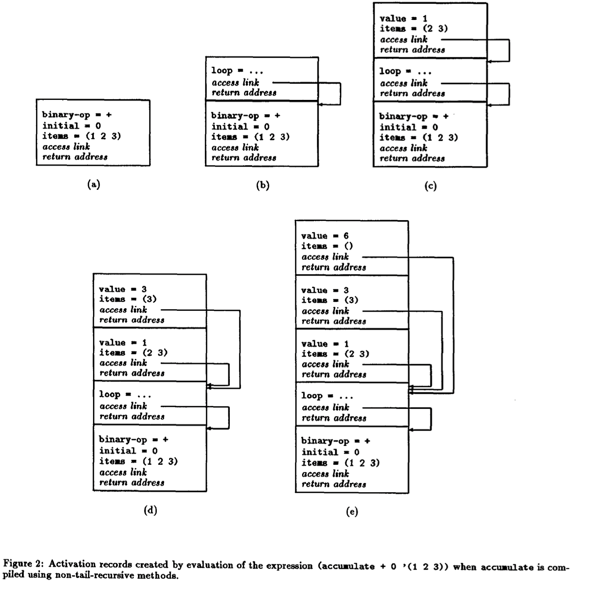

# Efficient Stack Allocation for Tail-Recursive Languages

- https://dl.acm.org/doi/10.1145/91556.91603
- 1990
```scheme
(define (f a)
  (define (g)
    a) ; fの引数aを参照
  (g))
```

- ↑のように，末尾呼び出しをしたフレームをすぐには破棄できないケースがあることについて議論している論文
- []
  - Activation records created by evaluation of the expression `(accuaulate + 0 '(1 2 3))` when accurtiate is compiled using non-tail-recursive methods.
