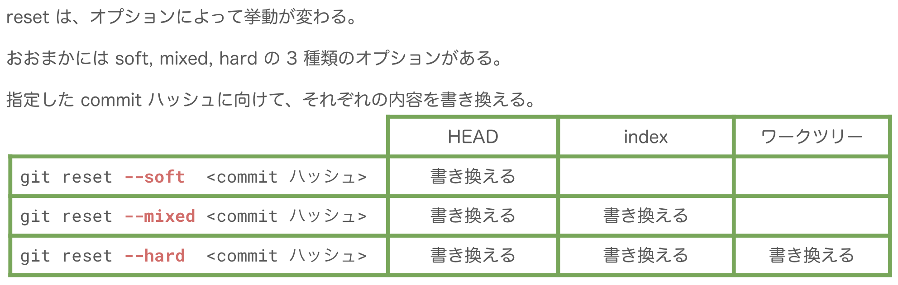

# Git

- [Git - Reference](https://git-scm.com/docs)
  - gitkeep
    - こんなかんじに書くと空のtmpディレクトリをadd出来る
**.gitignore**

```
tmp/*
!.gitkeep

git-cherrypick
 他のブランチの、特定のコミットの変更だけを適用できる
 コミットIDでそのコミットを反映させることができる

`git diff check`で余分な空白を教えてくれる

リモートブランチ foo を削除する
 `git push delete origin foo`

httpでのgitで、id, pwを$HOMEに暗号化して置いておいて、入力しなくてpushpullできるのがあるらしいけど面倒そう

`git commit --amend`
```

- なにか少し作業をして，それを直前のコミットに含めたいときにamendオプション
  - ローカルのコミット履歴を編集するためのrebase
    - `git rebase i HEAD~4`
    - pickとかfixupとかする．これらだけならこれで終わり
    - 順番入れ替えたりもできる。コレとp,s,f,eを組み合わせて、自在に履歴を操れる
    - editを選んでいたら面倒なことになる
  - gitのコンフリクト
    - マスターからhogeブランチを切って、そのマスターが気づけばすすんでいてpullしたらコンフリクトが起きたとき
    - masterから切ったのだから、hogeで手を付けてないファイルはマスターの内容に更新される
    - hogeで手を付けたやつは、コンフリクトが起きて、どっちを使うか選ぶやつが起こる
  - gitで作業を退避するときにメッセージを付ける
    - `git stash save "stash message"`
    - `git stash list`
  - 退避した変更の詳細をみる
    - `git stash show stash@{0}`
  - checkout f で現在の変更破棄して移れる。便利
  - リポジトリの過去を遡って要らないファイル消すには
    - [Git リポジトリに上がっているファイルを履歴ごと消すには？ Qiita](https://qiita.com/go_astrayer/items/6e39d3ab16ae8094496c)
    - バックアップ取ってからやろう
  - gitのauthorとcommiterの違い
    - authorはオリジナルのコードを書いた人
    - commiterはコミットした人
    - rebaseとかをしたときには、コミッターはそのrebaseした人になって、オーサーはそのコードを書いた人になる
  - masterの履歴を合わせるためのrebase
    - `git checkout mybranch`
    - `git rebase master`
    - `git push origin mybranch -f`
      - 既にpushしているときはforceにしないといけない
    - masterから遅れているかどうかは、bitbucketsのcommitの欄を見ればわかる
  - 部分的にコミット
    - [Gitで部分的にコミットする方法 - Qiita](https://qiita.com/miyohide/items/79ab0ff3b3852289a6be)
    - `git add -p myfile`
      - ynで答える
    - `git commit`
      - `-a`とかは付けない. `-a`付けると未stagingもstagingにしてコミットしてしまう.
      - `git diff --cached` でstageに載っているもの、`git diff`で載ってないものがわかる
  - force pullのようなことをするには
    - [Git で force pull する方法 ( $ git reset --hard origin/branch_name ) - Qiita](https://qiita.com/Yinaura/items/30992f25b87f76af3ba2)
  - pre-commitとは
    - [pre-commitでこんな自動レビューをしています！手戻りが少なくて最高！ - appbrew Tech Blog](https://tech.appbrew.io/entry/2020/05/15/132413)
    - >Gitには標準で、特定のタイミングでスクリプトを実行する機能があります。 pre-commitもその一つで、コミットの実行前に実行されます。 また、エラーを返すことでコミットを中断させることも出来ます。
  - マージコミットのみ
    - `--merges`
  - [Git submodule の基礎 - Qiita](https://qiita.com/sotarok/items/0d525e568a6088f6f6bb)
  - ワーキングディレクトリを過去のコミットにするには?
    - [git - How to set the working directory to an older commit? - Stack Overflow](https://stackoverflow.com/questions/16539779/how-to-set-the-working-directory-to-an-older-commit)
    - checkoutすればOK. 戻るにはmasterに戻ってから元のブランチに戻る
  - `-X ours`
    - 未マージの改修ブランチAから切って別のブランチBを作り、Aは進み、BはAを取り込みたいとき
      - 普通にrebase, mergeしてコンフリクトすると、全部A側を取る作業が必要で面倒
      - `merge -X ours branchA`のようにすると、全部A側を取るマージができる
    - ↑なんか勘違いしてるかも。今度ちゃんと調べる
  - developにだけマージされているブランチがあるときに、
    - masterから新しいブランチを切ってそのデプロイ中ブランチをrebaseして
      - develop宛にプルリクしたら
        - →コンフリクトする
```text
   master: A-B
  develop: A-B-DE
deploying: A-B-D-E
  feature: A-B-D-E-F

D,E: deployingブランチのコミット
F: featureブランチのコミット
DE: deployingブランチのsquashコミット
```

- コードの中身的にはプルリクの宛先に含まれているはずなのにdiffが出るときはこういった理由によるもの
- [ミクシィGit研修 (21新卒) - Google スライド](https://docs.google.com/presentation/d/1EwjQnoqzzYsijrMNEsWGAj54yfQlbr2mvuxrDtKl-Ww/edit#slide=id.gcda03b9aa0_1_3123)
  - 
- git-flow
  - master, develop, featureでやるとき
    - masterとdevelopが完全一致する地点を残しておくとよい
  - Epic branch
    - そこそこの大きさの機能をまとめるためのブランチ
    - >大きな機能の中にいくつものサブ機能があり、そのサブ機能を複数人で開発する。
      - [チーム開発で Epic branch を運用した話-フリューテックブログ | Furyu Tech Blog](https://tech.furyu.jp/p7121/)
    - `epic: 大作`
- `git rebase --onto`
  - master→A→B→C→D と来て、C→D は別プルリクにしたいようなときに使える
  - [git rebase --onto を使って、まずは自分だけ幸せになる - Qiita](https://qiita.com/kyanro@github/items/d0111b07022494457b75)
- `rebase -i` で指定を間違えたときは全部消せばOK
  - > `# However, if you remove everything, the rebase will be aborted.`
  - 普通に閉じるとコミットのハッシュ値が変わっちゃうから困ってた
- [Gitで間違ってPRをマージした時にRevertして再度PRを出す方法 - Qiita](https://qiita.com/Esfahan/items/d70dabbebed851bc6978)
  - 「マージコミット」をrevertするときは`-m 1`というオプションをつける
  - `$ git revert (revertしたいマージコミットのSHA) -m 1`
- [Gitで数個前のcommitを遡って分割する - 納豆には卵を入れる派です。](https://ken-c-lo.hatenadiary.org/entry/20130706/1373092204)
  - `git rebase -i` でN個目のcommitを`edit`に変える
  - `git reset HEAD~`する
    - 一つ手前のcommitに移動
    - 分割したいcommitの中のファイルがUnstageされる
  - addしてcommitし直す
  - `git rebase --continue`
- https://gitingest.com/
  - gitのリポジトリの要約をしてくれるサービス
- [コンフリクトしたときの --theirs と --ours · GitHub](https://gist.github.com/d-kuro/08ec0964107ae4c8bc074ed8162b63cc)
  - 相手の内容を一方的に取り込みたい
    - $ git checkout --theirs file
  - 自分の内容を一方的に取り込みたい
    - $ git checkout --ours file
  - **rebase中はtheirsとoursが逆になるので注意！**
