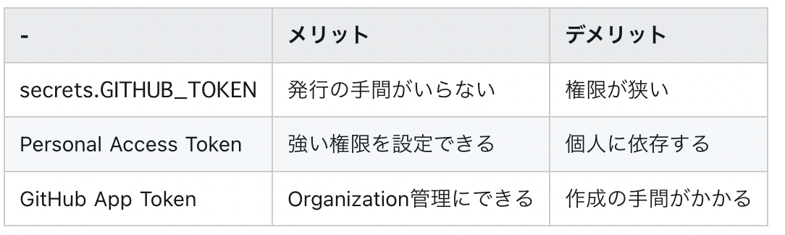

# GitHub

- PRの検索
  - https://docs.github.com/ja/github/searching-for-information-on-github/searching-issues-and-pull-requests
  - `base:feature_hoge` でfeature_hoge宛のPRのみに絞れる
- レビューするPRのみ絞り込むクエリ
  - `is:pr review-requested:(自分の名前) archived:false NOT in:title "リリース" `
  - ↑ 複数リポジトリを跨ぐときに困るから https://github.com/pulls/review-requested から見に行くのが手っ取り早いや
- githubにpushとかするときの認証
  - id/pw
    - そろそろ非推奨
  - id/アクセストークン
    - 推奨。アクセストークンを設定画面で作る
  - ssh越しのgitプロトコル
    - 公開鍵をgithubに登録すれば使える
- github actionsの入門
  - [入門 GitHub Actions - メドピア開発者ブログ](https://tech.medpeer.co.jp/entry/2021/06/24/100000)
- リリースの作り方
  - ソースコード中のバージョンを書いている箇所を、希望するバージョンに書き換えたブランチを用意する
    - 普通はPRを送って、main(= 希望するバージョンに書き換えたブランチ)とかにマージされれば準備完了
  - GitHub内のリリースページの、「Draft New Release」を押して、そのバージョンと同名のタグを作成&選択してリリースする
- (Gemなどを)リリース時に(Privateであっても)Publishするためには、CIでタグの作成とかをhookにしてrubygemsとかにpushされるようにする
- [GitHub APIのトークンの種類](https://zenn.dev/tsuruo/scraps/a4c223cd2a704f)
  - > GitHub APIを実行する場合に渡すTokenとしては主に以下の３つ
  - 
- `involves:@me` で、自分が関連しているチケットやPRが全て絞り込める
