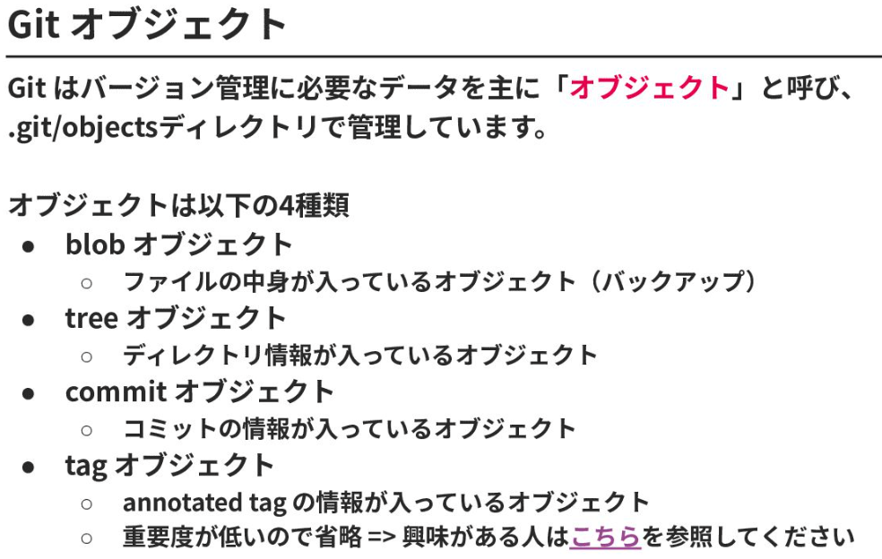
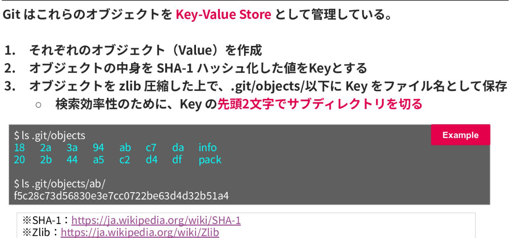
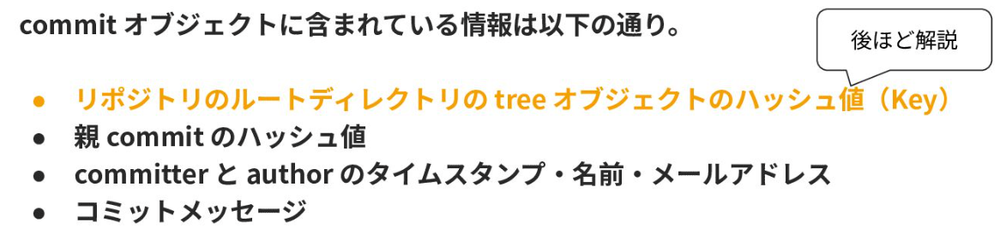
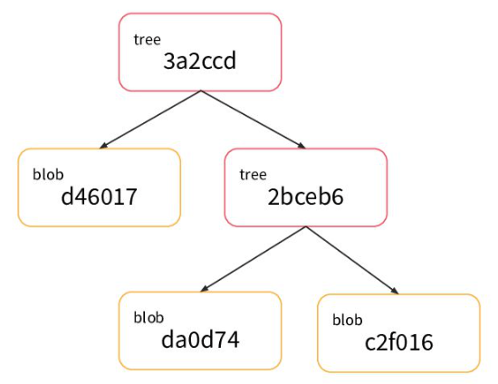

# Git 研修【MIXI 26新卒技術研修】 - Speaker Deck

- [Git 研修【MIXI 26新卒技術研修】 - Speaker Deck](https://speakerdeck.com/mixi_engineers/2026_new_grad_training_git?slide=71)
- 72ページから、Gitの内部構造の紹介をしている
- 
- 
  - commitオブジェクト
    - `git cat-file ...` で中身見れる
    - 
  - blobオブジェクト
    - 実際のファイルのバックアップ（差分ではなく全体を保持）
  - treeオブジェクト
    - バージョンごと(= 1回のコミットごと)に、git管理下のすべてのディレクトリに対応するtreeオブジェクトが(それぞれ)作成される
      - 1ディレクトリ：1treeオブジェクト の関係
      - treeという名前が若干ややこしい
    - 「パーミッション」「種類 (blobとか)」「Key」「ファイル名」のセットが沢山記録されている
    - 
