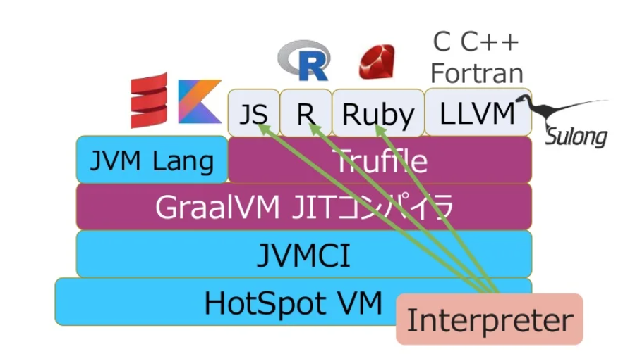
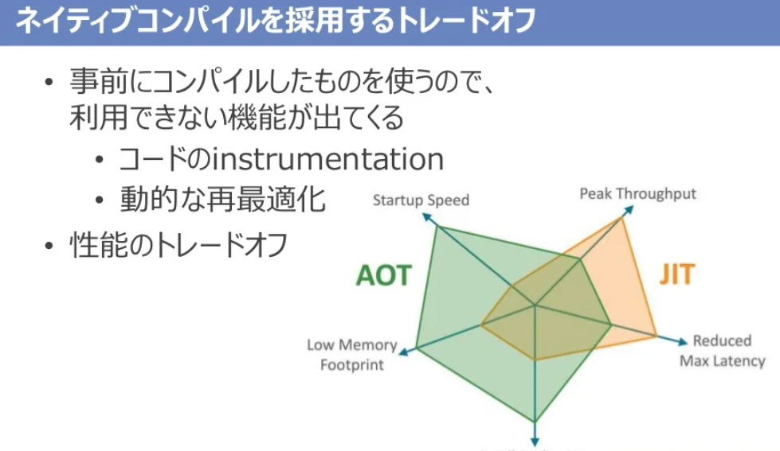

# Graal/Truffle

- [Graal/Truffleについて軽く | κeenのHappy Hacκing Blog](https://keens.github.io/blog/2017/12/13/graal_trufflenitsuitekaruku/)
  - Graal
    - JavaのJITエンジン
    - GraalVM
      - GraalをデフォルトでonにしたJavaのVM
  - Truffle
    - 自己最適化インタプリタ
    - JavaのASTインタプリタフレームワーク
    - 実行時にはGraalと連携して最適化
    - Truffleが行う最適化は自己最適化
      - ASTを実行中に書き換えることで高速化
    - TruffleRuby
      - >TruffleRuby is the GraalVM high-performance implementation of the Ruby programming language.
- [GraalVMを3つの主機能から眺めてみよう（Oracle Groundbreakers APAC Virtual Tour 2020 講…](https://www.slideshare.net/nttdata-tech/graal-vm-nttdata-sakata-oracle-groundbreakers-apac-virtual-tour-2020)
  - 
  - 
- Misreading Chat 07 で扱っている
  - https://misreading.chat/2018/05/03/episode-07-one-vm-to-rule-them-all/
  - > Truffle では個々のオブジェクト (AST のノード) ごとにメソッドの実行時プロファイルを集計
  - >Truffle では、文字列を扱う関数 F と数値を扱う関数 G の中で登場するプラス演算子の AST ノードがそれぞれ独立して実行時の情報を集めます
  - >Truffle はそうしたデザインを前提として、最適化のためのヒントである実行情報をAST のオブジェクトとの間でやりとりする API を提供しました。それらの API をある種の instrincis として特別に解釈し、ふつうのコンパイラにはできないような最適化が可能になるのです。
- [Rubyオブジェクトの未来をつくる「シェイプ」とは（翻訳）｜TechRacho by BPS株式会社](https://techracho.bpsinc.jp/?p=111656)
  - シェイプ
  - 最初に、オブジェクトのフィールドの探索についてMRIとJRubyの実装を紹介
  - >TruffleRubyでは、Rubyのメタプログラミングを最適化するために「ディスパッチチェイン（dispatch chain）」と呼ばれる新しい形のポリモーフィックインラインキャッシングを採用しています。
  - >主な違いは、シェイプはイミュータブル（不変）という点です。つまり、過去のある時点でどんなシェイプだったかがわかれば、以後そのシェイプに関するすべてを確実に把握できるようになります。しかもこの仮定はハードコードできます。
  - > また、シェイプはクラスから切り離されており2、同じクラスの2つのインスタンスがそれぞれ異なるシェイプを持つことも可能です。つまり、他のインスタンスが変更されたからといって背後のオブジェクトを変更する必要はありません。
