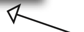
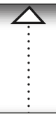

# Head First デザインパターン

- 矢印
  - (矢印先の親クラスを)継承する
    - 
  - (矢印先のインターフェースを)実装する
    - 
  - HAS-A (矢印元が矢印先を持つ)
    - 
- 紹介されているパターン
  - Observer
  - Decorator
  - Factory
  - Singleton
  - Command
  - Adapter, Facade
  - Template Method
  - Iterator, Composite
  - State
  - Proxy
  - Compound
  - 残り
    - Bridge
    - Builder
    - Chain of Responsibility
    - Flyweight
    - Interpreter
    - Mediator
    - Memento
    - Prototype
    - Visitor
