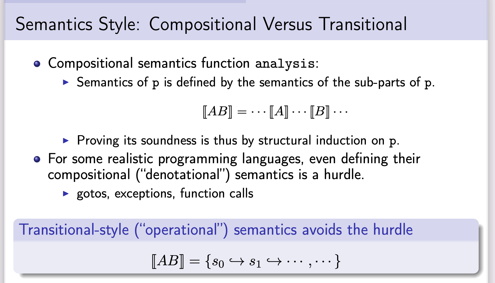
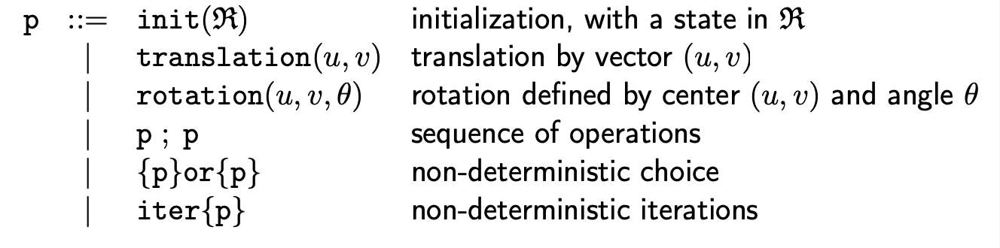
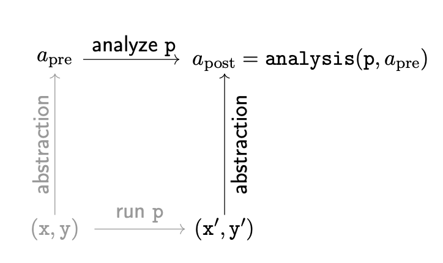
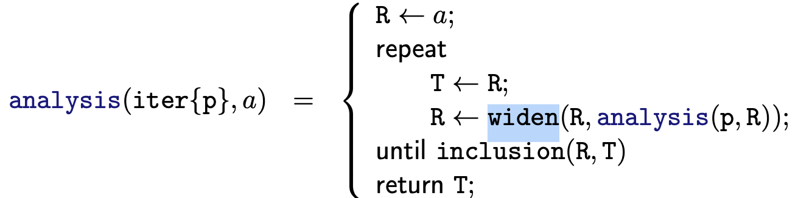
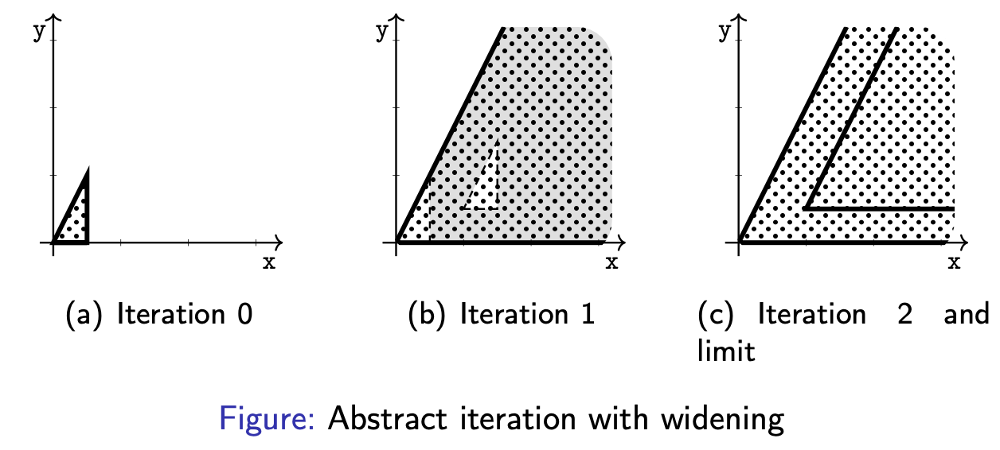
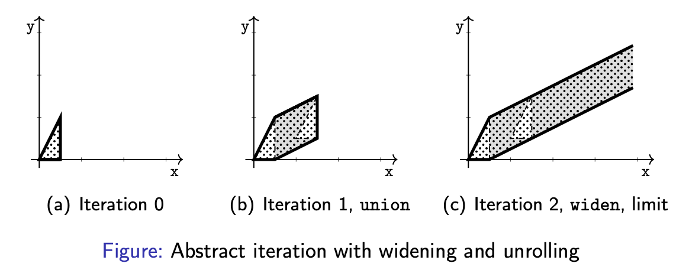
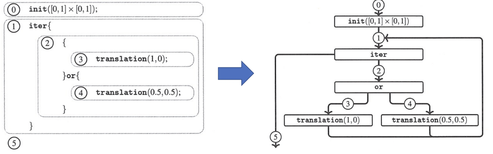
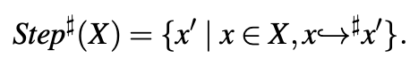

# INTRODUCTION TO STATIC ANALYSIS

- [Introduction to Static Analysis | The MIT Press](https://mitpress.mit.edu/books/introduction-static-analysis)
- STATIC ANALYSIS
  - http://kwangkeunyi.snu.ac.kr/#teaching
    - 著者のサイト
      - 「SSFT 2019 Introduction to Static Analysis」「SSFT2019 静的解析の概要」がそれっぽい
        - https://fm.csl.sri.com/SSFT19/#lecturers 「抽象的解釈の観点からの静的分析の紹介」
          - スライド https://fm.csl.sri.com/SSFT19/ssft19-kkyi.pdf
            - 
        - 部分的にならpdfのものを配っている？
          - https://fm.csl.sri.com/SSFT19/ssft19-kkyi-supplementary.pdf
  - 1章
    - 静的解析の目的
    - 静的解析が答えられる問題の種類を理解するための背景
    - プログラムに関する推論のための他の技法との比較
  - 2章
    - プログラムの意味論の抽象化
    - プログラムの静的解析
  - 3, 4章
    - 具体的な言語を例として，意味論，抽象化，抽象解釈の概念を説明
  - 5章
    - 高度な，抽象化と静的解析アルゴリズム
  - 6章
    - 静的解析ツールの実用的な使用方法，設定，解析結果の利用方法
  - 7章
    - 単純な静的解析器の実装
  - 8章
    - 3，4章よりも高度な言語についての議論
  - 9章
    - より複雑な意味的特性
  - 10章
    - 特定のプログラミング言語の特徴を利用して効率的な静的解析を構築する特殊なフレームワーク
  - 11章
    - 静的解析の主要な概念
    - 今後の研究のためのいくつかの道筋
    - 将来への課題
  - 付録A
    - この本で使用される数学的表記
  - 付録B
    - 各章で示されている定理の証明を集めたもの
- ---
  - 1 Program Analysis 1
    - 1.1 Understanding Software Behavior 1
    - 1.2 Program Analysis Applications and Challenges 2
    - 1.3 Concepts in Program Analysis 4
      - 1.3.1 What to Analyze 4
      - 1.3.2 Static versus Dynamic 6
      - 1.3.3 A Hard Limit: Uncomputability 7
      - 1.3.4 Automation and Scalability 8
      - 1.3.5 Approximation: Soundness and Completeness 9
        - 健全性と完全性
        - sound (健全な) analysis
          - 偽陽性のプログラムも陽性だと判定する。安全倒し
    - 1.4 Families of Program Analysis Techniques 12
      - 1.4.1 Testing: Checking a Set of Finite Executions 12
      - 1.4.2 Assisted Proof: Relying on User-Supplied Invariants 13
      - 1.4.3 Model Checking: Exhaustive Exploration of Finite Systems 14
      - 1.4.4 Conservative Static Analysis: Automatic, Sound, and Incomplete Approach 15
      - 1.4.5 Bug Finding: Error Search, Automatic, Unsound, Incomplete, Based on Heuristics 16
      - 1.4.6 Summary 17
    - 1.5 Roadmap 17
  - 2 A Gentle Introduction to Static Analysis 19
    - 2.1 Semantics and Analysis Goal: A Reachability Problem 19
    - 2.2 Abstraction 24
    - 2.3 A Computable Abstract Semantics: Compositional Style 31
      - compositional style: 構成していく感じ？
      - 抽象領域(abstract area)`a`
        - 抽象的な型のようなもの
        - 多角形とか
      - 具体化
        - 抽象領域を満たすプログラムの集合`γ(a)`
      - pはプログラム
        - 
      - pを抽象化するとaになる
        - 
      - `analysis: (p, a) -> a`
        - 
      - `widen: (a, a) -> a`
        - >  over approximates **unions** enforces finite convergence
      - ↑不動点を求めている
      - 例
        - 
        - 最初、a0が3個の直線による三角形で定義されていたとする(`／`, `＿`, `｜`)
        - a1の制約を求める
        - a0の制約のうち、a1に含まれるもののみを保持する(widen演算子)
        - 減らなくなるまで繰り返して、最終的に残ったものが`analysis`の結果
          - `／`と`＿`だけになる
        - しかし、最初(0回目)からこのアルゴリズムを行うと、過剰に見積もってしまう
          - 一回目は普通にunionをとって、二回目以降は上記のアルゴリズムを行うことで、ちょうどよい近似ができる
          - このやりかたをunrolling操作という？
          - 
    - 2.4 A Computable Abstract Semantics: Transitional Style 44
      - ステートメントラベル`l`
        - 
        - ①, ②とかがステートメントラベル
      - 点`p`
      - 動的なジャンプ構文については、4章で紹介
        - 動的：どこに飛ぶかが実行時に決まるという意味
      - `(l, p) \-> (l', p)`
        - ラベルlのプログラムが点pをp'に変換し、次のラベルl'に渡す
        - 点pは、translation操作を通過した際に変化する。iter, or操作を通過しても変化しない
      - 
        - 抽象状態Xをとり、次の抽象状態を返す
        - 抽象遷移
  - 3 A General Static Analysis Framework Based on a Compositional Semantics 59
    - 3.1 Semantics 60
    - 3.2 Abstractions 65
    - 3.3 Computable Abstract Semantics 74
    - 3.4 The Design of an Abstract Interpreter 92
  - 4 A General Static Analysis Framework Based on a Transitional Semantics 95
    - 4.1 Semantics as State Transitions 96
    - 4.2 Abstract Semantics as Abstract State Transitions 101
    - 4.3 Analysis Algorithms Based on Global Iterations 109
    - 4.4 Use Example of the Framework 112
  - 5 Advanced Static Analysis Techniques 119
    - 5.1 Construction of Abstract Domains 120
    - 5.2 Advanced Iteration Techniques 131
    - 5.3 Sparse Analysis 137
    - 5.4 Modular Analysis 143
    - 5.5 Backward Analysis 147
  - 6~11章は略
