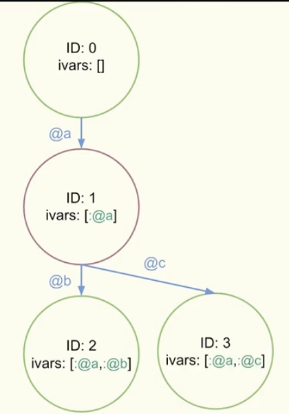

# Implementing Object Shapes in CRuby

- https://rubykaigi.org/2022/presentations/jemmaissroff.html#day2
- [https://www.youtube.com/watch?v=So-KvN3p-eE](https://www.youtube.com/watch?v=So-KvN3p-eE)
  - Object Shapes とは
    - Ruby Object shapes
    - オブジェクトのプロパティーのこと
      - インスタンス変数など
      - frozenかどうかなども
    - 別のクラスでも、インスタンス変数の名前と数が同じなら、同じshape
    - `ID:0, ivass: []`がroot shape
      - ivarが増えるごとに別のshapeへ遷移する
      - 
  - どう実装する?
    - `struct rb_shape`
      - 40bytes
      - `flags` ID, frozenのflag
      - `parent` 親へのポインタ
      - `edges`  id_table from ivars to next shapes
      - `ID edge_name`
      - `iv_count`
  - なぜMRIにObjectShapesが効くのか
    - 変数アクセス→ivarのハッシュテーブル→値
      - ハッシュテーブルのlookupが重い処理
    - キャッシュにヒットする率が上がる
    - 処理が軽くなる
      - 変数アクセスの際に、キャッシュの有無を調べるために、Classの比較ではなく、ShapeIDの比較をすれば良くなる
      - frozenかどうかの処理を、ShapeIDが不一致のときにのみ行えば良くなる
  - アセンブリレベルでも、命令の数が減り、メモリreadの回数も減る
  - Railsで2%くらいのパフォーマンス工場
  - 今後
    - https://bugs.ruby-lang.org/issues/18776
