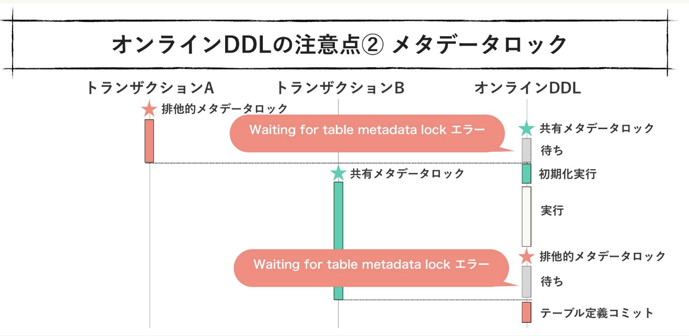
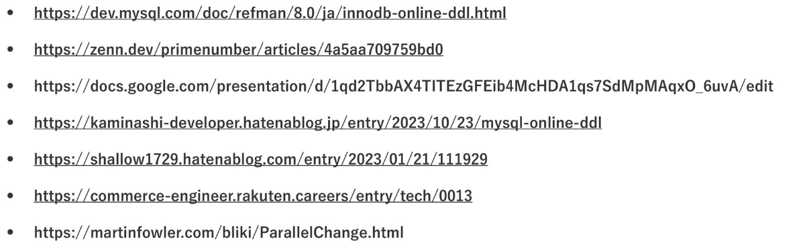

# Kaigi on Rails 2023

- [About - Kaigi on Rails 2023](https://kaigionrails.org/2023/about/)
- [Kaigi on Rails 2023 - Kaigi on Rails \| Doorkeeper](https://kaigionrails.doorkeeper.jp/events/161847)
  - ruby-jp/Kaigi on Rails 2023
  - [Startup Drinkup at Kaigi on Rails 2023 - connpass](https://youtrust.connpass.com/event/295807/)
  - [STORES CAFE〜Kaigi on Rails 2023出張版〜 - connpass](https://hey.connpass.com/event/297819/)
- ---
- **day1**
  - mybest
  - techhouse
    - [スケーラブルActive Jobs with Sidekiq Enterprise (Kaigi on Rails 2023 Day 1 スポンサーLT2) - Speaker Deck](https://speakerdeck.com/techouse/sukeraburuactive-jobs-with-sidekiq-enterprise-kaigi-on-rails-2023-day-1-suponsalt2?slide=60)
    - fargate
      - sidekiq job
      - ecs scale in protection
        - [Amazon ECS タスクのスケールイン保護の発表 \| Amazon Web Services ブログ](https://aws.amazon.com/jp/blogs/news/announcing-amazon-ecs-task-scale-in-protection/)
        - killしないことをawsに依頼できる
          - ミドルウェアで実装
  - gifty
    - 2年目のかたによるgiftee Portの紹介
  - 基調講演
  - Rails アプリの 5,000 件の N+1 問題と戦っている話
    - スライド：[BulletmarkRepairer: auto corrector for N+1 queries - Speaker Deck](https://speakerdeck.com/makicamel/bulletmarkrepairer-auto-corrector-for-n-plus-1-queries)
    - N+1の対策
      - preload
        - inを使う
      - eager_logads
        - left outer joinを使う
      - includes
        - よしな
        - [ActiveRecordのjoinsとpreloadとincludesとeager_loadの違い  - Qiita](https://qiita.com/k0kubun/items/80c5a5494f53bb88dc58)
      - bullet gem
        - N+1を教えてくれる
    - bullet mark repairer gem 作った
      - [makicamel/bulletmark_repairer: Auto corrector for N+1 queries detected at runtime with Bullet](https://github.com/makicamel/bulletmark_repairer)
      - includeを追加してくれる
      - どこでincludeするかを考えるのが大変
      - 普段どうしている？
        - 基本はController
      - どうやる？(どこで編)
        - view
          - スタックトレースにコントローラが無いので探せない
          - 対象のインスタンス変数はなんとなく(行はわかるので)わかる
          - それっぽいインスタンス変数の初期化箇所っぽいところを治す
          - 文字列操作なので正しさは保証できない
        - controller
          - これも文字列操作で見つける？
          - アクション→アクションが呼んでいるメソッド→コールバック の順で見に行ってそれっぽい箇所を治す
        - その他
          - そのファイルを治す
      - どうやる?(なにを編)
        - bulletが教えてくれているものを付け足す
        - 色々修正の種類がある
      - include vs preload vs eagerl_ogad
        - eagerl_ogad
          - メモリを食う
        - preload
          - INに入るidが多いと遅い
        - include
          - 動的にクエリが変わりうるので運用(クエリ分析)で困るかも
      - N+1との向き合い方
        - 見つける人と治す人を分ける
      - 解法まとめ
        - include系
        - exist?やpluck を使おう系
        - 本当に使うもののみ取ってこよう
  - 生きた Rails アプリケーションへの delegated types の導入
    - スライド：[生きた Rails アプリケーションへの Delegated Types の導入 (Kaigi on Rails 2023) (公開用) - Google スライド](https://docs.google.com/presentation/d/1Y5ZPVfNNLlTeE5VsT-JbpuWDgF_q1RF6wJHH8JAFV0w/edit#slide=id.gf559c2d176_0_136)
    - hako-console
      - ECSでデプロイされた色々を確認できるツール
    - (hako-consoleを)aws-lambda対応したい
      - (ecsの他に)lambdaも使おうとなった
      - lambdaに対応するためにデータの構造を変える必要があった
    - ECS固有のテーブルのカラムがある。どうする？
      - STI
        - 複数のモデルで1つのテーブルを共有
        - クエリはシンプル
        - コードも直感的
        - 無駄なnullが生まれる
        - not null制約をかけられない
      - delegated type
        - rails 6.1~
        - STIの代替
        - ポリモーフィック関連っぽい
        - 子テーブルがhas_oneで親テーブルを持つ
      - どうdelegated typeに移行したか
        - (略)
      - 気づき
        - 移行時に考えたこと：細かくやる
        - インターフェースが直感的になってgood
        - Baseという命名だと、継承っぽい命名になる
          - 継承ではなく「関連」
        - 共通用テーブルに外部キー制約をかけられなくなった
          - SQLアンチパターンに該当...
  - Exceptional Rails
    - [Exceptional Rails - Speaker Deck](https://speakerdeck.com/willnet/exceptional-rails)
    - 例外との付き合い方
      - いつ例外を発生させるか
        - (発生させなくても)問題ないときは発生させないほうがいい
          - フローが分かりづらくなるため
            - 特に、すぐ直近にrescueが無いようなとき
          - ifなどの分岐と比べて遅い
        - 正常系、準正常系、異常系
          - 準正常系
            - バリデーションエラーなど
          - 異常系
            - DBサーバーへの接続に失敗など
        - 原則として「異常系」で例外を発生させる
          - 例外的に、上位でやってもらったほうが簡単になるケースではOK(`find`とか)
      - どのようにrescueするか
        - 具体的にrescueする
        - begin~rescueは狭くする
      - どんな例外をどう通知
        - `Rails.error.handle(例外クラス) do`という書き方がある
          - [Rails アプリケーションのエラー通知 - Railsガイド](https://railsguides.jp/error_reporting.html#%E3%82%A8%E3%83%A9%E3%83%BC%E3%83%AC%E3%83%9D%E3%83%BC%E3%82%BF%E3%83%BC%E3%82%92%E5%88%A9%E7%94%A8%E3%81%99%E3%82%8B)
          - ユーザー的にはエラーは握り潰して、開発者的には通知させるようなコードが書きやすくなる
        - エラーを通知するかどうか判断
          - 起きる状況を考えてみる
          - 対応できないこと(外部サービスの不具合など)が原因で起こるエラーは通知させないようにする
            - wariningなどのレベルにして、wariningがたくさん来たら初めて通知する、のようにするとよい
      - どうエラーをユーザーに出すか
        - rescue_fromは特別な場合(認証失敗)などでつかうとよい
      - [Exceptional Railsの発表内容について - 未分類 - clean-rails.org](https://discourse.clean-rails.org/t/topic/364)
    - 目次、具体例、大きなコード、完結な説明文
  - Update Billion Records
    - [Update Billion Records - Speaker Deck](https://speakerdeck.com/ta1kt0me/update-billion-records)
    - backend/SREチーム
    - 数10億レコードのカラムにidを入れていく
    - やること
      - テーブルは1つ
      - 50~60億
      - 更新期間中もserviceは動かしたい
    - backend構成は一般的なモノリス
    - 以前は？
      - rails runnerで複数プロセスを動かして並列に更新していた
    - 課題など
      - 70min/1000万件
        - ふつうにやると1ヶ月...
      - 更新処理を途中で中断できるようにしなければならない
      - id にsnow flake id を利用
        - 時系列でソートされたUUID
        - 更新期間の指定のムラ
        - 最近の一定期間はユーザーが多いが、昔の一定期間はユーザーが少ない
    - 改善アイデア
      - (rails runnerではなく)Sidekiq Workerで処理する非同期jobにする
      - 並列に分けるやりかたもいい感じに分ける
    - DBに低負荷でやりたい
    - job数の制限もしたい
    - 全部一括停止機能もほしい
    - 自分自身が次の新しいjobを登録する方式？にした
    - 結果
      - 40分/1000万
      - 実行中もリリース可能になった
    - 学び
      - 大量データには時間がかかる
      - 小さく試して改善を回す
      - 改善のヒントは潜んでいる
    - 他事例への適用
      - 場合による
      - READよりWRITEが多いケースだとLockが発生して使えなかった
  - Simplicity on Rails - RDB, REST and Ruby
    - シンプル：サービスとしてやりたいことと、記述するコードの差が少ない状態
    - Rails「compress the complexity of modern web apps」
      - Railsが得意とするような設計に落とし込む
    - ふつうのサービスはscafloldじゃ機能不足。そのギャップをどう埋めるか。
    - **RDB: DB設計におけるイベントエンティティを見出す**
      - イベントエンティティをhas_manyで持つ
      - リソースエンティティ(テーブル)とイベントエンティティ(テーブル)に分ける
      - 多対多の関連付けを作る
      - 「楽々ERDレッスン」で練習
      - イベントエンティティを見出すことで...
        - 「登録したこと」をコード上で表現できる
        - 別のイベントに関連付けられる
      - 命名が難しい
        - 動詞の名詞形をつかうことが多い (registratonなど)
        - `~ing`みたくするのもあり
    - **REST: DBが表現したものをユーザーが扱えるようにする**
      - 「リソースなるものをHTTP経由でCRUDする」というマインドセットが難しい
      - RESTとRDBのCRUD操作が似ていなくても大丈夫
      - コト(イベントエンティティ)をリソースとして扱う
        - 登録のような操作はregisterのようなアクションを生やすのではなくて、createアクションで行う
        - コトのnewとは
          - のちに登録画面が必要になってきたところでnewを使えばいい
      - ログインやログアウトを「セッションのcreate/delete」として表現している慣習とかもまさにそう
        - coolなサンプル
    - **Ruby: UIとイベントエンティティの構造が異なったらどうする？**
      - RESTfulなフォームとDB間の違いを吸収する
      - 登録処理の前後処理を増やしたいようなとき
        - ActiveModelを使って、同じようなインターフェースの別レイヤーを作るのが良い
          - 同じようなインターフェース：Hashもどきを渡すだけでよいようなもの
```rb
@form = RsesigstationForm.new(...)
```

- 途中で変えたくなったらリファクタリングすればよい
- Turbolinksアレルギー患者に捧げるTurbo & Stimulusでの時短実装術
  - https://speakerdeck.com/lnit/kowakunai-hotwire-kaigi-on-rails-2023
  - turbolinks
    - トラブル多かったから外す人多かった
    - turbolinksつらたん。。。
  - hotwire
    - turbo
    - stimulas
    - strada
  - ヤクチエ
    - 他社から譲り受け
    - 実際は裏側の再スクラッチ
    - 時短をしなくては...! → Hotwire
  - hotwire
    - ブラウザにjsonではなくhtmlを送る
    - Stimulus
      - turboで対応できない制御をサポート
    - Strada
      - モバイル向けなので割愛
    - → リッチ！なのに時短...？
  - よくある要件1
    - 「フォームに確認画面が必要！」という要件
      - 普通のviewだと画面が遷移するとフィールドがけてしまうので対応が必須
    - hotwireで対応
      - 例えば、モーダルダイアログを出せばよかったりする
      - `turbo_stream.update`することで、DOMの差し替えができる
      - 取り消す場合はモーダルを外すだけでいい
    - hotwire無しだと、ユーザーの入力全てを再現する必要がある
      - 複雑なフォームだとその再現が超大変
      - hotwireならこの処理をしなくて良くなる
  - よくある要件2
    - 「フォームの動的な切り替え」という要件
    - StimulusControllerにJSの処理を定義できる
    - `tubro_stream.update "store-dadio" do`のように書ける
  - 本番利用に向けてのTips
    - いつどんなときに採用するのか
      - jsが小さい時
      - Vue, Reactほど細かいことはしなくていいとき
      - フロントに労力をさけないとき
    - iOS14だと動かないので注意!!
      - OSバージョン＝safariバージョンなのでつらみ
    - turboを消すと消すと連続submitが起きてしまう
- 定数参照のトラップとそれを回避するために行う2つのこと
  - 定数探査アルゴリズム
- Active Record クエリクイズ
  - 初学者向け
  - ARが発行するSQLはなにか知ろう？
  - クイズだよ
    - 2種類のコードを見せるよ
  - Q1
    - selectかwhereか
    - 遅延評価。to_a時点で初めてクエリが発行される
    - selectを使ったほうが良い例
      - なんどもselect(=filter)するならallで取ってインスタンスを使い回す方が早い場合もある
  - Q2
    - exist? vs any?
    - 取ってくるデータの差が生み出す
    - ARはそれ(existやconnt)用のMethodを用意していることがおおい
    - AbsstructtSyntaxTreeeで良い子は真似してはいけない黒魔術
  - Q3
    - ループの外側でクエリは発行したほうがいい
    - tips: ActiveRecordのcache機能を使えばそんなに時間かからなくなる
      - クエリログに`CACHE`と出る
      - キャッシュ無しだと43倍、キャッシュ有りだと4倍遅くなる
      - 4倍程度なら(リファクタつらいなら)許容という判断もあり
  - Q4
    - キャッシュが効かない例
    - キャッシュは、インスタンスの
    - ARのオブジェクト作成のコストがかかる
  - https://github.com/pocke/kaigi-on-rails-2023
- **day2**
  - 返金処理を通して学ぶ、カード決済電文の沼バトル
    - SMART BANK, B/43
    - [返金処理を通して学ぶ、 カード決済電文の沼バトル -kaigi on rails 2023 - Speaker Deck](https://speakerdeck.com/hirotea/numa-battle-of-card-transactions)
    - カード決済について
  - 1. 実装した機能
    - 明細分割
  - 2. 決済処理の仕組み・実装方針の検討
    - 方針
      - 取引履歴テーブルのサブレコードテーブルを作ろうかな
    - 要件：返金側のケアも要るよ！
  - 3. 返品・返金処理
    - 売上と同じような不ローデ返金処理も行われる
  - 4. ケア
  - 5. 沼
    - 処理の到着パターンが色々ある
    - 部分返金という処理もある
    - 海外事務手数料もある
    - 為替変動もある
  - 6. vs沼
    - フローを書き出した
    - 全パターン列挙(数十パターン)
  - 7. まとめ
  - 32個のPRでリリースした依存度の高いコアなモデルの安全な弄り方
    - [32個のPRでリリースした依存度の高いコアなモデルの安全な弄り方 - Speaker Deck](https://speakerdeck.com/shoheimitani/32ge-noprderirisusitayi-cun-du-nogao-ikoanamoderunoan-quan-nanong-rifang)
    - 話題
    - 1. MySQLのオンラインDDL
    - 2. アプリケーションの作りを意識した安全なテーブル定義の変更手順
    - 取引履歴テーブル
      - でかい
      - read/writeも多い
      - 案件「ポイント(カラム)に無期限と期間限定の種類を付けたい」
    - やりたいこと
      - カラムの変更と新カラム追加
      - 既存APPの実装を置き換え
      - 無停止でリリース
    - rails 7 & MySQL 8
    - オンラインDDL
      - MySQL 5.6~
      - 特別な設定は必要なしにオンラインDDLになる
        - どのような操作が対象かはMySQLのドキュメント参照
    - 注意1: 対象外になるケース
      - まとめて実行する処理のうち、のどれかが対象外だと全体的に対象外
      - 5.5以前に作ったテーブルに対しては適用できない
      - generated columnが存在するテーブルに対しては適用不可
    - 注意2: メタデータロック
      - 初期化→実行→コミット
      - 
      - 他の、ロックを取るトランザクション(上記図のAやB)があるとエラーになってしまう
    - 注意3: その他
      - 省略とのこと
    - 考えたこと2つ目
      - ECSのblue-greenデプロイの仕組み的に、状態が不一致する期間がある...
        - 古いアプリから新しいDBにアクセスしてしまうことに...
        - カラムのrenameできない
      - 同じコードを色々な場所(API, JOB, etc...)にデプロイするので、状態不一致の考えることが多い
      - レビューも大変(PRが巨大になる)
      - カラムは「変更」ではなく、「(新しいのを)追加→置き換え→(古いのを)削除」で置き換えることにした
    - リリース手順
      - PR1: カラムの追加
      - PR2: 値の同期
        - 新旧両方カラムを埋める
      - バックフィル
        - = 過去データの補完
        - タスクでやる
        - 昨日の「update billilion record」参考になるかもらしい
      - Not Null制約の追加
      - 参照を置き換え
        - アプリケーションコードを置き換えていく
        - 古いカラムを使っている箇所を消す
      - PR6: 同期の停止
        - ここは失敗したらリカバリーが大変なので慎重に(よーくテスト書こう)
      - ignored_columns
      - カラムの削除
        - (念のため&開発環境用に)remove_column時の型の指定を忘れずに
    - strong_migrations というgemがある
      - [strong_migrations gemのススメ - Money Forward Developers Blog](https://moneyforward-dev.jp/entry/2022/10/13/suggestion-strong-migrations-gem/)
    - 参考文献：
  - Multiple Databasesを用いて2つのRailsプロジェクトを統合する
    - pixivノベルとpixivコミックの統合
    - コードは一元化、DBは複数のまま
    - DBスキーマをコミックに移す
      - ノベル→コミックに色々コピー
        - スキーマ
        - 接続設定
        - db/novel_migrate/* にマイグレーションを移す
          - `rails db:migrate:primary`
    - モデルのネームスペースを見て繋ぐDBを切り替える
  - 管理機能アーキテクチャパターンの考察と実践
    - [管理機能アーキテクチャパターンの考察と実践 / Learn Architecture through Admin - Speaker Deck](https://speakerdeck.com/ohbarye/learn-architecture-through-admin)
    - 後回しにしがち
      - 価値に直結しないから
    - アーキテクチャ
      - 密結合させる
        - 楽
        - これ系のgemは充実している
        - スタートアップとかなら強い
        - そのまま大きくなると大変
      - 管理機能向けのbackendを再利用
      - マイクロサービス化
        - ドメインが一致しているならわざわざ分離させる必要ない
      - アンチパターン：マイクロサービスで共有データベース (Distributed Monolith)
  - APMをちゃんと使おうとしたら、いつのまにか独自gemを作っていた話
    - はじめに
      - APM: new relic, datadog など
      - APM導入後、放置というのがあるある
      - leaner社ではどうやっているかを消化い
    - APMの使い方
      - 全体
        - リクエスト数や応答速度などを見る
        - 異常値が合った場合はトリアージ
      - エンドポイントごと
        - 重くなったもののみを見る感じ
    - パフォーマンス・チューニング
      - N+1
        - 細切れになっている場所はN+1の可能性
      - スロークエリ
        - 長いとき
        - EXPLAINしよう
    - gem作った
      - 困ること
        - どのMethodがsqlを発行したかわからん
        - Rubyの処理が重い場合、自動で区切ってくれないので対処ができない
          - `Datadog::Tracing`はインターフェースが使いにくい
      - APM Traceable gem
        - apm_traceable, apm_traceable-datadog の2つのgem
      - しくみ
        - prepended Moduleとかをつかったメタプロ
    - 具体的な事例
      - 事例1
        - 5.7→8.0にしたとき遅くなった
      - 事例2
        - 外部API呼び出し
        - パースが重かった
          - did you mean が重かった...
            - name errorが多発して、did you meanが多発していた...
  - 数十億のレコードを持つ5年目サービスの設計と障害解決
    - [数十億のレコードを持つ 5年目サービスの 設計と障害解決 - Speaker Deck](https://speakerdeck.com/knr/shu-shi-yi-norekodowochi-tu-5nian-mu-sabisuno-she-ji-tozhang-hai-jie-jue)
    - Palcy(漫画アプリ)の開発
    - DAU30万
    - 履歴テーブルがでかい
      - 0時が一番リクエストが多い
  - 1. キャッシュを使う
    - WebAPIで同一のデータを使うもの
      - ユーザーに関わらないようなデータ
    - Active Model Serializer
      - expire期間もしていできる
    - railsのバージョンが古いときのキャッシュを新しいバージョンで使うバグとかもある
      - しっかり監視しよう
    - Redisの容量対応
      - 本番データをコピーして、Redisinsightを使って調査
      - 無駄に多くキャッシュしないようにしよう
  - 2. 不要なデータは使わない
    - 特定ユーザーによるスロークエリがある
      - 長期間利用しているユーザー
      - お気に入り機能が重かった
    - 対応
      - 最初は100件のみ出して、もっと見たい人へは全件見せる
        - ほとんどのユーザーはお気に入り100件もあれば十分
  - 3. テーブルの形を適切にする
    - DBの型エラー
      - int→bigintにしないと治らない
    - 他の箇所も直したいので、auto_incrementなカラムを全列挙
    - 初期対応は機能停止
    - 恒久対応
      - 新テーブルを作る
      - batchとafter_commitで新テーブルにデータを移して、最後にrename table
      - pt-online-schema-changeではだめなのか？
        - すでに実績が合った手法を使った
  - Railsアプリにパスワードレス認証を導入した知見
    - パスキー
      - WebAuthnの拡張
      - スマホやYubikeyで認証
    - 仕様等の参考情報
      - Googleのチュートリアルもある
      - RFCもある
    - 導入
      - 登録：公開鍵を生成、登録する
      - 認証：秘密鍵で認証する
    - webauthn gemでできる
    - ブラウザによっては未対応のものあり
  - Hotwireを使って管理画面を簡単にプチSPA化する
    - [yamataka22/kaigionrails2023-admin-modal: Kaigi on Rails 2023 Day2「Hotwireを使って管理画面を簡単にプチSPA化する」のサンプルコード](https://github.com/yamataka22/kaigionrails2023-admin-modal)
    - 一覧ページから詳細ページを開くとき、モーダルで開けば戻ったときに状態が保持される
    - TurboFrame + Stimlus
  - 基調講演 A Decade of Rails Bug Fixes
- 聞こう
  - テーブル分割で実現するdeviseの責務の分離と柔軟な削除機構
