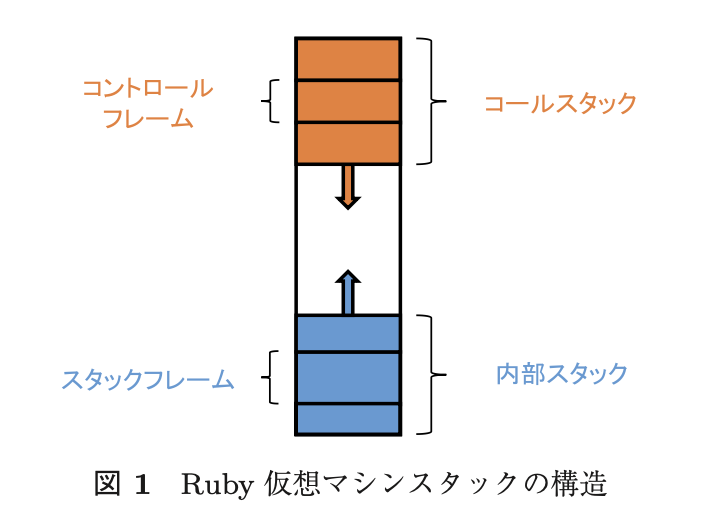
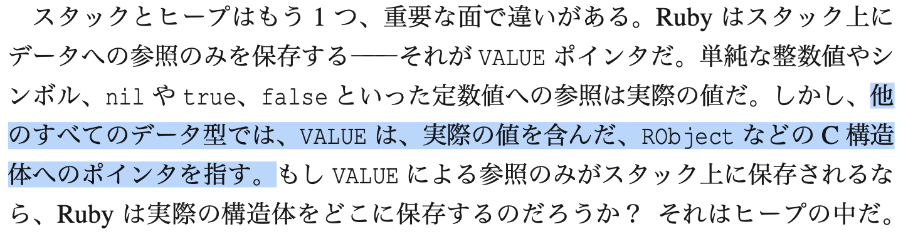

# MRIのスタックフレーム

- MRIの末尾呼び出し最適化やMRIのメソッド呼び出しやRubyのしくみも参考に
  - Ruby仮想マシンにおけるスタックの自動拡張より
    - 
      - 底が0番地
  - 内部スタックは1要素のサイズが`*VALUE`
    - **値は実体ではなくて参照を持っている**
    - 
    - Rubyのしくみより
  - `rb_control_frame_struct`
    - https://github.com/tetetratra/ruby/blob/5f8c73405ec9c5a642b208b23bf1b55b8e8f2045/vm_core.h#L826-L840
**vm_core.h**

```
typedef struct rb_control_frame_struct {
    const VALUE *pc;		/* cfp[0] */
    VALUE *sp;		      	/* cfp[1] */ // 評価スタックのtopを指すポインタ
    const rb_iseq_t *iseq;	/* cfp[2] */
    VALUE self;		    	/* cfp[3] / block[0] */
    const VALUE *ep;		/* cfp[4] / block[1] */ // 評価スタックの環境を指すポインタ
    const void *block_code; /* cfp[5] / block[2] */ /* iseq or ifunc or forwarded block handler */
    ...
} rb_control_frame_t;

```

- [RubyVM: メソッド呼び出し - nownab.log](https://blog.nownabe.com/2016/11/19/531.html/)
  - https://github.com/ruby/ruby/blob/202bbda2bf5f25343e286099140fb9282880ecba/vm_dump.c#L28
  - `control_frame_dump(ec, ec->cfp)`でコントロールフレームを出力してくれる(デバッグ用)
    - minirubyだとractorのエラーが出てコンパイルエラーになる
- [YARVアーキテクチャ](http://www.atdot.net/yarv/yarvarch.ja.html)より(2005年時点)
  - フレーム、「メソッドフレーム」「ブロックフレーム」「クラスフレーム」の3種類
  - 各フレームの構造
```flame
　　　　　　　　　　　　　　　　　　　    　　　　<- 継続フレーム ----->
     <-  引数  -> <-  変数  ->        <- 制御フレーム　---------------->
-------------------------------+-----+-----------+----------------------+----
self a1 a2 ... aM l1 l2 ... lN | XXX | self iseq | MAGIC pc cfp lfp dfp | ...
-------------------------------+-----+-----------+----------------------+----
                                       ^
                                       cfp
```

- selfは`cfp[0]`
- iseq
  - 命令列の情報
  - `cfp[1]`
- 継続フレーム
  - 前のフレームの情報が入っている
  - そのスコープから抜けるときに継続フレームの情報をレジスタに欠き戻す
- MAGIC
  - そのフレームの種類をしめす値
  - 今のyarvには無い？ 今は`type`という名前?
- **メソッドローカルフレーム**
  - メソッドを起動するごとに生成
  - 独立したスコープ を持つ
```flame
-------------------------------+-----+-----------+----------------------+----
self a1 a2 ... aM l1 l2 ... lN | blo | self iseq | MAGIC pc cfp lfp dfp | ...
-------------------------------+-----+-----------+----------------------+----
                                 ^     ^
                                 lfp   cfp
                                 dfp
```

- a1 から aM
  - M個のメソッドの引数
- l1 から lN
  - N個のメソッドローカル 変数
- selfはレシーバ
- ローカル変数には、`lfp[-X]` という形でアクセス
- **ブロックローカルフレーム**
  - ブロックが Proc#callやyield などにより起動されたときにできるスコープを表 現するためのフレーム構造
  - ブロックを起動したごとに生成
```flame
（メソッドローカルフレーム）
-------------------------------+-----+-----------+----------------------+----
self a1 a2 ... aM l1 l2 ... lN | blo | self iseq | MAGIC pc cfp lfp dfp | ...
-------------------------------+-----+-----------+----------------------+----
                                 ^
                                 lfp

（ブロックローカルフレーム１）
-------------------------------+-----+-----------+----------------------+----
self a1 a2 ... aM l1 l2 ... lN | pre | self iseq | MAGIC pc cfp lfp dfp | ...
-------------------------------+-----+-----------+----------------------+----

（ブロックローカルフレーム２）
-------------------------------+-----+-----------+----------------------+----
self a1 a2 ... aM l1 l2 ... lN | pre | self iseq | MAGIC pc cfp lfp dfp | ...
-------------------------------+-----+-----------+----------------------+----
                                 ^     ^
                                 dfp   cfp
```

```ruby
def m(a1, ..., aM)
  l1 = ...; ...; lN = ...;
  method_foo(){|...|
    # Block1
    method_bar(){|...|
      # Block2
      ...(running)...
    }
  }
end
```

- `dfp`
  - ブロッ クローカル変数をアクセス
- `pre`
  - フレームを遡る
- **クラスフレーム**
  - クラス定義、モジュール定義の場合に生成
  - スコープは独立
```flame
-------------+-----+-----------+----------------------+----
l1 l2 ... lN | nil | self iseq | MAGIC pc cfp lfp dfp | ...
-------------+-----+-----------+----------------------+----
               ^     ^
               lfp   cfp
               dfp
```

- 引数とブロックが無い
- self
  - その定義中のクラス・モジュールのインスタンス
