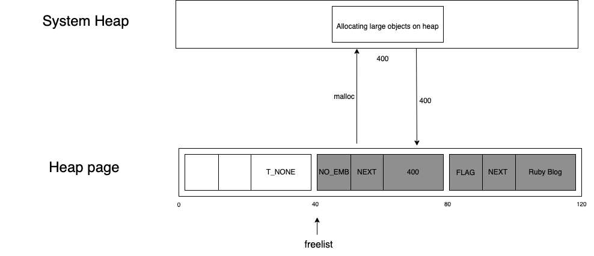

# MRIのメモリ管理

- [Rubyのメモリ管理方法2: Ruby 3.1の文字列の可変幅アロケーション（翻訳）｜TechRacho by BPS株式会社](https://techracho.bpsinc.jp/?p=118447)
  - ヒープページ(400個強のRVALUE(1個40byte)のリスト)に入らないオブジェクトは、mallocでメモリが確保される
  - オブジェクトの値の情報の16バイトはヒープページに入り、残りはmallocで確保されたメモリに入る
    - つまり 40 - 16 = 24byte より大きいオブジェクトのときにmallocが呼ばれる
  - >システムヒープのアドレスをスロットに保存してフラグの値を`NO_EMBED`に設定
- 
  - 可変幅アロケーション
    - VWA
    - >このプロジェクトの主な目的は、Ruby全体のパフォーマンス改善です。従って、コンテンツをRVALUEの直後に直接配置することでキャッシュの局所性を高めるとともに、ヒープ内で動的サイズのスロットをアロケーションすることで、高価なmallocシステムコールの呼び出しを回避できるようになります。
    - 40, 80, 160, 320 byteごとにサイズプールが確保される
      - サイズプール：そのN byteヒープページのコレクション
    - ヒープページに入らないオブジェクトは、ギリギリ入るサイズのサイズプールから1個とってきてそれを使う
  - つまり
    - 小さいものはヒープページに入る
      - 中身も埋め込まれる
    - Class, Stringの大きいものは、可変幅アロケーションで確保された、ちょうどよいサイズのサイズプールに入る
    - 他のものはmallocでメモリが確保されて、(通常の)ヒープページに値のメタデータとそのメモリアドレスが入る
  - そもそもRubyになぜ保守的GCが必要なのか
    - https://i.loveruby.net/ja/rhg/book/gc.html で詳しく解説している
```c
static int
f(void)
{
    VALUE arr = rb_ary_new();
    /* ……いろいろする…… */
}
```

- 要件
  - ただ(Cの)変数に入れておくだけでそのオブジェクトは保護される(markされる)
- そのためには
  - CPUのレジスタやマシンスタックをGCのルート扱いする必要がある
- 実装
  - レジスタに入っている値を覗くには
    - setjmpの仕様を悪用してレジスタの値を取得している
  - どのCPUのレジスタやマシンスタックをmarkするか
    - VALUEっぽいものは安全に倒して全部markする
    - VALUEっぽいもの：
      - >1. RVALUEがあるアドレスの最下端と最上端の間にあるか調べる
      - >2. 各ヒープの範囲内にあるかどうか調べる
      - >3. その数値がRVALUEの先頭を指しているかどうか確かめる
- 保守的GCによる問題
  - (VWAなどで) オブジェクトのアドレス(= VALUE)を移動したくても、それが本当にオブジェクトのアドレスなのか(もしかしたらCの整数やVALUE以外のアドレスかも)確信が持てないからアドレスの移動ができない
    - 「動かせないオブジェクトだ」というマークを行う
