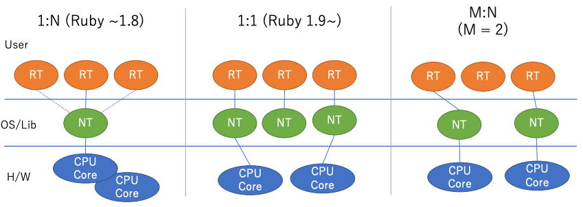
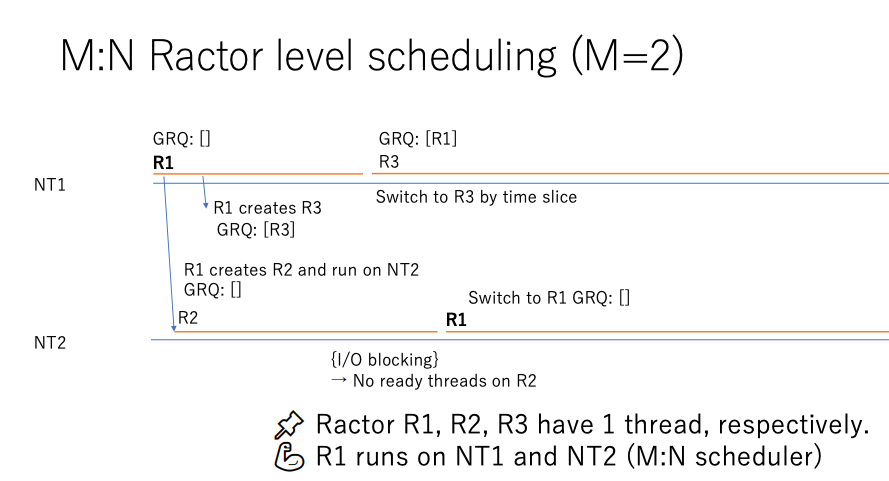
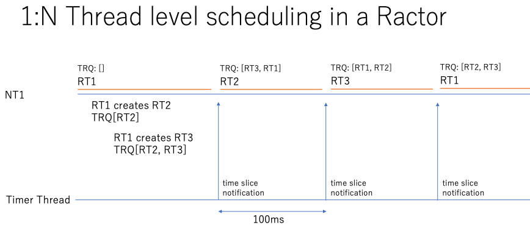
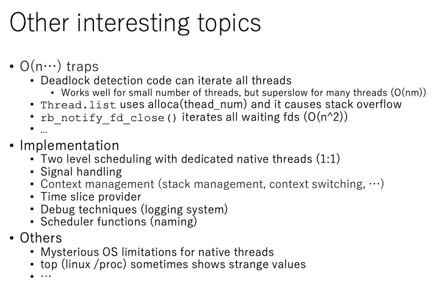
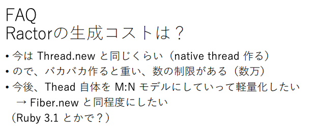

# Making MaNy threads on Ruby

- 後日談(本人によるブ解説)
  - [Rubyの並列並行処理のこれまでとこれから - クックパッド開発者ブログ](https://techlife.cookpad.com/entry/2023/08/31/152511)
- >Goal: Make MANY **threads** (> 100K)
  - https://rubykaigi.org/2022/presentations/ko1.html
  - [https://www.youtube.com/watch?v=G0LX53QJdBE](https://www.youtube.com/watch?v=G0LX53QJdBE)
  - [RubyKaigi2022 参加記  - Making *MaNy* threads on Ruby (Day 1) | Wantedly Engineer Blog](https://www.wantedly.com/companies/wantedly/post_articles/430779)
  - many = 100K
  - Rubyのスレッドの歴史
    - 
  - 1:N
    - 並列ではない
      - (並行ではある)
  - 1:1
    - 並列
    - ブロッキング操作の管理を簡単に行える
    - OSのスレッド機構のスケジューラーにべったり
      - OSのスレッド機構では100K個のスレッドを作れない
  - M:N
    - ブロッキング操作の管理が難しい
    - 「ネイティブスレッド1でRubyスレッド1を動かしていたが、途中からはネイティブスレッド2で動かす」のような管理が必要
  - Goのgoroutine, Erlangのプロセス, Javaのvirtual thread, Rustのtokio などがM:Nスレッド
  - Rubyの今
    - GVLがあるため、Rubyスレッドは平行(コンカレント)だが、並列(パラレル)ではない
    - RactorはGVLの影響を受けないので、並列
    - 1つのRactorは少なくとも1つのネイティブスレッド(マシンスレッド)を持っている
  - MaNyプロジェクト
    - Ractorレベルとスレッドレベルの、2つのスケージュール機構を組み合わせて使う
      - **二段階**のスケジューリング機構(多分)
    - Ractorレベルのスケジューリング
      - Global ready queue (GRQ) で Ractor を管理
      - M:N
      - 
        - ↑の図の赤線はRactor(R)
        - Ractorはそれぞれ1個のスレッドを持っている
    - スレッドレベルのスケジューリング
      - 1:N
      - Thread ready queue (TRQ) で Ractor内のRubyのスレッドを管理
      - 
        - ↑の図の下の線はタイマースレッドで、NT1のみでRT1, 2, 3 を回している
        - ↑の図の赤線はRubyスレッド(RT)
      - どうしようもないケースでは1:1モデルにフォールバックする
  - なぜ1:Nが必要なのか? Ractorをqueueを使ってM:Nにする1番目の方式だけを使うのは何が不都合なのか?
    - → Ractorを作ると、その数だけ少なくとも1個の(runningな)Rubyスレッドが必要で、そうすると100K個のRactorを作ることはできない
      - 図：Ractor#6455e7e8a7b03c0000bb295f
    - →なので、ある程度の数のRactorを作り、それぞれのRactor内でたくさんのRubyスレッドを作り、そのたくさんのRubyスレッドのうち1個をrunして、他はTRQ(thread ready queue)に入れておくというやりかた
    - のはず...
  - blocking-operation には Managed と Unmanagedがある
    - Managed
      - 終了を検知できるブロッキング操作
      - read, write, sleep など
    - Unmanaged
      - 終了を検知できないブロッキング操作
        - Managedに挙げたもの以外のCで書かれたものすべて
      - DNS lookup, bignumの積の計算 など
      - Ruby 1.9 からは、`rb_thread_call_without_gvl(func)`経由でfuncを呼べば、スレッドで止まることがなくなるようにした
  - Fiber スケジューラーとの比較
    - Fiber スケジューラーは、アプリケーションに特化したものを作りたい用
    - MaNyでは、たくさんのRubyスレッドを何も考えずに作ってもいい感じになるのを目指している
    - MaNyはRactorを使っているから、並列(Parallels)に動く
      - Fiberは並列には動かない
        - IO待ちとかには便利だけど、計算の効率化には不向き
  - 
  - [ruby/ractor.md at master · ruby/ruby](https://github.com/ruby/ruby/blob/master/doc/ractor.md)
    - >各 Ractor には独自のスレッドがあります。つまり、各 Ractor には少なくとも 1 つのネイティブ スレッドがあります。
  - [Ruby3.0でRactorを入れた理由、M:Nスレッドの制限。深掘りRubyKaigi 2022 with ko1 & kateinoigakukun 文字起こしレポートvol.2 - STORES Product Blog](https://product.st.inc/entry/fukaborirubykaigi2022_vol2)
    - 並列のデバッグについて、世の中には3つのアプローチがある
      - デバッガ、デバッグ環境を頑張る
      - Thread Sanitizer
        - >こういう場合にはロックを取ってなきゃいけないっていうのを先に計算しておいて、ここロックを取ってなきゃいけないのに、このリソースに対してロックを取らないでアクセスしてるっていうのを検証する。
      - 言語に制限を入れる
        - >例えば、Erlangみたいにすべてがイミュータブルだと、並列並行の嫌なところってだいぶ消えるんですよね。
    - >fujimura：イミュータブルだと思っていた言語の標準ライブラリをのぞいてみると、unsafeってめちゃくちゃ書いてあるの見たことある（笑）。Haskellで見たやつでしたね。ちょっと質問を回してみようと思います。
    - 他にも深い話をしていて面白かった
      - OSのスレッドと言語処理のスレッドの話
  - http://www.atdot.net/~ko1/activities/2020_ruby3summit.pdf
    - 「Guild → Ractor」
    - 
  - https://www.atdot.net/~ko1/activities/2021_ginzarails.pdf
    - 「Ruby 3.0 の Ractor について」
  - [Ruby FiberとかRactorを理解する上で理解しておく良さそうなこと - という、話だったそうじゃ](https://bino98.hatenablog.jp/entry/2020/11/12/180855)
