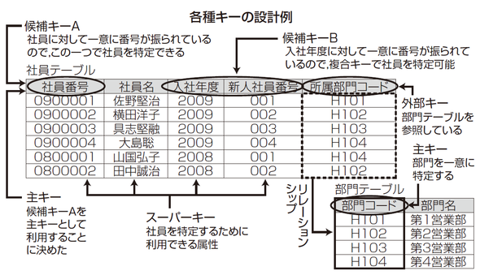
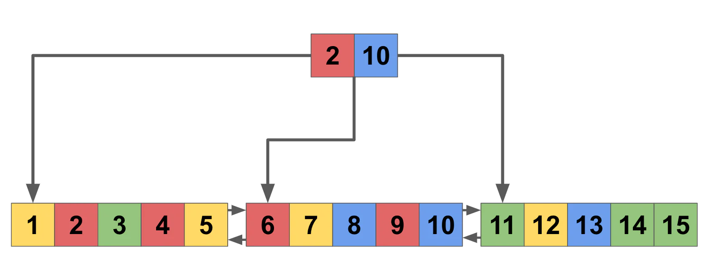
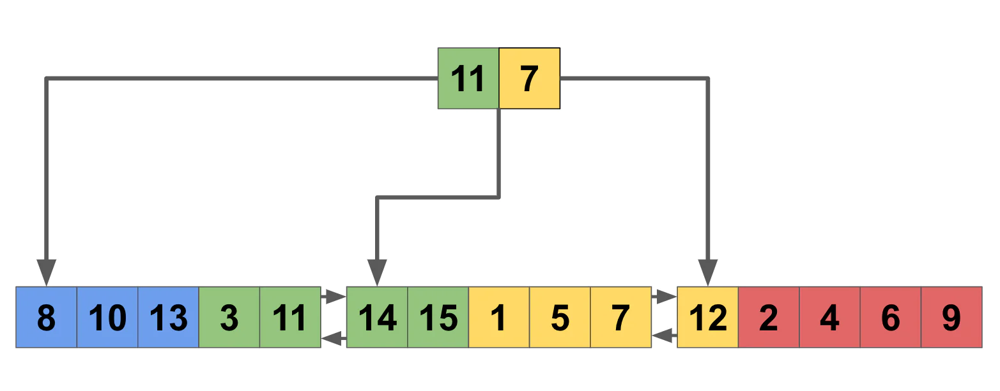

# MySQLの型・スキーマ設計と参考資料

- encoding
  - [MySQLのutf8_general_ciとutf8_unicode_ciの違い - プログラミング探して！](https://program.sagasite.info/wiki/index.php?MySQL%E3%81%AEutf8_general_ci%E3%81%A8utf8_unicode_ci%E3%81%AE%E9%81%95%E3%81%84)
  - [MySQLで大文字小文字を区別しないのを直す - sambaiz-net](https://www.sambaiz.net/article/11/)
  - ci: case-insensitive
  - cs: case-sensitive
  - >utf8_unicode_ciのデメリット
    - >日本語の検索で、「ひらがな」「カタカナ」が混在した形でヒットしてしまう。
    - >文字化けが起こる場合があるらしい。
- `TRUNCATE`はトランザクションで囲ってもロールバックされない
  - DBの構造を変える意図系の文だから
- >セッション変数はクライアント接続ごとに存在し、クライアントとの接続に影響を与えます。 セッション変数はクライアントとの接続時に、対応するグローバル変数の現在の値で初期化されます。
  - [【MySQL】システム変数の設定と値の確認方法 - アナグマのモノローグ](https://monologu.com/set-and-show-mysql-system-variable/)
- `<-- 1 : 0..1 -->`のようにリレーションを文字で表すとツウっぽい
- IDEF1X記法
  - [第2回　IDEF1XによるER図の記述 | gihyo.jp](https://gihyo.jp/dev/feature/01/database/0002)
  - ER図の記述方法
  - IDEF は Integration Definition の略
  - 四角形の上の項目が主キー
  - `[親] ---* [子]` のように線を引く (子が親IDを持つ)
- イベント系のテーブル(予約・購入 など)を考えてから、そのあとにリソース系のテーブル(商品・顧客 など)を考えるとよい
  - 「楽々ERDレッスン」より
- https://github.com/sqlitebrowser/sqlitebrowser
  - SQLiteのGUI
- [さまざまな種類の「キー」を理解する：「データベーススペシャリスト試験」戦略的学習のススメ（7）（1/2 ページ） - ＠IT](https://atmarkit.itmedia.co.jp/ait/articles/1703/01/news180.html)
  - 
- 複合主キーをつかうと、DBに保存するときに効率的な場所に保存されるようになる(参照局所性up)
  - [How to Introduce Composite Primary Keys in Rails](https://shopify.engineering/how-to-introduce-composite-primary-keys-in-rails)
    - これが
    - こうなる
- [データベースを勉強したいあなたに送る技術書17冊(+11冊1講義7link)](https://zenn.dev/levtech/articles/9ab9eea13a826d)
  - 『SQL実践入門』
    - >データベースについて勉強しようとするとまずお勧めされるのがミックさんの書いた書籍です。その中でもデータベースについてのいろんな視点を与えてくれるのがこの書籍だと思っています。どうSQLチューニングするか？　というテーマに沿いながら、簡単な内部構造や実行計画の読み方、基本的なSQL構文の書き方、つまりどころなどを解説しています。
  - 『絵で見てわかるSQL Serverの仕組み』
    - > Win向けRDBMSであるSQL Serverの内部構造を解説する書籍です。RDBMSの扱う問題領域がどんなものなのか？　というのが色々分かります。本書を選んだのはその分かりやすさゆえで、イラストも程よく使われており、知識のない状態で読んでも割とすんなり理解できます。
    - > 扱うテーマの一例を出すと、データベースにおけるプロセス管理の話やインデックスの実装の話などです。
    - >また、他のRDBMSの解説書だと、MySQLユーザー向けには『詳解MySQL5.7』、PostgreSQLユーザー向けには『内部構造から学ぶPostgreSQL設計・運用計画の鉄則』がおすすめです。MySQLの解説書としてあえて5.7のものを出すのか、と思われるかもしれませんが、『詳解MySQL5.7』の熱量はすごいのでおすすめです。『理論から学ぶデータベース実践入門』と同じ著者です。
  - チューニング
    - >SQLチューニングにとどまらないパフォーマンスチューニング全体についてであれば『達人が教えるWebパフォーマンスチューニング 〜ISUCONから学ぶ高速化の実践』がおすすめです。ハンズオン環境が用意されているのも嬉しいところ。チューニングにかかわる内部構造的なところだと『SQLパフォーマンス詳解』もとても評価が良いです。お値段はちょっと高いですが、なんとWeb上で全文公開されています。
      - SQLパフォーマンス詳解：[SQLのインデックスとそのチューニングについてのオンラインブック](https://use-the-index-luke.com/ja)
