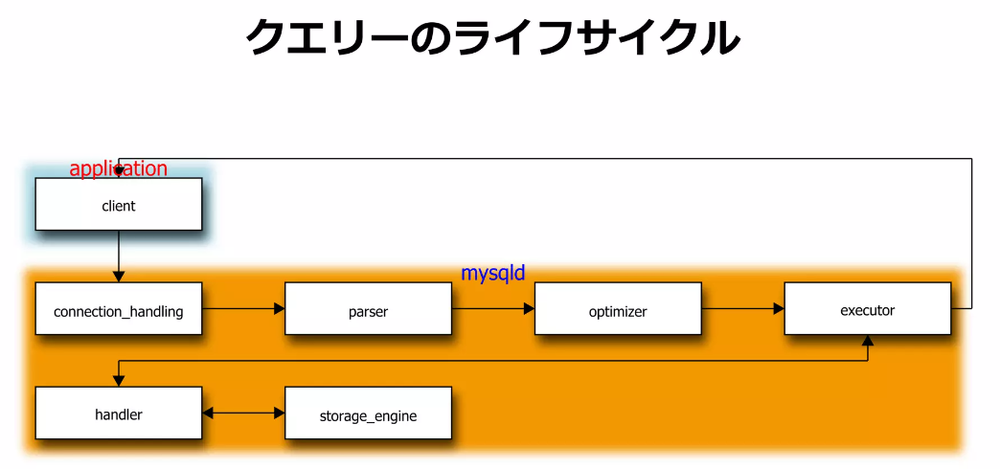
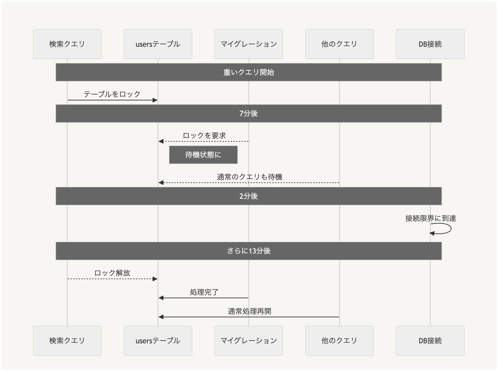

# MySQLの実行計画・ロックと運用

- [雑なMySQLパフォーマンスチューニング](https://www.slideshare.net/slideshow/embed_code/key/C2Z5uLNqNoGAcw)
  - [MySQL with InnoDB のインデックスの基礎知識とありがちな間違い - クックパッド開発者ブログ](https://techlife.cookpad.com/entry/2017/04/18/092524) で勧められていた記事
  - 
  - Optimizer
    - 実行計画の決定
  - Executer
    - Handlerを叩き、帰ってきた結果を使って実行計画の残りを実行
    - `Using where; Using filesort; Using temporary;` はここでやっている
      - これらが発生すると遅くなりがち
    - 関数の演算もココ
    - EXPLAINの`Extra`列にある情報はExecuterに関する情報
  - Handler
    - ストレージエンジンの抽象化レイヤー
  - Strage Engine
    - 取り替え可能
      - InnoDBとか (これしか知らない)
    - ほとんどの機能はここに詰まっている
- どの順番でJOINが行われるのか
  - → EXPLAINの出た順
  - [漢(オトコ)のコンピュータ道: MySQLのEXPLAINを徹底解説!!](https://nippondanji.blogspot.com/2009/03/mysqlexplain.html)
    - >クエリがJOINだけから構成される場合、select_typeはSIMPLEと表示される。如何に複雑なJOINであってもCOMPLEXとはならずにSIMPLEなのである。従って「これはシンプルなクエリを示すのだ」などと誤解をしてはならない。SIMPLEではidが全て同じ値になる。これはそのクエリが一つのNLJで処理されることを示すからである。NLJではどのテーブルから処理するのかということが最も重要になるが、EXPLAINの出力の順序がどのテーブルから処理するかということを反映している
      - Nested Look Join
- [漢(オトコ)のコンピュータ道: MySQLのEXPLAINを徹底解説!!](https://nippondanji.blogspot.com/2009/03/mysqlexplain.html)
  - ↓から順にみていく
  - select_type
    - JOINのみで作られているクエリなら全てSIMPLE
    - idが同じならそれらはひとつのNLJで処理される
  - type
    - > const・・・PRIMARY KEYまたはUNIQUEインデックスのルックアップによるアクセス。最速。
    - > eq_ref・・・JOINにおいてPRIARY KEYまたはUNIQUE KEYが利用される時のアクセスタイプ。constと似ているがJOINで用いられるところが違う。
    - > ref・・・ユニーク（PRIMARY or UNIQUE）でないインデックスを使って等価検索（WHERE key = value）を行った時に使われるアクセスタイプ。
    - > range・・・インデックスを用いた範囲検索。
    - > index・・・フルインデックススキャン。インデックス全体をスキャンする必要があるのでとても遅い。
    - > ALL・・・フルテーブルスキャン。インデックスがまったく利用されていないことを示す。OLTP系の処理では改善必須。
  - Extra
    - Extraとは
      - > Extraフィールドは、そのクエリを実行するためにオプティマイザがどのような戦略を選択したかということを示すフィールドである
    - > Using where・・・頻繁に出力される追加情報である。WHERE句に検索条件が指定されており、なおかつインデックスを見ただけではWHERE句の条件を全て適用することが出来ない場合に表示される。
    - > Using index・・・クエリがインデックス**_ だけ**を用いて解決できることを示す。Covering Indexを利用している場合などに表示される。
      - `Using index`が無いからといってインデックスが全く使われていないわけではない！！！
        - `Using index`は、インデックス以外によるフェッチをしていない(= ので超効率的)という意味
    - > Using filesort・・・filesort（クイックソート）でソートを行っていることを示す。Using filesortについては先日詳しく説明したので参照されたい。
    - > Using temporary・・・JOINの結果をソートしたり、DISTINCTによる重複の排除を行う場合など、クエリの実行にテンポラリテーブルが必要なことを示す。
    - > Using index for group-by・・・MIN()/MAX()がGROUP BY句と併用されているとき、クエリがインデックスだけを用いて解決できることを示す。
    - > Range checked for each record (index map: N)・・・JOINにおいてrangeまたはindex_mergeが利用される場合に表示される。
    - > Not exists・・・LEFT JOINにおいて、左側のテーブルからフェッチされた行にマッチする行が右側のテーブルに存在しない場合、右側のテーブルはNULLとなるが、右側のテーブルがNOT NULLとして定義されたフィールドでJOINされている場合にはマッチしない行を探せば良い・・・ということを示す。
- `LIMIT 1000`なら早くても`LIMIT 1000 OFFSET 100000`のようにすると遅くなるクエリもあるので注意！クエリ分析するときは確かめよう。
  - (NLJで)最も外側のテーブルのtypeがindexになっているときに起きた
  - 気付けないがち
- [MySQL :: MySQL 8.0 リファレンスマニュアル :: 8.8.2 EXPLAIN 出力フォーマット](https://dev.mysql.com/doc/refman/8.0/ja/explain-output.html#explain-extra-information)
  - MySQL公式のEXPLAINのドキュメント
  - `Using index`
    - >実際の行を読み取るための追加のシークを実行する必要がなく、インデックスツリーの情報のみを使用して、テーブルからカラム情報が取得されます。 この戦略は、クエリーで単一のインデックスの一部であるカラムのみを使用している場合に使用できます。
- 複合主キーのようなテーブル(レコード)を適当なバッチサイズで回すとき
  - https://stackoverflow.com/a/13213567
  - `a_id, b_id`について、`1,1 → 1,2 → 1,3 → 2,1 → 2,2 → 2,3` の順で回したい
  - タプル比較という構文を使えば簡単に書ける
```sql
select * from tbl
where (a_id, b_id) > (1, 2) -- この書き方がタプル比較
order by a_id, b_id;
-- a_id,b_id : 1,3 → 2,1 → 2,2 → 2,3 → 3,1 → 3,2 → ... が返ってくる
```

- `WHERE a_id > 1 AND b_id > 2`と書いてしまうのは**バグ**になるので注意！
- railsの対応は、、、議論中っぽい？
  - [Support nested array bind parameter for PostgreSQL parameter. by simi · Pull Request  · rails/rails](https://github.com/rails/rails/pull/48393)
  - 今のrailsで使うなら生文字列で書くことになりそう
- TEXT型(65,535文字, 65KB)よりも大きいテキスト型として、MEDIUMTEXT型(**上限1.6MB**)、LONGTEXT型 (上限4GB) がある
  - MEDIUMTEXT型だと、たとえば1行平均100バイトのCSVを格納する場合、16000行くらいで上限が来るので、S3的な感じでcsvを置き始めるといずれ(サービスが大規模になったら)上限突破する恐れがある
- Local Write Forwarding
  - [freee人事労務の給与計算ロジックにLocal Write Forwardingを導入した話 - freee Developers Hub](https://developers.freee.co.jp/entry/introduce-local-write-forwarding)
    - >reader に向けて貼った transaction の中で、 write の query だけを writer instance に転送してくれる仕組み。
    - ダークローンチして反映したところ、元処理とdiffが出たとのこと
      - > 検証を始めてdiff が出たかでいうと、結構出ました。
      - >理由としては、freee人事労務はユーザーが打刻をする、人事情報を書き換える、など給与金額に変更が起こり得る操作が数多くあります
      - > LWF を有効にした給与計算実行開始から、LWF を無効にした給与計算の実行開始までの間にそれらの操作を実行されると給与計算に用いるデータが異なるので結果が異なります
      - >ある程度自動的に省けるものは通知対象から省きつつ、残りはクラッシュレポートの情報から実際のユーザー操作を確認し、納得感のある diff しか通知されていないことを確認し、安全性が検証できたと判断しました。
- テーブル内のレコードを一部だけdeleteするようなときであっても、その絞り込み条件次第ではテーブル全体にロックがかかるので注意！
  - MySQLではDeleteでもロックが発生する
    - [MySQL :: MySQL 8.4 Reference Manual :: 17.7.3 Locks Set by Different SQL Statements in InnoDB](https://dev.mysql.com/doc/refman/8.4/en/innodb-locks-set.html)
      - > DELETE FROM ... WHERE ... sets an exclusive next-key lock on every record the search encounters.
      - > However, only an index record lock is required for statements that lock rows using a unique index to search for a unique row.
      - > DELETE FROM ... WHERE ...検索で検出されたすべてのレコードに排他的な次のキー ロックを設定します。
      - > ただし、一意の行を検索するために一意のインデックスを使用して行をロックするステートメントには、インデックス レコード ロックのみが必要です。
      - 排他ロックがかかる
      - next keyロックがかかる
  - delete句の絞り込み条件で、インデックスの使われない(= 全体検索が起きる)whereで絞り込んだようなとき、全レコードに排他ロックがかかって実質そのテーブル全体を触れなくなってしまう
- IN句で大量のid(primary_key)を指定したとき、**primary_indexが使われないことがある**
  - [MySQL の UPDATE で IN 句の要素が多すぎてデッドロックした話  - LayerX エンジニアブログ](https://tech.layerx.co.jp/entry/2024/12/07/105714)
  - 場合によってはフルスキャンが発生してしまう
  - 確認方法
    - 実行計画を見ていた
    - performance_schema.data_locks でロック状況も確認していた
  - 記事では、UPDATE句でロックがかかってしまう問題に遭遇していた
- [Amebaの大規模Aurora MySQLクラスタでのサービス無停止アップグレードへの挑戦 | CyberAgent Developers Blog](https://developers.cyberagent.co.jp/blog/archives/51492/)
- 普通の構成のwebアプリにおけるDBのMaxコネクション数は
  - `ワーカー数 ✕ コネクション設定 ✕ ECSタスク数` で計算できる
- [マイグレーション実行時のロック競合によるDBインシデントから学んだこと / 開発者向けブログ・イベント | GMO Developers](https://developers.gmo.jp/technology/56790/)
  - 原因
    - 外部キー制約を追加する際は、(参照先の) 親テーブルに対しても[メタデータロック](MDL)がかかる
  - 事象
    - 親テーブルへ対して重い & ロックを取る クエリを実行している最中に、その外部キー制約追加のマイグレーションをしてしまうと、「親テーブルの**排他**ロック取得待ち」でそのマイグレーションが待機してしまう
      - その結果、そのマイグレーション以降にそのテーブルを(更新ではなく)参照するクエリであっても、排他ロック取得待ちによりクエリが実行できずに、レイテンシへの影響 & DBへのコネクションプール枯渇 が起きてしまう
  - 流れ
    - >1. 管理画面でのユーザー検索により、重い検索クエリがusersテーブルの共有MDLを取得
      - 普通のSELECTクエリであっても、トランザクション内で行われた場合は共有MDLを取る
    - > 2. その途中でマイグレーションが実行され、usersテーブルの排他MDLを要求
    - > 3. 既存の共有MDLが解放されるまで待機状態に
    - > 4. **この間、新規のクエリも全て待機状態となる**
    - > 5. MySQLの接続が次々と消費され、ついには上限に到達
    - > 6. 監視サービスを含む全ての新規接続がタイムアウト
      - 
- SHOW PROCESSLISTの`sleep`について
  - `sleep`状態になってから何秒経ったかが`Time`列に書いてある
  - railsはコネクションプールを保持するので、sleep状態でtime列が大きいクエリが残っていても問題ない
  - 一方で、`command`状態でtime列がデカい場合は普通にスロークエリなので注意すべし
- DBの入れ替えやアップデート直後などは、空きメモリはキャッシュ領域として使われていくものなので、空きメモリが減少していても問題ない
  - 1GB残っていればOK
  - `innodb_buffer_pool_size`のサイズまで使われる
- [2025年度 新卒研修「100分で学ぶ サイバーエージェントのデータベース活用事例とMySQLパフォーマンス調査」 | CyberAgent Developers Blog](https://developers.cyberagent.co.jp/blog/archives/55842/)
- [クエリキャッシュは切ったほうがいいんじゃなイカ？](http://dsas.blog.klab.org/archives/52021866.html)
  - mysql8からはデフォルトでoffになっている
