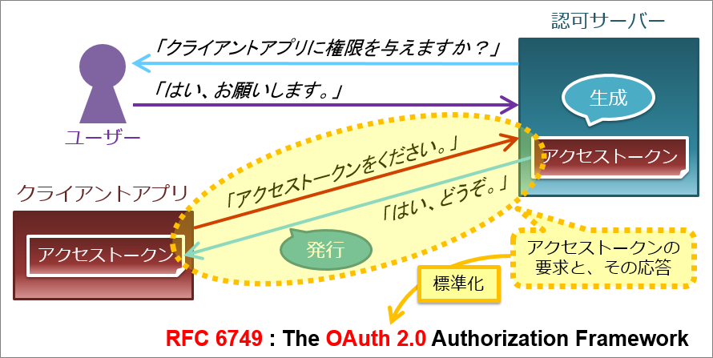
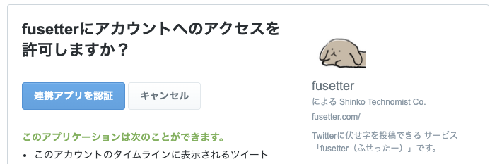

# OAuth

- [一番分かりやすい OAuth の説明 - Qiita](https://qiita.com/TakahikoKawasaki/items/e37caf50776e00e733be)
  - 
    - 「認可サーバー」がOAuth2プロバイダー?
      - doorkeeperで実装するやつ?
- Grant Types
  - 4種類の認可方式がある
    - Authorization Code
    - Client Credentials
    - Device Code
    - Refresh Token
  - [OAuth Grant Types 概要 - Qiita](https://qiita.com/KWS_0901/items/bb2c1dae9dcb66a3c6f3)
  - [よりよくわかる認証と認可 | DevelopersIO](https://dev.classmethod.jp/articles/authentication-and-authorization-again/)
    - Client credentials grant
      - > 従来型のアプリケーション神パターン (管理画面など)
      - > ユーザーからの権限委譲が必要ない、アプリケーションが単独で実行し得るパターン (EC サイトでの商品情報の参照 / バッチ処理など)
    - Resource owner password credentials grant
      - > **公式**アプリケーション (Twitter の認可サーバーを利用する場合の、公式 Twitter アプリなど)
      - > 利用は推奨されません。
    - Implicit grant
      - > モバイルアプリや JS アプリケーション等、エンドユーザーの支配下にあるノード上で動くアプリケーション
      - > 利用は推奨されません。
    - Authorization code grant
      - > OAuth の理想が詰まった、ユーザーからの権限委譲が必要な場合の推奨パターン
- [色々な OAuth のフローと doorkeeper gem での実装 - Qiita](https://qiita.com/tyamagu2/items/5aafff7f6ae0a9ec94aa)
  - リソースオーナーパスワードクレデンシャルグラント（Resource Owner Password Credentials Grant)
  - >クライアントがリソースオーナーのクレデンシャル（通常はユーザ名とパスワード）を受け取り、それを認可サーバに渡す、というフローです。
  - > それって最初に挙げた問題何も解決できてないじゃん！って言いたくなります。その通りです。
  - 公式クライアントが使う分には大丈夫そう
- クライアント認証の`confidential`タイプでは、クライアントの認証が必要
  - [OAuth 2.0 クライアント認証 - Qiita](https://qiita.com/TakahikoKawasaki/items/63ed4a9d8d6e5109e401#12-%E3%82%AF%E3%83%A9%E3%82%A4%E3%82%A2%E3%83%B3%E3%83%88%E3%82%BF%E3%82%A4%E3%83%97)
  - >クライアントアプリケーションには、クライアントタイプ（RFC 6749, 2.1. Client Types）という属性があります。
    - `public` or `confidential`
  - クライアント認証
    - `client_secret_post`
      - >クライアントシークレットを認可サーバーが生成し、**あらかじめクライアントアプリケーションに渡しておき**ます。
      - `client_id`および`client_secret` というリクエストパラメーターを使う
    - `client_secret_basic`
      - ベーシック認証を使う
      - `client_secret_post`とほぼ同じ？
    - `client_secret_jwt`
      - 署名を用いてクライアントシークレットの所持を証明
    - `private_key_jwt`
- scopeとは
  - どの権限を与えたか、を表す文字列
- [OAuth関連の専門用語 - 強火で進め](https://nakamura001.hatenablog.com/entry/20100531/1275329032)
  - OAuth
    - >Open Authorizationの略。認証のプロトコル。
  - サービスプロバイダ
    - >OAuth認証を使ってユーザデータを提供する側。今の例ではTwitterがサービスプロバイダーとなります。
    - twitterとか
  - コンシューマ
    - >OAuth認証を使ってユーザデータを提供を受ける側。開発者やサービスを提供する人や団体。
    - fusetterとか
  - リクエストトークン
    - >ユーザがユーザデータへのアクセスをコンシューマに承認するページを表示するときのキーとなる文字列。
    - >Consumer KeyとConsumer secretを使ってリクエストトークン取得APIで取得します。
    - API Key, API secret と呼ばれることもある
      - どちらもサービスプロバイダにアプリ(= コンシューマ)を登録する際に発行してもらえる
  - アクセストークン
    - >Twitter APIを使用するときのキーとなる文字列。
- [OAuth認証でTwitterとアプリを連携する](https://zenn.dev/kjumanenobikto/articles/86541146abba96)
- OAuth認証の流れについて
  - `https://api.twitter.com/oauth/request_token`宛に、取得したAPI_KEYとAPI_KEY_SECRETをヘッダーに入れ、Callback URLを指定し、POSTする
    - [POST oauth/request_token | Docs | Twitter Developer Platform](https://developer.twitter.com/ja/docs/authentication/api-reference/request_token)
    - [リクエストの認証 | Docs | Twitter Developer Platform](https://developer.twitter.com/ja/docs/authentication/oauth-1-0a/authorizing-a-request)
      - **リクエストトークン**を取得するエンドポイント
        - `Authorization`ヘッダーに、`key="value", ...`形式で値を入れる
**Authorizationヘッダーの値の例**

```
oauth_nonce="K7ny27JTpKVsTgdyLdDfmQQWVLERj2zAK5BslRsqyw",
oauth_callback="http%3A%2F%2Fmyapp.com%3A3005%2Ftwitter%2Fprocess_callback",
oauth_timestamp="1300228849",
# API_KEY のこと
# どのアプリががリクエストを行っているかを識別する
oauth_consumer_key="OqEqJeafRSF11jBMStrZz",
# 署名
# Consumer secretを使って署名する
oauth_signature="Pc%2BMLdv028fxCErFyi8KXFM%2BddU%3D",
# 署名の方法
oauth_signature_method="HMAC-SHA1",
oauth_version="1.0"
```

- POSTするリクエストのヘッダの中身はライブラリがよしなにやってくれる
- `oauth_token=token文字列&oauth_token_secret=secret文字列&oauth_callback_confirmed=true` というレスポンスが帰ってくる
  - ここから`https://api.twitter.com/oauth/authenticate?oauth_token=token文字列`というURLを作る
  - ユーザーがアクセスする、`https://api.twitter.com/oauth/authorize?oauth_token=XXXXX`のURLのこと
  - 
- ユーザーが認証すると、登録しておいたコールバックURLにリダイレクトされる
  - `https://callback.example.com?oauth_token=token文字列&oauth_verifier=verifier文字列`など
  - サーバーサイドでは、このURLの`verifier文字列`を切り出す
- API Key, API Key Secret, OAuth Token, OAuth Verifier (verifier文字列のこと) を使って `oauth/access_token` にPOSTすることで、今度は**アクセストークン**が手に入る
- たとえばアプリがそのユーザーで「hello」とツイートをするときは、このアクセストークンから作った`oauth_signature`などをリクエストのヘッダーに入れてPOSTすればよい
  - [POST statuses/update | Docs | Twitter Developer Platform](https://developer.twitter.com/en/docs/twitter-api/v1/tweets/post-and-engage/api-reference/post-statuses-update)
```curl
curl -X POST 
  --url 'https://api.twitter.com/1.1/statuses/update.json?status=hello' 
  --header 'authorization: OAuth
  oauth_consumer_key="oauth_customer_key",
  oauth_nonce="generated_oauth_nonce", # ライブラリが計算してくれた値を使う
  oauth_signature="generated_oauth_signature", # ライブラリが計算してくれた値を使う
  oauth_signature_method="HMAC-SHA1",
  oauth_timestamp="generated_timestamp", # ライブラリが計算してくれた値を使う
  oauth_token="oauth_token",
  oauth_version="1.0"'


```
