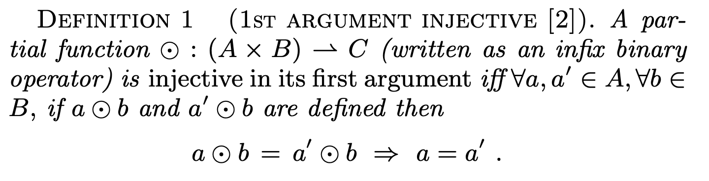
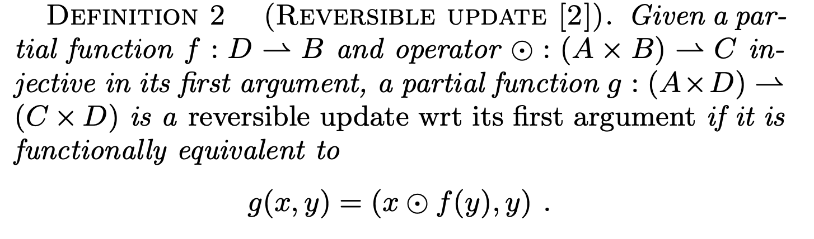
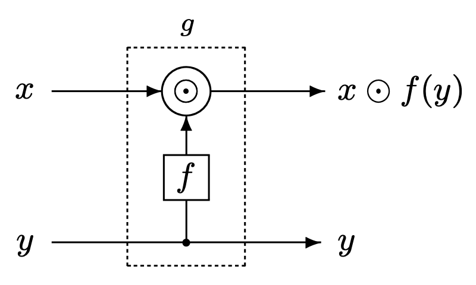
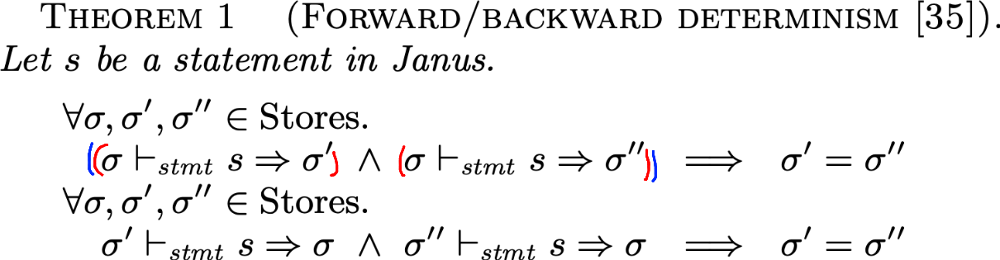
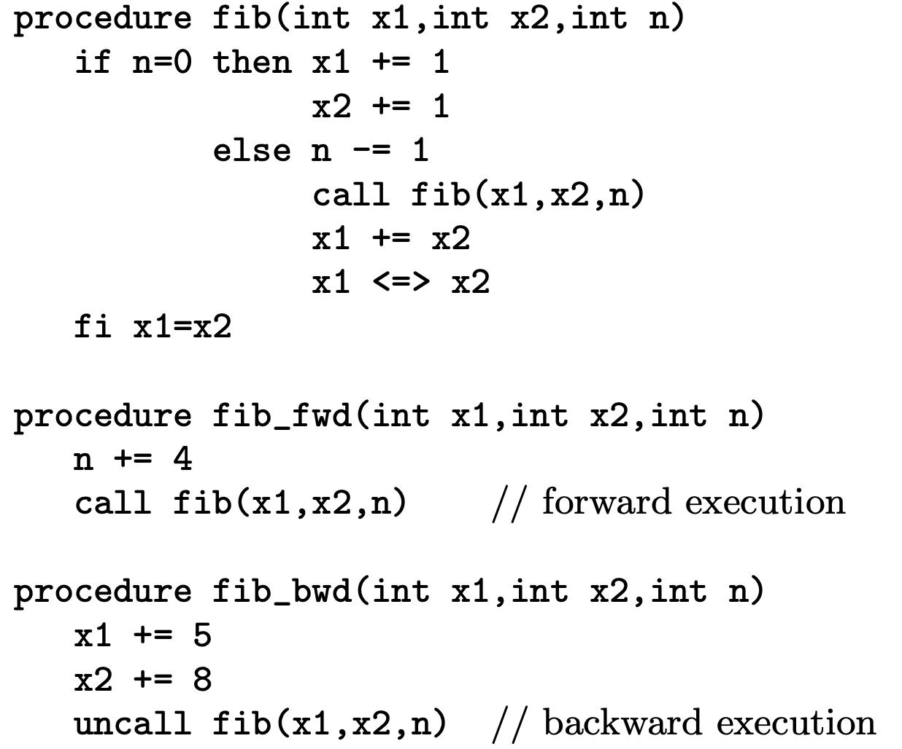
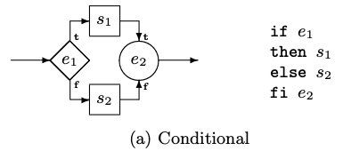
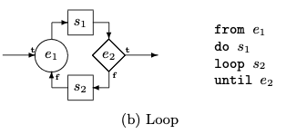

# Principles of a Reversible Programming Language

- Reversible Programming Language
- [Principles of a reversible programming language | Connected Papers](https://www.connectedpapers.com/main/7e728c2375c991610aec24caf9901f8b2ab72974/Principles-of-a-reversible-programming-language/graph)
  - Towards a Reversible Functional Language
    - 関数型言語への拡張
    - case文とかが出てくる
- >The principles of reversible programming languages are ex- plicated and illustrated with reference to the design of a high-level imperative language, Janus. The fundamental properties for such languages include backward as well as forward determinism and reversible updates of data. The unique design features of the language include explicit post- condition assertions, direct access to an inverse semantics and the possibility of clean (i.e., garbage-free) computa- tion of injective functions. We suggest the clean simulation of reversible Turing machines as a criterion for computing strength of reversible languages, and demonstrate this for Janus. We show the practicality of the language by imple- mentation of a reversible fast Fourier transform. Our results indicate that the reversible programming paradigm has fun- damental properties that are relevant to many different areas of computer science.
- >可逆的プログラミング言語の原理を、高水準命令型言語Janusの設計を参照しながら説明する。このような言語の基本的な特性は、前進と同様に後退も決定論的であり、データの可逆的な更新を含む。この言語のユニークな設計上の特徴として、明示的な後条件アサーション、逆意味論への直接アクセス、および射影関数のクリーンな（すなわちガベージフリー）計算の可能性がある。可逆言語の強度を計算する基準として、可逆チューリング機械のクリーンなシミュレーションを提案し、Janusに対してこれを実証する。また、可逆高速フーリエ変換の実装により、この言語が実用的であることを示す。この結果は、可逆プログラミングパラダイムが、コンピュータサイエンスの様々な分野に関連する楽しい数学的特性を持つことを示している。
  - 普通の計算機はランダウアーの原理に従う
  - Landauer embedding
    - 計算ごとにガーベージデータを追加する方法
      - コードに比例してガーベージデータが増えてしまう
- **2.FUNDAMENTALS OF REVERSIBLE LANGUAGES**
- **2.1 Reversible Updates**
  - 可逆更新
  - 可逆更新の定義は以下
  - 
    - 関数が第一引数についてinjectiveである
      - 上記の条件を満たしていれば
        - 普通満たすのでは？
          - `true & false = false & false \=> true = false`
            - 論理ANDは満たさない
          - `1 + 2 = 1 + 2 => 1 = 1`
            - 加算は満たす
    - `((a ⊙ b) ⊘ b) = a`となる演算子`⊘`が存在する
    - `+`なら`-`
      - `((a + b) - b) = a`
    - `xor`なら`xor`
      - `((a xor b) xor b) = a`
  - 
  - ↑
    - `f : D -> B` とする
      - これはinjectiveじゃなくてok
    - `⊙ : (A × B) -> C` とする
      - この関数はinjective(定義は先述)であるとする
    - `g : (A × D) -> (C × D)` とする
    - 以下のとき、`g`は第一引数に関してreversible update
      - `g(x, y) = (x ⊙ f(y), y)`
  - なぜか
    - `g^-1(x, y) = (x ⊘ f(y), y)` のように`g^-1`を定義できるため
      - とっておいたyを使って、xへの演算を打ち消している
    - `g`で包めばreversibleじゃない関数`f`を使えるようになる... ってこと!?
  - 図解 "Logically reversible update"
    - 
  - 具体例
    - `g(x, y) = (x + f(y), y)`とする
    - `g^−1(x, y) = (x − f(y), y)`のように`g^-1`が手に入る
    - `f`を具体的にしてみる
      - `f(x) = x % 5`としてみる (明らかに非可逆な関数)
      - `g(x, y) = (x + (y % 5), y)`
      - `g^-1(x, y) = (x - (y % 5), y)`
```c
(x, y) = (0, 18) // y%5 を求めたい
(x, y) = g(x, y) // 再代入
// (x, y) = (3, 18) となっている
// ここで、g^-1を使えば (x, y) = (0, 18) を復元できる
```

- 1回だけだとありがたみが感じられない気がするけれど、何度もgを使えばありがたいのか?
- **2.2 Backward Determinism**
  - 意味論に関しても逆方向
  - 
  - 文の実行を、ストアに対する関数として見たときに、文の実行はinjective(射影的)
  - 代入は可逆
    - Janusは、代入の右側が非可逆だとしても、代入全体として見れば可逆だから、可逆言語である
- **2.3 Access to Inverse Semantics**
  - 逆意味論
- **2.4 Inverse Program Efficiency**
  - 効率
  - >反転プログラムは順プログラムと同じ複雑さ
- **3. THE REVERSIBLE LANGUAGE JANUS**
  - Lutz と Derby が作った
    - Janus: a time-reversible language
      - C. Lutz.
      - Letter to R. Landauer. http://www.cise.ufl.edu/~mpf/rc/janus.html 1986.
        - 40年前...
- **3.1 Example Program: Fibonacci Pairs**
  - JANUSは参照渡し
    - 使いにくそう
  - フィボナッチ数
- 
  - `n, x1, x2`の初期値はそれぞれ`0`
- **3.2 The Language**
  - 文
    - 可逆代入
    - 条件文
    - ループ文
    - スタック操作
    - ローカル変数ブロック
    - call
    - uncall
    - 何もしない文(skip文)
    - 文の列
  - 変数
    - 整数変数
      - booleanは整数で扱う
    - 1次元の整数型配列
- **3.2.1 Assignments and Expressions**
  - 代入
    - 左辺は整数型or配列のindex指定
    - `+=`
    - `-=`
    - `^=`
    - 代入の右辺の式には自在に計算ができる
      - 数のmodとかをとってOK
      - 2.1節の原理があるので
  - 制御フロー
    - if文
      - 
      - cond部分の式e1
      - body部分の後のアサーションe2
      - e2では、e2がe1と同じ結果かどうかをアサーションする
        - e1をもう一度やるのとは何が違う?
          - e1・e2の実行時に「e2の結果==e1の結果」とは限らないから
        - アサーションの失敗は実行時エラー
    - ループ
      - 
      - ループ前にアサーションe1(= true)が入る
      - e2がtrueならループ終了
      - s2からe1に来たときは、e1はfalseでなければならない
      - 矢印を入れ替えて、アサーションとcondを入れ替えれば、可逆ループになる
      - >入口でアサーション（e1）、出口でテスト（e2）の2つの述語を持つ（図2（b））。最初は、e1が真でなければならず、次にs1が実行される。テストe2が真であればループは終了し、そうでなければs2が実行され、その後にe1が偽でなければならない。アサーションが真であるのは最初だけである。ループはアサーションとテストが偽である限り繰り返され，テストが真になると終了する．これにより，このループは後方決定論的である．
      - 例
        - 正: `start -> e1 -> s1 -> e2 -> exit`
        - 逆: `exit  <- e2 <- s1 <- e2 <- start`
        - 正: `start -> e1 -> s1 -> !e2 -> s2 -> !e1 -> s2 -> e2 -> exit`
        - 逆: `exit  <- e1 <- s1 <- !e2 <- s2 <- !e1 <- s2 <- e2 <- start`
      - s2をskip文とする糖衣構文`from e1 do s until e2`を使える
- **3.2.3 Dynamic Allocation of Storage**
- **3.2.4 Procedure Calls and Uncalls**
- **3.3 Discussion of Parameter Passing Modes**
- **4. FORMALIZATION**
- **5. COMPUTATIONAL STRENGTH**
- **6. REVERSIBLE FAST FOURIERTRANSFORM**
- **7. RELATED WORK**
- **8. CONCLUSION**
