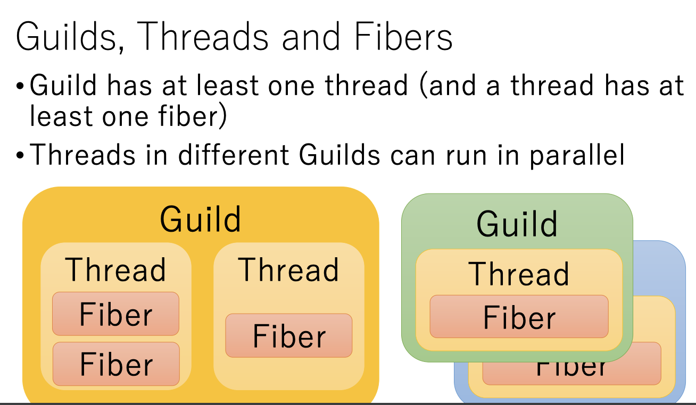

# Ractor

- >Ractor はアクターモデル風の並行・並列制御機構であり、スレッド安全に関する懸念なく、Rubyで並列処理を行うための機能として設計されています。
  - https://www.ruby-lang.org/ja/news/2020/12/25/ruby-3-0-0-released/
- https://docs.ruby-lang.org/en/3.0/ractor_md.html
  - >Each Ractor has 1 or more Threads.
    - Ractor : スレッド = 1 : N
- [Ruby向け並列化機構Guildの試作](https://atdot.net/~ko1/activities/sasada_ipsj_pro_120.pdf)
  - 論文
  - 2018 情報処理学会プログラミング研究会 発表資料
  - モデル
    - >共有メモリモデルではなく、並行実行単位で独立したメモリ空間をもつモデルを目指す
    - >各並行実行単位は専用のチャンネルを通じ通信することでプログラムを進める。この並行実行単位を Guild とする。
  - しくみ
    - >Ruby 処理系を起動すると、1 つの Guild を作成する（これをメイン Guild とする）。Guild は最低 1 つのスレッドを持つ。
    - >同一 Guild 内の複数のスレッドは、Ruby 2 と同様に並行処理を行うが、ジャイアントロックによって同時に実行はされない（Ruby 2 と完全に互換となる）。
      - 「複数のスレッド」というのは「複数のRubyスレッド」のこと?
        - でも、MaNyプロジェクト以前のRubyでは、複数のRubyスレッドを作るとその数だけ複数のネイティブスレッドが作られる
  - 実装
    - >インタプリタプロセスに唯一であったグローバルロックを、Guild ごとに持たせる。
    - >すでにスレッドはネイティブスレッドで実装しているため、並列計算機上では並列処理が可能である。
- [Guild Prototype](https://www.atdot.net/~ko1/activities/2018_rubykaigi2018.pdf)
  - 2017
  - 
