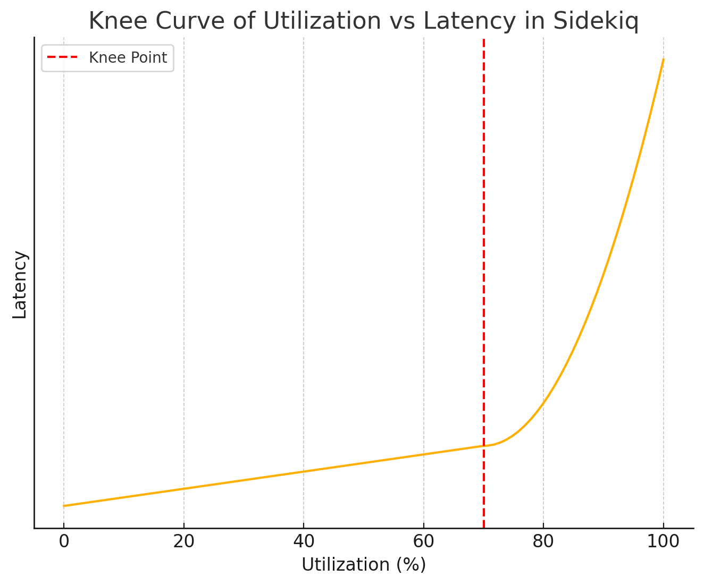

# Railsスケーリング

- [Railsスケーリング（1）Puma、コンカレンシー、GVLのパフォーマンスへの影響を理解する（翻訳）｜TechRacho by BPS株式会社](https://techracho.bpsinc.jp/?p=151182)
  - Pumaがリクエストを処理するしくみ
    - リクエストはTCPソケット経由で届き、まずはTCPのqueueに入る
    - Pumaはそのqueueからリクエストを取り出す
  - RubyにはGVL（Global VM Lock）があるので、スレッドを（コア数まで）増やしても、CPUバウンドである限り早くはならない
    - スレッドが実行しているコードがIO操作をしたときにGVLを解放するので、IOバウンドについては早くなる
    - それとは別に、100ms経つと強制的に別のスレッドに切り替わる
  - [gvl-tracing: Get a timeline view of Global VM Lock usage in your Ruby app](https://rubygems.org/gems/gvl-tracing) Gem でGVLを可視化できる
  - スレッド数を増やしすぎてもGVLの競合が大量に発生するのでよくない
- [Railsスケーリング（2）: アムダールの法則で高速化とコンカレンシーの関係を理解する（翻訳）｜TechRacho by BPS株式会社](https://techracho.bpsinc.jp/?p=151214)
  - Pumaで設定できるのは「プロセス数」と「（プロセスごとの）スレッド数」のみ
  - アムダールの法則
    - 達成可能な高速化の上限についての式
    - 並列実行数を上げても速度向上は緩やか（反比例の式のかたち）なことを示す式
    - 立式のためには「実行時間のうち並列化できる時間の割合 (＝ I/Oに費やしている時間の割合)」を知る必要がある
      - 後半の記事で紹介するとのこと
- [Railsスケーリング（3）: GVL競合を計測してプロセスごとの理想的なスレッド数を決定する（翻訳）｜TechRacho by BPS株式会社](https://techracho.bpsinc.jp/?p=151299)
  - アムダールの法則を使い、スレッドを増やすごとにどの程度高速化されるかを計算し、丁度良いスレッド数を決定する
- [Railsスケーリング（4）: Active Recordコネクションプールの適切な設定を理解する（翻訳）｜TechRacho by BPS株式会社](https://techracho.bpsinc.jp/?p=151486)
  - Active Recordにおけるコネクションプールの実装
    - スレッドでコネクションが必要になると、スレッドはプールからコネクションをチェックアウト（=借り出し）し、データベース操作を実行したら、コネクションをプールに返却する
    - Reaperという機能があり、定期的にプール内のコネクションをチェックして、デッドコネクションや、長時間チェックアウトされたままのアイドリングコネクションを削除している
      - <https://api.rubyonrails.org/classes/ActiveRecord/ConnectionAdapters/ConnectionPool/Reaper.html>
        - DBコネクションにおけるGCのようなもの
  - 最大コネクション数の設定
    - Pumaの場合
      - それぞれのプロセスがそれぞれのコネクションプールを持つ
      - 最大で、スレッドの個数(`max_threads`)と同じ数だけのコネクションが必要
    - Sidekiqの場合
      - 最大で、スレッドの個数(`concurrency`)と同じ数だけのコネクションが必要
    - Rails全体
      - Webコネクション数 = Webのdyno数 ✕ Pumaプロセス数 ✕ max_thread値
      - バックグラウンドコネクション数 = ワーカーのdyno数 ✕ Sidekiqプロセス数 ✕ プロセスあたりのスレッド数
      - 最大コネクション数 = Webコネクション数 + バックグラウンドコネクション数
      - DBは↑の最大コネクション数に耐えるように設定する必要がある
        - デプロイ戦略によってはさらに2倍必要
- [Railsスケーリング（5）: 待ち行列理論でジョブキューのパフォーマンスを理解する｜TechRacho by BPS株式会社](https://techracho.bpsinc.jp/?p=151581)
  - リトルの法則
    - 「**あるシステム内におけるジョブの平均件数**は、新しいジョブの平均到着率とシステム内におけるジョブの平均処理時間をかけたものに等しい」というもの
    - `L = λW`
      - `L` = システムの平均ジョブ件数（提供トラフィック）
      - `λ` = 新しいジョブの平均到着率
      - `W` = システム内におけるジョブの平均処理時間
    - 例：ジョブが平均で1分あたり10件到着し（λ）、個別のジョブが完了するまで30秒（W）要したとすると
      - → `システムの平均ジョブ件数 = 10（ジョブ/分） * 0.5（分） = 5（ジョブ）`
  - 利用率は(100%ではなく)70〜75%未満に留めておくべき
    - 利用率＝利用中のキャパシティ／処理可能なキャパシティ
      - ＝提供トラフィック／パラレリズム
    - 70〜75%あたりからレイテンシが悪化するため
    - 100%ギリギリは、少しでも上がるとパンクするためNG
    - 膝（knee）：パフォーマンスのグラフが上向きに急上昇するポイント
      - 
    - たとえば「目標とする利用率」と「提供トラフィック（時間あたりのリクエスト数）」が定まっているとき、それを満たす「並列実行数」を逆算できる
      - （詳しくは記事を参照）
  - （キューの容量の他に）飽和が起きる箇所
    - CPU使用率
    - メモリ使用率
      - 100%を超えると著しく悪化する
    - Redis（の容量）
