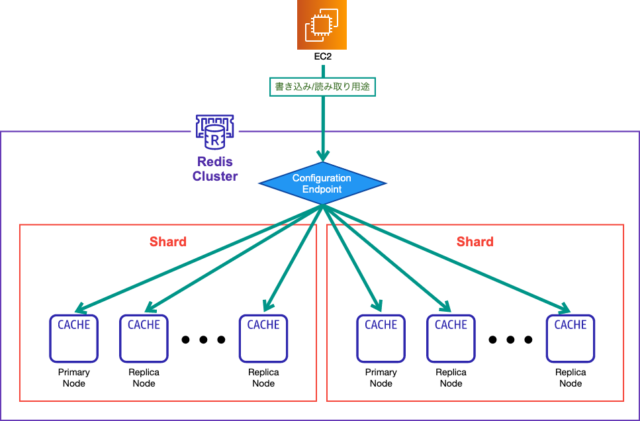

# Redis

- Redisはシングルスレッド。Memcachedはマルチスレッド
  - pod de enginner podcastの2022年8月あたりの回で話していた気がする
- sidekiqでjob管理に使う
- redisのクラスタモードとは
  - 参考 [ElastiCache for Redisのクラスターモードについて調べてみた | DevelopersIO](https://dev.classmethod.jp/articles/elasticache-cluster-mode/)
  - 用語
    - クラスター：1個以上のシャードで構成されるグループ
    - シャード：プライマリノード(1個) + レプリカノード(0-5個)で構成されるノードグループ
      - 1シャード内のノードにはすべて同じ値が入る
    - ノード：redis1個1個
      - ノードの種類と総数によって課金額が決まる
  - クラスタモードとは
    - データをシャード間で分散して配置するモード
    - write処理をスケールアウト分散できる
    - 
  - クラスタモードを無効化すると
    - データをシャード間で分散して配置しなくなる
    - クラスター・シャードという概念が無くなる
- ElastiCache (AWS ElastiCache)のインスタンスタイプを変えるときの情報
  - バージョンに関する情報
    - インスタンスタイプ←→redisバージョン 間の制約などは特に無さそう
    - どのインスタンスタイプに移行できるかはCLIで調べられる
      - `aws elasticache list-allowed-node-type-modifications --replication-group-id (idを指定)`
  - sidekiq (job worker)に関する情報
    - 溜まっているデータはベストエフォートで保持してくれる
      - [Amazon ElastiCache for Redisのエンジンバージョンとノードタイプを変更する際にデータは保持されるか | DevelopersIO](https://dev.classmethod.jp/articles/elasticache-redis-upgrade-node-type-engine-version/)
        - >Q: より大きなノードタイプにスケールアップしたり、より多くのノードにスケールアウトしたりするにはどうすればよいですか?
        - >スケールアッププロセスは、既存のデータをベストエフォートで保持する
    - もしも消えたらやばいjobはあるかどうかは事前に調べておこう
    - jobを投げる処理を止めるかどうかも事前に決めておくべし
      - [レプリカを含む Redis クラスターのスケールダウン - Amazon ElastiCache フォー・レディス](https://docs.aws.amazon.com/ja_jp/AmazonElastiCache/latest/red-ug/Scaling.RedisReplGrps.ScaleDown.html) らへんのドキュメントに色々書いてある
        - Redisのバージョンやクラスターモードの有効無効とかで色々違ってくる
      - バージョン中はjobの受付が短時間中断されるらしい
        - 「短時間中断」ってどれくらい？
          - 検証している記事：[ElastiCacheのスケールアップは本当にダウンタイムなしでできるのか検証してみた！  | DevelopersIO](https://dev.classmethod.jp/articles/can-elasticache-onlinescalingup-without-downtime/)
            - 2〜3msに1回アクセスし続けている最中にredisのスケールアップをした結果、エラーは1件のみ発生
            - ほぼ無問題
    - sidekiq gem, redis gem に関する情報も調べておこう
      - gemがアップデートしたいバージョンを対応しているかどうかとか
  - その他
    - Redisはインプレースでアップデートできたとしても、内部的にはIPが変わる場合がある
      - なにか別のインフラのコンポーネントからRedisに対してコネクションプールを保持していた場合、Redisアップデートによってそのコネクションプールが使えなくなって、不具合が起きたりする場合がある
- (改修によって) 同じキーで別の型の値を保存するようにしたとき、**旧→新の移行の考慮の他に、新→旧の移行の考慮もすべし**
  - PRをrevertする可能性があるため
  - そもそも改修で型を変えるときは別のキーにするべき
- [Redisのメモリが100%を超えたときの挙動の調査・検証  - Qiita](https://qiita.com/shiro1212/items/7d9aec8a753ac8bfedf8)
  - メモリが100%になったとき、ReclaimedKeys/Evictions といって、**古いキーが削除される！**
  - ElastiCacheではこの設定がデフォルトとなっている
  - 不具合調査のとき、ElastiCacheのメトリクスの ReclaimedKeys/Evictions グラフを見て、これが起きたかどうかを調べたい
- [Feature FlagのRedis負荷を90%削減した - Timee Product Team Blog](https://tech.timee.co.jp/entry/2025/11/20/100000)
  - >3. Redis Connection Poolの導入
  - > これまでは毎リクエストでRedis接続を確立していましたが、Sync Adapterを導入することで接続が長期間保持されるようになります。そのため、接続が切れた場合の耐障害性を高めるため、Flipper 1.3.3から導入されたRedis Connection Poolsの機能を使ってconnection poolを持つようにしました。
