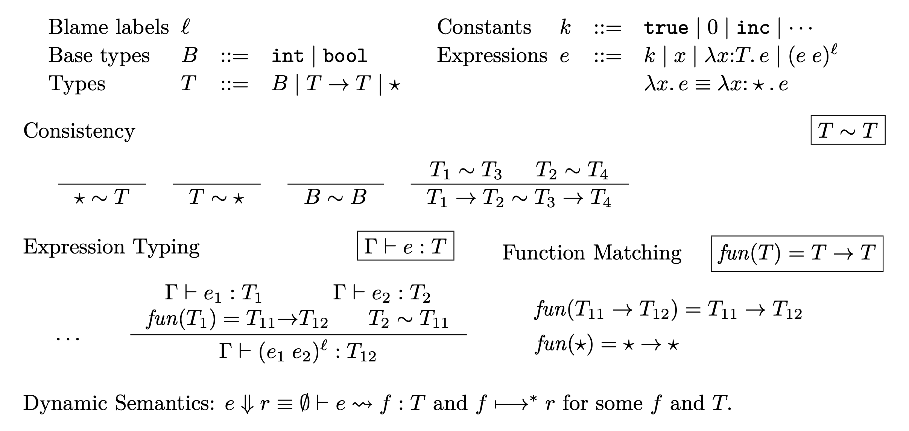
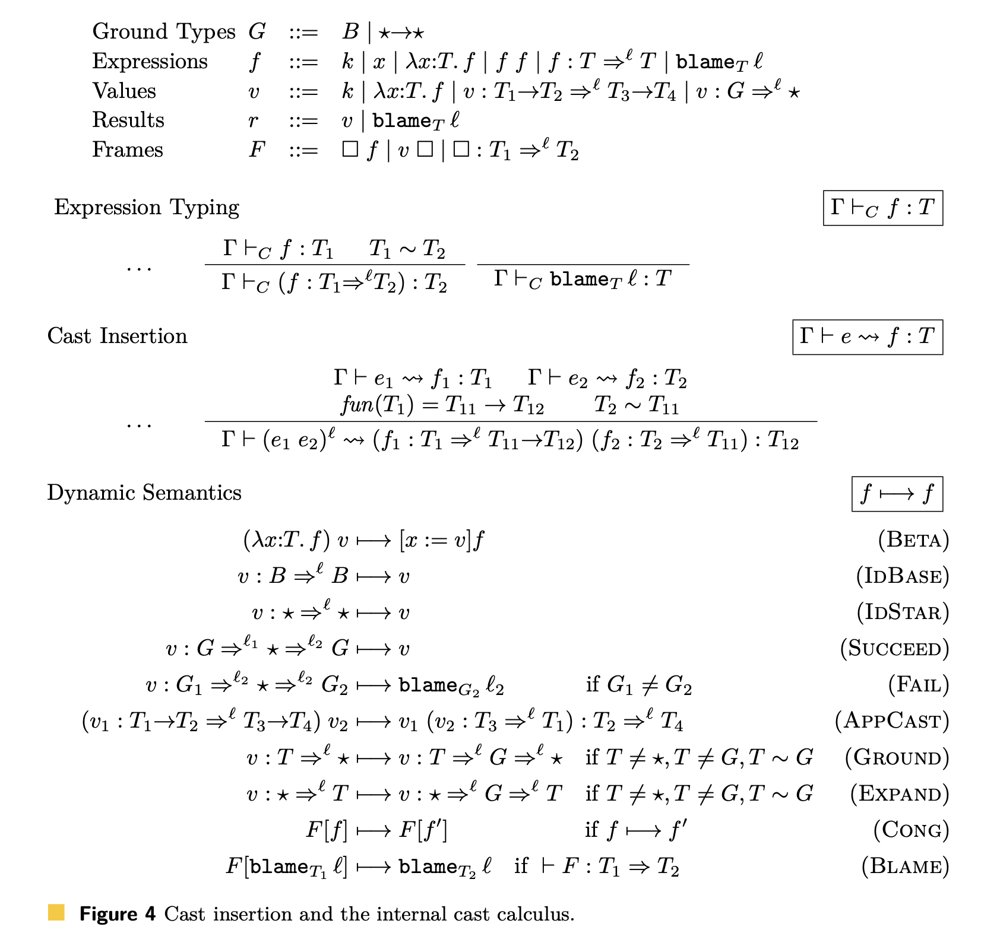
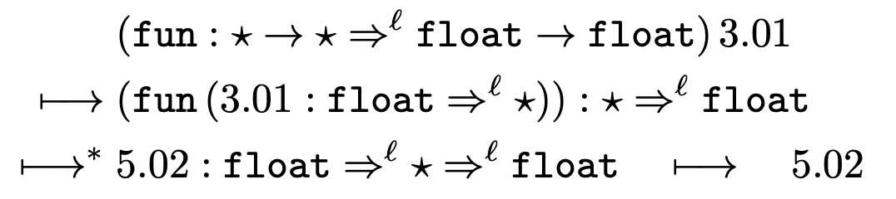
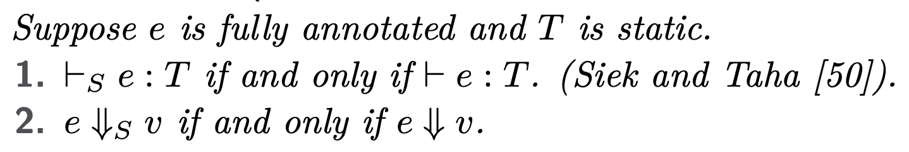
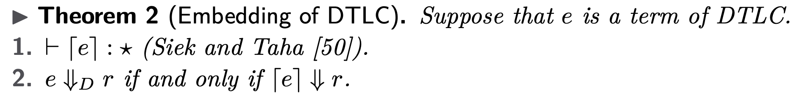
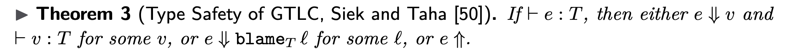
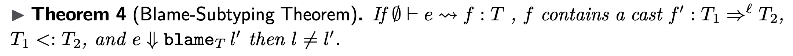

# Refined Criteria for Gradual Typing

- gradual typing
  - 未知の型`★`
  - gradual guarantee
    - 漸進的保証
- **Introduction**
  - 静的型付け
    - 型の一貫性
    - >which allows implicit casts to and from the unknown type, here written ⋆,
    - >未知の型（ここでは⋆と書く）との暗黙のキャストを可能にする
      - 型推論のこと？
  - 動的型付け
    - 契約、型強制？、interlanguage migration?
  - 型検査が入る点で、タイプインターフェースとは異なる
  - 動的・静的型付けを統合する研究はあるが、目的が(gradual typingとは)異なる
    - Dynamic & Typecase
      - mrsekut-p/typecase
        - >実行時に、型情報に基づいたパターンマッチを行う
    - Object-Oriented Languages
    - Soft Typing
    - Type Hints
      - 型ヒント
      - 速さのため
    - Types for Dynamic Languages
      - Typed Racketなど
  - >implicit casts to and from the unknown type.
    - Cecil
    - Visual Basic.NET
    - Bigloo
    - ProfessorJ
  - 産業界で動的型と静的型を統合する試み
    - Dart
    - TypeScript
    - Hack
    - C#
  - >To this end, we offer a new criterion in this paper, the gradual guarantee
- **Examples of Gradual Typing**
  - 漸進的型付けされた言語は、動的型付けされた言語と静的型付けされた言(同一の言語)の中間にある
  - STLC: Simply Typed Lambda Calculus
  - DTLC: Dynamically Typed Lambda Calculus
  - GTLC: Gradually Typed Lambda Calculus
    - `★`が現れない(= fully annotatedな)GTLCはSTLC
  - Gradual Evolution
  - なぜgradualなのか
    - 型注釈を付けても外しても、型チェック時のエラーになるか実行時のエラーになるかで、起こること自体は変化しないということ
  - 付けた型注釈が間違えているときは
    - 型システムがrejectすべし
  - 正しく型注釈が付けらてたコードは、その型注釈を外しても正しく型付けされたコードである
    - ？？？具体例が無いとよくわからぬ
      - tsありきでこの論文を読んでいるから混乱するのかもしれない
      - 実行時の動作が、型注釈の有無に全く関係ないということかも
  - 型なしコードから型付きコードに変換させることが、gradual typingの目的のひとつ
- **The Gradually Typed Lambda Calculus**
  - GTLC型システムにおいて重要な2点は、関数適用にある
  - 1. 静的型システムにおいては同等の型$ T_1 と T_2を、漸近的型システムにおいては$ T_1 \sim T_2と書き、consistency relation (一貫的な関係?)という
    - 未知の型$ \starは、consistency relationにおいて、任意の型と関係を作ることができる
      - たとえば
        - `gcd(10, 5)`という呼び出しがあって、これは`(int, int)`
        - `gcd(a, b)`という関数定義があって、これは(型注釈が無いので)`(*, *)`
        - これについて`int ~ *`とできる
      - `gcd(32, true)`のような呼び出しは`int !~ bool`なので、型システムが拒否する
    - OOPLにも
      - 対象律はある
      - 推移律は無い
  - 2. メタ関数fun
    - 構文上関数であるものの型として、`T1 -> T2`と`*`の両方がOK
      - `*`を`* -> *`のように扱ってOK
    - 
  - internal cast 計算
    - 静的型付けを`*`で拡張したもの
    - キャスト表現 $ f: T \Rightarrow^l T
      - 関数の型の右矢印とは別のもの(だと思う)
      - lはBlame label. ソースコードの場所
      - >The blame labels l represent source position information from the parser, so blame labels are unique.
      - 関数適用の規則の右上に付いている
    - internal cast 計算の定義
- 
  - $ v : T_1 \rightarrow T_2 \Rightarrow^l T_3 \rightarrow T_4を、wrapped functionという
  - $ v : G \Rightarrow \starを、injectionという
    - $  \star \Rightarrow Gはprojection
  - >Identity casts on base types and ⋆ are discarded (rule IdBase and IdStar).
    - cast情報が付いている値とcast情報が付いていない値があるのか？
  - 規則 SUCCEED
    - 同じGでinjectionとprojectionがあったとき、cast情報は消える
  - 規則 FAIL
    - 違うGでinjectionとprojectionがあったときは、失敗？
      - `blame`がよくわからぬ
      - 失敗したときは、どこで失敗したか追えるってこと？
  - injectionとprojectionはGな型に対してのみ行えるから、Tな型をGな型に変換させるためにGROUND, EXPAND規則がある
  - 規則 APPCAST
    - 一番重要
      - >Perhaps the most interesting rule concerns casts between function types (rule AppCast).
    - cast情報ありの関数に値を与えたとき
```py
// 2.2章のコード
def deriv(d: float, f: Callable[[float],float], x: float) -> float:
  return (f(x + d) - f(x - d)) / (2.0 * d)
def fun(y):
  if y > 0: return y ** 3 - y - 1

deriv(0.01, fun, 3.0)
deriv(0.01, fun, -3.0)
```

- 
  - 1行目、derivの引数に型注釈があるので、`* -> * => float -> float`になっている
  - 2行目、APPCASTを適用している
  - 3行目、実際に`fun`を計算した？
    - 実際に計算していいのか？
    - 型エラーになるのは実行時だが。。。これでいいのかも
      - [TypeScriptはgradual typingシステムか - Qiita](https://qiita.com/uhyo/items/df276348b966f0e9fe1c#2-siek--taha-%E3%81%AE%E4%BD%93%E7%B3%BB%E3%81%AE%E5%9E%8B%E5%AE%89%E5%85%A8%E6%80%A7)
        - >Siek & Taha の体系λ?→λ→?においては上記のように誤ったプログラムはどのような結果になるのでしょうか．実はこの体系では**ランタイムに誤りを検知**します．これは，キャストの情報を値に保存するセマンティクスによって実現されます．
- **Criteria for Gradual Typing**
  - Criteria、この論文の主題かも
  - 4.1 Gradual as a Superset of Static and Dynamic
    - 4.1 Gradual as a Superset of Static and Dynamic
      - Theorem 1 (Equivalence to the STLC for fully annotated terms).
        - 
        - STLCにおける型判断と評価は$ \vdash_s, \Downarrow_S
        - STLCにおいてある型判断や評価があったとき、GTLCでも同じ判断や評価がなされる
      - Theorem 2 (Embedding of DTLC)
        - 
        - $ \lceil \cdot \rceilで、未知の型へキャスト
        - $ \Downarrow_Dで、DTLCにおける評価
    - 4.2 Soundness for Gradually Typed Languages
      - > Let e ⇑ indicate that e diverges.
        - $ e \Uparrowで、eの発散を示す
      - 
        - > If ⊢ e : T, then
          - > either e ⇓ v and ⊢v:T for some v,
          - > or e ⇓ blameT l for some l,
          - > or e ⇑.
        - (GTLCにおいて)eがT型なら、
          - eがT型のvに評価されるか、
          - eがblameか、
            - ？
            - 実行時の型エラーのことかも
          - eが発散するか
      - 
    - 4.3 The Gradual Guarantee
