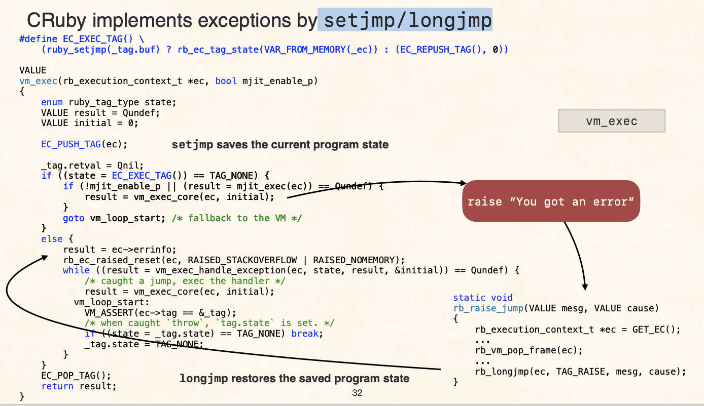
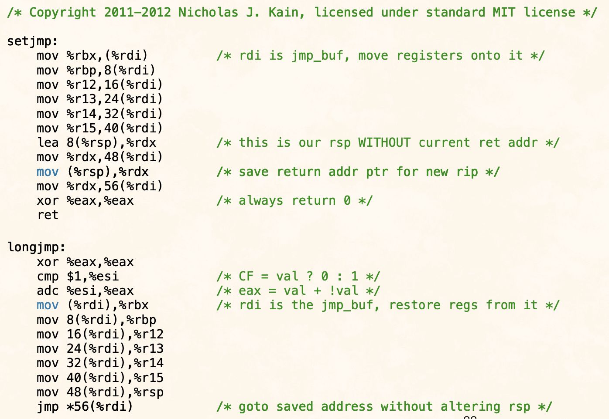
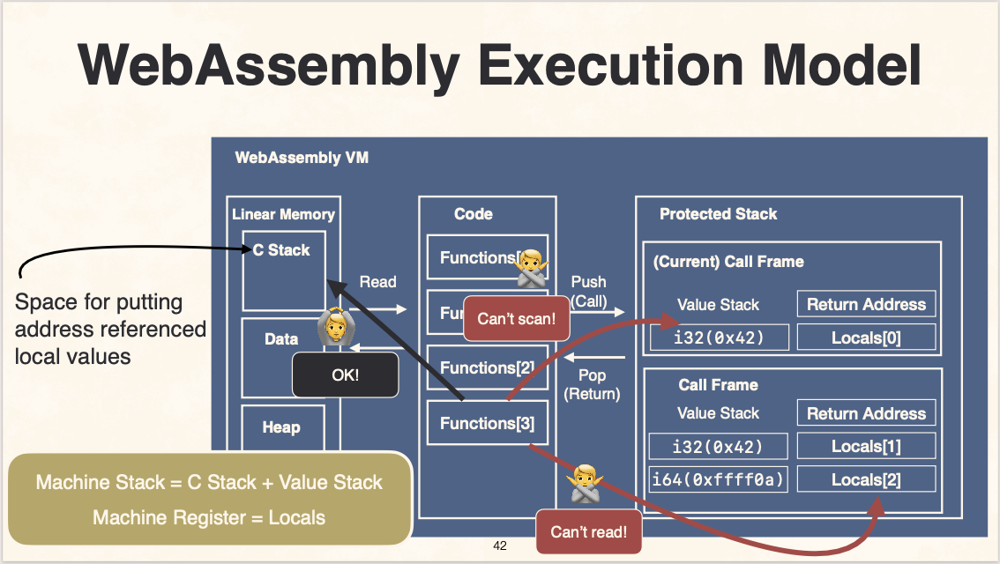

# Ruby meets WebAssembly

- https://rubykaigi.org/2022/presentations/kateinoigakukun.html#day1
- https://speakerdeck.com/kateinoigakukun/ruby-meets-webassembly
- [https://www.youtube.com/watch?v=-x8pU6mGtPI](https://www.youtube.com/watch?v=-x8pU6mGtPI)
  - @kakeinoigakukunさん
  - CRubyを(C言語で書かれているので)`.wasm`に変換できる
  - https://github.com/ruby/ruby.wasm
  - irb
    - https://irb-wasm.vercel.app/
  - TimeとかはJSのものを利用
  - WASI
    - プラットフォーム非依存のシステムコールのようなもの
  - VFS
    - virtual filesystem
  - Ruby 3.2から入る
  - WebAssenmblyにポートするにあたって困難が3つ
  - 1. 例外
  - 2. Fiber
  - 3. 保守的GC
  - 例外
    - setjmp/longjmpで実装されている
    - EC_PUSH_TAGでsave, EC_POP_TAGでrestore
    - 
    - x86_64上でのsetjmp/longjmpの実装
      - 
      - spやレジスタやpcを保持・復帰している
    - WebAssenmbyで提供されているコントロールフローは、 goto, call, return のみ
      - 例外機構に必要な機能が備わっていない
  - Fiber
    - CRubyのFiberは semi-coroutine
      - 主従関係を持つコルーチンのこと
    - マシンスタックやレジスタ、PCなどはアーキテクチャ固有の状態
    - あらゆる実行stateへ(全然関係ないコールスタックへ)復帰する機能が必要
  - 保守的GC
    - CRubyのGCは
      - 「オブジェクトっぽいもの」をマーク
      - マシンレジスタとスタックをスキャンしていく
    - WebAssemblyの実行モデル
      - スタックマシン
        - 値のスタックがある(図右)
          - アドレス参照できない
        - Cでローカル変数を参照するときは、C Stack(図左)に配置する
      - スキャン対象について、CRubyの諸々がWebAssembly上でどこに置かれるか
        - マシンスタック(C Stack と Value Stack から成る)
          - C Stack
            - こっちは線形メモリ(Liner Memory)に配置されるため、アドレス参照**できる**
          - Value Stack
            - こっちは保護されたメモリに配置されるため、アドレス参照**できない**
        - マシンレジスタ
          - Localsという領域に対応
            - 関数ローカルな領域
            - 現在のcall_frameのものしか見れないという制限がある
              - (GCのために)すべてのフレームのlocalsをスキャン**できない**
      - 
  - Asyncfi (エーシンクファイ)
    - 上記の3問題を解決する
    - プログラム変換
    - jsの`async`をCから、プログラム変換によって実現する技術
    - wasmファイルを食わせると、変換したwasmファイルを吐いてくれる
    - sleepなどの関数で、 unwind/rewind という処理を挟む
      - すべての関数定義内にこれらに関する処理を挟むことで、実質的にCRuby側でスタックやレジスタを簡単に見に行けるようになる
  - Q&A
    - スレッドは未実装
      - そもそもWasm上でのスレッドの意味論がまだ議論中
    - C拡張は、ビルドシステムまわりの整備がまだだからまだ使えない
      - 実験中
