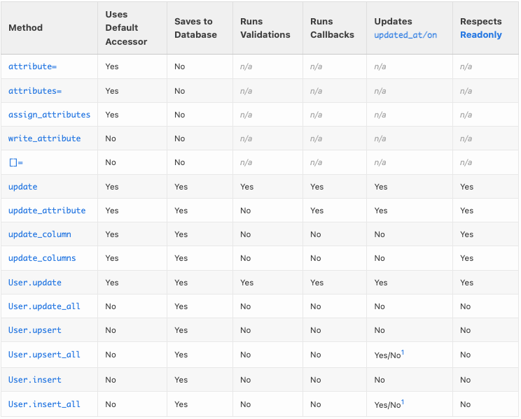

# Ruby on Rails model

- マイグレーションや、テーブル定義関連の話は Ruby on Rails マイグレーション へ
  - `ActiveModel::Model`をincludeすると、DBに保存しないモデルを扱える
    - 検索フォーム専用のモデルを作ったり
      - [1.1. 検索フォームの実装 — Railsアプリケーション構築ガイド](https://rails.densan-labs.net/form/search_form.html)
      - [【Rails】FormObjectを使ってほしい - Qiita](https://qiita.com/9ro/items/10e3676741e09ffb98bb)
      - [【Rails】Form Objectを使ってModelに依存しないFormを作成する ｜ もふもふ技術部](https://tech.mof-mof.co.jp/blog/rails-form-object/)
  - 単一モデルで検索を扱うときはこっち
    - [【Rails】一覧ページ上部に検索機能を実装する ~ form_with ~ - Qiita](https://qiita.com/shin1rok/items/779e581e9d12a92310c3)
    - モデルに検索用scopeを作って、formの値はまとめてハッシュ的なインスタンス変数1つに。
- **has_secure_password**
  - モデルに、`has_secure_password`を付けると、`password`という名前で、暗号化の処理は考えなくてレコードの更新ができる
    - リファレンス: [ActiveModel::SecurePassword::ClassMethods](https://api.rubyonrails.org/classes/ActiveModel/SecurePassword/ClassMethods.html)
    - [Ruby on Rails の has_secure_password のコードを読んでみる - What is it, naokirin?](https://naokirin.hatenablog.com/entry/2019/03/29/032801)
    - [Railsのhas_secure_passwordとは - Qiita](https://qiita.com/shumpeism/items/4d8946ade2dbdccab31c)
      - >セキュアにハッシュ化したパスワードを、データベース内のpassword_digestという属性に保存できるようになる。
      - > 2つのペアの仮想的な属性（passwordとpassword_confirmation）が使えるようになる。また、存在性と値が一致するかどうかのバリデーションも追加される 。
      - > authenticateメソッドが使えるようになる（引数の文字列がパスワードと一致するとUserオブジェクトを、間違っているとfalseを返すメソッド）。
    - [第6章 ユーザーのモデルを作成する - Railsチュートリアル](https://railstutorial.jp/chapters/modeling_users?version=5.1#sec-adding_a_secure_password)
    - `model.authenticate("aabbcc")` で、パスワードが引数の文字列どうかを確かめられる
    - updateやsaveで、passwordに空文字列を渡すと、パスワード更新をスキップしてくれるらしい
      - https://teratail.com/questions/248543
      - けど、公式リファレンスを読んでも記載は見当たらない
    - passwordのバリデーションをこれに追加で付けるときは、`allow_nil: true`をしないと、(passwordは仮想的に扱えるカラムなので)、1カラムだけupdateとかで毎回バリデーション失敗になってしまう。
  - messageオプションで、invalid時のメッセージを変えられる
    - [Active Record バリデーション - Railsガイド](https://railsguides.jp/active_record_validations.html#%E3%83%90%E3%83%AA%E3%83%87%E3%83%BC%E3%82%B7%E3%83%A7%E3%83%B3%E3%81%AE%E3%82%B9%E3%82%AD%E3%83%83%E3%83%97)
    - `@rec.errors`でとれる
    - simple_form gemを使うと、このメッセージを自動でviewに表示してくれる
      - [GitHub - heartcombo/simple_form: Forms made easy for Rails! It's tied to a simple DSL, with no opinion on markup.](https://github.com/heartcombo/simple_form)
  - alias定義するときは`alias_attribute `
    - [Railsのカラムにaliasをかける - Qiita](https://qiita.com/jkr_2255/items/168a35e937166e5e9790)
    - イコール付きメソッドとかもまとめてaliasにしてくれる
  - 条件付きユニーク
    - [Rails - Modelのユニークバリデーションを複数項目で判定 - Kei178's blog](https://kei178.me/programming/1025/)
  - モデルのvalidationを、特定の場合のみに適用・スキップ
    - [Active Record バリデーション - Railsガイド](https://railsguides.jp/active_record_validations.html)
    - `unless: -> { validation_context == :hoge }`
    - コントローラーでは、`@model_object.save(context: :hoge)`のようにかく
    - updateメソッドではcontextを設定できない
    - [Rails4でModelのvalidatesを切り替える - Qiita](https://qiita.com/HamaTech/items/e4016224a134f1b35535)
    - `user.attributes = { email: 'test@mail.com' }`  `user.save(context: :hoge)`のように書く
  - active recordのwhereとかで、boolにbool以外の値を使う時
    - [tinyint(1)がtrue, falseなのはRailsの世界 - hatappi.blog](https://blog.hatappi.me/entry/2018/05/05/154429)
    - `[false, 0, "0", "f", "F", "false", "FALSE", "off", "OFF"]` がFALSE扱い
  - preloadして、子のSUMをする
    - [How to eager load child model's sum value for ruby on rails? - Stack Overflow](https://stackoverflow.com/questions/30112199/how-to-eager-load-child-models-sum-value-for-ruby-on-rails)
  - 加工処理をどこに書こう問題
    - 「Rails実践入門」より
    - ビューにそのまま書くと見にくい(醜い)
    - ヘルパーは、全view共通で定義されちゃうから名前付けが難しい
    - モデルは、MVCから離れててイマイチ
    - なので、デコレーターという選択肢がある
      - そのままだと、`return view_context.link_to(...)`のように書く必要があるので委譲を使うと良い
  - `uniq`は`distinct`のaliasになってるので注意!
    - `model_ojbect.method(:uniq).source_location #=> ActiveRecordのソースの場所が出る`
    - Emumのuniqを使うには、、、
  - [Railsでこの時だけ特定のバリデーションを検証したくないときしたこと - hatappi.blog](https://blog.hatappi.me/entry/2017/04/13/201505)
    - `unless: -> { validation_context == :hoge }`
  - modelのerrorについて
    - [【Rails】errors.addって何？ - Qiita](https://qiita.com/yujiG/items/3e34e2e0e7b4120b0584)
    - 調べたら出てきたのが知ってる人だった..!
  - user_idが同一内でnameがユニーク、みたいな制約をかけることができる
  - `find_or_initialize_by`
    - レコードがなければ作って(new)あればそれを使う(find_by)
  - `ActiveRecord::Base.transaction`でトランザクションの開始
    - `raise ActiveRecord::Rollback`でロールバックしてブロックを抜ける(後の処理も実行する)
    - それ以外のエラーraiseだと、ロールバックして、ブロックの外側でもraiseされている状態になる(rescueに行くやつ)
    - コンソール見てると`BEGIN, ROLLBACK`とか出てくる
  - すでに定義されたvalidationを新しく上書きするのは難しそう?
    - [Railsのvalidationの実行過程を調べる - Qiita](https://qiita.com/wakasa51/items/b3d65eac5cdad7787083)
  - [Railsモデルの関連付けでbuildを使う時のメソッド名](https://gist.github.com/seak0503/7291012e7e99fc8aca80)
    - >モデル間の関連付けの際に、データを保存したくない場合はbuildを使うが、 関連付けのパターンによって、メソッド名が変わる
    - [railsのnewとbuildの違い - Qiita](https://qiita.com/sukechansan/items/6bae532b4f678fdcf87d)
      - buildもnewと同じ。でも慣用的に関連モデルはbuildで作ることが多い
  - presenceとかのvalidationをこう書くこともできる
    - `validates_presence_of(バリデーション対象 [, ...])`
    - https://railsdoc.com/page/validates_presence_of
  - jbuilderのcall
    - [Method: Jbuilder#call — Documentation for rails/jbuilder (master)](https://www.rubydoc.info/github/rails/jbuilder/Jbuilder:call)
    - https://github.com/rails/jbuilder/blob/master/lib/jbuilder.rb#L224-L230
```ruby
def call(object, *attributes, &block)
  if ::Kernel.block_given?
    array! object, &block
  else
    extract! object, *attributes
  end
end


```

- Kaminariで、COUNTするサブクエリのSELECT句が1を指定しているので、havingで集計済みの結果が取れない問題
```sql
SELECT COUNT(*)
FROM (
  SELECT 1 -- 自動で1のみ指定になってしまう. 元のsqlは is_foobar をSELECTしているのでHAVINGで使える
  FROM table_name
  GROUP BY col_name
  HAVING (is_foobar = 1) -- ココでエラーに
) subquery
```

- => HAVING句に計算を書くことで解決
- kaminariでコントローラーとアクション指定
  - [ruby on rails 3 - How to specify a controller & action for Ajax pagination with Kaminari? - Stack Overflow](https://stackoverflow.com/questions/7942347/how-to-specify-a-controller-action-for-ajax-pagination-with-kaminari)
  - `:params => {:controller => :exchanges, :action => :paginate_remotely}`
- has_manyに`autosave: true`オプションをつけると、親のsaveで子のsaveもしてくれる。
  - https://railsguides.jp/association_basics.html#belongs-toのオプション-autosave
  - 子レコードに`mark_for_destruction`メソッドを呼ぶと、親のsave時に削除してくれる
    - [ActiveRecord::AutosaveAssociation](https://api.rubyonrails.org/classes/ActiveRecord/AutosaveAssociation.html)
  - めちゃくちゃバグを踏みそう
    - https://github.com/rails/rails/issues/17466
    - 親が子を子だと認識できていなくて、子のsaveをしてくれないときがある。トランザクションを使ったほうがよさそう
  - `指定なし`, `autosave: true`, `autosave: false` の3種類ある
    - [ActiveRecord::AutosaveAssociation](https://api.rubyonrails.org/classes/ActiveRecord/AutosaveAssociation.html)
    - 一般的な「`指定なし`」の場合、親のsave時に**子が作られていなければ**子もsaveされる
      - 親が未saveでも子のbuildはできて、親のsave時に子もsaveされる
      - > When `:autosave` is not declared new children are saved when their parent is saved:
```rb
class Post < ActiveRecord::Base
  has_many :comments # :autosave option is not declared
end

post = Post.new(title: 'ruby rocks')
post.comments.build(body: 'hello world')
post.save # => saves both post and comment

post = Post.create(title: 'ruby rocks')
post.comments.build(body: 'hello world')
post.save # => saves both post and comment

post = Post.create(title: 'ruby rocks')
comment = post.comments.create(body: 'hello world')
comment.body = 'hi everyone'
post.save # => saves post, but not comment

```

- `accepts_nested_attributes_for`
  - >form でネストする params を作って異なる model の属性を格納し、一回のアクションで同時にsaveしたい。
  - [accepts_nested_attributes_forの使い方 - yshrfmru’s diary](https://yshrfmru.hatenablog.com/entry/2018/11/25/183126)
  - [Rails API: ActiveRecord::NestedAttributes（翻訳）｜TechRacho by BPS株式会社](https://techracho.bpsinc.jp/?p=132223)
- トランザクションのときは、`ActiveRecord::Base.transaction`内で、こんな風に書くとシンプルそう?
  - エラーを起こす update!, create!, destroy! を保存時には使うこと
```ruby
rescue ActiveRecord::RecordInvalid => err
  render json: { _errors: err.record.errors }, status: :unprocessable_entity

```

- `attribute_before_last_save`でafter_save内でsave前の値が知れる
  - むずそう
  - [Rails 5.1 で attribute_was, attribute_change, attribute_changed?, changed?, changed 等が DEPRECATION WARNING - Qiita](https://qiita.com/htz/items/56798d53ec5988733fc6)
  - `name_before_last_save`のような使い方?
- `t.references` は `type: :integer`のようにオプションを取れる
- 共通のbefore_saveとかを書きたいときどうするか。
  - 継承すると、その分のDBテーブルが必要？
  - Moduleで解決するのが良いらしい
  - https://qiita.com/iwsksky/items/e4baed3d7ef1b98f3ec5
  - moduleでは定数やメソッドは定義できるけど、メソッドをよびだすことはできないからbefore_saveできなかった。
    - includedメソッドで、ブロックに処理を渡すと、呼び出せる
    - https://ref.xaio.jp/ruby/classes/module/included
    - https://qiita.com/aosho235/items/1867be19d044d83127d4
**main.rb**

```ruby
 module CrawlFinishedAtSupport
  def self.included(base)
   base.class_eval do
    before_update :add_crawl_finished_at_colmn
   end
  end

  def add_crawl_finished_at_colmn
   self.crawl_finished_at ||= Time.now
   self
  end
 end
```

- updateで注意すること
  - attributes => save が中で起きてる
    - attributeはメモリでの値の設定
    - saveはDBの更新
  - https://www.rubydoc.info/docs/rails/4.1.7/ActiveRecord/Persistence#updateinstance_method
  - attributeとsaveの2つの操作があることに注意。
  - [ActiveRecord の attribute 更新方法まとめ Qiita](https://qiita.com/tyamagu2/items/8abd93bb7ab0424cf084)
  - saveが失敗したらattributeもなかったことにしてくれる方法があれば嬉しい。
- 関連付け系のローディングについて
  - [ActiveRecordのjoinsとpreloadとincludesとeager_loadの違い - Qiita](https://qiita.com/k0kubun/items/80c5a5494f53bb88dc58)

    **まとめ**

    | メソッド | キャッシュ | クエリ | 用途 |
    | --- | --- | --- | --- |
    | joins | しない | 単数 (INNER JOIN) | 絞り込み |
    | eager_load | する | 単数 (LEFT OUTER JOIN) | キャッシュと絞り込み |
    | preload | する | 複数 | キャッシュ |
    | includes | する | 場合による | キャッシュ、必要なら絞り込み |

  - include以外のメソッドを用途別に使おう
  - [ActiveRecordを使うときは頭にSQLを描こう - Qiita](https://qiita.com/ham0215/items/bf99d3c44e029176c2af)

- selectの使い所
- selectを使わないと、`SELECT *`になる

- 引数なしの`find_each`は`Enumerator`が返る
- https://api.rubyonrails.org/classes/ActiveRecord/Batches.html#method-i-find_each
  - > If you do not provide a block to find_each, it will return an Enumerator for chaining with other methods:


- [ActiveRecordを単体で使ってる場合のタイムゾーンの設定 - tyn-iMarketの技術メモ](https://tyn-imarket.hatenadiary.org/entry/20131027/1382897686)

- [RailsでArel、早見表 - Qiita](https://qiita.com/k-fujino/items/09f8baf790abd49308f4)

- `sanitize_sql_array`
- SQLインジェクション対策用のクエリを文字列として作れる
- `ActiveRecord::Base.sanitize_sql_array(['where id = ?', 1])`
- [ActiveRecordのSanitization　初心者→中級者へのSTEP19/25 - Qiita](https://qiita.com/kamohicokamo/items/6933e90237935c011efb)
  ```ruby
  .joins(sanitize_sql_array([<<~EOS, var]))
  JOIN table_name
  ON table_name.col = ?
  EOS
  ```

- `reload`でモデルの再取得ができる
- `lock`でロックできる

- `references`でLEFT OUTER JOIN
- [似ているようで全然違う!?Activerecordにおけるincludesとjoinsの振る舞いまとめ - Qiita](https://qiita.com/south37/items/b2c81932756d2cd84d7d)

- テーブル`a`から`c`を、`a.b_id = c.b_id`でつなぐ
- [ActiveRecord::Associations::ClassMethods](https://api.rubyonrails.org/classes/ActiveRecord/Associations/ClassMethods.html#method-i-has_one)
- [Active Record の関連付け - Railsガイド](https://railsguides.jp/association_basics.html#belongs-to%E3%81%AE%E3%82%AA%E3%83%97%E3%82%B7%E3%83%A7%E3%83%B3-foreign-key)
- `a`のモデル定義の`has_one`に、`foreign_key: :b_id`と`primary_key: :b_id`を指定する
- `foreign_key`
  - >Specify the foreign key used for the association. By default this is guessed to be the name of this class in lower-case and “_id” suffixed. So a Person class that makes a `has_one` association will use “person_id” as the default `:foreign_key`.
  - > If you are going to modify the association (rather than just read from it), then it is a good idea to set the `:inverse_of` option.

  - >Railsの慣例では、相手のモデルを指す外部キーを保持しているjoinテーブル上のカラム名については、そのモデル名にサフィックス`_id`を追加した関連付け名が使われることを前提とします。`:foreign_key`オプションを使えば、外部キーの名前を直接指定できます。
  - `c.b_id`の部分の指定
- `primary_key`
  - >Specify the method that returns the primary key used for the association. By default this is `id`.

  - >Railsの慣例では、`id`カラムはそのテーブルの主キーとして使われます。`:primary_key`オプションを指定すると、指定された別のカラムを主キーとして設定できます
  - `a.b_id`の部分の指定

- kaminariのtotal_countをAPIモードで返すとき
- コントローラーで `response.headers['X-Total-Count'] = @records.total_count`
- フロントの受け取る処理で`X-Total-Count`を取り出す

- マイグレーションファイル内の`execute`で、up/down時にSQLを発行できる
- バッチファイルを当てる代わりに使えたり

- delegated type
- https://github.com/rails/rails/pull/39341
  - 入ったプルリク
- [Rails: ActiveRecord::DelegatedType APIドキュメント（翻訳）｜TechRacho by BPS株式会社](https://techracho.bpsinc.jp/hachi8833/2022_04_12/112882)
  - プルリクの和訳
- テーブルの共通のカラムは親テーブル＆親モデルで持つ
- テーブルごとに違うカラムは子テーブル＆子モデルで持つ

- ActiveModelを構成する色々なモジュール
- `ActiveModel::Validations`
  - バリデーション(`validates :hoge`)ができるようになる
- `ActiveModel::AttributeAssignment`
  - `assign_attributes`を使えるようになる
- `ActiveModel::Attributes`
  - `attribute :flag, :boolean, default: false`のようなものを使えるようになる

- `pluck(Arel.sql('count(id)'))`

- モデル A,B,C が 1:N:1 のとき、`a.bs.map { |b| b.c }`のようなことがしたいなら、Aのhas_manyにCを`through`で指定すればOK

- ActiveRecord関連付けの3大激ムズ機能
- [ポリモーフィック関連付け]
  - `type`と`id`をもつやつ
  - なんでも紐づけできる
  - モデルとテーブルが多：1
- [STI]
  - `type`をもつやつ
  - typeによっては無駄になるカラムが発生したりする
  - モデルとテーブルが多：1
- [delegated type]
  - STIの無駄を無くしたもの
  - モデルとテーブルが1：1
  - 共通のカラムのみ一つのテーブルに切り出す

- `ActiveRecord::Relation => ActiveRecord` を返すようなメソッドを生やしたいとき
- `current_user.hoges.current #=> 最新Hogeのインスタンス` のようなことができる`current`メソッドを生やしたい
- https://stackoverflow.com/questions/13070658/first-or-limit-in-rails-scope
- クラスメソッドとして生やせば ActiveRecord::Relation からも使えるようになるらしい


  - > 🔗 Rails 7版: Active Recordのさまざまなattribute更新系メソッドの比較リスト（Ruby Weeklyより）
- [週刊Railsウォッチ: Active Recordのattribute更新系メソッド比較リスト、Railsリファクタリングガイドほか（20220425前編）｜TechRacho by BPS株式会社](https://techracho.bpsinc.jp/hachi8833/2022_04_25/117359#2-2)
- [Different Ways to Set Attributes in ActiveRecord (Rails 7)](https://scottbartell.com/2022/04/12/set-attributes-in-active-record-rails-7/)

- []
  - 一度のクエリで、scopeの付いた同一クラスのリレーションを複数扱うときは注意
    - 記事
      - [Rails 6.0でDeprecatedになるActive Recordの振る舞い3つ - かみぽわーる](https://blog.kamipo.net/entry/2019/05/15/152652#:~:text=これは説明がむずかしいというか面倒なんですけど%E3%80%81たとえばTopicのツリー型の掲示板みたいなものがあったとして%E3%80%81トップレベルのTopic%E3%80%81かつその中でも子スレッドを持つものをscopeとして定義したいとします%E3%80%82)
      - [DEPRECATION WARNING: Class level methods will no longer inherit scoping from スコープ名 in Rails 6.1. 〜〜 の解説 Rails6 - Qiita](https://qiita.com/KeiSakam/items/7964fd43865c7fea8817)
      - https://railsguides.jp/6_1_release_notes.html#active-record-主な変更:~:text=名前付きスコープをチェーンしたときのスコープが%E3%80%81クラスレベルのクエリメソッドにリークしないようになった
    - Rails 6.0まで
      - あるクエリAにscopeを付けると、モデルクラスの(内部的な)グローバル変数を利用してscopeが付くので、別のクエリBの発行時にクエリAのscopeが付くことがある
    - Rails 6.1から
      - ↑の挙動が治ったが、逆にこの挙動に依存していいた処理は注意が必要
    - 例
      - Rails6.0までは `Model.admin.where(条件2).or(Model.where(条件2))` で、or内のクエリにも`scope :admin`が付いた
      - Rails6.1からは付かないので、`Model.admin.where(条件1).or(Model.admin.where(条件2))`のようにor内のクエリにも`.admin`を付ける必要がある
        - `scope = Model.admin; scope.where(条件1).or(scope.where(条件2))`のような書き方もアリ
  - Rails6.1からは`.not(...)`に複数条件を渡したときに**NORではなくNAND**になった
    - https://railsguides.jp/6_1_release_notes.html#active-record-主な変更
    - `.not(A, B)`と書いたとき
      - 6.0まで：「Aじゃない」かつ「Bじゃない」
        - (not A) and (not B) = not (A or B) = A nor B
      - 6.1から：「AかつB」じゃない
        - not (A and B) = A nand B
        - こっちの新しい挙動の方が若干直感的かも?
  - 同一テーブルの複数データのcreate!が誕生した場合、bulk化を考慮する
    - bulk自体はバグりやすいので、必要になるまでbulk化はしなくていい
    - 少し書き換えるだけですぐにbulk化できるようなコードにはしておく
  - JSON型
    - mysql5.7から標準でサポートされている
      - JSON型を扱う関数とかがある
    - Railsでも使える
  - どんなクエリが流れているか知りたいとき
    - `echo -n '' > log/test.log && less -R +F log/test.log`してrspecして
    - `cat log/test.log | grep SELECT | sort | uniq | grep ちょうどよいキーワード`からの目grep
  - 定数とマスタデータの半々くらいのデータはActiveHashで表現する選択肢もある
  - 非正規化されてしまったマスタデータ的なenumのカラムがあるとき、妥協案としてActiveHashとかを使って分解する方法がある
    - `emum { :hoge_fuga_piyo, :hoge_fuga, :hoge, ... }`のようなenumがあるとき、`:hoge, :fuga, :piyo`ごとにカラムを作って正規化するのが設計としては正しい。ただ、今更治すのはとても大変という時がある
    - こういうとき、実質的に`:hoge, :fuga, :piyo`カラムがあるようなインターフェースをActiveHashとかを使って用意してあげることで、既存のシステムに手を加えずにマシな設計で進むことができる
  - `eager_load` で`LEFT OUTER JOIN`されるのは知っていたけれど、1：多 の多側を`eager_load`してもrails側でよしなにやってくれてレコードの重複は起きないの知らなかった... なんか勘違いしていた
    - `limit`とかと併用するときはまた変な挙動をするから注意
