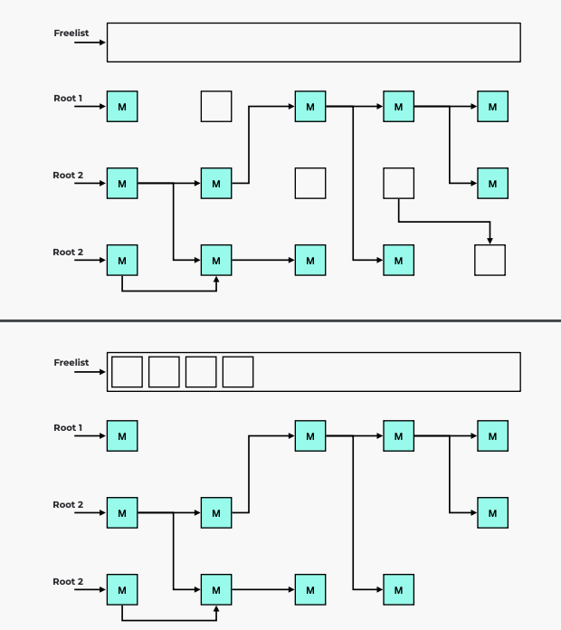
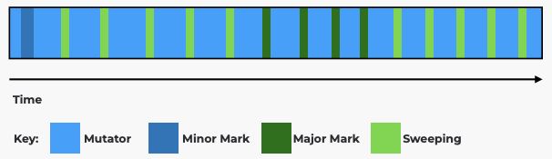

# RubyKaigi 2023

- in 松本
- 5/11(木), 12, 13
- https://rubykaigi.org/2023/schedule/
- ruby-jp/RubyKaigi 2023
- 事前イベント情報
  - [Ruby-dev office hour RubyKaigi 2023 直前スペシャル - connpass](https://rhc.connpass.com/event/279952/)
    - 5/1
- 当日イベント情報
  - [KeebKaigi 2023 Sponsorship Prospectus - Google ドキュメント](https://docs.google.com/document/d/1KYFmcw5EUdQWHeMGH6pxVp1vWrGEe36ySkLVh7y4Ovw/edit#heading=h.ige8lu3qf2h1)
  - [“RubyMusicMixin 2023”, a RubyKaigi after event, and Call for DJs and VJs! - pixiv inside](https://inside.pixiv.blog/2023/03/13/180000)
  - [Agileware Drinkup at RubyKaigi 2023 - connpass](https://agileware.connpass.com/event/279278/?utm_campaign=recent_events&utm_source=feed&utm_medium=atom)
    - 05/12(金) 18:00 〜 20:00
  - [MNTSQ Beer Hush!!! at RubyKaigi 2023｜IT勉強会・イベントならTECH PLAY［テックプレイ］](https://techplay.jp/event/899924)
    - 05/12(金) 18:00〜20:00
- 事後イベント情報
  - [After RubyKaigi 2023〜メドピア、ZOZO、Findy〜 - connpass](https://zozotech-inc.connpass.com/event/281473/)
    - メドピアが会場
- 予習情報
  - [RubyKaigi 2023 を最大限に楽しむために予習、ふりかえり、深堀り、三つのイベントを開催します！ - STORES Product Blog](https://product.st.inc/entry/2023/03/29/173529)
  - [RubyKaigi 2023予習](https://jungle-traffic-1ba.notion.site/RubyKaigi-2023-9dc26316fbf040eeb7d73acdbc18c893)
    - >この記事はわいたなかが、RubyKaigi 2023の予習のために調べた内容をまとめたものです。誤った内容や古い内容が多く含まれる可能性があることをご留意ください。誤りなどについてご指摘を頂ける場合は、TwitterのDMかリプライでお願いします。
- その他
  - [自腹で作る松本グルメマップ  2023 - SmartHR Tech Blog](https://tech.smarthr.jp/entry/2023/04/20/180925)
  - [After RubyKaigi 2022〜メドピア、ZOZO、Findyの参加者がLTします〜 - connpass](https://findy.connpass.com/event/260097/)
    - youtubeに残っているから見よう
  - [RubyKaigi 2023で「Rubyメソッドかるた」を配布します! - ESM アジャイル事業部 開発者ブログ](https://blog.agile.esm.co.jp/entry/ruby-method-karuta)
- スポンサー情報
  - [メドピアはRubyKaigi 2023にPlatinum Sponsorとして協賛します！ - メドピア開発者ブログ](https://tech.medpeer.co.jp/entry/2023/03/08/100000)
  - [【速報】マネーフォワードはRubyKaigi 2023 にPlatinum Sponsor で協賛します！ - Money Forward Developers Blog](https://moneyforward-dev.jp/entry/2023/03/01/104214)
  - [【申込開始】SmartHRは RubyKaigi 2023 に「Matsumoto Box Sponsor」として協賛します！ - SmartHR Tech Blog](https://tech.smarthr.jp/entry/matsumoto-box)
  - [RubyKaigi 2023 に ANDPAD メンバーが参加&登壇します! - ANDPAD Tech Blog](https://tech.andpad.co.jp/entry/2023/04/21/100000)
- **Day1**
- [since:2023-05-10_10:30:00_JST until:2023-05-11_11:30:00_JST ( OR  - Twitter検索 / Twitter](https://twitter.com/search?q=since%3A2023-05-10_10%3A30%3A00_JST%20until%3A2023-05-11_11%3A30%3A00_JST%20(%23RubyKaigi%20OR%20%23RubyKaigiA)%20&src=typed_query&f=live)
  - (A) JA Matz Keynote Yukihiro ""Matz"" Matsumoto @yukihiro_matz
    - Rubyの歴史と教訓
    - 1994/2/24 Rubyという名前が決まった日
      - Coral, Tish などの名前の候補があった
      - 言語の基本的な方針はこの時点で決まっていた
        - 最初の方針が大事
    - 1994~95
      - インターネット公開前
      - Alpha release
      - 他の人の意見でdo-endの文法が入った
        - 他の人の視点大事
      - バグ報告などのコミュニケーションからコミュニティーになっていった
    - 97~
      - Ruby1.0
      - 利益(99%)vs楽しみ(1%)
        - 楽しみ目的の人を同志という感じで開発に協力してもらう
    - 1999~
      - 本
        - 99 オブジェクト指向スクリプト言語 Ruby
          - まつもと ゆきひろ (著)
        - 00 ピッケル本 (プログラミングRuby)
          - 世界に広まるきっかけ
          - 達人プログラマーを書いた人
      - カンファレンス
        - JAOO(2001-09)
          - DHH(学生)がカンファレンスの手伝いをしていた(まだRailsを作っていない頃)
        - RubyConf(2001-10)
          - 37人くらい。フロリダ
            - RubyKaigi2023は1300人
      - → 人とのつながりが大事
    - 2004 Rails
      - Joy can create Benefit
      - Marketing is Important
        - 必ずしも「良いものと作れば自然に広まる」というわけではないことを知った
        - DHHはマーケティング(プレゼンテーションなど)がうまい
          - 15分blog動画を当時出たばかりのyoutubeで公開
    - 2009~
      - Ruby1.9.1
      - YARV やるぶ
      - 互換性を壊すとコミュニティーが荒れることを痛感
      - ↑を打ち消すくらいのパフォーマンス向上
    - 2013 20周年目
      - Ruby2.0
      - Railsの陰り
      - 「Rubyは死んだ」になってくる
    - 3x3
      - MJIT, YJIT が出てきた
      - リーダーシップとビジョンの提示は大事
        - キーノートなどで「Ruby 3x3」というビジョンを提示
    - その他
      - 他の実装があることは嬉しい
        - JRuby, IronRuby, TruffleRuby, mruby
      - RubyのISO規格(2012)
      - paul graham 100年の言語
        - Rubyは30年の言語
        - もう30年生きたい
- [since:2023-05-11_13:30:00_JST until:2023-05-11_14:00:00_JST ( OR  - Twitter検索 / Twitter](https://twitter.com/search?q=since%3A2023-05-11_13%3A30%3A00_JST%20until%3A2023-05-11_14%3A00%3A00_JST%20(%23RubyKaigi%20OR%20%23RubyKaigiA)%20&src=typed_query&f=live)
  - (A) JA The future vision of Ruby Parser Yuichiro Kaneko @spikeolaf
    - スライド：[The future vision of Ruby Parser - Speaker Deck](https://speakerdeck.com/yui_knk/the-future-vision-of-ruby-parser)
    - LR parser
      - 1965 Knuthが発明
      - 1875 Yacc
      - 1985 Bison
      - 今は手書きパーサーが主流
        - Goとかは2015年にbisonから手書きパーサーに移行した
      - 今のRubyはGNU Bisonを使ってLALRパーサを生成している
    - 問題(ドラゴン(ドラゴンブック))
    - 課題1：usability
      - LSPが出てきて、リッチなエラーを出したい要望
      - 構文エラーの場合もできるだけAST化したい
      - Python
        - PEGを使っている
        - 捕まえたいエラーケースを全部列挙して対応している
      - Rust, Go
        - 手書きパーサー
        - エラーケースの列挙が必要
      - Bison(Rubyが使っている)
        - エラーが起きた周辺を一旦消すことでどんなエラーなのを見つけている
          - 入力の一部を失ってしまう欠点あり
      - 採用したアプローチ
        - トークンを追加・挿入することで、エラーリカバリーをする
          - [Don't Panic! Better, Fewer, Syntax Errors for LR Parsers](https://arxiv.org/pdf/1804.07133.pdf) という論文の手法
        - (LA)LRパーサーでは、構文定義を[DFA](決定性有限オートマトン)に変換している
        - (LA)LRパーサーは、[PDA](プッシュダウンオートマトン)として実装されている
        - validな構文になるようなトークンを探索する方法さえ実装すれば、この手法が使える
      - 一旦まとめ
        - エラーから回復する方法がある
          - 一番カンタンに直せる方法を見つける
          - path finding logicだけを実装すれば良い
            - Rubyの文法がどうこうとかはきにしなくていい
          - bisonでこれを入れるのは大変
    - 課題2：maintaninability
      - bison
        - 実装をbisonのバージョンに追従するは大変
        - [yui-knk/lrama](https://github.com/yui-knk/lrama) をつくった
          - parse.y を読み込ませると Cで書かれたLALRパーサーを出してくれる
      - LRパーサーはオートマトンなので、CSの知見を十分に活かせる
      - parse.yが難しい理由
        - 1.5万行
        - LALRはコンフリクトが起きたときが難しい？
        - パーサーとレキサーが混ざっているのが鬼門
      - do-endのdoトークンには4種類がある(レキサーで判断)
        - [Matzにっき(2004-04-26)](https://matz.rubyist.net/20040426.html)
          - >OSS yaccの弱点(その2)
            - > Rubyの文法には「ifなどの条件式には任意の式が書けるけどdoが来てはいけない」とか、 「メソッド引数には任意の式が書けるけどコンマを含んではいけない」のようなルールが存在する。 これに対応するためには、
              - >すべてのルールを展開して、doが出現しうるものとdoが出現しないものの両方を用意する(コンマについても同様)。
              - >lexerに手を回して予約語doに対して違うトークンを返すようにする。
            - 2番目の手法を使っている
      - Nonterminal attributes という技術
        - 論文 [Practical LR Parser Generation](https://arxiv.org/abs/2209.08383)
        - コンテキスト?を運ぶ?ための技術
        - 非終端記号について属性を設定する
        - しかし、エンドレスdefの文法でコンフリクトを引き起こしてしまった
      - 考えてみると、これはdoの優先順位に関する問題
        - 優先度を定義する機能はbisonが既に提供している→コンフリクトしなくなった
      - まとめ：Nonterminal attributesだけでは解決できなかったdoの問題も既存の技術で解決できた
    - 課題3：universal parserf
      - RubyのパーサーはRubyの機能をたくさん使って作られているという問題がある
      - → 209個の関数に切り出した
      - 引き続きインターフェースを整理していきたい
    - まとめ
      - Rubyの3つの問題はLRパーサーの延長で解けた
      - リャマというパーサー基盤を用意したので、今後はこれを使おう
      - ドラゴンブックの剣士が持っている剣にはLALR Parser Generationという文字が書かれているぞ！
- 詳しくは [Ruby Parser開発日誌 (1) - かねこにっき](https://yui-knk.hatenablog.com/entry/2022/12/11/154502) を読むのが良さそう
- [since:2023-05-11_14:10:00_JST until:2023-05-11_14:40:00_JST  - Twitter検索 / Twitter](https://twitter.com/search?q=since%3A2023-05-11_14%3A10%3A00_JST%20until%3A2023-05-11_14%3A40%3A00_JST%20%23RubyKaigiB&src=typed_query&f=live)
  - (B) EN Understanding the Ruby Global VM Lock by observing it Ivo Anjo @KnuX
    - デモで使ったコードなど：https://ivoanjo.me/rubykaigi2023/
    - dd-trace-rb gem, gvl-tracing gem を作っている
    - 0 story
      - GVLはレイテンシに影響
      - gvl-tracing gem https://github.com/ivoanjo/gvl-tracing
    - 1 what GVL
      - RubyはC(とRust)で書かれている
      - Ruby threadとOS threadは1:1
      - マルチスレッドにおけるCコードの正しさを保証するためにGVLがある
    - 2 whati s the GVL not?
      - GVLでも、並行実行はできるが、並列はできない
      - コード実行時にロックを取れば、threadをたくさん作るコードでも正しく動く
      - GVLはRubyの処理系を守るものであり、Rubyで書かれたのコードを守るもんではない
      - JRubyやTruffleRubyは別の機構でGVLが必要ない実装になっている
    - gvl-tracing gemを使って色々解析
      - 100msごとにスレッドを切り替えている
      - webアプリが遅いのは、処理の中身のせいではなく、リクエストが重複しているせいかも
      - Ractorで解決
      - shopify/gvltools gem
      - 推測せずに計測、実験してみよう
        - pumaでためしてみたり
      - Rubyの未来は明るい
        - Ractor, YJIT, MaNyProject, 10msでスレッド切り替えするようになる(かも)
- スピーカーの方の記事
- [Ruby’s unexpected I/O vs CPU unfairness - ivo's awfully random tech blog](https://ivoanjo.me/blog/2023/02/11/ruby-unexpected-io-vs-cpu-unfairness/)
  - >入出力を実行するスレッドと CPU 処理を実行するスレッドを混在させると、I/O 処理が大幅に遅くなることに気づきました。
  - IOのスレッドのみの場合、IOが完了したらその瞬間に読み込んだIOを処理できる。早い。
  - IOのスレッドとCPUのスレッドがある場合、IOが終わったとしても、CPUのスレッドで100ms経たない限りはスレッドが移らず、結果的にIOのスレッドのレイテンシ(遅延)が大きくなってしまう
  - `Thread.pass`メソッドを活用するとよい
    - >他のスレッドに実行権を譲ります。実行中のスレッドの状態を変えずに、他の実行可能状態のスレッドに制御を移します。
      - https://docs.ruby-lang.org/ja/latest/method/Thread/s/pass.html
- まとめてくれている方
- https://twitter.com/m4buya/status/1656528507718217728?s=20
- [since:2023-05-11_14:50:00_JST until:2023-05-11_15:20:00_JST  - Twitter検索 / Twitter](https://twitter.com/search?q=since%3A2023-05-11_14%3A50%3A00_JST%20until%3A2023-05-11_15%3A20%3A00_JST%20%23RubyKaigiA&src=typed_query&f=live)
  - (A) EN "Ractor" reconsidered Koichi Sasada @ko1
    - or 2nd progress report of MaNy projects
    - スライド：https://www.atdot.net/~ko1/activities/2023_rubykaigi2023.pdf
    - Ractorの難しさ
      - プログラミングモデルの難しさ
      - エコシステム
      - 実装の問題
    - プログラミングモデルの難しさ
      - オブジェクトをメモリ
      - APIのルールが難しい
    - エコシステムの難しさ
      - 既存のライブラリはそのままじゃ使えない
      - いくつかのプログラムはractore用に再設計する必要がある
    - 実装の難しさ
      - send/recieveは実装がかんたん
      - rendezvous style (yield/take)の実装は難しい
      - Ractor.select は滅茶苦茶難しい
    - パフォーマンスの問題
      - 竹内関数で、4つのracotorを使うと、普通の実行よりも3.7倍早い
      - オブジェクトアロケーションをするコードだと2倍遅い
    - オーバーヘッドの理由
      - GCでは全部のractorがとまる
      - Ractorごとにnative threadを作っている
      - `Ractor.seleact(*rs)`はO(n)
        - `select()` system callと同じオーダー
    - 品質を上げて(今はココ)、沢山の人に使ってもらって、feedbackを得たい(良いサイクル)
    - 最近の良くしたもの
      - Rendezvous style の難しさは、同期の処理を書き直すことで良くなった
      - `Ractor::Selector`APIを提供して、これを使うことでO(1)になった
      - MaNyプロジェクトが完成すれば、ネイティブスレッド立ち上げすぎの問題も解決する
        - 技術的な話題が沢山ある
          - 現状：https://github.com/ko1/ruby/tree/many2
          - ほとんどのruby/rubyのテストは通った状態
        - MaNyプロジェクトによりRactorのコードが2倍早くなったが、ネイティブスレッド1個に縛ったときに素のRubyと同じ速さになるはずなのに遅くなっており(理論上は同等の速度)、改善できそう
    - 今後の課題
      - ractorごとのGCを並列に行いたい
        - Ractor感で共有しているオブジェクトが少しだけあり、それが問題
        - 解決を、GSoC2022で進行中
- [since:2023-05-11_16:00:00_JST until:2023-05-11_16:30:00_JST  - Twitter検索 / Twitter](https://twitter.com/search?q=since%3A2023-05-11_16%3A00%3A00_JST%20until%3A2023-05-11_16%3A30%3A00_JST%20%23RubyKaigiB&src=typed_query&f=live)
  - (B) EN  Plug & Play Garbage Collection with MMTk Matt Valentine-House @eightbitraptor
    - スライド：https://www.eightbitraptor.com/presentations/RubyKaigi2023-mvh.pdf
    - 1995 Ruby 0.95
      - 最初期のGC
**gc.c**

```
typedef struct RVALUE {
  union {
    struct {
      VALUE flags;		/* always 0 for freed obj */
      struct RVALUE *next;
    } free;
...
```

- `RVALUE *freelist`というものがあって、中身は↑のリスト
  - ヒープのうち、空いているスロットをポインタでつなげたLinkedList (のrootを指している)
- Rootから、マークされなかったモノをfreelistとしてつなげる
  - 
- 2011 Ruby 1.9.3
  - Lazy Sweep の導入
    - Sweepちょちょっとずつおこなって、Markは一気やる
    - 
      - mutatorというのはユーザーのコードの実行などの、オブジェクトの生成や破棄をするもの
- 2013 Ruby 2.1
  - 世代別GC (Generational GC)
    - MinorMark と MajorMark
  - ライトバリア
    - オブジェクトへの書き込みを検知する機構のこと
    - C拡張のオブジェクトはUnprotectedであり、Unprotectedなオブジェクトはoldには決してならない(常にyoung)
    - (既存のC-extなどへの)後方互換性を保っているが、パフォーマンスを犠牲にしている
- 2014 Ruby 2.2
  - Incremental Marking
  - MinorMarkとMajorMarkとSweepingがあって、どれもちょっとずつ
  - 
- 2019 Ruby 2.7
  - Compaction
  - ヒープが少しで済む、局所性が上がる、CoWのパフォーマンスが上がるなどのメリット
  - C-ext によって作られたオブジェクトは常にpinned(固定)(compactionされない)
- 2020 Ruby 3.0
  - Automatic Compaction
  - 2.7は手動でcompactionしていたが、3.0からは自動になった (?)
  - スイープ中であってもオブジェクトの変更ができるようになった(?)
- 2022 Ruby 3.2
  - variable width allocation (VWA)
  - improve mutator performance
  - improve date locality
  - fewer external allocations
- 2023 ?
  - RubyGCは30さい
- Immix
  - [Immix: a mark-region garbage collector with space efficiency, fast collection, and mutator performance](https://dl.acm.org/doi/10.1145/1379022.1375586) で提案された手法
  - GCのアルゴリズムは↓の3つの組み合わせ。性能はそれぞれ。
    - Allocation
      - Free-List
      - Bump Pointer
    - Identification
      - Tracing (Implicit)
      - Reference Counting (Explicit)
    - Recaimation
      - Sweep
      - Evacuation
      - Compaction
  - Immixという、Mark-Region 方式のGC?
    - Inko, Scala Native, GHC, Rubinius
      - Inko というの言語がある https://inko-lang.org
      - Rubinius: https://github.com/rubinius/rubinius
        - >Rubinius uses a single mechanism for garbage collection, the **Immix mark-region collector.**
- LXR
  - [Low-latency, high-throughput garbage collection](https://dl.acm.org/doi/abs/10.1145/3519939.3523440)
  - 新しいGCアルゴリズムのこと
  - リファレンスカウント方式?
- MMTk
  - https://github.com/mmtk/mmtk-core
  - memory management toolkit
    - メモリマネージャー
  - 元々は Jikes RVM という JVM の一部
  - これを組み込めばいろいろな種類のGCを使うことができる？
  - いくつかの言語で取り込み済み(OpenJDK, V8, JikesRVM), 取り込み中(Julia, GHC, Ruby!)
  - rubyのmmtkブランチで試せる(linux only)
- よしあし
  - よし
    - 早くなりそう
  - あし
    - エラーのコードが複雑？
    - GCの処理は変更しづらい
- Rubyは一般的なメモリマネジメントのAPIを提供するべきか？
  - Benefits
    - GCライブラリを使える
    - mmtkとかを使える
  - Questions
    - C-ext
    - メンテナンス負担
    - パフォーマンスペナルティ
- https://wiki.eightbitraptor.com/rubykaigi-2023-references
- (A) EN/JA Lightning Talks
  - Building Ruby Native Extention using Ruby
    - **Rubyで**Rubyのネイティブextを作りたい
    - 「Rubyをx86のアセンブラにする」
    - https://github.com/katsyoshi/vaporware
    - https://blog.katsyoshi.org/blog/2023/03/21/my-hobby-is-building-vaporware/
  - RBS meets LLMs - Type inference using LLM
    - 単語の意味から型を推測できるかも？
    - だいたい上手く行った
    - FewShot
      - 模範解答を入力してから回答させる手法
      - →余分なコードも出ずにいい感じになった
  - Customize your Vim/Neovim directly with Ruby
    - vimは**高橋メソッド**に便利
    - vimscriptでrubyが書ける?
      - `rubyeval`関数
    - Ruby3.2のAbstractSyntaxTree::keep_tokensの機能を使っている
      - ノードからそのトークンを得れる機能
  - mruby VM
    - mruby
      - resgister based
        - 1個1個の命令は長くなるが、トータルの命令の量はへる
        - のぞき穴最適化がしやすい
      - ruby specialized instructinos
      - portable
    - keyboardの上で動かしたりできる
      - picorubyコンパイラでやっている人がおおいかも
  - Natsukantou the XML translator
  - BINGO!
  - Adding custom rule for Rubocop in the 2 month of employment
  - Unexplored Region - parse.y -
    - [たのしいRubyの構文解析ツアー - Speaker Deck](https://speakerdeck.com/coe401_/tanosiirubynogou-wen-jie-xi-tua)
  - Ultra-fast test-driven development
    - https://github.com/asonas/rspec-daemon
    - guradとのちがい
      - プロセス立ち上げっぱなし
        - じゃあspring gemとは何が違うのか
          - fgで起動しておいている
  - Optimizing Ruby’s Memory Layout: Variable Width Allocation
    - VWA
    - GCによるメモリレイアウトの制限
      - 40byte
        - それ以上は別の場所に置かれる
      - ↑欠点
        - キャッシュが効きにくい
        - mallocのオーバーヘッド
        - メモリの使い方が非効率的
    - そこで、VWA
      - 動的にサイズが変化するオブジェクトについて... (聞き取れず...)
  - Dividing and Managing: The Cops Squad of RuboCop RSpec Dept
  - Serverless IdP for small team
    - https://github.com/sorah/himari
- **Day2**
- [since:2023-05-12_10:20:00_JST until:2023-05-12_10:50:00_JST  - Twitter検索 / Twitter](https://twitter.com/search?q=since%3A2023-05-12_10%3A20%3A00_JST%20until%3A2023-05-12_10%3A50%3A00_JST%20%23RubyKaigiC&src=typed_query&f=live)
  - (C) JA Implementing ""++"" operator, stepping into parse.y Misaki Shioi @coe401_
    - スライド：https://speakerdeck.com/coe401_/implementing-plus-plus-operator-stepping-into-parse-dot-y
    - https://github.com/shioimm/ruby-plusplus
    - parse.yの説明
    - `++`を`#succ`にしたい
    - やること
      - `++`の記号定義(scanner)
        - `iINCOP`
        - parser_yylexにcaseを追加
      - 構文規則の追加(parser)
        - `++`をメソッド呼び出しにする
        - 還元時のアクションで、メソッド呼び出しを表すRNodeを作る
          - `$$ = new_qcall(...)`
    - ↑破壊的にレシーバーを書き換えたい
    - `#__plusplus__`メソッドを使う方式
      - メタプロで変数をgetして再代入
    - ↑レシーバが数値リテラルの場合に動かない
    - やること
      - Matz: inc/decにオブジェクト指向のセマンティクスを追加できない
    - `++`を`+=1`のsyntax suggerにする方式
      - scanner
        - `+`と`++`
          - `+`を見たときに次の1文字を見る(`peekc`)
            - それが`+`なら一旦次へ
    - ↑`++`の優先順位がいまいち
    - parserで頑張る方式
      - scannerはほぼ同じ(字句解析はそのまま)
      - `i++`の構文規則を追加(構文規則の方を変える)
        - `new_op_assign()`を使う
          - `+=`や`-=`などを表すノードを作る
    - ↑単項演算子`+`の連続の文法が壊れた... これはruby++
- [RubyKaigi 2023に参加しました & 登壇しました - shioimm || coe401_](https://coe401.hatenablog.com/entry/2023/05/21/212347)
- [since:2023-05-12_11:00:00_JST until:2023-05-12_11:30:00_JST  - Twitter検索 / Twitter](https://twitter.com/search?q=since%3A2023-05-12_11%3A00%3A00_JST%20until%3A2023-05-12_11%3A30%3A00_JST%20%23RubyKaigiA&src=typed_query&f=live)
  - (A) EN Yet Another Ruby Parser Kevin Newton @kddnewton
    - https://github.com/Shopify/yarp
    - error tolerance (エラーの許容範囲)
      - IDEのため
      - 自動でトークンを追加
      - 自動でノードを追加
      - `a + (`まで書いたときに何が足りていないのかを知りたい
      - コンテキストに応じた回復
        - `missing token`を追加？
        - どの`end`が足りないかとかを補完してくれる？
    - portability
      - いろいろな実装やツールのため
      - CRuby固有のもの(`VALUE, ID`など)に依存してはいけない
      - 他のパッケージに依存してもいけない
      - 文字列のエスケープなどは外から使えるAPIとして切り出さないといけない
      - 各々の実装が文法に関するコードをアップグレードしなくて良くなる?
    - maintaainability
    - challenges
    - adoption
    - future work
- [since:2023-05-12_11:30:00_JST until:2023-05-12_14:00:00_JST  - Twitter検索 / Twitter](https://twitter.com/search?q=since%3A2023-05-12_11%3A30%3A00_JST%20until%3A2023-05-12_14%3A00%3A00_JST%20%23RubyKaigiB&src=typed_query&f=live)
  - (B) EN Splitting: the Crucial Optimization for Ruby Blocks Benoit Daloze @eregontp
    - スライド：https://eregon.me/blog/assets/research/splitting-the-crucial-optimization-for-ruby-blocks-rubykaigi.pdf
    - >この最適化は分割と呼ばれ、メソッドのさまざまなコピーを使用し、それらをさまざまな呼び出しサイトで指定されたブロックに特化します。これにより、メソッドとブロックを一緒にコンパイルして最高のパフォーマンスを得ることができます。
    - cache
      - loopup cache
        - どこのクラスのメソッドが呼ばれたか
      - call target cache
        - どこで呼ばれたか
    - 渡されたブロックをインライン化する
      - どんなブロックが渡されたかによってメソッドの中で分岐する
    - TruffleRubyではもっと一般的なアプローチでやっている
```text
1.0.sum_to(10.0) ->                                     -> `Float >`
1.sum_to(10)     -> sum_to->step `untile value > limit` -> `Integer >`
```

- 性能
  - splittingをTruffleRUbyですると、CRubyの106倍(元々TruffleのはCRubyの15倍)
  - OptCarrotも性能up
- まとめ
  - paper SELF VM (1989)
  - completely removes polymorphism and megamorphism
- TrufflleRubyやGraalVMの利点
  - `Polyglot.eval('python', 'import matplotlib')`
  - 複数の言語をまたげる
    - LSPやバックトレース用
  - GCを使い分けられる？
- [since:2023-05-12_14:10:00_JST until:2023-05-12_14:40:00_JST  - Twitter検索 / Twitter](https://twitter.com/search?q=since%3A2023-05-12_14%3A10%3A00_JST%20until%3A2023-05-12_14%3A40%3A00_JST%20%23RubyKaigiC&src=typed_query&f=live)
  - (C) EN Reading and improving Pattern Matching in Ruby Yuki Torii @yotii23
    - arrayの場合はdeconstructとかをやめた
    - 2倍になった
    - deconstructのoverrideのcheck
    - https://twitter.com/kokuyouwind/status/1656894460914188288?s=20
      - >「ArrayパターンにおけるdeconstructメソッドとそれがArrayを返すかのチェックは、Arrayには必要ないはずなので、Arrayチェックを先に挟んでスキップすることで高速化できないか」 これどっちが速いんだろうなぁ。Array渡すケースが支配的ならこの方が速いのか
- [since:2023-05-12_14:50:00_JST until:2023-05-12_15:20:00_JST  - Twitter検索 / Twitter](https://twitter.com/search?q=since%3A2023-05-12_14%3A50%3A00_JST%20until%3A2023-05-12_15%3A20%3A00_JST%20%23RubyKaigiA&src=typed_query&f=live)
  - (A) EN Fitting Rust YJIT into CRuby Alan Wu @alanwusx
    - 2020 μJIT
    - 2021 YJIT
    - 2022 TJITtoRust
      - AArch64
    - 自動生成したコードをRustの借用チェッカーで検査できるのがうれしい
    - Rustの統合における難しさ
      - Rubyにはバイナリはない (自前でビルドしないといけない)
      - 一口にRubyを入れると行ってもたくさんの選択肢がある
    - rubyのmake
      - cargoは(Rubyのmakeの)インクリメンタルビルド? ができない?
    - C言語の仕様(型のサイズ?)がなにか難しい
    - Cの修飾子restrict, constなど)とRustの`&, &mut`
      - >restrict は C99 標準によって導入されたキーワードであり、ポインター宣言で使用できます。この型修飾子を追加することにより、プログラマーは、ポインターの有効期間中、ポインターが指すオブジェクトへのアクセスに他のポインターが使用されないことをコンパイラーに示唆します。(日本語訳)
        - https://en.wikipedia.org/wiki/Restrict
      - RefCellはメモリを食うしクラッシュするかも
      - 今はunsafeでなんとかしている
    - link
      - `ld`コマンド(コンパイルされたコードを統合するツール)
- [since:2023-05-12_16:00:00_JST until:2023-05-12_16:30:00_JST  - Twitter検索 / Twitter](https://twitter.com/search?q=since%3A2023-05-12_16%3A00%3A00_JST%20until%3A2023-05-12_16%3A30%3A00_JST%20%23RubyKaigiA&src=typed_query&f=live)
  - (A) EN Tips and Tricks for working in the MRI Codebase Jemma Issroff @jemmaissroff
    - 3bugs
    - ①`#sum`のバグ
      - build locally
        - デバッグフラグ色々
      - test localy
        - miniruby
          - bootstraptest ディレクトリ
          - `make btest`
          - `BTEST=ファイル`
        - ruby
          - testディレクトリ
          - `make test-all -j16`
          - `TEST=ファイル`
      - 関数の見つけ方
        - `#sum`の例
        - `rb_define_xxx`
      - lldb
        - `make lldb`
    - ②system stack error
      - lldbコマンド
        - `bt` backtrace
        - `f <number>` n番目のフレームへ行く
        - `up, down`↑↓のフレームへ
      - `misc/lldb_helpers`
      - `rb_bug`関数を使おう
    - ③ipaddr
      - libディレクトリへの変更は、ruby/rubyとは別のディレクトリにある
        - 別のディレクトリにある実装が、ruby/rubyにミラーされる
      - 便利なURLがある
        - `https://gem.wtf/irb`→`https://github.com/ruby/irb`
- [since:2023-05-12_16:40:00_JST until:2023-05-12_17:40:00_JST  OR  - Twitter検索 / Twitter](https://twitter.com/search?q=since%3A2023-05-12_16%3A40%3A00_JST%20until%3A2023-05-12_17%3A40%3A00_JST%20%23RubyKaigiA%20OR%20%23RubyKaigi&src=typed_query&f=live)
  - (A) EN Keynote Optimizing YJIT’s Performance, from Inception to Production Maxime Chevalier-Boisvert @maximecb
    - 技術的な話ではない。YJITの紹介など
    - JITはAOTに比べて、動作を観察できる利点がある
    - マイクロJITの時代
      - JITに入るときと出るときに時間ががかかっていた
    - ベンチマークだけでもなんだか滅茶苦茶色々なことを考えないといけなくて大変そう
- **Day3**
  - (A) EN Ruby Committers and The World CRuby Committers @rubylangorg
    - new committers
      - matt valentine-houserさん
        - shopyfy, yjit
      - makenowjustさん
        - regexの人
  - (A) EN Ruby JIT Hacking Guide Takashi Kokubun @k0kubun
    - スライド：https://speakerdeck.com/k0kubun/rubykaigi-2023
    - リポジトリ：https://github.com/k0kubun/ruby-jit-challenge
    - Ruby3.3 RJIT
    - `--yjit-dump-disasm`
    - x86のアセンブリをRubyでかいて`pack('*c')`してfiddleで読み込めば実行できる
    - 独自のjitを作ればfibonattiとかはYJITより早くできる?
    - メソッドの中身を置き換えられて、Intergerの`+`メソッドのバリデーションを外したりできる？
    - 定数もできる
    - https://twitter.com/kokuyouwind/status/1657266997338714112?s=20
      - >「Optimizing Ruby JIT。side exitsがとても重要」 ちょっと聞き取りきれてないけどメモリページをまたぐときにジャンプが必要でオーバーヘッドがかかるって話？
        - > Fixnum+Fixnumの結果が64bit signed intをoverflowしたときに、結果をBignumにしないといけないって話だと思います (@nalsh)
    - `stack[0]`がレジスタみたいな話をしているけれどもよくわからん
    - Ploymorphic method cache
      - ブロックのiseqが違う`each`について、インライン化できたりもするらしい?
- [RubyKaigiでJITコンパイラの書き方について発表した - k0kubun's blog](https://k0kubun.hatenablog.com/entry/2023/05/18/171546)
