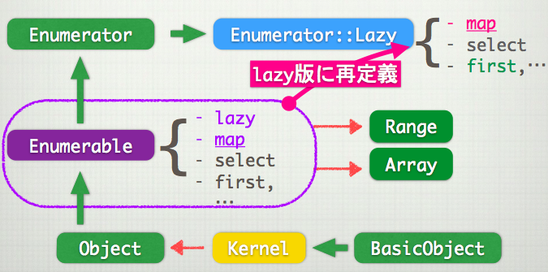

# Rubyのイテレーター系クラスの整理

- `Enumerator::Lazy < Enumerator < Enumerable(module) < Object < Kernel < BasicObject`
- `Range < Enumerable(module) < Object < Kernel < BasicObject`
- Enumrableをincludeするクラスはeachの定義が必要
  - Enumrableがselectとかを提供している
- Enumeratorは、イテレーターそのものを実装するためにあるクラス
  - Enumrableのメソッドで(selectとか)、ブロックを与えずなかったときの返り値のクラスがこれ
  - `with_index`や、`next`や`rewind`とかを追加している
- Rangeは、始点・終点のオブジェクトが`succ`を実装している必要がある
- `Enumrator::Lazy`は... 下の記事参照
  - もともと、selectとかでブロック指定しなければ`Enumrator`が返ってきて、これは遅延評価
**lazy.rb**

```
(1..(10**100)).select # 一瞬で返ってくる #=> #<Enumerator: 1..10000000000000000000000000000000000000000000000000000000000000000000000000000000000000000000000000000:select>
```
  - 昔からある`Enumrator`オブジェクトをselectとかで返したいときに、`Enumrable#lazy_select #=> Enumraterオブジェクト`の方法で定義すると、lazy_hogehogeみたいな名前のメソッドが増えすぎるから、名前空間を分けて対処しようという目的でこのEnumrator::Lazyクラスが出来た。

**lazy.rb**

```
(1..(10**100)).lazy.select{|x|x.odd?} #<Enumerator::Lazy: #<Enumerator::Lazy: 1..10000000000000000000000000000000000000000000000000000000000000000000000000000000000000000000000000000>:select>

```

- [EnumeratorとEnumerator::Lazyの違い - Qiita](https://qiita.com/gam0022/items/8acfc0c674b96060c03f)
- ここが分かりやすくまとまっていた
- 
- **Array, Enumrator, Rangeの相互変換**
  - Array
    - => Enumrator
      - Lazy化してmapすれば、Enumrator::Lazyを返すようになる
      - Enumratorを返すのは標準メソッドでは無さそう
        - あるとしたらEnumrable#lazy_mapみたいな名前になるんだろうけど上に書いた理由で実装されてない
        - 作ったEnumrator::Lazyをeagerすれば良いかも?
    - => Range
      - succメソッドをそのArrayのオブジェクトに定義すればいい
      - succメソッド内に、前の値と次の値のペアを定義しておけば出来なくもない
        - succメソッド定義内に値のペアをメタプログラミングでハードコーディングする実装になりそう
        - せっかくRangeを作ってるのにメモリ消費しちゃってるからやるメリットが薄い
        - やるとしたらこう。IntegerやNilClassとかには特異メソッドできないからできない。
```ruby
class Array
  def to_range
    self.each_cons(2) do |a, b|
      a.define_singleton_method(:succ) { b }
    end
    Range.new(self.first, self.last)
  end
end
a = ["a", "b", "c"]
r = a.to_range
p a === 'b' # => false
p r === 'b' # => true
```

- Enumrator
  - => Array
    - to_aがある
  - => Range
    - Array => Rangeのときと同じ方法で実装できそうだけど無意味
- Range
  - => Array
    - to_a
  - => Enumrator
    - ブロックなしeach
- 雑感
  - Range#shiftみたいなメソッドがあってもいいと思う
