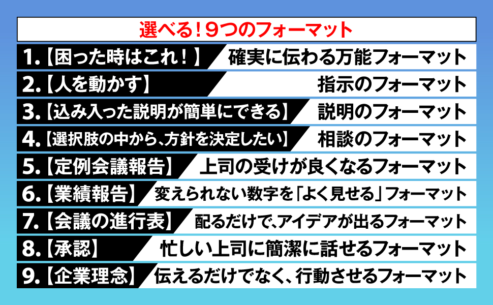

# THE FORMAT

- https://www.sunmark.co.jp/detail.php?csid=4018-0
- 
  - 序章
    - 「対話」する
      - 1回のやりとりで終わらせようとせず、何度もやり取りする
  - 1章 フォーマット 4個
    - 伝える
      - 1. (この文章を)なんのために書くのか
      - 2. 誰が読むのか
      - 3. 相談したいこと
      - 4. 現状
      - 5. 問題
      - 6. 対策案
      - 7. 判断してほしいこと
      - 8. いつまでに返事が欲しいか
    - 指示
      - 1. なんのために書くのか
      - 2. 誰が読むのか
      - 3. この仕事のゴール・目的
      - 4. 具体的に頼みたい仕事
      - 5. 注意してもらいたいこと
      - 6. (仕事を進めるにあたって)必要なデータや情報
      - 7. 疑問や質問がある場合
      - 8. 期限
    - 承認
      - 1. なんのために書くのか
      - 2. 誰が読むのか
      - 3. 現状
      - 4. 課題
      - 5. 課題の原因
      - 6. 原因の根拠や元データ
      - 7. 解決案
      - 8. 解決案による効果
      - 9. これで進めて問題ないか?
      - 10. 返事の期限
    - 方針相談
      - 1. ゴール
        - 決めたいこと
      - 2. メリット・デメリット
      - 3. 議論すべき点(論点)
  - 2章 テクニック 10選
    - 会話はチャット、相談内容は資料
      - 資料を作って、相談したい旨をチャットで伝える
    - 推測せず、具体的に
      - X 大丈夫ですか? → O 時間や忙しさ等問題ないですか?
      - 曖昧な部分があったら(推測せずに)積極的に聞く
    - 1トピック1メッセージ
    - 事実と印象と意見を分ける
      - 事実：(確定事項なので)こうなるはず
      - 印象：(自分から見た感じ)多分こうなるはず
      - 意見：(自分が)こうするつもり
      - 事実と意見はハッキリ分けられるけれど意見と印象は混ざりそう
    - 適切な「たとえば」をつける
    - 解釈が分かれそうなことには定義を書く
      - 「期日」とか？
    - 主語を小さくする
    - 数字を入れる
    - 比較を入れる
      - 縦(時系列間)の比較
      - 横(他部署間)の比較
    - 過程を書いておく
  - 3章 フォーマット 5個
    - フォーマット紹介というよりも、2章と3章の実践っぽい感じがする
    - 会議を方針を決める
      - 数字を書くときは比較も書く
      - アクションリストを書く
    - 実績を報告する
      - 振り返り欄に書くべきこと
        - やったこと
        - その結果
        - 今後やっていくこと
    - 会議でアイデアを出してもらう
      - 「ゴール」「前提条件」を書く
      - 「ゴール」は絞る(増やさない)
    - 提案を承認してもらう
      - 「目的」「提案」「期待効果」を書く
    - 全員を同じ方向に向かわせる
- 書いてあることはためになった部分もあるけれど、本の構成が破茶滅茶で読みにくかった
- チャットであっても見出しをつけて書くようにしたい
- とはいえamazonのレビューは3.9だ...
