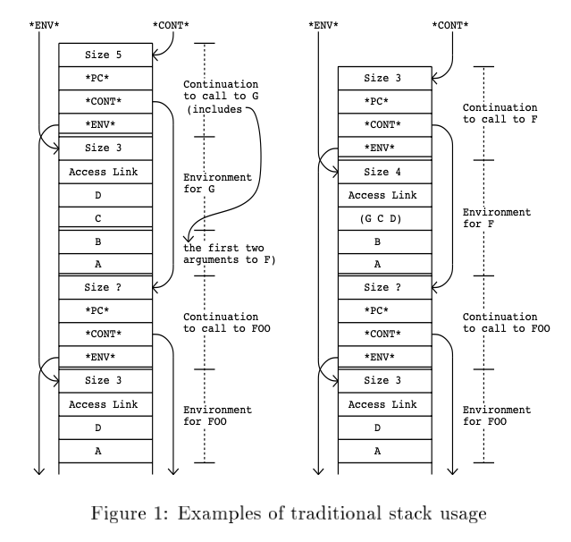
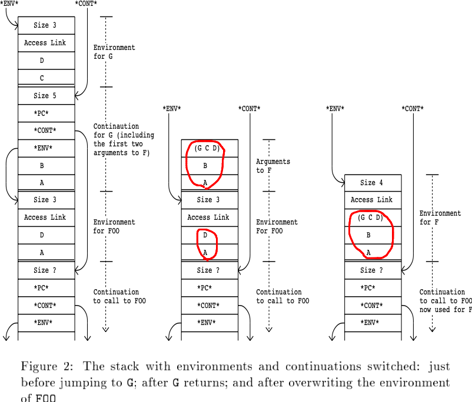

# Tail-Recursive Stack Disciplines for an Interpreter

- https://citeseerx.ist.psu.edu/viewdoc/summary?doi=10.1.1.51.6448&rank=1&q=Tail-Recursive%20Stack%20Disciplines&osm=&ossid=
- Richeard A. Kelesey
- NEC Research Institute
- 1993
- >Many languages, including Scheme, ML, and Haskell, require that their implementations support tail-recursive calls to arbitrary depth. This requirement means that a traditional stack discipline cannot be used for these languages. This paper examines several diierent methods of implementing proper tail recursion in a stack-based interpeter, including passing arguments in a heap, copying arguments to tail-recursive calls, and garbage collecting the stack. Benchmark timings and other run-time statistics are used to compare the diierent methods. The results show that using a stack is a good idea, and that the overhead of the interpreter largely overshadows the diierences in performance of the various stack disciplines.
- > Scheme、ML、Haskellなど多くの言語では、任意の深さの末尾再帰的呼び出しをサポートすることが実装上要求されている。この要件は、これらの言語に対して伝統的なスタック規律が使えないことを意味する。本論文では、スタックベースのインタプリタに適切な末尾再帰性を実装するための、**ヒープでの引数渡し**、**末尾再帰呼び出しへの引数のコピー**、**スタックのガベージコレクション**など、いくつかの異なる方法について検証する。また、ベンチマークタイムとその他の実行時統計量を用いて、それぞれの方法を比較した。その結果、スタックを使用することは良いアイデアであり、インタープリタのオーバーヘッドは、様々なスタック分野の性能の違いを大きく覆い隠してしまうことがわかった。
- **1 The Problem**
  - Scheme, ML, Haskell で要求されているもの
    - 末尾再帰
      - >プログラミング言語の実装において、再帰的に表現された無限の反復計算が定数空間で実行可能であれば、適切な末尾再帰的であると言える。
    - クロージャ環境
    - 継続(Schemeのみ)
      - >継続とは、手続き呼び出しの間に保存され、手続きが戻ってきたときにその手続きの呼び出し元を再起動させるために使われるすべての情報のこと
  - 上記言語をインタプリタとして実装するのはなぜか
    - 移植性
    - デバッグ
  - Appel曰く、GCとコンパイラが頑張れば、スタックよりもヒープの方が効率的
    - 多分、この論文ではこの主張を検証しようとしている
  - スタックを使わずスタックのGCを使う実装では、スタック最遅よりも13%遅かった
- **2 Why traditional stack won't work**
  - スタックは継続や環境の標準的な実装方法
  - 「引数、プログラムカウンタ、環境ポインタ、プロシージャが返された後に必要なもの」がスタックにpushされる
  - returnしたとき
    - 普通はスタックのトップは削除される
    - 保存する必要がある場合はヒープにコピーされる
      - このとき、環境と継続は、自身のサイズ(?)を知っている必要がある
  - 環境や継続の保存時は、それらをスタックからヒープにコピーする
    - >For "continuations", this may be either unnecessary, if continuations need not be preserved, or it may be found at a known offset from the saved program counter and not take up any space on the stack.
    - > 継続の場合、継続を保存する必要がなければ、これは不要であるか、保存されたプログラムカウンタからの既知のオフセットで見つかり、スタック上のスペースを取らないかもし れません。
      - ここでの継続は、いわゆる第一級継続ではなくて、関数がreturnしたあとにどこに戻るのかという意味で(計算の流れという意味で)継続という言葉を使っている？
```lisp
(DEFINE FOO
  (LAMBDA (A D)
    (F A B (G C D))))
```

- 
  - `Access link: 値を参照する変数を探すためのリンク．`
    - [プログラム言語論 亀山幸義](http://www.cs.tsukuba.ac.jp/~kam/lecture/plm2013/3.pdf)
  - [c - スタック フレームのアクセス リンクとは? - スタックオーバーフロー](https://stackoverflow.com/questions/39230768/what-is-an-access-link-on-a-stack-frame)
    - レキシカル環境を辿るためのリンクっぽい
    - それなら`*ENV*`は何？
- >The difficulty with the standard stack discipline is that it does not implement proper tail recursion. When control transfers to the body of F the stack contains the environment and the continuation of the call to FOO.
- > But since the call to F is tail recursive, these do not contain any necessary information.
- > The values in the environment will never be used again.
- > The continuation will just remove itself and the environment from the stack and return to its saved value of *CONT*.
- > After a series of such calls the stack may overflow, even though it contains very little useful data.
- > The traditional stack discipline eventually recovers the stack space used for a procedure call, but in the case of tail-recursive loops, it recovers it too late.
- > Overflowing the stack in this fashion puts a limit on the number of times a recursively expressed iterative loop can execute.
- > 標準的なスタック規律の難点は、適切な末尾再帰を実装していないことである。制御が F のボディに移るとき、スタックは環境と FOO への呼び出しの継続を含む。
- > しかし、F の呼び出しは末尾再帰的であるため、これらには必要なインフォーメーションが含まれない。
- > 環境中の値は二度と使われることはない。
- > 継続はスタックから自分自身と環境を取り除き、保存された値である *CONT* に戻るだけです。
- > このような呼び出しが続くと、スタック はほとんど有用なデータを含んでいないにもかかわらず、オーバーフローすることがあります。
- > 従来の スタック規律は、最終的に手続き呼び出しに使用されたスタック領域を回復する。しかし、末尾再帰ループの場合、回復が遅すぎる。
- > このようにスタックをオーバーフローさせることにより再帰的に表現された反復ループが実行できる回数に制限がかかる。
  - Fは末尾呼び出しをしているので、FOOがFを呼び出すとき、FOOのフレームには不要な(ゴミの)情報しか残っていない
    - 環境の値は(もう参照されないので)使われない
    - 継続の値は(`*CONT*`)に戻るのみ
  - (TCOしていないと) TCが続いたときに、ゴミのフレームで溢れてスタックオーバーフローする
- >Dealing with the continuations is easy. Simply do not make a new continuation for a tail-recursive call, and reuse the current continuation instead.
- > In the example, the call to F does not require a new continuation and could use the one passed to FOO.
- > The real problem is the environments. A tailrecursive call simultaneously creates a new environment and makes the old one obsolete.
- > On a stack, the storage used for the old environment is lost, as it lies beneath the new environment.
- >継続への対処は簡単です。単に、末尾再帰的な呼び出しに対して新しい継続を作らず、代わりに現在の継続を再利用すればよいのです。
- > この例では、Fへの呼び出しは新しい継続を必要とせず、FOOに渡されたものを使用することができます。
- > **本当に問題なのは環境です。末尾再帰呼び出しは同時に新しい環境を作り出し、古い環境 を陳腐化させる。**
- > スタック上では、古い環境に使われていたストレージは失われる。スタック上では、古い環境に使われていたストレージは新しい環境の下にあるため、失われます。
  - 継続は、同じものを付け替えればいいだけ
  - 環境は、、、古い環境中のストレージが失われるのが問題？
- **3 Methods for implementing proper tail recursion**
  - スタック上で適切な末尾再帰を実装するための3つの一般的なアプローチを紹介
- 1. スタックの代わりにヒープを使用する
  - 環境をスタックではなくてヒープに置けばよい
  - >Appel 87は、すべての環境とすべての継続をヒープに置くことを提唱している。
- 2. 末尾再帰呼び出し時に環境を上書きする
- > It is also possible to implement proper tail recursion and still use a stack for the environments.
- > If no new continuation were created for the call to F and its arguments overwrote the environment of FOO, the call could be made with no unnecessary data on the stack.
- > Any number of such calls could be made without overflowing.
- > 末尾再帰を正しく実装しても、環境のためにスタックを使用することは可能である。
- > F の呼び出しに対して新しい継続が生成されず、その引数が FOO の環境を上書きする場合、スタック上に不要なデータがない状態で呼び出しを行うことができます。
- > このような呼び出しはいくつでもオーバーフローすることなく行うことができる。
- >
- > There are two possibilities here.
- > The current environment could be incrementally overwritten as the new arguments are produced, as in (Kranz 88, Hanson 90) , or the arguments could be stored in temporary locations and then copied on top of the current environment once they are all available, also in (Hanson 90, McDermott 80).
- > The first is usually more efficient, as a clever implementation can get away with moving fewer values, and the second is clearly simpler, as data dependencies between the values in the environment and the arguments can be ignored. In the worst case, where every element of the environment is needed to compute each argument, the first method degenerates to the second.
- > ここで、2つの可能性がある。
- > (Kranz 88, Hanson 90) のように、**新しい引数が生成されると、現在の環境は漸進的に上書きされる。  または、引数は一時的な場所に保存され、その後、現在の環境の上にコピーされる**かもしれません。のように、新しい引数が生成されると、現在の環境は徐々に上書きされていく。(Hanson 90, McDermott 80) のような方法もあります。
- > 前者は、賢い実装ではより少ない値の移動で済むので、通常より効率的です。後者は、環境中の値と引数の間のデータ依存性が無視できるので、明らかに単純です。最悪の場合、環境のすべての要素が各引数を計算するのに必要な場合、最初の方法は2番目へと退化する。
  - Rubyはこの方法の、後者の可能性の方で実装している
- > There is a difficulty with incrementally overwriting the current environment that makes it unsuitable for an interpreter. If an error occurs during the evaluation of an argument, the calling procedure's environment will be partially overwritten by the arguments to the called procedure.
- > 現在の環境を漸進的に上書きすることには、インタプリタに適さない難点がある。引数の評価中にエラーが発生した場合 引数の評価中にエラーが発生した場合、呼び出した手続きの環境は 呼び出された手続きへの引数で部分的に上書きされる。
- >This makes providing coherent debugging information to the user very difficult.
- >そのため、ユーザーにまとまったデバッグ情報を提供することが非常に難しくなっています。
- > The goals of simplicity and maximal debugging information become mutually exclusive.
- > Delaying the overwriting until all of the arguments have been produced avoids this problem, so from here on I will only consider that alternative.
- > 簡略化とデバッグ情報の最大化という目標は、相互に排他的になってしまうのです。
- > すべての引数が生成されるまで上書きを遅らせればこの問題は回避されるので、ここからはその選択肢だけを考えることにする。
- > To avoid complications, the stack usage
- > would have to be changed so that continuations to calls were pushed before the arguments, rather than afterwards.
- > 複雑なことを避けるために、スタック使用法を変更する必要があります。を変更し、呼び出しの継続を引数の後ではなく、先にプッシュする必要があります。というように変更しなければならない。
- > Figure 2 shows how such a stack would appear at various times during the execution of the example.
- > A similar calling sequence is presented in (Steele 77).
- > Otherwise a procedure would sometimes be called with its arguments on the top of the stack, while at other times there would be a continuation above the arguments.
- > 図 2 は、このようなスタックが、例の実行中のさまざまな時間にどのように表示されるかを示している。
- > 同様の呼び出しのシーケンスはSteele 77に示されている。
- > そうでなければ、ある手続きはその引数がスタックの一番上にある状態で呼び出されることもあるであろう。の引数がスタックの一番上にある状態で呼び出されることもあれば、引数の上部に がある。
```lisp
(DEFINE FOO
  (LAMBDA (A D)
    (F A B (G C D))))
```

- 
  - 継続を先にpushして、その後に環境をpush
- 3. スタックをGC
- >Another possibility is to wait until the stack is full and then reclaim any unused space.
- > The stack can be treated as a constrained heap, containing only environments and continuations.
- > With this method many environments can be reclaimed without cost when procedures return.
- > もう一つの方法は、スタックが一杯になるまで待って、未使用の領域を回収することです。を回収することです。
- > スタックは制約のあるヒープとして扱うことができ、環境と連続体だけが含まれます。環境と連続体だけを含む制約付きヒープとして扱うことができます。
- > この方法では、多くの環境 はプロシージャが戻ったときにコストなしで回収されます。
- >The additional cost of garbage collection matters only in the relatively rare instance of the stack actually filling up.
- >ガベージコレクションの追加コストは、スタックが実際に一杯になる比較的まれなケースでのみ問題となる。
- >Garbage collecting the stack is simple as pointers between continuations and
- > environments follow a very regular pattern.
- >連続体や環境間のポインタは非常に規則的なパターンに従っているので、スタックのゴミ収集は簡単です。
- > There are at most three pointers into the stack from the outside: the stack pointer, the control link, and the current environment.
- > 外部からのスタックへのポインタは、スタックポインタ、制御リンク、現在の環境の 3 つだけである。
- > In a highly optimized implementation there may only be the stack pointer, with the other two pointers being implicit.
- > Continuations contain a control link which points into the stack, and a saved environment pointer that may or may not point into the stack.
- > 高度に最適化された実装では、スタックポイン タのみが存在し、他の 2 つのポインタは暗黙のうちに存在することがあります。
- > 継続は、スタックを指す制御リンクと、スタックを指すかどうかわからない保存環境ポインタを含んでいます。
- > Again, in a complex implementation the control link may be implicit.
- > The access link of environments on the stack may also point into the stack.
- > There are no other pointers into the stack.
- > ここでも、複雑な実装では 複雑な実装では、制御リンクは暗黙のうちに存在することもあります。
- > スタック上の環境のアクセスリンクは スタック上の環境のアクセスリンクもスタックを指すことがあります。
- > スタックへの他のポインタはありません。スタックへのポインタはありません。
- > Control links always point to continuations, and saved environment pointers and access links always point to environments.
- > Thus the stack garbage collector never needs to check the type of an object.
- > 制御リンクは常に継続を指し、保存された環境ポインタとアクセスリンクは常に 環境を指す。保存された環境ポインタとアクセスリンクは常に環境を指します。
- > したがって、スタック・ガベージコレクタはオブジェクトの型をチェックする必要がありません。
- > There are at least three strategies for a stack garbage collector.
- > The stack could be compacted in place, it could be copied to another stack, or it could be copied into a heap.
- >スタックガベージコレクタには、少なくとも3つの戦略があります。
- >スタックは、その場で圧縮されるか、別のスタックにコピーされるか、あるいは、ヒープにコピーされます。ヒープにコピーすることです。
- >The first possibility, compacting the stack in place, can be implemented
- > using a pointer reversal algorithm as long as the compiler maintain certain
- > invariants. The requirement is that pointers to environments on the stack
- > must point to the next highest used environment; they cannot skip over any
- > environment that is still in use. This is not difficult for the compiler to do
- > indeed generating correct code that violates this requires some program
- > analysis
- > but it does eliminate certain potential optimizations.
- >最初の可能性であるスタックの圧縮は、コンパイラが一定の条件を満たす限り、ポインタ反転アルゴリズムを用いて
- > ポインタ反転アルゴリズムを使って実装することができます。
- > を維持する限り、ポインタ反転アルゴリズムを使って実装することができます。その条件とは、スタック上の環境に対するポインタは、次に使用される環境を指さなければならない。
- > スタック上の環境へのポインタは、次に使用されている環境を指す必要があり、まだ使用されている環境をスキップすることはできません。
- > まだ使用中の環境はスキップできない。これは、コンパイラにとって難しいことではありません。
- > しかし、これに違反する正しいコードを生成するには、プログラム
- > 解析
- > しかし、最適化の可能性を排除することになります。
- >The second method, copying the live data into a second stack, does not
- > restrict the compiler as
- > the additional space allows the use of forwarding
- > pointers. It could result in thrashing if a program pushed a large quantity of
- > live data and then repeatedly caused the stack to overflow. A system similar
- > to that described in (Hieb 90) for minimizing the cost of saving continuations
- > could be used to reduce or avoid copying data multiple times.
- > 2つ目の方法は、ライブデータを2つ目のスタックにコピーする方法です。
- > コンパイラが制限されることはありません。
- > を使用することができます。
- > ポインタを使用することができます。もし、プログラムが大量のライブデータをプッシュして、スタックに何度も
- > をプッシュし、繰り返しスタックをオーバーフローさせた場合、スラッシングを引き起こす可能性があります。Hieb] で説明されているようなシステム
- > Hieb 90] で説明されているような、継続を保存するためのコストを最小にするためのシステム
- > で説明されているようなシステムを使って、データの複数回コピーを減らすか避けることができます。
- >The third possibility, copying the live data into a heap, reduces the pos-
- > sibility of thrashing. It is also simpler as it avoids the necessity of preserving
- > the relative positions of the environments and continuations. There is the
- > additional overhead of copying continuations back onto the stack as they are needed (the environments might as well remain in the heap). Checking for
- > stack underflow during procedure returns can be avoided by placing a spe-
- > cial continuation at the base of the stack which copies the next continuation
- > from the heap onto the stack. Locality considerations might keep the cost
- > of copying fairly low, as argued in (Clinger 88). This is certainly the most
- > attractive strategy for languages that already require a heap.
- >3番目の可能性は、ライブデータをヒープにコピーすることで、スラッシングの可能性を減少させる。
- > スラッシングの可能性を減らすことができます。また、環境と連続の相対的な位置を保存する必要がないため、より単純である。
- > 環境と継続の相対的な位置を保存する必要がないため、より単純である。ただし
- > 連続体が必要なときにスタックにコピーして戻すというオーバーヘッドが追加されます。(環境はヒープに置いたままでも良い)。プロシージャの戻り時に
- > スタックアンダーフローのチェックは、特別な継続をプロシージャの先頭に置 くことで回避できます。
- > 特別な継続をスタックの底に置き、ヒープから次の継続をスタックにコピーすることで、プロシージャの戻り時のスタックアンダーフローのチェックを避けることができます。
- > をヒープからスタックにコピーします。局所性を考慮すると、コピーにかかる費用はかなり低く抑えられるかもしれません。
- > Clinger 88 で議論されているように、コピーのコストはかなり低く抑えられるかもしれません。これは確かに最も魅力的な戦略である。
- > ヒープを必要とする言語にとって最も魅力的な戦略であることは確かである。
- **4 Saving Environments**
- > All of the languages which were given as examples of properly tail-recursive languages are also lexically scoped and allow procedures to escape upwards.
- > This means that a local environment may be needed long after the return of the call that created it.
- > When it is determined that an environment may outlive the call that created it, the environment can be preserved by a sort of sub-garbage-collection, which migrates the environment (and its superior environments if they are also on the stack) from the stack to the heap.
- > The decision to save an environment on the heap may be made at compile time or by a check at run time.
- > The same restrictions on pointers into the stack that make the full garbage collection simple are useful here as well.
- > The cost of migrating an environment to the heap is linear in the size of the environment and the number of continuations that reference it; the size of the rest of the stack does not matter.
- > Compile-time analysis and run-time checks can both be used to reduce the number of environments that are migrated to the heap, as reported in McDermott 80, Kranz 88, Hanson 90| and elsewhere.
- > The ability to garbage collect the stack increases the number of environments that can be allocated on the stack, even for a compiler that normally overwrites the current lexical environment when making tail-recursive calls.
- > Environments that would not be allowed on the stack according to a strict interpretation of proper tail recursion can be stack-allocated and migrated in the unlikely event of a stack overflow.
- > Using a compiler that allows destructive reuse of environments will greatly decrease the frequency of the already rare stack overflows.
- >
- > 適切な末尾再帰言語の例として挙げられた言語はすべて、レキシカルスコープされ、 手続きを上方にエスケープすることも可能である。
- > つまり、ローカル環境は、それを生成した呼び出しが返った後もずっと必要とされる可能性がある。
- > 環境がそれを作成した呼び出しよりも長持ちすると判断される場合、環境は一種のサブGCによって保存され、環境（およびその上位環境もスタック上にある場合）はスタックからヒープに移行することができる。
- > 環境をヒープに保存するかどうかの判断は、コンパイル時または実行時のチェックで行うことができる。
- > 完全なガベージコレクションを簡単にするスタックへのポインタに関する同じ制限が、ここでも役に立ちます。
- > 環境をヒープに移行するコストは、環境のサイズとそれを参照する継続の数に対 して線形であり、スタックの残りのサイズは関係ありません。
- > McDermott 80, Kranz 88, Hanson 90| などで報告されているように、コンパイル時解析とランタイムチェックは共にヒープに移行される環境の数を減らすために使用することができます。
- > スタックをガベージコレクションできることで、末尾再帰呼び出し時に現在の字句環境を通常上書きするコンパイラであっても、スタック上に割り当て可能な環境の数が増加する。
- > 適切な末尾再帰の厳密な解釈によればスタック上に置くことが許されない環境も、スタックオーバーフローの可能性が低い場合には、スタックに割り当てて移行することが可能です。
- > 環境の破壊的再利用を可能にするコンパイラを使用することで、すでに稀なスタックオーバーフローの頻度を大幅に減少させることができます。
  - 第一級クロージャのこと？
- **5 Analysis**
- **6 Experimental Results**
- **7 Comparison with other work**
- **8 Conclusion**
