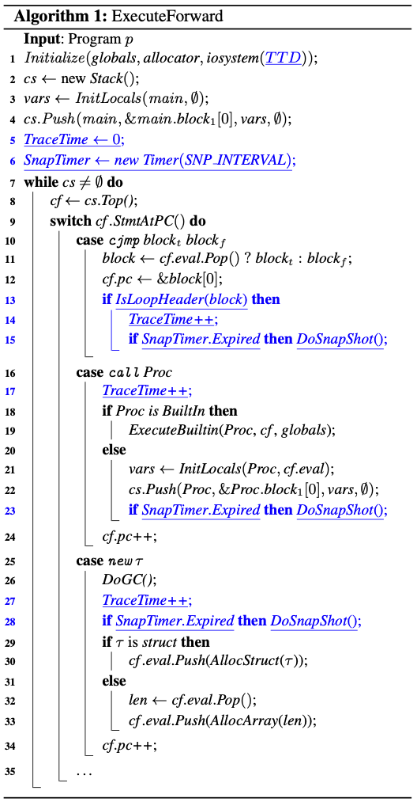

# Tardis: affordable time-travel debugging in managed runtimes

- https://dl.acm.org/doi/abs/10.1145/2714064.2660209
- [Tardis: affordable time-travel debugging in managed runtimes | Connected Papers](https://www.connectedpapers.com/main/fd6ba7a984977dbd62352448a13705c8babf2ea5/Tardis%3A-affordable-time%20travel-debugging-in-managed-runtimes/graph)
  - Authors
    - Earl T. Barr
    - Mark Marron
  - 2014 ACM SIGPLAN
- **Abstract**
- >ブレークポイントを設定するのが数ステートメント分遅かったり、シングルコアダンプから微妙なバグを診断しようとする開発者は、しばしばタイムトラベルデバッガを望むものである。時間を巻き戻して、エラーにつながるステートメントやプログラム値の正確なシーケンスを確認できる機能は、直感的に非常に魅力的ですが、時間と空間のオーバーヘッドが大きいため、時間旅行型デバッガの採用は限定的でした。
- > Java JVMやJavaScriptエンジンのようなマネージドランタイムは、型安全性、メモリ管理、仮想IOといったコア機能を提供するためのコストの多くを既に支払っており、それを再利用して低オーバーヘッドの時間旅行デバッガを実装することができます。私たちはこの知見を活かして、マネージド・ランゲージ用の安価な時間旅行型デバッガーを設計・構築しています。TA R D I S は、ベンチマークアプリケーションにおいて、ノーマル実行時の平均オーバーヘッドがわずか 7%、ヒストリーロギングが 0.6MB/s で、タイムトラベルの待ち時間が最悪でも 0.68s と、手頃な価格で実現しました。TA R D I S は、タイムトラベルを使用して状態を再構築し、最適化されたコードをデバッグすることも可能です。この機能は、低いオーバーヘッドと相まって、TA R D I S をマネージド言語用のデフォールトデバッガとして使用するのに適しており、タイムトラベルデバッグを主流にしてデバッグの実践を変えることが期待されます。
- **1. Introduction**
  - マネージドランタイム
    - JVMとか。VM
  - 実行オーバヘッドが25%以下
  - 時間旅行待ち時間が1秒以下
  - TARDIS
  - >TTDシステムを実装するための標準的なアプローチは、一定間隔でプログラムの状態のスナップショットを取得し、スナップショット間に発生するコンソールI/Oやタイマーイベントなどの非決定論的環境相互作用をすべて記録することである。
  - >メモリ管理機能により、システムは実行時にヒープを走査して操作することができます。
  - セクション3
    - >TARDISがどのようにこれらの機能を利用して、ライブオブジェクトとプログラム状態のみを効率的に識別してスナップショットするか、それによって、基本的なスナップショットと記録/再生のTDD設計を改善するかについて説明します。
  - セクション3.2
    - >ガベージコレクションの研究成果を活用して、状態スナップショット生成のコストをさらに削減する。
  - ガベージコレクタにスナップショットのピギーバックを実装
- **2. Time-Traveling Debuggers**
  - 設計・アプローチについて
  - 定期的にスナップショット
  - ファイルやコンソールとのIOをログに記録
  - 復元時には、最も近いスナップショットを復元
  - インタプリタのロジックにロジックを少し加えるだけでよい(青字)
- []
- **3. Implementation of TARDIS**
  - メモリアロケート、メモリレイアウト、GCの方法には手を加えない
- **4. Debugging Optimized Code**
- **5. Evaluation**
  - C# ランタイム(.NET)に実装した
- **Reference**
