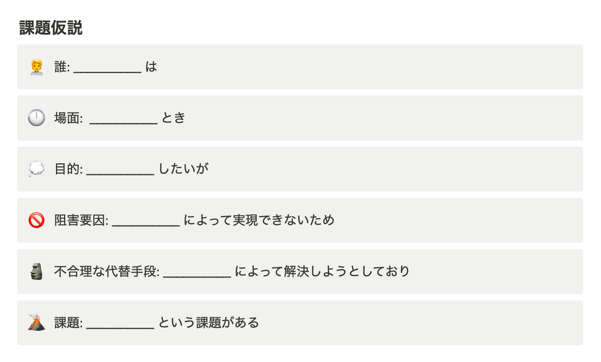
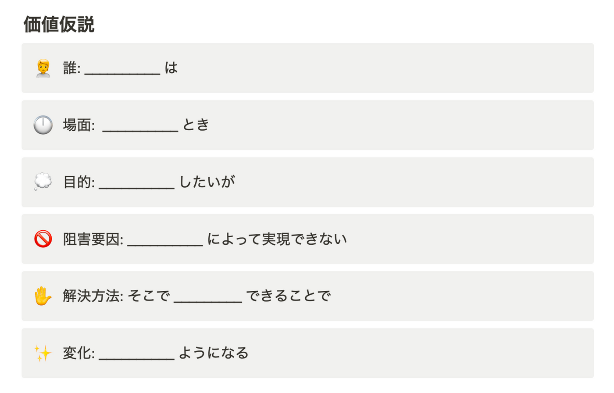

# Think N1

- smartbank独自のフレームワークっぽい
- [課題を捉え、解くための書「Think N1 シート」を公開しました - inSmartBank](https://blog.smartbank.co.jp/entry/thnink-n1)
  - 新しいプロダクトや機能の**WhyとWhatを定義するための**設計書
  - 参考にしたフレームワーク
    - [主観と客観を切り替える鍛錬｜Miwa Kuramitsu / KRAFTS&Co.](https://note.com/hebereke/n/n56f6fe99740e) 「ユーザーストーリーシート」
    - [結局のところ、UI/UXって何ですか？vol.3 ROLLCAKE社のCXO、伊野亘輝さんに聞いてみた | TD](https://www.td-media.net/interview/what-is-ui-ux-vol-3/) 「ユーザー体験設計書」
  - リサーチ → 要件定義 → プロトタイピング → 詳細設計 → 実装 というプロセスの中のリサーチ〜要件定義 で使うフレームワーク
  - 進め方
    - 課題定義
      - 
        - > 誰が、どんなときに、何をしたくて、何によって実現できず、どんな代替手段で解決していることから、どんな課題があることがわかるのか
      - その後、N1インタビューをしていき、課題仮説を修正していく
        - 「何を知らないのか」「何を知っているのか」
    - 価値定義
      - ↓「解決方法」「変化」欄が↑とは違う
      - 
    - > 次のステップとしては、定義した価値仮説・提供すべき利便性の実現方法を考えるために、デザイナー主導でPMが伴走する形でプロトタイピングに入っていきます。 Howを定義するための設計書「Be Openシート(仮)」もいま開発中なので、また別の機会にご紹介できればと思います。
