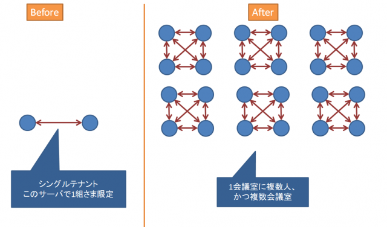

# WebRTCのシグナリング

- [連載 | WebRTC入門2016 | HTML5Experts.jp](https://html5experts.jp/series/webrtc2016/)

- シグナリングサーバーを動かそう
  - （この文脈における）シグナリングサーバーとは：↑の SDP と ICE candidate を仲介するサーバー
  - websocket接続でシンプルなシグナリングサーバーを立ち上げていた
- シグナリングを拡張して、複数人で通信してみよう
  - 複数人それぞれで相互に接続する必要がある（ので、人数増えると大変）
  - 
  - やりかた自体は力技で複数接続を確立させればよい
- Firebaseで楽々シグナリング
