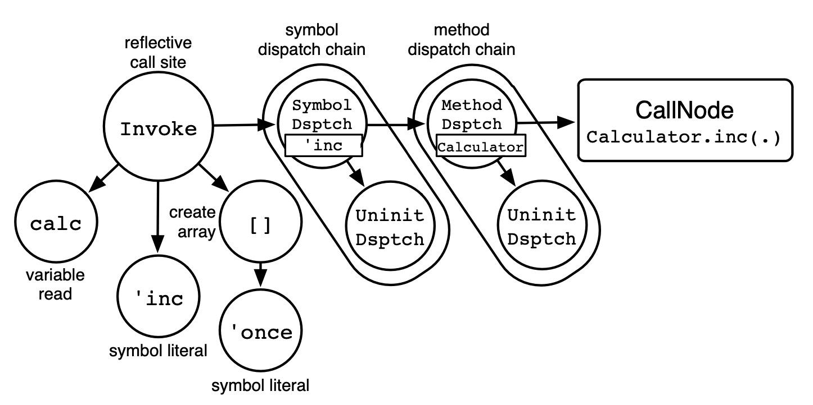
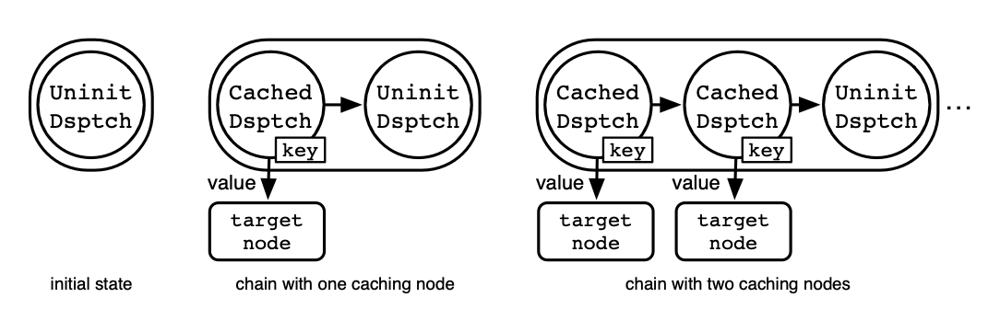
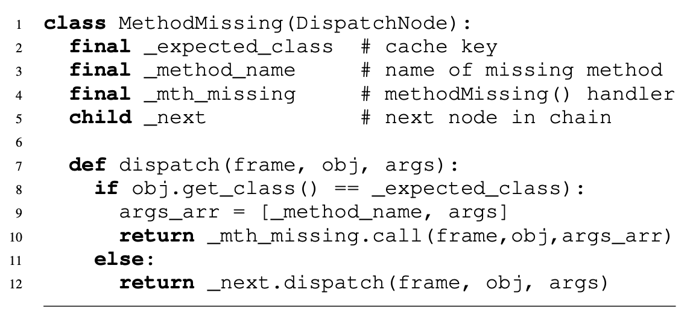

# Zero-overhead metaprogramming: reflection and metaobject protocols fast and without compromises

- ACM
- PLDI 2015
- [Zero-overhead metaprogramming: reflection and metaobject protocols fast and without compromises | ACM SIGPLAN Notices](https://dl.acm.org/doi/10.1145/2813885.2737963)
- >ランタイムメタプログラミングは多くの有用なアプリケーションを可能にし、しばしば汎用的な方法で問題を解決する便利なソリューションであるため、フレームワーク、ミドルウェア、ドメイン固有言語などで広く利用されています。しかし、強力なメタオブジェクトプロトコルはほとんどサポートされておらず、反射的メソッド呼び出しや動的プロキシなどの一般的な概念でさえ最適化されていません。文献で提案されている解決策は、メタプログラミング機能を制限するか、アプリケーションまたはライブラリ開発者が性能改善技術を適用することを要求するものです。オーバーヘッドのない実行時メタプログラミングのために、自己最適化インタプリタに共通する**多相インラインキャッシュの一般化形態であるディスパッチチェーン**が、言語実装レベルでの簡単な最適化であることを実証しています。自己最適化インタープリタによる評価では、制限のないメタオブジェクトプロトコルが初めて実行時オーバーヘッドなしに実現できること、この最適化がメタトレーシングに基づくインタープリタのジャストインタイムコンパイルや部分評価にも適用可能であることを示した。また、この文脈で、一般的な反射操作を最適化することで、既存のアプリケーションの性能を大幅に改善できることを実証しています。
  - 自己最適化インタプリタ
    - →TruffleRubyとかのやつ
      - MRIでやるには、まずMRIの改造が必要
- **Introduction**
  - dispatch chainsにより実行時オーバーヘッドを除去する
- **Background**
  - メタオブジェクトプロトコル
    - MOP
    - The Art of the Metaobject Protocol. The MIT Press, 1991. が提案した?
    - 言語のセマンティクスを変更できる
    - 委譲とかもそう
  - pythonに関するメタプロのオーバーヘッド説明がよくわからぬ
  - Self-optimizing Interpreters もなんの話かよくわからぬ
- **Using Dispatch Chains for Zero-Overhead Metaprogramming**
- **3.1 Reflective Operations**
- **Optimizing Reflective Method Invocation with Dispatch Chains.**
  - 普通の呼び出しは、メソッド名は定数
  - ポリモーフィック・インライン・キャッシュ
    - 論文17へのreference
    - この一般化をディスパッチチェインと呼ぶ
  - ディスパッチチェイン
    - >プログラムのASTノードの一部として任意の値をキャッシュする機構
    - >ここでは、その余分な変動性を解決し、安定した実行時動作に関する情報を公開し、JITコンパイラの最適化を可能にするために、反射型演算への適用性を探る。
  - 
    - `calc.invoke('inc, ['once])`
    - >第一階層ではメソッド名のシンボルを記録し、
    - >第二階層ではディスパッチチェーンが実行時に観測されたオブジェクトのクラスを記録し、対応するルックアップ結果、つまり呼び出すべきメソッドをキャッシュしている。
  - 
    - ディスパッチチェインの構築
    - >チェーンは未初期化ノードのみから始まり，キャッシュされたノードと新しい未初期化ノードに特化される
    - 最後のノード以外の各ノードはキーとターゲットノードを保持
    - キー
      - キャッシュを使うか否かの判断に使う
        - 使う場合→そのノードを使う
        - 使わない場合→次のノードに移る
      - メソッド名などがキーになる
        - reflect呼び出し時のシンボルと比較される
    - ターゲットノード
      - ネストしたターゲットノード
      - メソッド呼び出し
      - (任意のノード)
  - メソッド検索を反射的呼び出しのためにもキャッシュ可能
- **Optimizing methodMissing().**
  - >メソッド検索に失敗した場合、MethodMissing ノードがチェーンに追加され、 methodMissing() が通常のディスパッチの一部となり、関連する最適化の恩恵を受けることができます
  - 
    - メソッドについてのディスパッチチェーンをするクラス
    - 上の図のノードに該当する
    - キー: クラス, 値:ハンドラ
- **Reflective Field and Global Access Operations.**
  - フィールドアクセス & グローバル変数へのアクセス
  - メソッドのときと同様
- **Partial Evaluation versus Meta-Tracing.**
  - 部分評価とメタトレーシングの比較
  - ???
- **Evaluation**
- **Related Work**
  - >ディスパッチチェーンは自己最適化インタプリタにおける一般的なパターン
- **Conclusion**
  - >現在のところ、ディスパッチ・チェーンは自己最適化インテルプリタに対して評価されています。
  - >しかし、最近のVMは一般的に多層化されたコンパイラを使用しています。
- **References**
