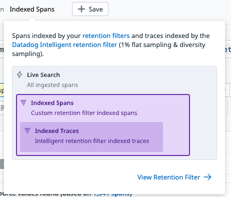

# datadog

- 通知に使える変数 [変数](https://docs.datadoghq.com/ja/monitors/notify/variables/?tab=is_alert)
  - `@slack-チャンネル名` でそのチャンネル宛に流せる
  - terraformでは、`resource "datadog_integration_slack_channel"`で、`channel_name`にチャンネル名を指定する必要がある
- APMの「view related trace」で、どのリクエストでそのグラフになったのかを見れる
- デプロイをリソースとして扱えるようにするために、Workflow Automationを使ってデプロイEventを自動で作成するやり方がある
  - [Datadogのグラフにデプロイタイミングを表示する方法 - 世界中の羊をかき集めて](https://shepherdmaster.hateblo.jp/entry/2024/03/24/111025) の3
    - スライド：https://speakerdeck.com/sheepland/deploy-timing-on-datadog-graph
- `default_zero` した `datadog.service.time_between_deployments` の `moving_rollup` をとって、その値を自身で割ってboolean値にすることで、「デプロイ後3時間のみこの監視を有効にする」というような設定ができる
- [DatadogでECS Fargate TaskのCPU利用率が100%を超えて表示されていたので調べてみた - Classi開発者ブログ](https://tech.classi.jp/entry/2022/05/24/120000)
  - `ecs.fargate.cpu.percent`を見ている
  - > Irix mode ではcpu usageをCPUコア数で割らない値をCPU使用率として表示しています。 **たとえばCPUコア数が4のサーバであれば、最大400%として表示され得るということです。**
  - > つまりわざわざCPUコア数を乗算することで、top コマンドの Irix mode でのCPU利用率の値を表現していたのです。
  - > 冒頭の疑問にやっとここで返ってこれるのですが、該当のECS Fargate Task はcpuを4096 = 4vCPU(CPUコア数:4) で設定し稼働させているので、100%を超える値が表示されていたということです。
- datadogのAPMのtrace画面では、**サンプリングされた1%の記録しか残っていないので、数値の大小を見るときは注意！**
  - 
- カスタムメトリクスをむやみに追加すると課金額が増大するので注意！
  - [Datadogのカスタムメトリクスによる予期せぬコスト増加を回避する](https://zenn.dev/tkaga/articles/291af41d8e43b0)
  - 「メトリクス名 + タグの全組み合わせ」の数ぶんだけ集計対象となるので、カーディナリティの大きいカスタムメトリクス（user_id, リクエストIDとか）を追加してしまうと肥大化してしまう
    - 性別とかのカーディナリティの小さいものなら大丈夫
