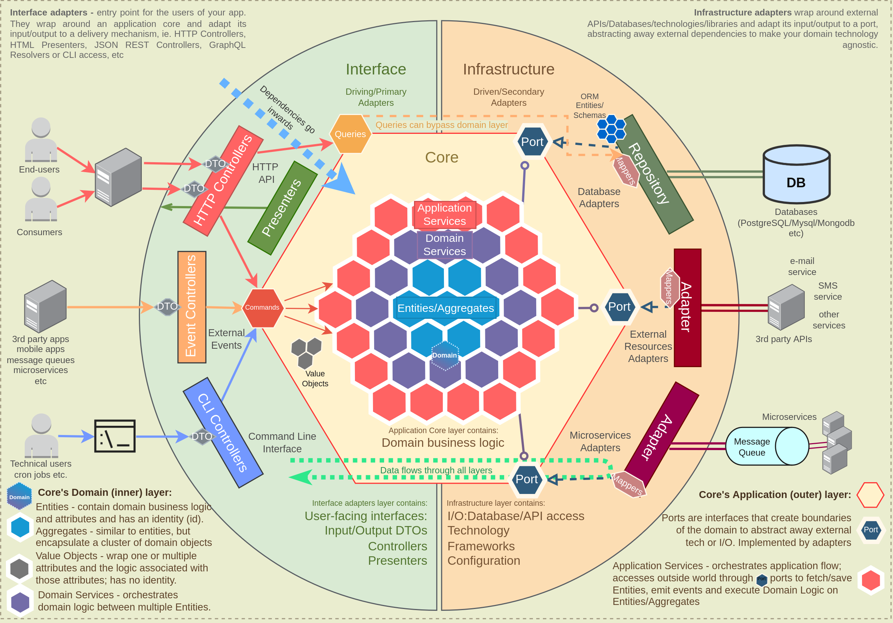

# domain-driven-hexagon

- https://github.com/Sairyss/domain-driven-hexagon
  - Domain-Driven Hexagon
  - Architecture
  - Pros
  - Cons
  - Diagram
    - 
  - Modules
    - 数日で最初から書き直すことができるくらい小さく保つこと
    - この例では `src/modules/{user,wallet}`のように配置している
    - `src/modules/user/commands` などにユースケース（コマンド）（`create-user`, `delete-user` など）を置いている
  - Application Core
  - Application layer
    - Application Services
      - 「ワークフローサービス」、「ユースケース」、「インタラクター」とも呼ばれる
      - やること
        - スカラー型を操作してドメイン型に変換
        - データベース/外部APIからドメイン Entities/ Aggregates を取得する
      - コード例：`src/modules/user/commands/create-user/create-user.service.ts` (`CreateUserService` クラス)
        - Userエンティティを作ってUserRepositoryを使ってユーザーを作成してる
    - Commands and Queries
      - 「コマンド・クエリ分離（CQS）」
      - Commands（状態変更操作）
        - `CreateUserCommand` など
        - ここでは操作の実行はしないことに注意！
        - コード例：`src/modules/user/commands/create-user/create-user.command.ts`
          - パラメーターを作っているのみで、ユーザー作成の実行はしていない
        - 関連コード
          - `src/modules/user/commands/create-user/create-user.message.controller.ts`
            - `Command` を作り、 `commandBus` に渡している
          - `src/modules/user/commands/create-user/create-user.service.ts`
            - 受け取った `Command` から値を取り出して、エンティティを作ったりしている（実際の実行）
      - Queries（データ取得操作）
        - コード例：`src/modules/user/queries/find-users/find-users.query-handler.ts` の `FindUsersQuery`
    - Ports
      - ポートは実装ではなくインターフェース
        - たとえば 「`insert`, `findAll` を実装していること」といったようなインターフェース
  - Domain Layer
    - Entities
      - 中核の概念のモデル化
      - 不変条件を満たすようにする（有効なエンティティである必要がある）
        - 単純なsetterではなく専用のメソッドを用意する
        - 更新時にバリデーションを行うようにする
      - ビジネスロジックはエンティティに持たせる（＝サービスは持たせない）
        - サービスに持たせてしまうとドメインモデル貧血症になる
      - アイデンティティ（通常はidフィールド）を持つようにする
        - それぞれを区別できるようにする
    - Aggregates（集約）
      - ドメインオブジェクト（エンティティや値オブジェクト）の集合
        - 集約とエンティティはMECE（相互排他かつ網羅的）ってわけではなく、「集約という大きな管理・境界の単位の中に、エンティティ（や値オブジェクト）が含まれている」という包含関係
          - 数学における「値」と「集合」の関係のイメージ（「集合」もまた「値」である点などが似てる）
      - 集約ルート：他のエンティティ／値オブジェクトと、それらを操作するためのすべてのロジックを含むエンティティのこと
      - 集約に対する操作はすべてトランザクション操作であること
    - Domain Events
      - ドメイン内で発生したイベントを表すメッセージ
    - Integration Events
    - Domain Services
      - ドメインをまたぐ操作でつかう
    - Value objects
    - Domain Invariants (ドメイン不変条件)
      - エンティティや集約ルートの責任
      - Replacing primitives with Value Objects
      - Make illegal states unrepresentable
        - Validation at compile time
        - Validation at runtime
      - Guarding vs validating
    - Domain Errors
    - Using libraries inside Application's core
  - Interface Adapters
    - Controllers
      - 責務：リクエストの解析・ビジネスロジックの実行・結果のクライアントへの返送
      - ユースケースごとにコントローラーを1つ用意する
      - Resolvers
    - DTOs
      - 生の値を受け取る/返すのではなく、DTO（Data transfer object）に詰め替えたものを使う
        - 外界への依存を断ち切る層
      - Request DTOs
      - Response DTOs
      - Additional recommendations
      - Local DTOs
  - Infrastructure layer
    - インフラ層に置くもの：アダプター・リポジトリ・ORMのモデル（クラス）など
    - Adapters
    - Repositories
      - 一般的にはインターフェースを使ってリポジトリへの依存を避けるのが良いとされているが、実際問題DB部分を抽象化したところでDBを差し替えたりはしないのだからインターフェースの導入は要注意
    - Persistence models（永続化モデル）
      - ドメインモデルと永続化モデルを分離するのは単純に労力がかかるので、本当にその抽象化が必要かよく考えべし
    - Other things that can be a part of Infrastructure layer
  - Other recommendations
    - General recommendations on architectures, best practices, design patterns and principles
    - Recommendations for smaller APIs
    - Behavioral Testing
    - Folder and File Structure
      - 階層型アーキテクチャは非推奨
```text
- Controllers
  - UserController
  - WalletController
  - OtherControllers...
- Services
  - UserService
  - WalletService
  - OtherServices...
- Repositories
  - ...
```

- モジュールごとに分類するのが良い
```text
- User
  - UserController
  - UserService
  - UserRepository
- Wallet
  - WalletController
  - WalletService
  - WalletRepository
  ...
```

- さらに分割する場合
```text
- User
  - CreateUser
    - CreateUserController
    - CreateUserService
    - CreateUserDTO
  - UpdateUser
    - UpdateUserController
    - UpdateUserService
    - UpdateUserDTO
  - UserRepository
  - UserEntity
- Wallet
  - CreateWallet
    - CreateWalletController
    - CreateWalletService
    - CreateWalletDto
  ...
```

- File names
  - `*.service.ts`, `*.entity.ts` のような命名が分かりやすくてオススメ。もしくはSuffixに`Service`などつけるか
- Enforcing architecture
  - 静的解析ツールを導入して↑をチェックできる
- Prevent massive inheritance chains
- Additional resources
  - Articles
  - Websites
  - Blogs
  - Videos
  - Books
