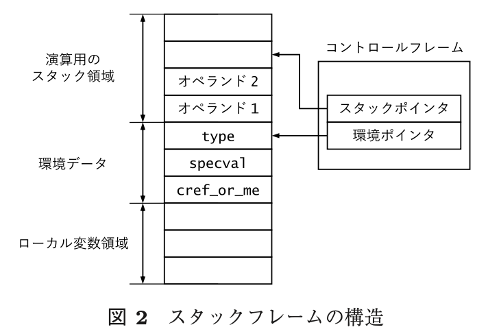

# ensemble_cast

- thats_it
- gem
- yarv
- [rubyでgroovyやKotlinのitが使えるthats_it gemを作った - Qiita](https://qiita.com/hanachin_/items/8df68325142d46a7fb0b)
- https://github.com/hanachin/thats_it
  - 作った
    - https://github.com/tetetratra/ensemble_cast
    - https://gems.ruby-china.com/gems/ensemble_cast
- 流れ
  - Ruby処理系を直接弄って実装してみる
    - https://github.com/tetetratra/ruby/tree/hook_block のリポジトリで行う
      - https://github.com/example/ruby_builder のdocker-compose.ymlを利用
```sh
dcrb rhc
cd build
make gdb
```

- C拡張のgemとして実装する
- `rb_iseq_disasm((GET_EC()->cfp + N)->iseq)` の N を 1~4まで変えてみた
  - N = 0 だとエラーで落ちる
  - このコードを実行中の、`static VALUE tracepoint_test(VALUE _)`内で出力
```rb
TracePoint.trace(:b_call) do |tp|
  tracepoint_test
  p 1
end
yield_self do |x|
  p 2
  p x
end
```

```rb
# 1 TracePointの .trace のブロックの実行を指している
== disasm: #<ISeq:block in <main>@../ruby/test.rb:1 (1,26)-(4,3)> (catch: false)
local table (size: 1, argc: 1 [opts: 0, rest: -1, post: 0, block: -1, kw: -1@-1, kwrest: -1])
[ 1] tp@0<Arg>
0000 putself                                                          (   2)[LiBc]
0001 opt_send_without_block                 <calldata!mid:tracepoint_test, argc:0, FCALL|VCALL|ARGS_SIMPLE>
0003 pop
0004 putself                                                          (   3)[Li]
0005 putobject_INT2FIX_1_
0006 opt_send_without_block                 <calldata!mid:p, argc:1, FCALL|ARGS_SIMPLE>
0008 leave                                                            (   4)[Br]

# 2 yield_self のブロックの実行を指している
== disasm: #<ISeq:block in <main>@../ruby/test.rb:6 (6,11)-(9,3)> (catch: false)
local table (size: 1, argc: 1 [opts: 0, rest: -1, post: 0, block: -1, kw: -1@-1, kwrest: -1])
[ 1] x@0<Arg>
0000 putself                                                          (   7)[LiBc]
0001 putobject                              2
0003 opt_send_without_block                 <calldata!mid:p, argc:1, FCALL|ARGS_SIMPLE>
0005 pop
0006 putself                                                          (   8)[Li]
0007 getlocal_WC_0                          x@0
0009 opt_send_without_block                 <calldata!mid:p, argc:1, FCALL|ARGS_SIMPLE>
0011 leave                                                            (   9)[Br]

# 3 ???
== disasm: #<ISeq:yield_self@<internal:kernel>:144 (144,2)-(149,5)> (catch: false)
0000 opt_invokebuiltin_delegate             <builtin!block_given_p/0>, 0( 145)[LiCa]
0003 branchif                               9
0005 opt_invokebuiltin_delegate             <builtin!_bi3/0>, 0       ( 146)[Li]
0008 leave                                  [Re]
0009 putself                                                          ( 148)[Li]
0010 invokeblock                            <calldata!argc:1, ARGS_SIMPLE>
0012 leave                                                            ( 149)[Re]

# 4 トップレベルの実行を指している
== disasm: #<ISeq:<main>@../ruby/test.rb:1 (1,0)-(9,3)> (catch: false)
0000 opt_getconstant_path                   <ic:0 TracePoint>         (   1)[Li]
0002 putobject                              :b_call
0004 send                                   <calldata!mid:trace, argc:1>, block in <main>
0007 pop
0008 putself                                                          (   6)[Li]
0009 send                                   <calldata!mid:yield_self, argc:0, FCALL>, block in <main>
0012 leave

== disasm: #<ISeq:block in <main>@../ruby/test.rb:1 (1,26)-(4,3)> (catch: false)
local table (size: 1, argc: 1 [opts: 0, rest: -1, post: 0, block: -1, kw: -1@-1, kwrest: -1])
[ 1] tp@0<Arg>
0000 putself                                                          (   2)[LiBc]
0001 opt_send_without_block                 <calldata!mid:tracepoint_test, argc:0, FCALL|VCALL|ARGS_SIMPLE>
0003 pop
0004 putself                                                          (   3)[Li]
0005 putobject_INT2FIX_1_
0006 opt_send_without_block                 <calldata!mid:p, argc:1, FCALL|ARGS_SIMPLE>
0008 leave                                                            (   4)[Br]

== disasm: #<ISeq:block in <main>@../ruby/test.rb:6 (6,11)-(9,3)> (catch: false)
local table (size: 1, argc: 1 [opts: 0, rest: -1, post: 0, block: -1, kw: -1@-1, kwrest: -1])
[ 1] x@0<Arg>
0000 putself                                                          (   7)[LiBc]
0001 putobject                              2
0003 opt_send_without_block                 <calldata!mid:p, argc:1, FCALL|ARGS_SIMPLE>
0005 pop
0006 putself                                                          (   8)[Li]
0007 getlocal_WC_0                          x@0
0009 opt_send_without_block                 <calldata!mid:p, argc:1, FCALL|ARGS_SIMPLE>
0011 leave                                                            (   9)[Br]
```

 「TracePointの .trace のブロックの実行」よりも「yield_self のブロックの実行」のフレームの方が**先に**積まれている
 わざわざこんなに出力しなくても`rb_vmdebug_stack_dump_raw_current()`を呼べば十分だったかも
 **rb**
 ```text
-- Control frame information -----------------------------------------------
c:0006 p:---- s:0022 e:000021 CFUNC  :tracepoint_test
c:0005 p:0003 s:0018 e:000017 BLOCK  ../ruby/test.rb:2 [FINISH]
c:0004 p:0001 s:0014 e:000013 BLOCK  ../ruby/test.rb:7
c:0003 p:0012 s:0010 e:000009 METHOD <internal:kernel>:148
c:0002 p:0012 s:0006 E:0006d0 EVAL   ../ruby/test.rb:6 [FINISH]
c:0001 p:0000 s:0003 E:0007c0 DUMMY  [FINISH]
 ```

`[-2, -1, 0, 1, 2].filter { even? && positive? }`を動かすには
  - 整理
  どうにかして {ブロック} のiseqを得たい
    - Cで実装できそう
  第一引数も得たい
    - が、thats_itの記事を見るに、すでに積まれていなさそう
   thats_it gem を参考にして、引数が捨てられないようにする
  そうすれば `第一引数.instance_eval(ブロック)` できる
    - `InstructionSequence.load`が要るけれどこれはある
   本来のブロックの評価はさせないようにする

```c
# :b_call の場合
# -- Control frame information -----------------------------------------------
# c:0006 p:---- s:0021 e:000020 CFUNC  :tracepoint_test
# c:0005 p:0003 s:0017 e:000016 BLOCK  ../ruby/test.rb:2 [FINISH]              tpのブロック
# c:0004 p:0001 s:0013 e:000012 BLOCK  ../ruby/test.rb:6                       yield_selfのdo~end (このiseqと引数を得たい)
# c:0003 p:0012 s:0010 e:000009 METHOD <internal:kernel>:148                   yield_self自身(多分)
# c:0002 p:0013 s:0006 E:001240 EVAL   ../ruby/test.rb:5 [FINISH]              toplevel
# c:0001 p:0000 s:0003 E:001450 DUMMY  [FINISH]

# :call の場合
# -- Control frame information -----------------------------------------------
# c:0005 p:---- s:0018 e:000017 CFUNC  :tracepoint_test
# c:0004 p:0003 s:0014 e:000013 BLOCK  ../ruby/test.rb:2 [FINISH]             tpのブロック
# c:0003 p:0001 s:0010 e:000009 METHOD <internal:kernel>:145                  yield_self自身(多分)
# c:0002 p:0013 s:0006 E:000c30 EVAL   ../ruby/test.rb:5 [FINISH]             toplevel
# c:0001 p:0000 s:0003 E:000e40 DUMMY  [FINISH]

gdbの使い方
	`$ gdb ./miniruby`
	`(gdb) break tracepoint_test`
	`(gdb) run ../ruby/test.rb`
	`(gdb) source ../ruby/.gdbinit`
コマンドラインオプションで指定できる
	`make miniruby && gdb ./miniruby -ex 'break rb_tracepoint_b_call' -ex 'run ../ruby/test.rb'`


```

```c
(gdb) p rb_p((rb_control_frame_t)(GET_EC()->cfp + 2)->self)
main # yield_self内のselfはmainになっている。これを123に書き換えたい

```

```c
(gdb) p rb_p((rb_control_frame_t)(GET_EC()->cfp + 3)->self)
123 # 123.yield_self の、yield_self自身のレシーバは123

```

```c
p ((rb_control_frame_t)(GET_EC()->cfp + 2))->self = Qtrue


```

- なんだこれ
```c
(gdb) p rb_p((rb_control_frame_t)(GET_EC()->cfp + 2)->self)
=> main
たぶん、p rb_p( (rb_control_frame_t)( (GET_EC()->cfp + 2)->self ) ) のようにパースされている。
2フレーム上を見て、そこのselfを見て、そのselfを rb_control_frame_t にキャストして見ている。ので誤り。

(gdb) p rb_p( ((rb_control_frame_t)(GET_EC()->cfp + 2))->self )
=> true
2フレーム上を見て、rb_control_frame_t にキャストして、そこのselfを見ている。こっちは正しい。

2フレーム上のselfを書き換えても、ブロック内の`p self`が依然mainを返してしまう...
2フレーム上は本当にyield_selfのブロックなのか? → 多分それは正しい
バイトコードはどうなっている？→普通にputselfだった

```

- なんでだろう。フレームが積まれた時点でselfは別の場所にコピーされて、そこのselfが使われているのかもしれない...
- でもputselfを見た感じそんなことはなさそうだし...
- iseqをinstance_evalする方式に切り替えよう。
- ↑この方針の方が難しいかもしれん... すでに呼ばれる予定のブロックを呼ばない処理と、Cの中でinstance_evalする処理があるから難しそう。`(GET_EC()->cfp + 2)->iseq`で得れるものは`rb_iseq_t*`型の値で、これは`VALUE`と互換のある型だけれども、Ruby上の型は`T_IMEMO`だからRubyの世界に持っていくには更にひと手間要る。
- メソッド探索をするときのselfの探索を調べよう。
- vm_push_frameで、cfpをconst structで作っているから書き換えられないのかもしれない。
- これを変えるには...
- `:b_call`だとすでにブロックのフレームが積まれているが、`:call`なら積まれない (詳しくは記事を参照)。
- なので、`:call`でhookして、`VM_CF_BLOCK_HANDLER`でブロックハンドラを取得して、そのselfを書き換えてみよう。
```c
// :call のときの色々

(gdb) p rb_vmdebug_stack_dump_raw_current()
-- Control frame information -----------------------------------------------
c:0005 p:---- s:0018 e:000017 CFUNC  :tracepoint_test
c:0004 p:0003 s:0014 e:000013 BLOCK  ../ruby/test.rb:2 [FINISH]
c:0003 p:0001 s:0010 e:000009 METHOD <internal:kernel>:145
c:0002 p:0013 s:0006 E:001fc0 EVAL   ../ruby/test.rb:5 [FINISH]
c:0001 p:0000 s:0003 E:001eb0 DUMMY  [FINISH]

(gdb) p VM_BH_TO_ISEQ_BLOCK( VM_CF_BLOCK_HANDLER( (GET_EC()->cfp + 0) ) )
$2 = (const struct rb_captured_block *) 0x0

(gdb) p *VM_BH_TO_ISEQ_BLOCK( VM_CF_BLOCK_HANDLER( (GET_EC()->cfp + 2) ) )
$1 = {self = 281474837368080, ep = 0xaaaaaafd2170, code = {iseq = 0xfffff7b5f7f0, ifunc = 0xfffff7b5f7f0, val = 281474837641200}}

(gdb) p rb_p(   VM_BH_TO_ISEQ_BLOCK( VM_CF_BLOCK_HANDLER( (GET_EC()->cfp + 2) ) )->self = Qnil  )
// ↑これでselfを書き換えられた

(gdb) p *VM_BH_TO_ISEQ_BLOCK( VM_CF_BLOCK_HANDLER( (GET_EC()->cfp + 2) ) )->code->iseq
$8 = {flags = 552986, wrapper = 0, body = 0xaaaaab0358d0, aux = {compile_data = 0x0, loader = {obj = 0, index = 8}, exec = {local_hooks = 0x0, global_trace_events = 8}}}


parameterは普通にTracePointの機能で得ればいいかも？
 と思ったけれど、仮引数が無いときは`parameters`に何も入らないんだった。
 なので、thats_it gemのやり方で改造する

selfの書き換えは、(gdb上ではなく)CRubyコード上で行うと、constを書き換えているからという理由でコンパイルエラーになったが、そこは強制的にキャストすることで通すことができた。(下記の`(struct rb_captured_block *)`の箇所)
```

```c
((struct rb_captured_block *)VM_BH_TO_ISEQ_BLOCK( vm_cf_block_handler( (GET_EC()->cfp + 2) ) ))->self = Qnil;

これらの値が何を意味しているのかを調べないといけないかもしれない...
```

```c
(gdb) p ((struct rb_captured_block *)VM_BH_TO_ISEQ_BLOCK( vm_cf_block_handler( (GET_EC()->cfp + 2) ) ))->code.iseq->body->param.flags
$1 = {has_lead = 0, has_opt = 0, has_rest = 0, has_post = 0, has_kw = 0, has_kwrest = 0, has_block = 0, ambiguous_param0 = 0, accepts_no_kwarg = 0, ruby2_keywords = 0}

```

- frameを指定してそのフレームのVALUEスタックを見れるデバッグ用関数は無いものか...
  - 方針
    - 一旦`:call`でhookして、受け取らないブロック引数もスタックに積まれるようにする
    - その後に`:b_call`でもhookして、今度は積まれるようになった引数を取得して、selfを置き換える?
  - `do`のときと`do |x|`のときのdiffを探す
    - → diffは5箇所っぽい
**param_empty.c**

```
{type = ISEQ_TYPE_BLOCK,
    iseq_size = 2,
    iseq_encoded = 0xaaaae7e03bd0,
    param = {flags = {has_lead = 0,
        has_opt = 0,
        has_rest = 0,
        has_post = 0,
        has_kw = 0,
        has_kwrest = 0,

        has_block = 0,
        ambiguous_param0 = 0,
        accepts_no_kwarg = 0,
        ruby2_keywords = 0},
    size = 0,
    lead_num = 0,
    opt_num = 0,
    rest_start = 0,
    post_start = 0,
    post_num = 0,
    block_start = 0,

    opt_table = 0x0,
    keyword = 0x0},
    location = {pathobj = 281472972738800,
        base_label = 281472972553280,
        label = 281472972739200,
        first_lineno = 19,
        node_id = 14,
        code_location = {
            beg_pos = {lineno = 9,
                column = 15},
            end_pos = {lineno = 10,
                column = 3}}},
    insns_info = {body = 0xaaaae7e053b0,
        positions = 0x0,
        size = 2,
        succ_index_table = 0xaaaae7e04a40},

    local_table = 0x0,
    catch_table = 0x0,
    parent_iseq = 0xffff888dd320,
    local_iseq = 0xffff888dd320,
    is_entries = 0xaaaae7e04a00,
    call_data = 0xaaaae7e04a20,
    variable = {flip_count = 0,

        script_lines = 8,
        coverage = 0,
        pc2branchindex = 0,
        original_iseq = 0x0},
    local_table_size = 0,
    is_size = 0,
    ci_size = 0,
    stack_max = 1,
    catch_except_p = 0 '\000',

    builtin_inline_p = false,
    outer_variables = 0x0,
    mandatory_only_iseq = 0x0,
    jit_func = 0x0,
    total_calls = 0,
    jit_unit = 0x0,
    yjit_blocks = 0x0}

```

**param_x.c**

```
{type = ISEQ_TYPE_BLOCK,
    iseq_size = 2,
    iseq_encoded = 0xaaaadd1773b0,
    param = {flags = {has_lead = 1, // diff(1)
        has_opt = 0,
        has_rest = 0,
        has_post = 0,
        has_kw = 0,
        has_kwrest = 0,

        has_block = 0,
        ambiguous_param0 = 1, // diff(2)
        accepts_no_kwarg = 0,
        ruby2_keywords = 0},
    size = 1, // diff(3)
    lead_num = 1, // diff(4)
    opt_num = 0,
    rest_start = 0,
    post_start = 0,
    post_num = 0,
    block_start = 0,

    opt_table = 0x0,
    keyword = 0x0},
    location = {pathobj = 281473463734440,
        base_label = 281473463548960,
        label = 281473463734840,
        first_lineno = 19,
        node_id = 16,
        code_location = {
            beg_pos = {lineno = 9,
                column = 15},
            end_pos = {lineno = 10,
                column = 3}}},
    insns_info = {body = 0xaaaadd176a80,
        positions = 0x0,
        size = 2,
        succ_index_table = 0xaaaadd176b00},

    local_table = 0xaaaadd175bd0,
    catch_table = 0x0,
    parent_iseq = 0xffffa5d1d2d8,
    local_iseq = 0xffffa5d1d2d8,
    is_entries = 0xaaaadd176ac0,
    call_data = 0xaaaadd176ae0,
    variable = {
        flip_count = 0,
        script_lines = 8,
        coverage = 0,
        pc2branchindex = 0,
        original_iseq = 0x0},
    local_table_size = 1, // diff(5)
    is_size = 0,
    ci_size = 0,
    stack_max = 1,
    catch_except_p = 0 '\000',

    builtin_inline_p = false,
    outer_variables = 0x0,
    mandatory_only_iseq = 0x0,
    jit_func = 0x0,
    total_calls = 0,
    jit_unit = 0x0,
    yjit_blocks = 0x0}
```


yield_self内で呼び出した`it`関数内にて
 **gdb.c**
 ```text
(gdb) p (GET_EC()->cfp + 2)->sp
$7 = (VALUE *) 0xffffa8c3e060
(gdb) p (GET_EC()->cfp + 2)->ep
$8 = (const VALUE *) 0xffffa8c3e058
 ```

 `0xffffa8c3e060 - 0xffffa8c3e058 = 0x8`で、これは`VALUE`一個分。改造によって引数はちゃんと積まれるようになったっぽい
 ここで元の記事の説明を確認
  >なのでitで積まれた引数を取るには以下のような感じの2通りのやり方で取れる
  **rb**
  ```ruby
def it
  # ここで1つ上のcfpを参照するとブロックのcfpが取れる、1つ上のcfp->ep - 3にアクセスする
  # or
  # ここで2つ上のcfpを参照するとブロックを呼び出したときのcfpが取れる、メソッド呼び出し時のcfp->spにアクセスする
end
  ```
  **gdb.c**
  ```text
(gdb) p ruby_debug_print_v(*((GET_EC()->cfp + 2)->sp - 0))
DBG> : 0x0000ffff80ae0c88 [0      ] T_STRING (String)receiver
$1 = void
(gdb) p ruby_debug_print_v(*((GET_EC()->cfp + 1)->ep - 3))
DBG> : 0x0000ffff80ae0c88 [0      ] T_STRING (String)receiver
$2 = void
  ```

 ↑カッコ`()`が不足していると変な表示になるので注意

`ep - 3`(`- 4`かも)の箇所にローカル変数があるはず
 

ブロックについては完成した
 `call`でパラメーターがスタックに乗せた
  - `b_call`ではパラメーターを取得して、それをselfと置き換えた
Cの関数(`Array#filter`など)ではうまく行かない
 フレームの構造は同じっぽいのに
  **c**
  ```text
(3個下が)METHODの場合
c:0006 p:---- s:0022 e:000021 CFUNC  :tracepoint_b_call
c:0005 p:0003 s:0018 e:000017 BLOCK  ../ruby/test.rb:6 [FINISH]
c:0004 p:0001 s:0014 e:000013 BLOCK  ../ruby/test.rb:16 <= ここに置いた値を得る & ここのselfを書き換える
c:0003 p:0006 s:0010 e:000009 METHOD ../ruby/test.rb:11
c:0002 p:0045 s:0006 E:001fe0 EVAL   ../ruby/test.rb:15 [FINISH]
c:0001 p:0000 s:0003 E:000960 (none) [FINISH]

(3個下が)CFUNCの場合
c:0006 p:---- s:0022 e:000021 CFUNC  :tracepoint_b_call
c:0005 p:0003 s:0018 e:000017 BLOCK  ../ruby/test.rb:6 [FINISH]
c:0004 p:0001 s:0014 e:000013 BLOCK  ../ruby/test.rb:14 [FINISH] <= [FINISH] なのがダメそう
c:0003 p:---- s:0011 e:000010 CFUNC  :filter
c:0002 p:0040 s:0007 E:0014e0 EVAL   ../ruby/test.rb:13 [FINISH]
c:0001 p:0000 s:0003 E:000260 (none) [FINISH]
  ```

 3番目の`BLOCK`が`[FINISH]`なのがダメそう
 CFUNCの場合`CFUNC  :filter`のブロックハンドラを経由して self を書き換えるようにしてみる???

`rb_vm_call_cfunc` や`rb_yield`を読もう
1. rb_ary_select
  array.c
2. rb_yield
 vm_eval.c
3. rb_yield_0
 vm_eval.c
4. vm_yield
  - vm.c
5. vm_yield_with_cref
 vm.c
6. invoke_block_from_c_bh
 vm.c
  - 渡すブロックはRubyで書いたから`case block_handler_type_iseq:`の分岐に行きそう
7. invoke_iseq_block_from_c
 vm.c
 VALUEスタックに値を詰めていそう
8. invoke_block
 vm.c
9. vm_push_frame
 おしまい
  - invoke_blockにreturnして、そこからvm_execが呼ばれてループ


だめだったら
  - `[1,2,3].filter { |x| ~ }` を `[1,2,3].filter { |x| [1,2,3].instance_eval { ~ } }`にする改造にしよう


CFUNCのときのパラメーターがだめなのかも

```c
(gdb) p *VM_BH_TO_ISEQ_BLOCK( vm_cf_block_handler( (GET_EC()->cfp + 2) ) )->code->iseq
$6 = {
  flags = 552986,
  wrapper = 0,
  body = 0xaaaaaaf8e030,
  aux = {
    compile_data = 0x0,
    loader = {
      obj = 0,
      index = 8},
    exec = {
      local_hooks = 0x0,
      global_trace_events = 8}}}

(gdb) p *VM_BH_TO_ISEQ_BLOCK( vm_cf_block_handler( (GET_EC()->cfp + 2) ) )->code->iseq->body
$7 = {
  type = ISEQ_TYPE_BLOCK,
  iseq_size = 4,
  iseq_encoded = 0xaaaaaaf8e170,
  param = {
    flags = {
      has_lead = 1,
      has_opt = 0,
      has_rest = 0,
      has_post = 0,
      has_kw = 0,
      has_kwrest = 0,
      has_block = 0,
      ambiguous_param0 = 1,
      accepts_no_kwarg = 0,
      ruby2_keywords = 0},
    size = 1,
    lead_num = 1,
    opt_num = 0,
    rest_start = 0,
    post_start = 0,
    post_num = 0,
    block_start = 0,
    opt_table = 0x0,
    keyword = 0x0},
  location = {
    pathobj = 281474837712960,
    base_label = 281474837527560,
    label = 281474837713360,
    first_lineno = 11,
    node_id = 16,
    code_location = {
      beg_pos = {
        lineno = 5,
        column = 26},
      end_pos = {
        lineno = 7,
        column = 3}}},
  insns_info = {
    body = 0xaaaaaaf8e1a0,
    positions = 0x0,
    size = 3,
    succ_index_table = 0xaaaaaaf8e210},
  local_table = 0xaaaaaaf8c3b0,
  catch_table = 0x0,
  parent_iseq = 0xfffff7b71270,
  local_iseq = 0xfffff7b71270,
  is_entries = 0xaaaaaaf8e1d0,
  call_data = 0xaaaaaaf8e1f0,
  variable = {
    flip_count = 0,
    script_lines = 8,
    coverage = 0,
    pc2branchindex = 0,
    original_iseq = 0x0},
  local_table_size = 1,
  is_size = 0,
  ci_size = 1,
  stack_max = 1,
  catch_except_p = 0 '\000',
  builtin_inline_p = false,
  outer_variables = 0x0,
  mandatory_only_iseq = 0x0,
  jit_func = 0x0,
  total_calls = 0,
  jit_unit = 0x0,
  yjit_blocks = 0x0}
```

`BLOCK  ../ruby/test.rb:10 [FINISH]`の`[FINISH]`については積まれた時点で`[FINISH]`フラグがついていたから、こういうものらしい

フレームがこのときに、次のフレーム(`BLOCK  ../ruby/test.rb:10 [FINISH]`)が積まれる前に、CFUNC のBLOCK_HANDLERのパラメーターを書き換えなければならない
 **c**
 ```text
c:0003 p:---- s:0011 e:000010 CFUNC  :filter
c:0002 p:0036 s:0007 E:0015b0 EVAL   ../ruby/test.rb:9 [FINISH]
c:0001 p:0000 s:0003 E:000300 (none) [FINISH]
 ```

 `rb_tracepoint_call`は`CFUNC`が積まれる前のhookだから意味無し
 `rb_tracepoint_call`で`VM_BH_TO_ISEQ_BLOCK( vm_cf_block_handler( (GET_EC()->cfp + 2) ) ))`を書き換えても、CFUNCのときのブロックは`CFUNC`のフレームに紐付いているものが使われるので、だめ
 `rb_tracepoint_b_call`は、すでに`BLOCK  ../ruby/test.rb:10 [FINISH]`が積まれた後のため、`invoke_block`から呼ばれた`vm_push_frame`の後に`*(ec->cfp->sp)`が上書きされてしまう(値が捨てられてしまう)
  `rb_tracepoint_b_call`で書き換えたときに`arr.filter`の`arr`の2要素目から反映されたのはこれが理由

tracepointのhook整理
 `:call`
  Rubyで記述されたメソッド
 `:c_call`
  Cで記述されたメソッド
 `:b_call`
  ブロックの開始

どうすれば...
  - `rb_ary_select`→...→`rb_yield_0`の`GET_EC()`の値をなにか変えればいいはず
  - しかし、`rb_ary_select`が積まれたときにhookを仕掛ける方法が多分無い

CFUNCのときにもブロックハンドラ(相当のもの)はあるはずで、それがどこに格納されているのかを調べる。
  - そのブロックハンドラ(相当)が積まれる前に、ブロックハンドラ(相当)のiseqのparamsを書き換えれば...

`rb_tracepoint_c_call`の時点でブロックハンドラがどこにあるのか
 **c**
 ```text
(gdb) p rb_p( rb_iseq_disasm( VM_BH_TO_ISEQ_BLOCK(  vm_cf_block_handler( (GET_EC()->cfp + 3) )  )->code.iseq ) )
== disasm: #<ISeq:block in <main>@../ruby/test.rb:13 (13,22)-(16,1)> (catch: FALSE)
0000 putself                                                          (  14)[LiBc]
0001 putself
0002 opt_send_without_block                 <calldata!mid:p, argc:1, FCALL|ARGS_SIMPLE>
0004 pop
0005 putself                                                          (  15)[Li]
0006 opt_send_without_block                 <calldata!mid:even?, argc:0, FCALL|ARGS_SIMPLE>
0008 leave                                                            (  16)[Br]
 ```

 ↑ `cfp+3` の位置にある
 **c**
 ```text
(gdb) p *VM_BH_TO_ISEQ_BLOCK(  vm_cf_block_handler( (GET_EC()->cfp + 3) )  )->code.iseq->body
$28 = {
  type = ISEQ_TYPE_BLOCK,
  iseq_size = 9,
  iseq_encoded = 0xaaaaaaf87380,
  param = {
    flags = {
      has_lead = 0,
      has_opt = 0,
      has_rest = 0,
      has_post = 0,
      has_kw = 0,
      has_kwrest = 0,
      has_block = 0,
      ambiguous_param0 = 0,
      accepts_no_kwarg = 0,
      ruby2_keywords = 0},
    size = 0,
    lead_num = 0,
    opt_num = 0,
    rest_start = 0,
    post_start = 0,
    post_num = 0,
    block_start = 0,
    opt_table = 0x0,
    keyword = 0x0},
  location = {
    pathobj = 281474837712000,
    base_label = 281474837527440,
    label = 281474837712960,
    first_lineno = 27,
    node_id = 44,
    code_location = {
      beg_pos = {
        lineno = 13,
        column = 22},
      end_pos = {
        lineno = 16,
        column = 1}}},
  insns_info = {
    body = 0xaaaaaaf8f760,
    positions = 0x0,
    size = 6,
    succ_index_table = 0xaaaaaaf8f840},
  local_table = 0x0,
  catch_table = 0x0,
  parent_iseq = 0xfffff7b710e0,
  local_iseq = 0xfffff7b710e0,
  is_entries = 0xaaaaaaf8f7f0,
  call_data = 0xaaaaaaf8f810,
  variable = {
    flip_count = 0,
    script_lines = 8,
    coverage = 0,
    pc2branchindex = 0,
    original_iseq = 0xaaaaaaf43a20},
  local_table_size = 0,
  is_size = 0,
  ci_size = 2,
  stack_max = 2,
  catch_except_p = 0 '\000',
  builtin_inline_p = false,
  outer_variables = 0x0,
  mandatory_only_iseq = 0x0,
  jit_func = 0x0,
  total_calls = 0,
  jit_unit = 0x0,
  yjit_blocks = 0x0}
 ```

 ↑paramsはこんな感じ

CFUNCはcfp+3のparamsを書き換えたら... 2回目以降からなら上手く動く
 thats_it gemで上手く行っていたのは、、、なぜだろう
  古いRubyだから?

`rb_tracepoint_b_call`ではタイミングが遅くて、`rb_tracepoint_c_call`でもまだ遅い
 全くべつのhookを仕掛けるか...
 もっと前にhookを仕掛けられないものか...
 →`rb_ary_select`をもっとよく読んで探してみる
  - 無さそうだった
 →`send`YARV命令から`rb_ary_select`が呼ばれるまでを読んでみる
  軽く見た感じ無いかも
 →cfpにブロックハンドラがセットされる箇所を読んでみる
  - ???
 →popしてpushし直す? CFUNCのcfpのspとかを付け替えて
  技術的に無理そう
   `rb_yield`が呼ばれているのはCからなので。Cの世界にspとかpcとかは無い。
 →iseqに強引に`_1`を埋め込む?
  **c**
  ```text
root@container:/workspace/build# ./miniruby --dump=insns -e '[1,2,3].filter { _1 }'
== disasm: #<ISeq:<main>@-e:1 (1,0)-(1,21)> (catch: FALSE)
0000 duparray                               [1, 2, 3]                 (   1)[Li]
0002 send                                   <calldata!mid:filter, argc:0>, block in <main>
0005 leave

== disasm: #<ISeq:block in <main>@-e:1 (1,15)-(1,21)> (catch: FALSE)
local table (size: 1, argc: 1 [opts: 0, rest: -1, post: 0, block: -1, kw: -1@-1, kwrest: -1])
[ 1] _1@0<Arg>
0000 getlocal_WC_0                          _1@0                      (   1)[LiBc]
0002 leave                                  [Br]
  ```

 無意味に1回`rb_yield`できれば...


```c
rb_tracepoint_c_call
p rb_p( rb_iseq_disasm( VM_BH_TO_ISEQ_BLOCK(prev_prev_cfp_bh->code.iseq) ) )
== disasm: #<ISeq:block in <main>@../ruby/test.rb:13 (13,26)-(16,1)> (catch: FALSE)
0000 putself                                                          (  14)[LiBc]
0001 putself
0002 opt_send_without_block                 <calldata!mid:p, argc:1, FCALL|ARGS_SIMPLE>
0004 pop
0005 putself                                                          (  15)[Li]
0006 putself
0007 opt_send_without_block                 <calldata!mid:even?, argc:0, FCALL|ARGS_SIMPLE>
0009 opt_send_without_block                 <calldata!mid:p, argc:1, FCALL|ARGS_SIMPLE>
0011 leave                                                            (  16)[Br]
```

Cのselect→yield(1回目)→push_frame(powのブロック)→rb_tracepoint_c_call(書き換えを行う)→rb_tracepoint_b_call(載せた値をget)→

「instance_evalされるメソッドを定義できるようにしました！」にする???
**rb**
```ruby
class Array
  selfish def my_map(arr)
    ret = []
    arr.each do |a|
      ret.push(yield(a))
    end
    ret
  end
end
[-1,2,-3].my_map { abs } # => [-1, 2, -3]
```

todo
 GEMにする
 対象メソッド内かどうかの管理をスタックのpushpopで実装
 Ｃで書かれた関数を渡しても動くようにしたい。メソッドかシンボルに単行演算子でも付ける？
  - method_missingで`[1,2,3].with.filter { even? }`のようなことを実現したい

selfでevalするのはmethod_missingを使えばメタプロのみで実現できてしまうことに気付いた...
今回の改造でしか実現できないことをしたい
 コードの途中でselfを置き換える、とか?
 `with`修飾子が一番ましかもしれない


