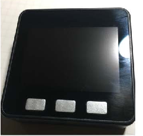
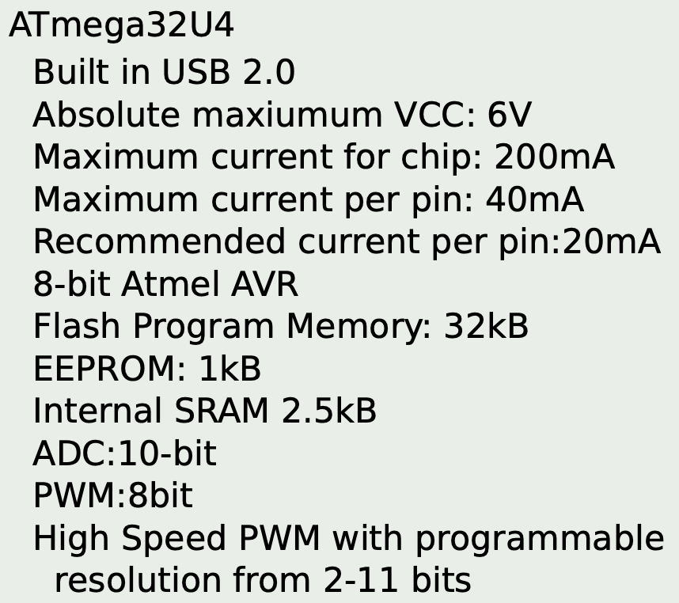
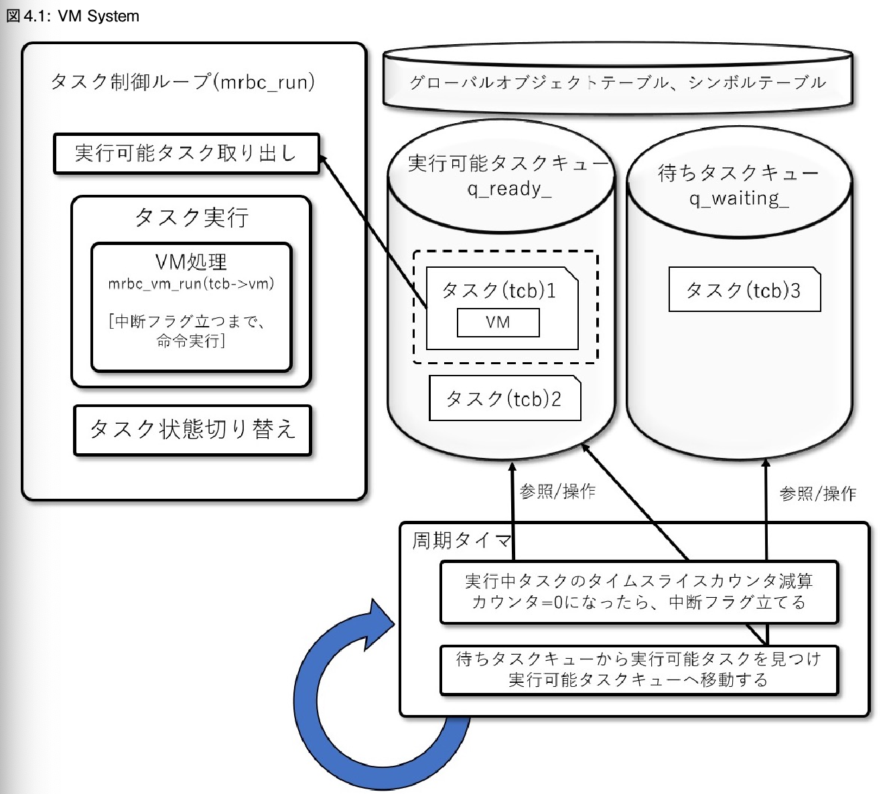
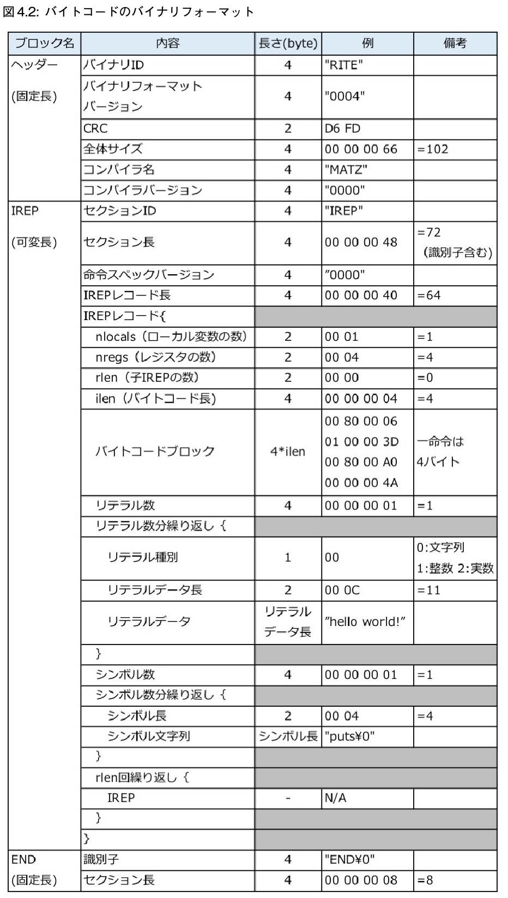

# mruby/cの小さな世界

- https://nextpublishing.jp/book/10601.html
- **第 1 章**
```c
mrb_state* mrb = mrb_open();
mrbc_context* c = mrbc_context_new(mrb);
mrb_load_string_cxt(mrb, code, c);
```

- mruby/c は mruby のVM部分を置き換えたもの
  - >ESP32 のようなマイコンでは RAM が 500KB 程度使えます。しかし、500KB 程度では mruby を起動することは出来ても、mrbgem などを 利用してちょっと規模が大きいアプリを書こうと思うと、すぐメモリー不足に悩まされます。
- メモリ使用量
  - mruby は 400KB 以下
  - mruby/c なら 40KB 以下
- (この本では) 開発環境に Arduino IDE を使う
  - https://www.arduino.cc/en/software
- **第 2 章**
  - ESP32
    - スペック
      - CPU Tensilica 社製の Xtensa 32bit LX6(デュアルコア)
      - 動作クロック 80MHz-240MHz
      - ROM 448KB
        - 読み込み専用メモリ
          - プログラムの動作中には書き込むことはない、ってこと？
        - プログラムを置く場所
        - 補助記憶装置
      - SRAM 520KB
        - SRAMとはRAMの一種
        - 読み書きができるメモリ
        - データを置く場所
        - 主記憶装置・メインメモリと言われているもの
      - 動作電圧 3.3V
    - ペリフェラルとは
      - >マイコンから生えているピンを通して、外の世界とどんなやりとりができるかを示したもの
      - 通信とかセンサーとか
    - 単周辺回路やアンテナと一体化したモジュールを購入して利用するのがふつう
      - ESP-WROOM-32, ESP32-WROVER-B, ESP32-SOLO などがある
      - 500~1000円
    - 開発ボード
      - USB を指すだけで開発できるモジュール
      - ESP32-DevkitC, ESPr Developer 32, ESPr One 32, M5Stack Basic
        - M5Stack Basicは見たことあるかも
        - 
      - 1500~3000円
  - Mint60についてきたProMicroは...?
    - 動作電圧 5V
    - 動作クロック 16MHz
    - [Pro Microとそのバリエーション](https://zenn.dev/koron/articles/9fee38469a8acc#%E3%82%AA%E3%83%AA%E3%82%B8%E3%83%8A%E3%83%ABpro-micro%E3%81%A8%E3%81%AF)
      - >そもそもPro Microとは狭義には[SparkfunのPro Micro - 5V/16MHz](https://www.sparkfun.com/products/12640)のことを指します。
        - Mint60についてきたのはどれだろう...?
          - https://lilakey.com/products/promicro
            - >ATMega32u4搭載ProMicro互換ボード単品です
              - ATMega32u4 とは?
                - [ATmega32U4について学んだこと](https://zenn.dev/koron/articles/a2e220d73800ba)
                  - MCU(Micro Control Unit)
                  - >m32u4は自作キーボードにおいて利用されることの多いPro MicroのMCUとしても知られています
        - sparkfun社が出している標準のやつっぽい。micro-usbのやつ。
          - https://cdn.sparkfun.com/assets/7/6/c/a/c/ProMicro8MHzv2.pdf
          - 
            - Flash Program Memory というのがROMのことかも？
            - SRAM 2.5kB が、mruby/cで要求されている 40KB よりも遥かに少ない
              - 第4章 で、Arduino Uno という、RAMが2KBのマイコンでmruby/cを動かす話が出てくる
                - https://github.com/kishima/micro_mruby_for_arduino_uno
- **第 4 章**
- []
  - tcb (task control block)
    - タスクのこと
    - タスクの数だけVMがある (タスクはVMを1個持っている) (`tcb->vm`)
  - タスクの状態
    - `DORMANT`(休止)
    - `READY`(実行可能)
    - `RUNNING`(実行中)
    - `WAITING`(待ち)
      - sleep待ちなど
    - `SUSPENDED`(停止)
      - 強制的に一時停止している状態
  - タスクの実行優先度 `tcb->priority_preemption` がある
  - 周期タイマー
    - 実行中のタスクのタイムスライスを減算する
      - タイムスライスが0になったらタスクは中断され、別のタスクに切り替わる
    - マイコンがタイマー割り込み可能であればそれを使って処理が行われる
    - そうでなければ1命令毎にVMの処理が中断されてタイマーの処理が行われる
  - バイトコードのフォーマット
    - 
      - (当時の情報)
  - mrubyはレジスタマシン
    - レジスタマシンだけれども、値の扱いはスタックマシンっぽいやり方をしている
      - レジスタ`R1, R2, R3`を、スタックの`s[0], s[1], s[2]`のように使っている
  - レジスタ一つには`mrb_value`構造体の値が入る
  - mrubyでは、タスクをまたいでグローバルに管理される値は無いが、mruby/cはある
    - シンボルテーブル、グローバル変数、定数、タスク管理情報
  - メソッド呼び出し`OP_SEND`
    - 引数を3つとる
    - 行う処理を式で示すと、`R(A) := call(R(A), Syms(B), R(A+1), ..., R(A+C))`
      - 値`R(A)`のメソッド`Syms(B)`を、`R(A+1), ..., R(A+C)`を引数にして呼び出す
    - 戻り値は`R(A)`に入る
      - Rはレジスタ
      - Symsはシンボルテーブル
      - AとかBとかは数値で、レジスタやテーブルの何番目の値を使うか
  - 外側の環境を参照するための`OP_UPVAR`
    - `vm->current_regs`を遡る
- **第5章**
  - Arduino Uno
    - ROM 32KB
    - RAM 2.5KB
